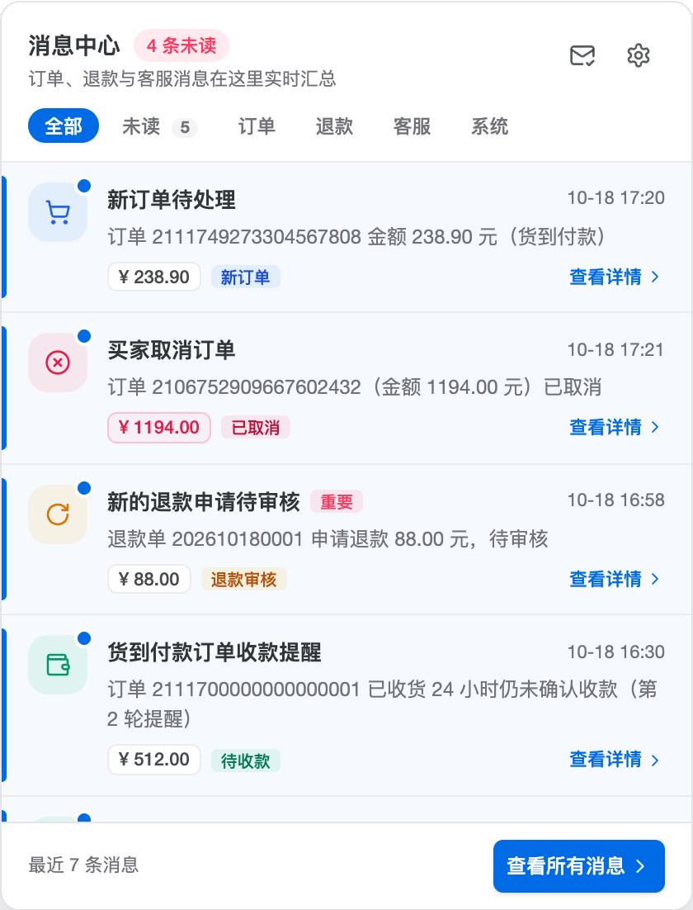
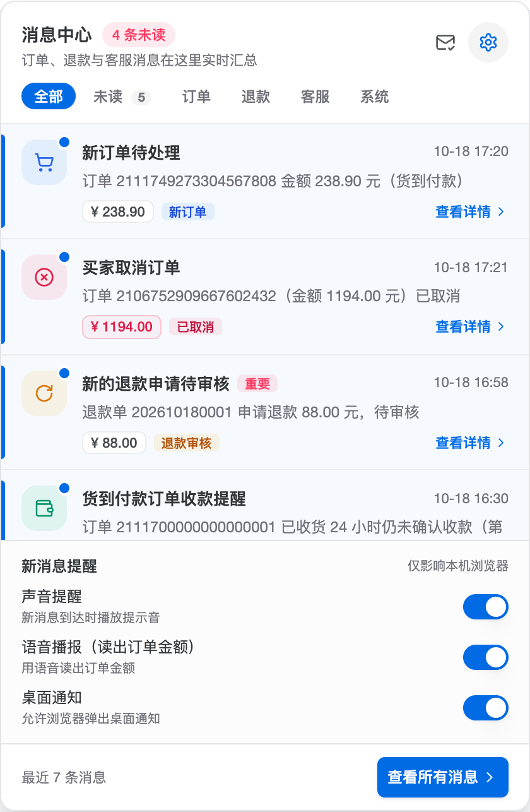
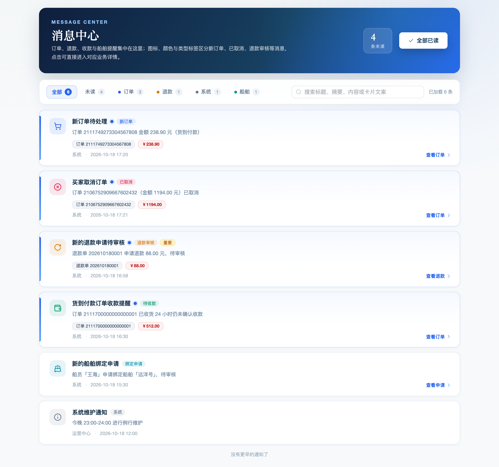
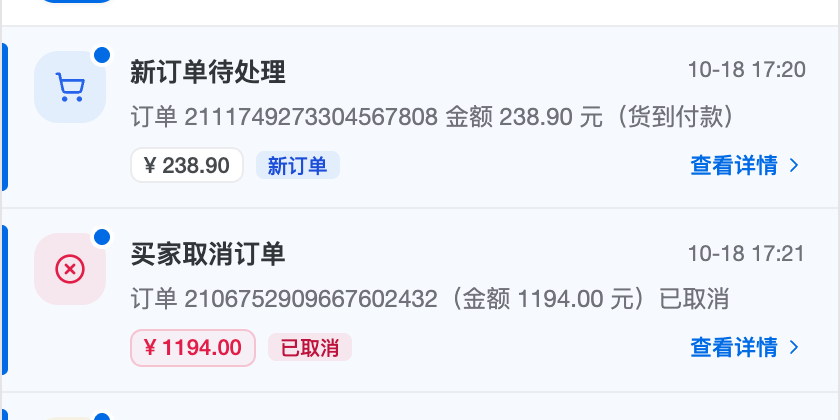

# 站内信（消息中心）交互与 UI/UX 重构

> 日期：2026-10-18 ｜ 状态：已实施（自动化门禁通过，待集成环境验收）
> 起因：运营反馈「管理端铃铛里的站内信点了没反应」——正常逻辑应该是点通知直接进订单/退款详情，
> 现在只能标记已读；同时希望把铃铛弹层与工作人员收件箱一起重做得更清楚、更好用。
> 第二轮反馈（同日）：新订单与取消订单的图标、颜色完全一样，无法一眼分辨，因此按消息类型
> 细化图标、配色与类型标签（见「三、消息类型辨识」）。

## 一、问题定位

| 问题 | 现状（改造前） |
|------|----------------|
| 点击无跳转 | `layouts/basic.vue` 的 `handleNoticeRead` 对站内信只调 `messageStore.markRead(item)`；铃铛弹层里也没有任何“可跳转”的视觉暗示 |
| 后端没给详情路由 | `OrderStaffNotifyServiceImpl` 的 `jumpPayload` 统一指向列表页 `/order/order-info`、`/order/order-refund`；`CodPayRemindServiceImpl` 的 COD 管理端提醒同样只给列表页。前端也从未消费 `jumpPayload`，即使有详情路由也跳不过去 |
| 数据口径埋在字符串里 | `jumpPayload` 是 JSON 字符串，历史数据还混用「`route` 裸路由」「`bizType/bizId`」两代口径；退款通知的 `cardPayload.orderId` 实际存的是退款单 ID |
| 弹层信息结构差 | 「清空」按钮实为全部已读（语义错误）；列表没有分类/筛选；时间是 `2026-10-18 17:21:01` 整串占一行；未读只有一个小圆点；三个提醒开关常驻在底部挤占列表 |
| 收件箱页简陋 | 纯文字卡片、无分类/筛选/搜索、无未读统计、点击只标已读，和「消息中心」的定位不匹配 |

## 二、改造后的交互设计

### 1. 铃铛弹层（消息中心）

- 头部：`消息中心` + `N 条未读` 胶囊摘要 + 一句说明；右侧「全部标记已读」「提醒设置」两个图标按钮。
- 分类页签：`全部 / 未读 / 订单 / 退款 / 客服 / 系统`（客服页签仅在有会话提醒时出现）；未读页签带数量。
- 每条提醒：
  - 左侧按消息类型着色的图标（见下方「消息类型辨识」表），未读时图标右上角蓝点；
  - 未读三重标记：左侧 3px 主色条 + 极浅主色底 + 图标蓝点；
  - 标题 + 状态/优先级标签（`待领取` / `重要`），右侧紧凑时间 `10-18 17:20`（悬停看完整时间）；
  - 摘要两行截断；底部金额 chip（取消订单会变成玫红弱化底色）、类型标签 chip（新订单/已取消/退款审核…）、会话未读数；
  - 有业务路由时恒定显示「查看详情 ›」——用户一眼就知道点进去能到订单/退款详情；
  - 整行是 `<button>`，支持键盘 Tab/Enter/Space 与 focus-visible 焦点环。
- 点击行为：先抛 `read`（父层标记已读），有 `link` 时关闭弹层并跳转；无 `link` 的系统通告只标已读、不关闭，不制造「点了没反应」的假象。
- 「提醒设置」默认收起，点齿轮展开；声音/语音/桌面三个开关各带一句说明（仅影响本机浏览器）。
- 底部：`最近 N 条消息` + `查看所有消息` 主按钮。
- 空状态区分「暂无新消息」与「没有未读消息」；弹层宽度在窄屏回落 `calc(100vw - 16px)`，390px 实测无横向滚动。

### 2. 工作人员收件箱（查看所有消息）

- Hero 头部：深海军蓝→主蓝渐变 + `MESSAGE CENTER` eyebrow + `消息中心` 标题 + 说明；右侧未读数胶囊与「全部已读」主按钮（无未读/请求中禁用并 loading）。
- 工具栏：分类页签（全部/未读/订单/退款/系统/船舶，带计数、零数据置灰）+ 搜索框（标题、摘要、正文、发送人、cardPayload 文案，空格分词 AND，大小写不敏感）；筛选与搜索只作用于已加载分页数据，「加载更早通知」保留游标分页与 loading 态。
- 卡片：按消息类型着色的图标与类型标签（新订单=蓝购物车、已取消=玫红叉、退款审核=琥珀循环箭头、待收款=绿色钱包、绑定申请=青色船、系统=灰色信息）、未读左色条 + 浅蓝底 + 圆点、标题（未读加粗）、`重要`标签、摘要两行、订单号/退款单号与金额 chip、完整时间 + 发送人；有路由时右侧固定「查看订单/查看退款/查看申请/查看详情 ›」，hover 抬升+描边，已读且无路由的卡片渲染为静态（不做伪按钮）。
- 「隐藏」只在 hover/键盘 focus 时出现（≤900px 常显），保留 `ElMessageBox` 确认文案；隐藏后本地移除并回刷铃铛。
- 空状态区分「收件箱为空」「筛选/搜索无结果」并提供清除筛选/刷新动作；首屏加载显示骨架屏；≤900px 工具栏换行、卡片操作区落到底部虚线区，390px 实测无横向滚动。

### 3. 消息类型辨识（第二轮反馈修复）

> 反馈原话：「前面的图标和颜色目前都是一样的，比如取消订单与新提交的订单不能一眼分辨出来。」

原因：旧实现按「分类」取图标（订单=蓝购物车、退款=琥珀循环箭头），而新订单、取消订单、COD 提醒
都属于订单分类，于是共用同一图标与配色；类型差异只藏在标题文字里。

修法：`@vben/utils` 新增 `noticeTypeOf`，按 `sourceType`（`ORDER_CREATE` / `ORDER_CANCEL` /
`ORDER_REFUND_APPLY` / `COD_PAY_REMIND` / `VESSEL_BIND_APPLY_TODO`…）判定到具体消息类型，
铃铛与收件箱共用同一类型口径，再各自渲染「图标 + 颜色 + 类型标签」：

| 消息类型 | 判定来源 | 图标 | 主色 | 类型标签 |
|----------|----------|------|------|----------|
| 新订单 | `ORDER_CREATE` | 购物车 | 蓝色 `#2563eb` | 新订单 |
| 取消订单（买家/超时/管理端） | `ORDER_CANCEL` | 圆形叉 | 玫红 `#e11d48` | 已取消 |
| 退款申请 | `ORDER_REFUND_APPLY` | 循环箭头 | 琥珀 `#d97706` | 退款审核 |
| COD 收款提醒 | `COD_PAY_REMIND` | 钱包 | 绿色 `#059669` | 待收款 |
| 船舶绑定申请 | `VESSEL_BIND_APPLY_TODO` | 船 | 青色 `#0891b2` | 绑定申请 |
| 配送任务 | `ORDER_DELIVERY_TASK` | 货车 | 紫色 `#7c3aed` | 配送任务 |
| 客服会话 | `kind=conversation` | 头像 | 绿色 | 客服会话 |
| 系统通告 | `SYSTEM` / 无业务来源 | 信息圆 | 灰色 `#64748b` | 系统 |

- 颜色只做辅助，**类型标签文字**保证色盲用户同样可分辨（不依赖颜色单一维度）。

- 历史通知没有 `sourceType` 时，用标题关键词（「取消」「退款」「绑定」「收款」「订单」）兜底判定。
- 铃铛与收件箱使用同一套 lucide 图标（为此在 `@vben/icons` 补齐 ShoppingCart/CircleX/Wallet/Ship/Truck
  等导出），两端视觉语言一致。
- 取消订单的金额 chip 使用玫红弱化底色，与「新订单」的常规金额 chip 区分。

### 4. 点击直达业务详情（深链）

| 通知 | 跳转 |
|------|------|
| 新订单待处理 / 买家取消订单 / 订单超时取消 / 管理端取消 | `/order/detail?id={orderId}`（管理端订单详情静态路由，按 `route.query.id` 调 `getById`） |
| 新的退款申请待审核 | `/order/order-refund?refundId={refundId}`（退单列表页自动打开对应退单详情弹窗） |
| 货到付款收款提醒（管理端） | `/order/detail?id={orderId}` |
| 船舶绑定申请待审核 | `/vessel/bind-apply`（列表页，原有路由） |
| 纯系统通告 / 无业务路由 | 仅标记已读，不跳转 |

历史数据兼容：老通知仍是列表页路由 + `{orderId,...}` 旧 cardPayload，前端 `resolveNoticeLink` 会按 `sourceType` 区分订单/退款并升级为详情深链，无需数据迁移。

安全约束：只允许管理端站内路由（拒绝 `//`、协议、反斜杠、路径穿越、C 端 `/pages/**`、`/sub-pages/**`），避免通知载荷变成开放重定向。

## 三、技术实现

### 前端

| 文件 | 说明 |
|------|------|
| `packages/utils/src/helpers/notice.ts`（新增） | 分类收敛（筛选页签用）+ **消息类型收敛 `noticeTypeOf`**（图标/配色用）+ 后端 `yyyy-MM-dd HH:mm:ss` 时间解析/格式化纯函数，铃铛与收件箱共用 |
| `apps/web-ele/src/utils/notice-link.ts`（新增） | `resolveNoticeLink`：`jumpPayload`（route / bizType+bizId 两代口径）+ `cardPayload` + `sourceType` 收敛为安全管理端路由，历史列表路由自动升级详情页 |
| `packages/effects/layouts/src/widgets/notification/notification.vue` | 铃铛弹层重写：分类页签、可点击行、金额/类型 chip、按类型着色的图标、折叠提醒设置、空状态、窄屏适配、减少动态效果 |
| `packages/@core/base/icons/src/lucide.ts` | 补齐 ShoppingCart/CircleX/Wallet/Ship/Truck/MessageSquare 等图标导出，供铃铛与收件箱共用同一图标语言 |
| `packages/effects/layouts/src/widgets/notification/types.ts` | `NotificationItem` 增加 `link/amount/category/priority/sourceType/timestamp` 字段 |
| `packages/locales/src/langs/{zh-CN,en-US}/ui.json` | 新增消息中心相关 i18n 文案（38 条/语言，含 8 个消息类型标签） |
| `apps/web-ele/src/store/message.ts` | 站内信映射补 `link/category/amount/priority/timestamp`；会话提醒带 `link=/message/service` |
| `apps/web-ele/src/layouts/basic.vue` | 点击通知：会话→工作台并打开会话；站内信→标记已读 + `router.push(item.link)` |
| `apps/web-ele/src/views/message/inbox/index.vue` | 收件箱重写（渐变 hero/筛选搜索/按类型着色的卡片/空状态/骨架屏/响应式/可访问性） |
| `apps/web-ele/src/views/message/inbox/inbox-filter.ts`（新增） | 收件箱筛选、搜索、统计、cardPayload 容错解析纯函数 + 16 条单测 |
| `apps/web-ele/src/views/message/inbox/notice-type-meta.ts`（新增） | 收件箱消息类型 → lucide 图标 / 主色 / 浅色底 / 类型标签映射 + 3 条单测（与铃铛同口径） |
| `apps/web-ele/src/views/order/order-refund/index.vue` | 支持 `?refundId=` 深链自动打开退单详情；保留首屏列表加载与搜索/分页口径 |

### 后端

| 文件 | 说明 |
|------|------|
| `aryn-order/.../OrderStaffNotifyServiceImpl.java` | 订单创建/取消跳 `/order/detail?id=`，退款申请跳 `/order/order-refund?refundId=`；cardPayload 改为 `{bizType,bizId,title,amount}`（退款单 ID 不再占用 `orderId` 键） |
| `aryn-order/.../CodPayRemindServiceImpl.java` | COD 管理端收款提醒改跳 `/order/detail?id=`（买家侧不变） |
| 对应两个测试类 | 断言详情深链与 cardPayload 口径；原有文案/幂等/租户/失败降级断言保留 |

无数据库结构变更，因此无需增量 SQL；API 路径未新增，boot/cloud 双模式不受影响。

## 四、验证

- 前端：`pnpm check:type` 通过；`pnpm test:unit` **92 文件 / 718 条全绿**（新增 `notice` 17 条、`notice-type-meta` 3 条、`notice-link` 12 条、`inbox-filter` 16 条）；本次改动文件 `eslint/prettier/stylelint` 干净。
- 后端：`mvn compile -pl aryn-boot -am -DskipTests` 通过；`mvn -pl aryn-order/aryn-order-biz -am test` **442 条全绿**（含 `OrderStaffNotifyServiceImplTest` 14 条、`CodPayRemindServiceImplTest` 9 条）。
- 视觉/交互：本地起 `web-ele` dev server，用临时预览路由 + Playwright（系统 Chrome）真实渲染组件并截图验收：
  - 铃铛：桌面 420px / 移动 390px 均无横向滚动，分类页签切换、点击带路由提醒后弹层关闭、提醒设置展开均正常；新订单/取消/退款/待收款/绑定申请/系统六类图标与标签同屏可辨；
  - 收件箱：mock 站内信接口后验证桌面 1280 / 移动 430 布局、筛选/搜索/空状态/未读标记/CTA 展示。
  - 预览脚手架（临时路由、preview html、Playwright 脚本）验收后已删除，未进入交付改动。
- 已知无关失败：`pnpm lint` 全量仍受工作树中其它未提交改造遗留的样式顺序报错影响（与本次改动的 TS/测试文件无关，本次文件单独 lint 干净）。

## 五、边界与后续

- `MessageCommandServiceImpl` 对非空 `jumpPayload` 统一落 `jumpType=BIZ_DETAIL` 是既有行为，本次未改；前端同时兼容 `route` 与 `bizType/bizId` 两种口径。
- 存量通知依赖前端历史口径兜底（不迁移数据），如需彻底统一可后续补一条数据清洗 SQL。
- 退单详情深链打开后不清除 query（URL 可分享）；同一页内手动关闭后再次点击同一通知不会重开同一弹窗（不同退单 ID 会正常切换）。
- 深色模式未单独适配（沿用管理端现有主题变量，颜色均走语义 token）。
