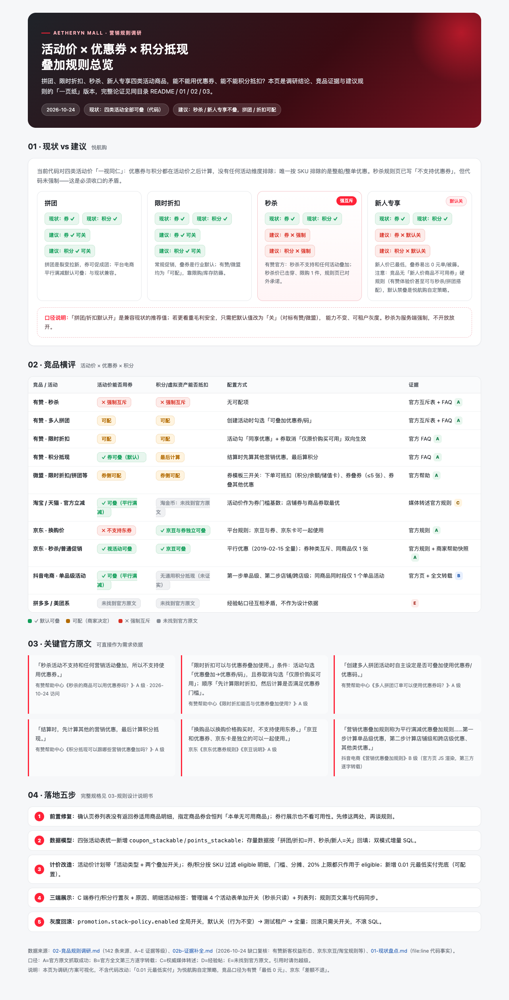

# 活动商品与优惠券/积分叠加规则调研

> 调研日期：2026-10-23
> 类型：现状盘点 + 竞品调研 + 规则建议
> 触发问题：C 端订单确认页上，**拼团、限时折扣、秒杀、新人专享** 这四类「活动价」商品，
> 还能不能用优惠券？还能不能用积分抵扣？同类竞品怎么做的？
> 关联：[秒杀规则与空态插画（规则页文案）](../2026-10-23-秒杀规则与空态插画/交付文档.md)、
> [新人专享定价调研](../2026-09-27-新人专享定价调研/README.md)、
> [船供活动治理](../2026-10-13-船供活动治理/README.md)

## 版本记录

| 版本 | 日期 | 变更 |
|---|---|---|
| v1 | 2026-10-23 | 首版：现状盘点 + 竞品调研 + 建议规则 |
| v1.1 | 2026-10-24 | 完善：补 02b 证据缺口、新增 03 可开发设计说明书、新增一页纸可视化；统一 4 表字段方案、补充前置缺陷与灰度方案 |
| v1.2 | 2026-10-24 | **按 03 说明书落地开发**（三端 + 双模式 SQL 157 号）：规则矩阵生效（秒杀/新人禁叠、拼团/折扣默认可叠、活动级开关、混合单按 SKU 收敛、0.01 保底、`promotion.stack-policy.enabled` 回滚开关）；Phase 0 券列表 couponGoodsList 缺陷同步修复。登记见 [需求记录 2026-10-24](../../90-记录归档/需求记录.md) |



## 文档清单

| 文件 | 内容 | 产出 |
|---|---|---|
| 本文件 | 结论、建议规则矩阵、落地方案 | Lead |
| [01-现状盘点.md](01-现状盘点.md) | 代码级现状取证（价格链路、券、积分、确认页、退款/快照） | Lead |
| [02-竞品规则调研.md](02-竞品规则调研.md) | 各平台/ SaaS 的叠加规则与来源（142 条来源，A~E 证据等级） | competitor-researcher |
| [02b-证据补全.md](02b-证据补全.md) | 02 的 §12 证据缺口补全（官方原文/仍缺清单） | Lead |
| [03-规则设计说明书.md](03-规则设计说明书.md) | 可开发方案：规则矩阵、字段/DDL、远程接口、计价算法、C 端/管理端规格、测试与灰度 | Lead |
| [营销叠加规则总览.html](营销叠加规则总览.html) | 一页纸可视化：现状 vs 建议、竞品横评、官方原文、落地五步 | Lead |
| [assets/营销叠加规则总览.png](assets/营销叠加规则总览.png) | 上述 HTML 的整页截图（便于快速预览/汇报） | Lead |

---

## 一、结论速览

### 1.1 直接回答：悦航购当前的真实行为

**当前系统里，四类活动商品都能用优惠券，也都能积分抵扣。**

- 活动价是**改基价**：下单/结算先按「拼团价 > 秒杀价 > 新人价 > 限时折扣 > 原价」改写成交单价
  （`OrderPriceComputeService.java:105-140`），之后的会员折扣（`:537`）、优惠券门槛与分摊（`:559`）、
  积分抵现基数（`:390`）**全部基于活动价后的金额**计算。
- 优惠券只有「全场 / 指定商品」两个范围维度（`CouponInfo.java:77` `useRange`，仅 1/2），
  **没有「活动商品除外」「仅原价购买可用」维度**；确认页券的可用性由前端按「门槛 + 券指定 SPU」判断
  （`CouponSelector.vue:40-67`），后端下单只校验持有/有效期/门槛/范围（`OrderPriceComputeService.java:559-628`）。
- 积分抵现只排除了**船供采购场景**（B 端成本价，`OrderPriceComputeService.java:396`）与运费，
  单笔上限 20%（`MallOrderConstants.java:50`），**没有排除任何活动商品**。
- 唯一已经做「活动价不叠加」的是**整船/整单优惠**：已享活动价的 SKU 不计入门槛、不参与分摊
  （`OrderPriceComputeService.java:848-900`，活动价标记见 `:229-241`）。这是本系统现成的「按 SKU 排除」先例，
  但优惠券与积分仍在它之前发生，不享受该排除。

**因此存在一个必须收口的矛盾**：2026-10-23 刚上线的秒杀规则页写着
「秒杀商品不支持使用优惠券、不参与其他满减活动」（`seckill-rule.vue:25`），但代码没有强制，
用户仍可在确认页选券/开积分。这是**文案先行、能力未实现**。

### 1.2 行业做法（详见 02-竞品规则调研.md）

先分清两类竞品，两者结论相反、不能混用：

| 竞品类型 | 对「活动价 × 券」的默认 | 代表 | 原因 |
|---|---|---|---|
| **电商 SaaS** | **默认不叠，商家可配** | 有赞、微盟 | 亏损由商家承担，平台只提供开关；秒杀被强制锁死 |
| **平台电商** | **默认叠加（平行满减）** | 淘宝/天猫、京东、抖音 | 平台补贴/流量活动，活动价作为券门槛基数，靠券张数上限与价格监控兜底 |

按活动类型拆开看：

| 活动类型 | SaaS 侧证据 | 平台侧证据 | 结论 |
|---|---|---|---|
| **秒杀** | 有赞官方互斥表：秒杀整行全 ❌（含优惠券、积分抵现）；官方 FAQ：「秒杀活动不支持和任何营销活动叠加」 | 京东商家帮助中心示例中秒杀日可叠「满 300 享 9 折券」（B 级）；淘宝秒杀未找到官方原文（E 级） | **SaaS 唯一被强制互斥的活动类型；悦航购建议默认禁、且秒杀不可配置放开** |
| **多人拼团** | 有赞：可配（创建拼团时勾选是否可叠券/码）；积分抵现 = 可配 | 京东拼购/京喜、淘宝拼团均未找到官方原文（E 级） | **可配；默认值按悦航购现状定为「可叠」** |
| **限时折扣** | 有赞：可配，需活动勾「同享优惠」+ 券取消「仅原价购买时可用」双向生效；微盟：券模板「券叠加其他优惠」开启才可叠 | 淘宝官方立减/京东平行优惠：活动价商品可叠券 | **可配；建议默认可叠 + 活动级开关** |
| **新人专享 / 0 元购** | 有赞「砍价 0 元购 × 优惠券 = ❌、× 积分抵现 = 可配」；有赞新客权益 = 新人券 + 首单立减 + 限时折扣(仅新客) + 体验价，**且官方称「体验价可搭配限时秒杀、拼团」**（02b 新增 A 级证据） | 京东新人券：仅首单、首单仅 1 张；美团系无官方原文（E 级） | **无统一的行业硬规则；「新人专享禁叠」是悦航购自定策略（防 0 元单/薅羊毛），不是行业惯例** |
| **积分 / 虚拟资产** | 有赞：券 × 积分抵现 = 默认 ✅；积分最后计算；微盟：券模板勾选「积分/余额/储值卡可抵扣」 | 京东京豆与优惠券官方明文「独立可一起使用」 | **积分默认可叠（用上限控风险），秒杀/积分兑换类除外** |

> 一句话：**「活动商品一律不能用券」是伪命题**——平台电商默认允许，SaaS 默认不允许但可配。
> 真正的行业共识只有三条：①秒杀/兑换类强制互斥；②层序固定（活动价→会员→券→积分→支付）；
> ③叠加必须有张数/金额/限购兜底。

### 1.3 给悦航购的建议（默认规则）

> 原则：**让利越深的活动，越不叠加；活动级可配，平台级有默认；宁可少叠，不可击穿。**

| 活动类型 | 默认优惠券 | 默认积分抵现 | 可配置 | 理由 |
|---|---|---|---|---|
| 拼团 | ✅ 可用 | ✅ 可用 | 活动级开关（可关） | 拼团是裂变拉新，券可促成团；平台电商平行满减默认可叠；与现状兼容 |
| 限时折扣 | ✅ 可用 | ✅ 可用 | 活动级开关（可关） | 常规促销，叠券是行业默认；与现状兼容 |
| 秒杀 | ❌ 不可用（与现行规则页文案一致） | ❌ 不可用 | **强制关，不开放配置** | 有赞官方硬互斥；秒杀价已击穿、限购 1 件、平台级爆款 |
| 新人专享 | ❌ 不可用 | ❌ 不可用 | 活动级开关，默认关 | 新人价已是最低价；叠券易出 0 元单/薅羊毛；依据为有赞 0 元购互斥 + 悦航购自定 |
| 整船/阶梯价（既有） | 维持现状（可用） | 维持现状（可用） | 本次不动 | 已有「整船优惠排除活动价 SKU」逻辑，避免一次改太多 |

> **默认值有两条路线**：本文推荐上表（拼团/折扣默认开 = 兼容现状、偏转化）；
> 若更看重毛利安全、完全对标有赞/微盟，可把拼团/折扣也默认设为关、由运营显式开启——
> 两种路线**能力完全相同，只差默认值**，建议上线时用租户级配置灰度，观察转化与毛利后再定。
>
> 依据强度说明：秒杀=强（有赞官方原文）；拼团/折扣=中（有赞可配、平台平行满减）；
> 新人专享=**弱**（竞品无「新人价商品不可用券/积分」硬规则，有赞体验价甚至官方称可与秒杀/拼团搭配；
> 默认禁叠主要是悦航购自定防薅策略）；积分=强（有赞默认叠、京东京豆可叠）。

补充建议：

1. **活动级开关 + 全局默认**：开关落在活动表（秒杀/折扣/拼团/新人活动），另设租户级默认模板，
   新活动按类型继承默认值；运营可在活动编辑页改。
2. **混合购物车按 SKU 排除**：一单里同时有活动商品和普通商品时，券/积分只作用于「允许叠加」的
   SKU；券门槛也只按可叠金额判断；分摊按现有「按明细比例分摊」逻辑落在可叠行上。
3. **金额保底**：券后/积分后实付不得低于 `0.01 元`（或业务确认允许 0 元单）；现有实现已保证不为负、
   券额不超过可叠金额，但没有整单保底。注意：**0.01 元是悦航购自定策略**——竞品口径是
   有赞「最低 0 元」、京东「差额不退」，不能对外声称行业惯例。
4. **展示口径**：券行/积分行按可用性置灰并给明确原因（如「秒杀商品不参与优惠券」「本单无可使用积分」）；
   活动商品在订单明细上标注活动类型，帮助用户理解为什么不能叠。
5. **口径一致**：结算（确认页）与提交订单共用同一份活动价计划和排除规则；提交时若优惠额度变化，
   沿用现有「订单金额已变动，请返回确认页核对」的硬校验。
6. **规则页文案统一**：秒杀规则页保留「不支持优惠券」，补充「不支持积分抵现」；拼团/折扣/新人专享
   规则页（若有）同步各自口径，避免再次出现「文案与代码不一致」。

---

## 二、现状盘点（摘要）

> 详细取证（file:line）见 [01-现状盘点.md](01-现状盘点.md)。以下为结论级摘要。

### 2.1 价格计算链路（结算与下单一致）

```text
生成明细（商品售价）
→ 活动价计划：拼团价 > 秒杀价 > 新人价 > 限时折扣 > 原价        ← 改成交基价
→ 营销引擎：阶梯价改基价 / 新人价改基价（整船优惠门槛排除活动价 SKU）
→ 会员折扣（按成交基价）
→ 优惠券（门槛与分摊基于「成交基价 - 会员折扣」）
→ 整船/整单优惠分摊（只分摊给未享活动价的明细）
→ 运费
→ 积分抵现（基数 = 商品应付，上限 20%，船供采购除外）
→ 金额一致性校验 → 落库
```

关键代码：`OrderInfoServiceImpl.settlementOrder`（确认页）与 `createOrder`（提交）两个入口顺序一致；
`OrderPriceComputeService` 提供 `resolvePromotionPricePlan` / `orderCouponHandler` /
`orderPointsDeductHandler` / `applyShipWholeDiscount`。

### 2.2 四类活动与两种优惠的现状结论

| 活动类型 | 优惠券现状 | 积分抵现现状 | 代码依据 |
|---|---|---|---|
| 拼团 | 可用 | 可用 | 活动价先落基价，券/积分后续计算 |
| 限时折扣 | 可用 | 可用 | 同上 |
| 秒杀 | 可用（规则页文案说不支持，**代码未执行**） | 可用 | 同上 |
| 新人专享 | 可用（设计文档明确「新人价 + 会员/券照常叠加」） | 可用 | `03-方案设计与接口变更.md §1.4` |

> 另：**会员折扣也按活动价后金额计算**（`OrderPriceComputeService.java:551`），四类活动商品同样会再打会员折扣，
> 代码同样没有活动维度判断。有赞矩阵中「限时折扣 × 会员折扣」是特殊折叠规则（⬇️），并不是简单叠加。

### 2.3 现有可复用的「排除」能力

`applyShipWholeDiscount` 已实现「按 SKU 排除已享活动价商品」：活动价 SKU 集合来自
`PromotionPricePlan.activityPricedSkuIds()` + `PromotionCalculationVO.ladderOverrides`，
排除后不参与门槛、不参与分摊，并显式清零历史分摊。**优惠券/积分若要支持排除，可直接复用这套
「活动价 SKU 标记」思路**，但需要把「是否活动价」升级为「活动类型 + 该类型是否允许叠加」。

### 2.4 能力缺口

| 缺口 | 影响 |
|---|---|
| 拼团/秒杀/折扣活动表无「是否允许叠券/叠积分」字段；新人专享的 `promotion_activity.stackable` 是死字段（但 DB 列已存在，可直接启用） | 运营无法按活动配置，只能全局一刀切 |
| 券可用性无活动上下文 | 确认页可能展示/允许选择最终不可用的券 |
| **券列表接口不返回券适用商品明细**（`CouponUserMapper.xml:12-16` 只嵌套 couponInfo；`CouponSelector.vue:52` 却读 `couponGoodsList`） | 指定商品券在确认页**恒判「本单无可用商品」**（静态推断，待实机验证）——做叠加规则前必须先修 |
| **券行展示只看券数量**（`ShopOrderItem.vue:76-79`） | 有券但全部不可用时仍显示「选择优惠券」，用户点进去发现没有可用券 |
| 结算接口不返回「为什么不能用券/积分」 | 用户困惑，客服成本高 |
| 无整单实付保底，且系统支持 0 元单支付（`FREE_PAY`） | 极端叠加可能出 0 元单（券额虽被 cap，积分上限 20%，折扣券无封顶） |
| 退款只处理**整单全退**（部分退款不返积分、不恢复券） | 活动商品部分退款时，券/积分回退口径未定义 |
| 快照缺活动维度：秒杀/拼团/折扣不落 `PromotionSnapshot`，券/积分也不落 | 客诉/对账解释成本高 |
| 会员折扣同样未按活动类型区分 | 与券/积分叠加后仍有价格击穿风险 |
| 规则页与代码不一致 | 客诉/合规风险（秒杀规则页已上线） |

---

## 三、竞品调研（摘要）

> 完整来源与证据等级见 [02-竞品规则调研.md](02-竞品规则调研.md)。

### 3.1 有赞（SaaS，最可直接借鉴）

有赞官方《新版营销插件叠加互斥表》（页面更新 2026-08-05，附官方 xlsx）给出的结算叠加关系：

| 活动 A × 活动 B | 优惠券码 | 积分抵现 |
|---|---|---|
| 秒杀 | ❌ | ❌ |
| 多人拼团 / 阶梯拼团 | 可配 | 可配 |
| 限时折扣 | 可配 | 可配 |
| 会员折扣 | 可配 | ✅ |
| 砍价 0 元购 | ❌ | 可配 |
| 积分商城（积分兑换） | ❌ | ❌（且与秒杀互斥） |

口径说明（官方原文）：
- 「可配：指两种插件可以自定义配置是否叠加」；
- 「同一个商品支持同时参加积分兑换与秒杀活动，消费者从不同入口进入可参与不同的活动」；
- 券×券叠加另有一套规则：商家按券配置「可叠加/不可叠加」（默认不勾选），单笔最多 3 张，
  「叠加后的总优惠金额受系统价格保护限制，优惠后订单实付金额最低为 0 元」。

各活动的官方 FAQ（均为一手原文，2026-10-23 访问）：

| 问题 | 官方回答 | 链接 |
|---|---|---|
| 秒杀的商品可以用优惠券吗？ | 「秒杀活动不支持和任何营销活动叠加，所以不支持使用优惠券。」 | [help.youzan.com/detail_0_4-1-25696](https://help.youzan.com/displaylist/detail_0_4-1-25696) |
| 限时折扣能否与优惠券叠加使用？ | 「限时折扣可以与优惠券叠加使用。」条件：活动勾选「优惠叠加→优惠券/码」，且券取消勾选「仅原价购买可用」；顺序「先计算限时折扣，然后计算是否满足优惠券门槛」。 | [detail_4_4-1-22249](https://help.youzan.com/displaylist/detail_4_4-1-22249) |
| 多人拼团订单可以使用优惠券吗？ | 「创建多人拼团活动时自主设定是否可叠加使用优惠券/优惠码」，勾选则可叠，反之不可。 | [detail_5_5-1-32358](https://help.youzan.com/displaylist/detail_5_5-1-32358) |
| 积分抵现可以跟哪些营销优惠叠加吗？ | 「结算时，先计算其他的营销优惠，最后计算积分抵现」；具体见叠加互斥表。 | [detail_5_5-1-29265](https://help.youzan.com/displaylist/detail_5_5-1-29265) |
| 新版营销插件叠加互斥表 | 官方矩阵：秒杀×优惠券=❌、秒杀×积分抵现=❌；拼团/限时折扣×券=可配；券×积分=✅。 | [detail_4_4-2-49295](https://help.youzan.com/displaylist/detail_4_4-2-49295) |

> 注意有赞的两级配置：**活动级「是否叠加优惠券」+ 券级「仅原价购买可用」**。
> 后者正是「券不参与任何折后价」的开关，比只做活动级更细，适合作为二期能力。

证据图：[有赞-营销插件叠加互斥矩阵](assets/有赞-营销插件叠加互斥矩阵-2026.08.05.png)。

> 含义：**秒杀是硬互斥，拼团/折扣是「可配」**。悦航购作为 SaaS，最该抄的不是某个平台的结论，
> 而是「按活动类型给默认值 + 允许商家逐活动配置」这个模型。
>
> 但要区分两类竞品：**平台电商（淘宝/京东/抖音）默认允许活动价叠券**（平行满减），
> **SaaS（有赞/微盟）默认不叠、需商家显式开启**。悦航购是 SaaS，默认值应偏保守；
> 但也要考虑「当前系统已经全叠」的现状兼容，见 §1.3 的说明。

### 3.2 微盟（SaaS 第二参照：配置集中在「券」上）

微盟官方帮助中心《优惠券（OneCRM / 券码中心）》（A 级原文）把「能不能叠加」拆成券模板上的三个开关：

| 开关 | 作用 | 官方口径 |
|---|---|---|
| 下单可抵扣 | 勾选积分/余额/储值卡后，才允许这些抵扣方式与券同单 | 未勾选余额时，用户用余额抵扣则「无法使用当前优惠券叠加优惠」 |
| 叠加优惠券 | 是否允许券×券叠加，可指定允许叠加的券类型，**最多 5 张** | 「若勾选允许叠加，同一订单可同时使用多张优惠券」 |
| 券叠加其他优惠 | 是否与限时折扣、拼团等促销共享 | 「若某商品参与了限时折扣，若未开启允许叠加，则无法使用当前优惠券」 |

> 对照：有赞是「活动级双向配置」（活动勾同享 + 券取消仅原价可用），微盟是「券级集中配置」。
> 悦航购建议走**活动级开关为主 + 券级「仅原价可用」为辅**，两种入口都保留，运营可按习惯使用。

### 3.3 平台电商：活动价默认可以叠券（与 SaaS 相反）

| 平台 | 机制 | 对「活动价 × 券」的结论 | 证据 |
|---|---|---|---|
| 抖音电商 | 官方《营销优惠叠加规则》：平行满减 | 先算单品级（活动价），再算店铺级/跨店级；活动价满足门槛即可叠券；同商品同 SKU 同时段仅 1 个单品活动；子订单同类型店铺优惠仅 1 个 | B（官方页 JS 渲染，第三方逐字转载） |
| 京东 | 平行优惠（2019-02-15 全量）+ 券种类互斥 | 「换购价购买时不支持使用东券」；秒杀等普通促销可与券叠；券与京豆官方明文「独立可一起使用」 | A |
| 淘宝/天猫 | 平行满减（2018-05-24 起） | 官方立减/活动价不排斥店铺券，券门槛按活动价计算；店铺券与商品券同单不可双叠、取最优；百亿补贴/淘金币**未找到官方原文** | C/D/E |
| 拼多多 | — | 未找到任何官方原文，经验帖口径互相矛盾，**不作为依据** | E/D |
| 美团系（小象/优选/叮咚） | — | 未找到官方原文；现象：新人权益多为「新人券包」，同类券每单 1 张 | E/D |

> 一句话：**平台电商敢让活动价叠券，是因为有「平行满减 + 券张数/类型上限 + 价格监控」兜底**；
> SaaS 默认不叠，是因为商家自担亏损、平台只提供工具。悦航购两者都要借鉴：**默认值保守、能力可配、兜底齐全**。

---

## 四、建议方案

> 完整可开发规格见 [03-规则设计说明书.md](03-规则设计说明书.md)；本节只保留结论级方案。

### 4.1 规则模型

**一等公民：活动级叠加策略。** 四张活动表统一各加两个字段（语义一致、加载代码一致）：

```text
-- seckill_activity / discount_activity / group_buy_activity / promotion_activity
coupon_stackable  char(1)  default '1'  -- 1 可用券；0 不可用
points_stackable  char(1)  default '1'  -- 1 可积分抵现；0 不可

-- promotion_activity 已有的 stackable 字段保留但标记 deprecated，不再复用
```

默认值按活动类型下发（秒杀强制 `0`；新人专享默认 `0`；拼团/折扣默认 `1`，即兼容当前行为），
并允许租户在「营销设置」里改默认模板；活动编辑页可逐活动覆盖。**秒杀的两个值在管理端置灰只读**。
若选择「完全对标有赞/微盟」的保守路线，只需把拼团/折扣默认值改为 `0`，能力不变。

> 不建议把规则只做在「券」上。券的维度是「发给谁、买什么」，不是「和哪个活动互斥」；
> 有赞也是把可配关系放在**插件×插件**层，再叠加券级「仅原价购买可用」开关。
>
> 如二期要做「券只对普通商品生效」（不区分活动类型），可再加券级字段 `original_price_only`，
> 语义与有赞同名开关一致：勾选后该券只能用于未享任何活动价的商品。
>
> 同单叠加张数建议 V1 只允许 **1 张**（有赞 3 张、微盟 5 张，悦航购从简从严），
> 避免「多券 + 活动价 + 积分」四重叠加击穿。

### 4.2 计价改造点（后端）

1. **活动价计划带类型**：`PromotionPricePlan` 从 `Set<String> activityPricedSkuIds` 升级为
   `Map<skuId, activityType+activityId>`；新人价从 `ladderOverrides` 反查活动 ID；
   拼团/秒杀/折扣在 `resolvePromotionPricePlan` 时就已知类型。
2. **券处理器**：`orderCouponHandler` 先按「券范围 ∩ 允许叠券 SKU」得到 eligible 明细
   （**落地前置**：先修确认页券列表的 `couponGoodsList` 缺字段问题，或改用服务端 `spuIds` 过滤，
   见 2.4）：
   - 门槛基数 = Σ eligible 的 `discountedGoodsPrice`；
   - 门槛不满足时给出可解释错误（现有 `ERROR_60060` 文案需细化）；
   - 券额分摊只落在 eligible 明细（沿用现有比例分摊 + 尾差处理）；
   - eligible 为空时：结算返回「不可用券」错误/空，提交订单直接拒绝（防绕过）。
3. **积分处理器**：`orderPointsDeductHandler` 的 `goodsPayable` 基数与分摊范围改为
   「允许积分 SKU」的 `itemGoodsPayable` 之和；20% 上限按该基数计算；
   结算接口返回的 `pointsDeductMax` 同步变化，确认页开关自然隐藏/置灰。
4. **一致性**：结算与提交都走同一 handler，天然一致；`expectedPaymentPrice` 校验兜底。
5. **快照**：`PromotionSnapshot` / 订单优惠明细记录活动类型与叠加策略，便于对账与客诉解释。

### 4.3 C 端展示（UniApp 订单确认页）

| 场景 | 展示 |
|---|---|
| 全部明细都不允许用券 | 券行置灰，文案「活动商品不支持使用优惠券」（不弹券选择器） |
| 混合单（部分允许） | 券行可点，券弹层内对「仅活动商品可用」的券置灰并给原因；门槛按可叠金额判断 |
| 全部明细都不允许积分 | 隐藏积分开关行（当前实现就是 `pointsDeductMax > 0` 才展示，后端算完自然隐藏） |
| 混合单积分 | 开关只对可叠部分生效，副文案注明「活动商品不参与积分抵扣」 |
| 活动标签 | 明细行可带「秒杀/拼团/新人价」小标签，解释为什么不可叠 |

### 4.4 管理端

- 秒杀/折扣/拼团活动表单：新增「优惠叠加」分组（可用优惠券 / 可用积分抵现，默认按类型带出）。
- 新人专享活动（`promotion_activity` type=9）：**表单在「船供活动」页**（`ship-supply/index.vue:730-738、982-1024`），
  新增 `coupon_stackable` / `points_stackable` 两列（`stackable` 保留但不用）；建议默认都关。
- 列表页展示叠加状态列，避免运营漏配；秒杀的开关置灰只读。
- 券模板 V1 不加「排除活动商品」，保持券的语义简单；二期再加券级「仅原价可用」（见 4.1）。

### 4.5 数据与双模式

- 增量 SQL：4 张活动表各加 `coupon_stackable` / `points_stackable` 两列。脚本编号接现网 155 →
  `db/boot/156promotion_stack_policy_incremental.sql` + `db/cloud/156...`（两份内容一致，参照
  `148points_closed_loop_incremental.sql` 的可重复执行写法），不 DROP/TRUNCATE；
  更新 `db/boot/build-full-sql.mjs` 的 `sections` 并重新生成 `aryn_boot_full.sql`，跑 `verify-full-sql.mjs`。
- 配置项：boot 与 cloud 各一份（活动默认模板若落 `sys_config` 则无需新配置类）。
- 后端禁止 biz 间直接 import：活动类型信息在 order 侧从 promotion 的远程返回即可（已有
  `PromotionCalculationVO` / `RemoteSeckillService` 等），不新增跨模块依赖。

### 4.6 验收用例（建议）

1. 纯秒杀单：确认页无「选择优惠券」入口，积分行不展示；提交带券/积分 → 拒绝。
2. 纯拼团单 / 纯折扣单：券与积分正常可叠，金额与线下手算一致。
3. 纯新人专享单：券与积分均不可用，文案正确。
4. 混合单（秒杀 + 普通商品）：门槛只按普通商品金额判断；券额只分摊到普通商品行；
   积分上限按普通商品应付计算；退款时逐行金额可还原。
5. 同一 SKU 同时命中多个活动：沿用现有优先级（拼团 > 秒杀 > 新人价 > 折扣），
   叠加策略取**最终生效活动**的类型。
6. 活动配置切换（开→关）后，结算与提交口径一致；已存在订单的优惠金额不受影响。
7. 船供采购场景 + 活动商品：积分仍不可用（既有规则不被破坏）。
8. 租户隔离：A 租户默认模板不影响 B 租户。

### 4.7 工作量粗估

详见 [03-规则设计说明书 §9](03-规则设计说明书.md)：Phase 0 前置修复 1–1.5 天，整体 **10–13.5 人天**
（后端 4–5 天、管理端 1.5–2 天、C 端 1.5–2 天、联调回归 2–3 天）。

---

## 五、未验证项与风险

1. 证据充分度分三档：**有赞/微盟/京东拿到官方原文（A 级）**；抖音为官方页 + 第三方逐字转载（B 级）；
   淘宝/拼多多/美团系只有权威媒体/经验帖或「未找到官方原文」（C/D/E 级）。02 文档逐条标注，引用时勿越级。
2. 淘宝/京东/拼多多/抖音的规则会随大促变化，且存在「平台强规则 + 商品级例外」，
   不建议把某个平台的结论直接抄成硬编码。
3. 「新人专享」在本系统是 `promotion_activity` type=9，与秒杀/折扣/拼团三张独立活动表结构不同；
   管理端入口在「船供活动」页而非独立页面。方案统一给 4 张表各加两列，`promotion_activity.stackable`
   保留但不再复用（见 03 §2.1）。
4. 混合单的券门槛口径（按可叠金额 vs 按整单金额）会明显影响转化，需产品拍板；
   本文建议按「可叠金额」，与行业「券只对适用商品计价」一致。
5. 0 元单是否允许需财务/支付流程确认；本文建议保底 0.01 元。
6. **会员折扣同样未按活动类型区分**：当前四类活动价后都还会再打会员折扣；有赞矩阵中
   「限时折扣 × 会员折扣」是特殊折叠（⬇️）而非简单叠加。本期若只做券/积分，会员折扣维持现状，
   但应登记为后续治理项（否则仍可能价格击穿）。
7. 本次未运行构建/测试；落地时需补 `OrderPriceComputeServiceTest` 单测与双模式验证。

### 5.1 需要业务拍板的 5 件事

| # | 待拍板项 | 本文建议 | 备选 |
|---|---|---|---|
| 1 | 拼团/折扣默认是否叠券 | 默认叠（兼容现状） | 默认不叠（对标有赞/微盟，需灰度） |
| 2 | 新人专享是否禁叠券/积分 | 默认禁（防薅） | 允许叠（延续 2026-09-27 的设计决定） |
| 3 | 混合单券门槛口径 | 按「可叠商品金额」判断 | 按整单金额判断（转化更高、风险更大） |
| 4 | 实付保底 | 0.01 元（自定） | 0 元（有赞口径）/ 差额不退（京东口径） |
| 5 | 券级「仅原价可用」 | 二期再做 | 一期与活动级开关同时上 |

---

## 六、参考来源（当前已核实）

| # | 来源 | 内容 | 链接 | 访问日期 |
|---|---|---|---|---|
| 1 | 有赞帮助中心《新版营销插件叠加互斥表》 | 官方叠加互斥矩阵（含 xlsx 下载） | https://help.youzan.com/displaylist/detail_4_4-2-49295 | 2026-10-23 |
| 2 | 有赞帮助中心《秒杀的商品可以用优惠券吗？》 | 「秒杀活动不支持和任何营销活动叠加，所以不支持使用优惠券」 | https://help.youzan.com/displaylist/detail_0_4-1-25696 | 2026-10-23 |
| 3 | 有赞帮助中心《优惠券叠加使用说明》 | 券×券可配、最多 3 张、实付最低 0 元 | https://help.youzan.com/displaylist/detail_4_4-2-68355 | 2026-10-23 |
| 4 | 有赞帮助中心《新人专享券是否可以和其他营销活动叠加？》 | 新人券与营销活动叠加规则与普通券一致 | https://help.youzan.com/displaylist/detail_4_4-1-67727 | 2026-10-23 |
| 5 | 本仓库《新人专享定价调研》§1.4 | 本地已拍板：新人价 + 会员折扣/优惠券照常叠加 | docs/50-需求文档/2026-09-27-新人专享定价调研/03-方案设计与接口变更.md | 2026-10-23 |
| 6 | 本仓库《秒杀规则与空态插画》 | 秒杀规则页已写「不支持优惠券」（未在代码强制） | docs/50-需求文档/2026-10-23-秒杀规则与空态插画/交付文档.md | 2026-10-23 |
| 7 | 有赞帮助中心《限时折扣能否与优惠券叠加使用？》 | 「限时折扣可以与优惠券叠加使用」，双向配置条件 + 先折扣后判券门槛 | https://help.youzan.com/displaylist/detail_4_4-1-22249 | 2026-10-23 |
| 8 | 有赞帮助中心《多人拼团订单可以使用优惠券吗？》 | 创建拼团活动时自主设定是否可叠券/码 | https://help.youzan.com/displaylist/detail_5_5-1-32358 | 2026-10-23 |
| 9 | 有赞帮助中心《积分抵现可以跟哪些营销优惠叠加吗？》 | 「结算时先算其他营销优惠，最后算积分抵现」 | https://help.youzan.com/displaylist/detail_5_5-1-29265 | 2026-10-23 |
| 10 | 微盟帮助中心《优惠券（OneCRM / 券码中心）》 | 券模板三开关：下单可抵扣 / 叠券上限 5 张 / 券叠其他优惠 | https://help.weimob.com/os/article/6413 | 2026-10-23 |
| 11 | 京东《京东优惠券规则》 | 「换购品以换购价格购买时，不支持使用东券」、同商品券仅 1 张 | https://help.jd.com/user/issue/169-1077.html | 2026-10-23 |
| 12 | 京东《京豆说明》 | 「京豆和优惠券、京东卡是独立的可以一起使用」 | https://help.jd.com/user/issue/167-330.html | 2026-10-23 |
| 13 | 抖音电商学习中心《营销优惠叠加规则》 | 平行满减：先单品级、再店铺/跨店级；单品优惠价作为门槛基准 | https://school.jinritemai.com/doudian/web/article/aHwMeX7MccpH | 2026-10-23 |
| 14 | 有赞产品中心《新客首单立减》 | 新人券仅店铺新客可领；限时折扣可设「仅店铺新客」参与 | https://www.youzan.com/chanpin/xinkeshoudanlj | 2026-10-24 |
| 15 | 有赞产品中心《体验价》 | 「体验价可搭配限时秒杀、拼团和推广员使用」；仅新客可买、限购次数 | https://www.youzan.com/chanpin/tiyanjia | 2026-10-24 |

> 其他平台来源见 [02-竞品规则调研.md](02-竞品规则调研.md)。
