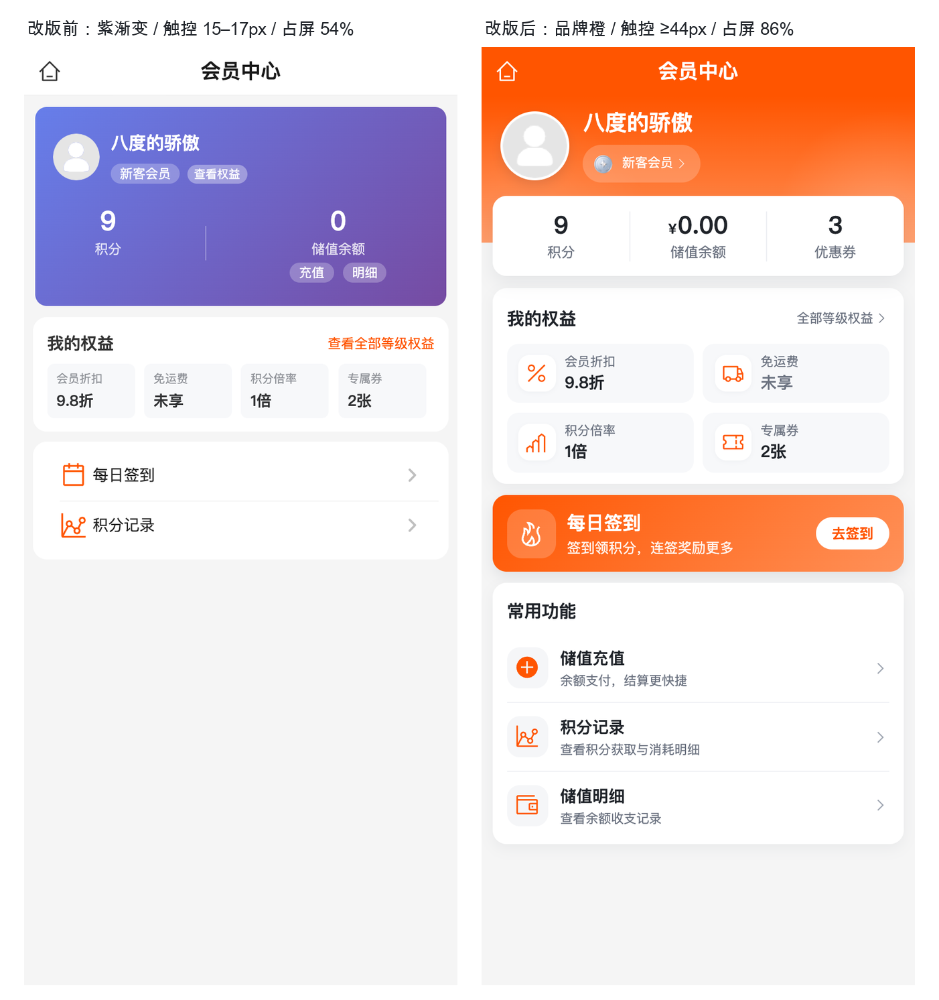

# 会员中心页视觉重构（C 端 /sub-pages/user/member/index）

> 日期：2026-10-24 ｜ 状态：**已完成**（单页 UI/UX 重构 + H5 四态实拍 + type-check / mp-weixin 构建通过）
> 原始请求：「重构 UI/ux，要主流的现代审美」（附当前会员中心页截图：写死紫渐变会员卡 + 橙色主题图标混用）

## 〇、一页结论

| 项 | 结论 |
|----|------|
| **问题定性** | 不是「换个颜色」的问题：旧页写死 `linear-gradient(135deg,#667eea,#764ba2)` 紫卡，与租户品牌橙（实测 `#ff5500 → #FF9159`）同屏冲突；色阶 5 套、栅格 3 套、可点文字 15–17px、内容仅占屏 54%、`wd-cell` 插槽写错导致说明文案不渲染 |
| **重构主线** | 对齐「个人中心页」已落地的设计语言：品牌渐变页头 + 上浮白资产卡 + 24rpx 圆角白卡 + `rgba(31,44,65,.06)` 阴影 + 20rpx 栅格 + 发丝线；全部颜色改走主题 CSS 变量，页面内零写死主色 |
| **信息架构** | 会员身份页头（头像/昵称/等级徽章/等级权益入口）→ 资产卡（积分 / 储值余额 / 优惠券，各自可点）→ 条件式积分过期提醒 → 我的权益（2×2 权益块）→ 每日签到横幅 → 常用功能（储值充值 / 积分记录 / 储值明细） |
| **数据原则** | 只用现有真实字段：`userStore`（昵称/头像/积分/余额/券数/等级）、`GET /app/member/benefits`（折扣/免运费/倍率/专属券）、`GET /app/member/levels`（3D 等级徽章）、`pointsInfo.expiringPoints/nearestExpireTime`；**不新增接口、不改后端、不造数据、不做无法支撑的等级进度条** |
| **结果** | 首屏内容占比 54% → 86%（积分数 0 态 85.6%，有过期提醒 91.8%）；主要触控目标 ≥44px；H5 四态（有数据/空/将过期/未登录兜底）实拍通过，console error = 0；`pnpm type-check`、`pnpm build:mp-weixin` 通过 |
| **非目标** | 不改路由登录策略、不做等级成长进度（`total_consume` 未在 C 端接口暴露，需后端配合）、不改签到/积分记录/充值等兄弟页（视觉可在下一轮对齐） |

## 一、改版前现状（客观度量，H5 390×844 实拍）

| # | 问题 | 证据 |
|---|------|------|
| 1 | 写死紫色渐变与品牌橙冲突 | `.card-bg` = `#667eea → #764ba2`；同屏「紫卡 + 橙字/橙图标 + 灰底」 |
| 2 | 触控目标远低于 44px | 查看权益 15px、充值/明细 16px、查看全部等级权益 17px，且为无按压反馈的 `text` |
| 3 | 文字对比度不达标 | 权益 label `#909399` on `#f7f8fa` = 2.90:1；橙色链接 `#ff5500` on `#fff` = 3.21:1；卡内 12px 白字 80% 在紫底 ≈2.92:1 |
| 4 | 栅格/卡片语言不一致 | 会员卡 20rpx 边距 vs 下两卡 `m-2`(16rpx)；圆角 20rpx vs 12px；纯色块无阴影，与个人中心语言断裂 |
| 5 | 信息层级失衡 + 页面不完整 | 昵称 16px 权重低于资产数字 24px；内容总高 453px 仅占 844 视口 54%，下半屏纯灰 |
| 6 | `wd-cell` 插槽 bug | 页面写 `<template #value>` 但 `wd-cell` 无该插槽，签到/积分记录右侧说明文案完全不渲染 |

## 二、改版后设计规格

### 2.1 区块与数据来源

| 区块 | 内容 | 数据来源 | 交互 |
|------|------|---------|------|
| 会员身份页头 | 头像、昵称、等级徽章 + 等级名胶囊 | `userStore` + `member/levels.levelIcon`（按 `levelId` 回查） | 整块可点：已登录→等级权益，未登录→登录页 |
| 资产卡 | 积分 / 储值余额 / 优惠券 | `userStore.getPoint/getBalance/getCouponCount` | 分别→积分记录 / 余额明细 / 我的优惠券 |
| 积分过期提醒 | `120 积分将于 2026-11-01 到期` + 查看明细 | `pointsInfo.expiringPoints/nearestExpireTime` | 有值才出现；→积分记录 |
| 我的权益 | 会员折扣 / 免运费 / 积分倍率 / 专属券（2×2） | `GET /app/member/benefits` | 单块或「全部等级权益」→等级权益页 |
| 每日签到 | 品牌渐变横幅 + 去签到 CTA | 无（签到状态由签到页自行处理） | →每日签到页 |
| 常用功能 | 储值充值 / 积分记录 / 储值明细 | 无 | 对应子页 |
| Guest 兜底 | 昵称「登录 / 注册」、登录引导资产条、「去登录」CTA | `authStore.isLoggedIn` | 统一 `requireLogin()` 落登录页并写 `redirectPath` |

### 2.2 设计令牌（与个人中心页同口径）

| 令牌 | 取值 |
|------|------|
| 品牌色 | `var(--theme-color-primary, var(--wot-color-theme-primary, #FF2237))`、`--theme-color-secondary`（禁止写死） |
| 文字 | 标题 `#1f2329` / 正文 `#4e5969` / 小字说明 `#6b7280` / 箭头弱化 `#9ca3af` |
| 卡片 | 白色、24rpx 圆角、`0 8rpx 24rpx rgba(31,44,65,.06)`；资产卡阴影加深到 `.08` |
| 栅格 | 左右 20rpx，卡间距 20rpx，卡内 24rpx，权益块间距 16rpx |
| 发丝线 | `#eef0f3`（1rpx） |
| 触控 | 主要目标 ≥44px（资产项 45px / 权益块 54px / 签到条 69px / 功能行 61px / 更多入口 46px） |

### 2.3 状态矩阵

| 状态 | 处理 |
|------|------|
| 已登录有数据 | 完整页：资产数字 + 权益值（9.8折/未享/1倍/2张）+ 签到横幅 + 功能入口 |
| 已登录空数据 | 资产 0 / ¥0.00 / 0；权益值降级为 `无折扣 / 未享 / 1倍 / 0张`（`#6b7280`，靠字重降权而非降低对比度） |
| 积分将过期 | 资产卡下插入琥珀色提醒条（`#fff7e8` / 正文 `#8a4b00` = 6.39:1），动作文案「查看明细」与真实去向一致 |
| 未登录（防御性兜底） | 页头「登录 / 注册」、资产卡变登录引导条、权益区变「去登录」CTA、隐藏重复的「全部等级权益」入口；不发起任何 `/app/**` 请求（避免 401 全局跳登录） |

## 三、实现要点

- **单文件改动**：`aryn-mall-uniapp/src/sub-pages/user/member/index.vue`（`<script setup>` + BEM 风格 scoped SCSS，零新增依赖）。
- **主题化**：页头/签到横幅/图标/CTA 全部取自主题变量；删除了写死紫渐变（改版前问题 1 的根因）。
- **等级徽章**：`benefits`/`pointsInfo` 都不带图标，进页时并行拉 `GET /app/member/levels`，按 `levelId` 回查 `levelIcon`（复用管理端已配置的 5 枚 3D 徽章）；拉取失败只隐藏徽章，不影响数字与权益。
- **冷启动补数**：与个人中心同口径，若只有 token 没有 `userInfo` 则 `fetchUserInfo()`，否则只刷新积分/券数/会员等级，避免每次返回整包拉取。
- **到期提醒**：`expiringPoints > 0 && nearestExpireTime` 才渲染，文案日期取 `yyyy-MM-dd`，与积分记录页口径一致。
- **未登录守卫**：`requireLogin()` 统一处理 6 个会员子页跳转；未登录时写 `redirectPath=/sub-pages/user/member/index` 再 `replaceAll(login)`，登录后回跳本页。
- **图标颜色坑（已修）**：UnoCSS 图标类自带后置 `color: inherit`，直接给图标元素写 `color` 会被覆盖成 `#333`；改为给父容器上色、图标继承。新增图标时注意同一坑。

## 四、验证

| 项 | 方式 | 结果 |
|---|------|------|
| 类型检查 | `cd aryn-mall-uniapp && pnpm type-check` | exit 0 |
| Lint | `npx eslint src/sub-pages/user/member/index.vue` | 0 error / 0 warning |
| 小程序构建 | `pnpm build:mp-weixin` | exit 0（`carbon:truck` 告警来自既有 `pages/delivery/index.vue`，与本次无关） |
| H5 实拍 | Playwright + Chrome，390×844 dsf=2，真实租户主题 `#ff5500`，mock 会员接口与登录态 | 4 态截图见下；`console error = 0`；无横向溢出 |
| 页头接缝 | 像素采样 5 点（x=12/100/195/300/380） | 导航栏 `#ff5500` vs 页头 `#ff5602`，最大通道差 Δ=2/255，不可见 |
| 图标渲染色 | `getComputedStyle` | 权益/入口 `rgb(255,85,0)`、火焰 `#fff`、箭头灰阶均正确 |
| 触控 | DOM 几何 | 主要目标全部 ≥44px；等级胶囊、签到 CTA 为纯视觉元素（父级整块可点） |

截图（H5 + 本地 boot 后端真实主题，mock 会员数据）：

| 状态 | 截图 |
|------|------|
| 改版前 | [before-member-center.png](./screenshots/before-member-center.png) |
| 改版后（有数据） | [after-member-center.png](./screenshots/after-member-center.png) |
| 积分将过期 | [after-member-center-expiring.png](./screenshots/after-member-center-expiring.png) |
| 空数据态 | [after-member-center-empty.png](./screenshots/after-member-center-empty.png) |
| 未登录兜底 | [after-member-center-guest.png](./screenshots/after-member-center-guest.png) |

## 五、已知取舍与边界

1. **品牌色面白字对比度**：导航标题/页头昵称/签到横幅/品牌 CTA 为白字压主题橙，实测 2.2–3.2:1，低于 WCAG AA 4.5:1。这是本商城既有的品牌视觉语言（个人中心页、全站主色按钮同口径）；试过叠黑色 scrim 提对比度，会把橙色压成脏棕、明显拉低观感，故放弃。**可读性做过低成本补偿**：页头昵称 19.76px/700（大字阈值 3:1，实测 2.85 临界）、签到标题 32rpx/700、描述 24rpx/92% 白；非品牌底的小字灰度全部按 AA 修正（`#6b7280` 系列、提醒条 `#8a4b00`）。
2. **状态栏前景**：本页沿用全局黑色（`#ff5500` 上黑字 ≈7:1，反而优于白字），也为规避下一条的 pages.json 陷阱。
3. **pages.json 平台拆分陷阱（重要）**：本仓 `src/pages.json` 带历史遗留的 `GENERATED BY UNI-PAGES, PLATFORM: 8899 || H5 || MP-WEIXIN` 状态，任何对某页 `definePage.style` 的**形态变更**（如本次尝试加 `navigationBarTextStyle`）都会被 uni-pages 的 platform-merge 拆成「旧变体 + 新变体」两条；H5 同时注册 → `Identifier ... has already been declared` → **全站白屏**。本次已回退该字段并恢复 pages.json 为单条，重跑预生成后 `git diff src/pages.json` 为空。后续改页面 style 前先确认 pages.json 不会被拆条。
4. **未登录不可直达**：`src/router/index.ts` 的 `WHITE_LIST` 不含会员中心，真实应用内未登录进入仍会跳登录页；guest 分支是防御性兜底（H5 直链可渲染，已实拍），未改路由策略。
5. **兄弟页未改**：每日签到 / 等级权益 / 积分记录 / 余额明细 / 充值仍是旧样式（写死渐变、`wd-cell`），视觉与本页存在代差；建议下一轮按本页令牌统一。
6. **等级进度条未做**：`member_level` 有升级条件（累计消费/累计积分），但 C 端接口未下发用户当前累计值（`total_consume` 只在 `user_info` 表内），做进度条只能伪造，故本期不做；若需要，后端在 `MemberBenefitsVO` 补 `growthValue`/`nextLevelValue` 即可增量实现。
