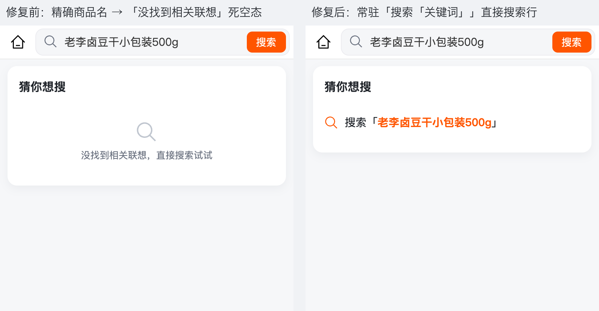

# 搜索提交链路与「猜你想搜」面板交互修复（C 端 /sub-pages/product/goods-search）

> 日期：2026-10-25 ｜ 状态：**已完成**（前端单文件 + 回归单测；type-check / test:unit / build:mp-weixin 全绿，H5 真实后端 23 项断言全过）
> 原始请求：用户贴三张截图（图一搜索页默认态 → 图二「猜你想搜」空面板 → 图三商品结果页）反馈：「我搜索商品，会先显示图二，然后在出现商品图三，这个过程的交互体验一点也不友好，需要优化修改一下」。

## 〇、一页结论

| 项 | 结论 |
|----|------|
| **问题定性** | ① 点热门/历史词提交后，搜索页会先闪一屏「猜你想搜」；② 输入与在售商品名完全相同（或热门词/历史词）时，联想面板给的是「没找到相关联想，直接搜索试试」的**死空态**——而商品其实存在，点下去立刻能搜到，文案与事实矛盾；③ 面板没有任何「立即用当前词搜索」的入口，用户只能再点一次导航栏「搜索」。 |
| **根因** | 提交函数把搜索词写回 `keyword`（输入框）→ `keyword` 的 watch 立刻把默认面板切成联想面板并发起一次联想请求。目标页加载期间搜索页仍在屏上（小程序 dev 构建首进页面要编译、弱网更明显），用户先看到的是一屏与结果无关的联想骨架/空态，然后才跳到结果页。空态则源于联想接口 `rankSuggestWords` 与前端 `buildSearchSuggest` 都按「与输入完全相同的词不重复推荐」过滤：热门词、历史词、商品全名恰好都是精确匹配，联想必然为空。 |
| **修复主线** | ① 提交搜索时**不再把词写回输入框**，并作废在途联想、加 600ms 连点节流 → 跳转过渡帧与提交前完全一致，不再闪「猜你想搜」；② 联想面板**首行常驻「搜索「关键词」」直接搜索行**，点击即提交，联想为空时它就是面板唯一内容 → 死空态被可执行动作取代。 |
| **非目标** | 不改后端联想语义（是否返回精确同名词、错别字/同义词）；不动 `hr-search-navbar` 共享组件；不把搜索结果内联进搜索页；不调整榜单/历史/热门区。 |

## 一、复现与根因证据

### 1.1 复现 A：精确商品名 → 死空态（H5 真实后端）

输入热门词/商品全名「老李卤豆干小包装500g」后，面板只有一行「没找到相关联想，直接搜索试试」：

- 修复前截图：`screenshots/before-exact-name-dead-empty.png`
- DOM 断言：`.suggest-empty` 可见、`rows = []`、文案命中「没找到相关联想」
- 接口事实（本地 boot，`tenant-id: 1590229800633634816`）：
  - `GET /boot/app/goodsspu/suggest?keyword=老李卤豆干小包装500g` → `{"code":0,"data":[]}`
  - `GET /boot/app/goodsspu/suggest?keyword=老李` → `{"code":0,"data":["老李卤豆干小包装500g"]}`
  - 原因：`GoodsSpuServiceImpl.rankSuggestWords` 显式跳过 `lower.equals(lowerQuery)`；前端 `buildSearchSuggest` 同样跳过同词。**「同词不重复推荐」本身合理，错在面板没有兜底提交入口。**

### 1.2 复现 B：提交瞬间闪「猜你想搜」

修复前 `doSearch` / `applySuggest` 均执行 `keyword.value = word` 再跳转。`keyword` watch 立即：

1. `showSuggest` 由 false → true，默认面板（历史/热门/榜单）被替换为联想面板；
2. `suggestLoading = true`，250ms 防抖后为**已确定要搜索的同一个词**再发一次联想请求；
3. 目标页加载期间（小程序 dev 首进页面编译可达数百毫秒），用户先看到联想骨架，请求返回空后变成死空态，然后结果页才出现——即截图「图二 → 图三」。

H5 本地导航约 40ms 时该帧不易观察；小程序 dev/弱网下会被放大，且热门词/历史词/商品全名必然触发 1.1 的空态，视觉上就是「先出现猜你想搜（没找到相关联想），再出现商品」。

## 二、修复方案

### 2.1 提交链路（`doSearch`）

- **不写回 `keyword`**：热门词/历史词/联想词/键盘确认/「搜索」按钮都只做提交动作，输入框保持原样；跳转过渡帧与提交前一致。
- **作废在途联想**：`cancelSuggestTimer()` + `suggestSeq++` + `suggestLoading = false`，页面被结果页覆盖后迟到的联想响应不再回写面板。
- **600ms 连点节流**：导航是异步的，窗口内重复点击不再重复压栈 `goods-list`（原实现连点热门词可压入多页）。
- 保留原语义：空词/纯空格不搜索；命中历史词仍写搜索历史。

### 2.2 联想面板（首行常驻直接搜索）

- 面板自上而下：卡头「猜你想搜」→ **直接搜索行**「搜索「关键词」」→ 发丝线 → 联想骨架或联想列表。
- 直接搜索行：品牌色搜索图标 + 「搜索」+ 品牌色高亮关键词 + 「」收尾；96rpx（48px）触控行高、按压反馈（H5 `:active` / 小程序 `hover-class`）、超长词尾部省略。
- 骨架只在直接搜索行**下方**出现；联想为空时直接搜索行单独成卡，**删除「没找到相关联想」死空态**与 `.suggest-empty` 相关样式。
- 联想词行点击行为不变（提交该词），但同样不再回写输入框。

### 2.3 行为对照

| 场景 | 修复前 | 修复后 |
|---|---|---|
| 点热门/历史词 | 先闪「猜你想搜」骨架/空态 → 结果页 | 默认面板保持到页面切换 → 结果页 |
| 输入商品全名 | 「没找到相关联想，直接搜索试试」 | 首行「搜索「商品全名」」，点击即出结果 |
| 输入无联想词 | 同上死空态 | 同上直接搜索行（仍可提交） |
| 输入有联想词 | 仅联想列表（无直接提交入口） | 直接搜索行 + 联想列表 |
| 连点热门词两次 | 可能压入两层结果页 | 600ms 内只提交一次 |
| 提交后返回搜索页 | 输入框被写入提交词，面板状态可能停留在空态 | 输入框与面板保留提交前的状态；有词时必有直接搜索行 |

## 三、改动清单

| 文件 | 动作 | 说明 |
|------|------|------|
| `aryn-mall-uniapp/src/sub-pages/product/goods-search/index.vue` | 修改 | `doSearch` 去掉 keyword 写回、作废在途联想、600ms 连点节流；删除 `applySuggest`；联想面板新增常驻直接搜索行、骨架/列表下移为 `suggest-block`、删除死空态；新增对应 scoped 样式 |
| `aryn-mall-uniapp/src/sub-pages/utils/search-suggest.test.ts` | 修改 | 新增回归护栏：精确商品名时 `mergeSuggestWords` 返回空数组是预期（面板必须由直接搜索行兜底，不能渲染死空态） |

无后端、无接口、无数据库改动（`db/boot`、`db/cloud` 均不需要增量 SQL）；boot/cloud 双模式无差异（纯视图与提交动作，不涉及请求路径）。

## 四、验证

| 项 | 方式 | 结果 |
|---|---|---|
| 类型检查 | `cd aryn-mall-uniapp && pnpm type-check` | exit 0 |
| 单元测试 | `pnpm test:unit` | 91 files / 958 tests 全通过（新增 1 例回归护栏） |
| 小程序构建 | `pnpm build:mp-weixin` | exit 0（仅既有 `carbon:truck` 图标告警，与本页无关） |
| H5 行为验收 | Playwright + Chrome，390×844 dsf=2，真实后端 | **23/23 断言 PASS**（`outputs/search-flow-fix/after-verify.json`） |
| 过渡帧 | rAF 逐帧采样（点热门词） | 跳转前无任何可见 `.suggest-card` 帧：`t=0` 默认面板 → `t=44ms` 已在 goods-list |
| 死空态回归 | DOM 扫描精确商品名 / 无联想词 | `.suggest-empty` 数量 0；全页无「没找到相关联想」；首行为「搜索「关键词」」 |
| 联想正常态 | 输入「老李」 | 直接搜索行 + 1 条联想行同屏，命中高亮正常 |
| 触控/布局/可读性 | DOM 度量 | 直接搜索行高 50px（≥44px）；无横向溢出（scrollWidth = clientWidth = 390）；console error + pageerror = 0 |
| 独立验证 | 独立 verifier（只读 + 独立 Playwright） | 见 §4.2 |

### 4.1 验收截图

| 状态 | 截图 |
|------|------|
| 修复前后对比（精确商品名） |  |
| 修复后：直接搜索行（精确商品名） |  |
| 修复后：直接搜索行 + 联想列表 |  |
| 修复后：热门词直达结果页 |  |

可复跑脚本与原始断言：`outputs/search-flow-fix/repro.mjs`（修复前复现）、`outputs/search-flow-fix/after-verify.mjs`（修复后断言）。

### 4.2 独立验证（teammate / flow-verifier）

独立 verifier 以只读方式复核源码与 git diff，并用自写 Playwright 在 H5（390×844 dsf=2，真实后端）独立复测，**70/70 条断言 PASS（14 个用例）**，与 Lead 结论一致：

| 用例 | 结论 |
|------|------|
| S1–S6 静态源码/diff 校验 | 全 PASS：`doSearch` 内无 keyword 写回（仅 `onLoad` 路由回填）、无 `applySuggest`、模板含直接搜索行、无「没找到相关联想」/`.suggest-empty`、600ms 节流 + 作废在途联想齐全，且旧实现均在 diff 删除侧 |
| A1 精确商品名 `老李卤豆干小包装500g` | PASS：面板首行「搜索「…」」；接口 `data:[]`；全页无空态文案、`.suggest-empty`=0；点直接搜索行进入 `goods-list?keyword=…` |
| A2 无联想词 `zzzz` | PASS：直接搜索行可用 → `goods-list?keyword=zzzz` |
| A3 前缀 `老李` | PASS：直接搜索行 + 1 条联想行，命中「老李」高亮 |
| B1 热门词提交（原 bug 触发路径） | PASS：点击前 rAF 采 12 帧、可见 `.suggest-card` 0 帧，MutationObserver 0 次插入，白盒 keyword ref 在 sync/microtask/timeout0/rAF1/t80 五个时点均未写回；采样器另有灵敏度对照（B1C） |
| B2–B4 搜索按钮 / 直接搜索行 / 联想行 | PASS：均进入 `goods-list` 且 keyword 正确 |
| C1 返回搜索页 | PASS：无死空态，面板仍可操作（直接搜索行 + 联想行），无横向溢出 |
| D 基础回归 | PASS：搜索历史 / 热门搜索（8 胶囊）/ 热门榜单（双 Tab + 10 行）齐全；直接搜索行 49.9px ≥44px；console error / pageerror = 0 |
| E1–E5 连点与边界 | PASS：同 tick 双点热门词、双点搜索按钮、120ms 连点、白盒连续 `doSearch` 均只 1 次 `goods-list` pushState、history 只 +1；纯空格不搜索不压栈 |

验证版本锚点：`index.vue` SHA-256 `6890c63f…e81e140`（mtime 2026-10-25 14:35:41），与交付版本一致。完整报告与证据：`outputs/search-flow-fix/verify/`（`REPORT.md`、`results.json`、`static-checks.json`、`git-diff-search-page.patch`、`verify.mjs`、`static-check.mjs`、17 张截图）。

已知验证局限（非阻塞）：H5 的 `router.push` 在 click 同一 task 内同步 `pushState`，因此「中间态」在 H5 采样窗口本就不可见——H5 已稳定观测并修复原 bug 的另一半（精确词死空态），MP 端过渡帧由「提交不写回 keyword」的源码约束 + 白盒逐 tick 校验覆盖；发布前建议用微信开发者工具对热门词提交做一次目视复核。

## 五、边界与遗留

1. **后端联想语义未改**：接口仍按「与输入完全相同的词不重复推荐」返回，精确商品名不会出现在联想列表里——这是有意保留的口径，由面板首行直接搜索行动作覆盖，避免同一词重复出现两遍。
2. **未在小程序真机/微信开发者工具实拍**：本机无微信开发者工具自动化链路；用 H5 同构 DOM + rAF 逐帧采样验证过渡帧，并跑通 `build:mp-weixin` 确认模板/样式可编译。小程序端 `hover-class` 按压反馈沿用既有组件写法。
3. **提交后返回搜索页的状态**：热门词路径输入框保持空（结果页导航栏仍显示搜索词），手动输入路径保留原输入；两种路径都不会出现死空态。若后续产品希望「返回时回填已提交词并自动出联想」，需要额外状态机（提交词回填 + 面板抑制），本次未做。
4. **共享 `hr-search-navbar` 的触控尺寸/品牌色对比度**属既有全局问题（前次需求已记录），本次未改动。
5. **联想面板无结果时的视觉**：直接搜索行单独成卡，留白较大但语义明确；是否再加「暂无联想」辅助说明由设计侧决定（当前不加，避免重新引入负面空态文案）。
