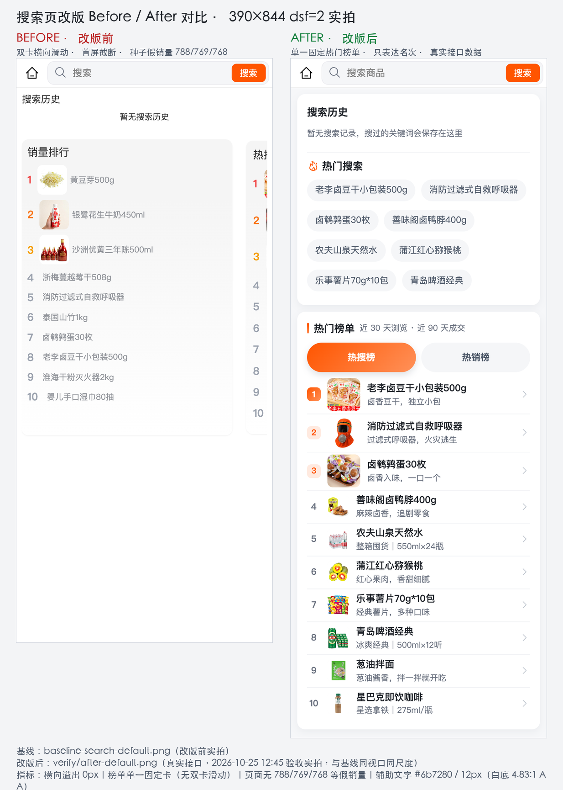
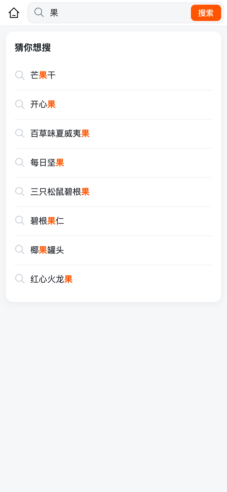
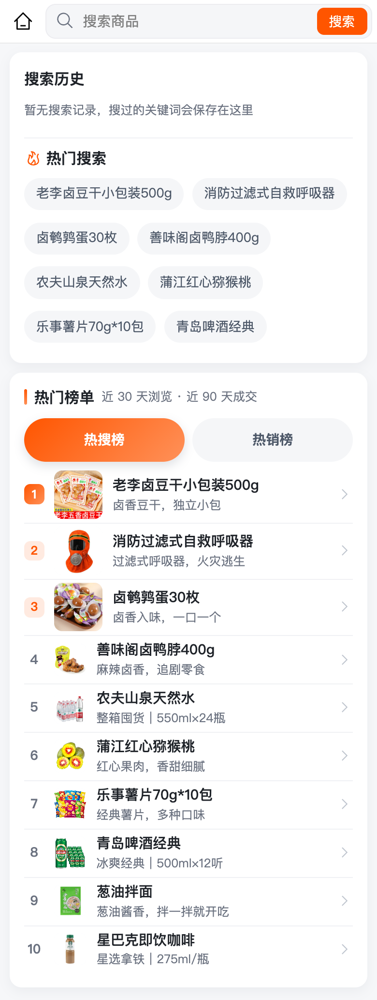
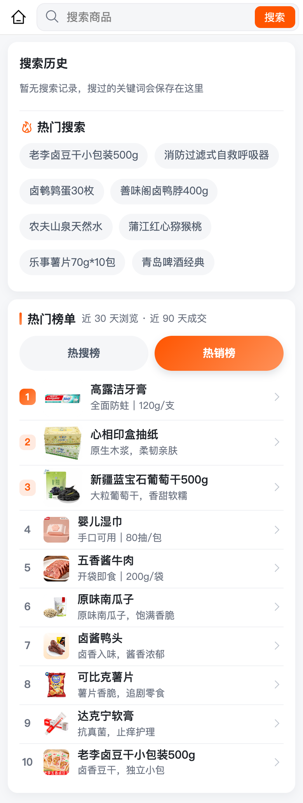
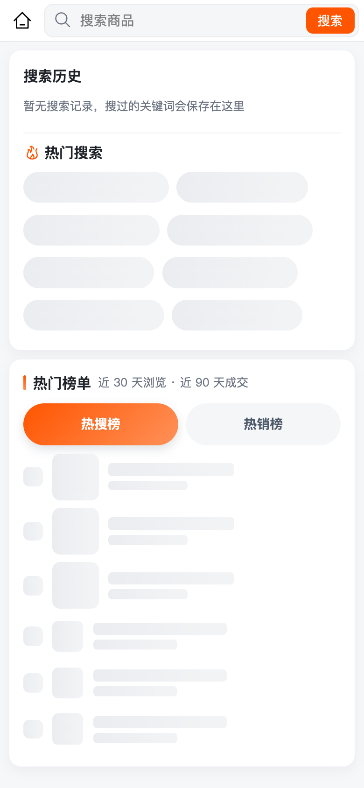

# 搜索页 UI/UX 与排行组件重构（C 端 /sub-pages/product/goods-search）

> 日期：2026-10-25 ｜ 状态：**已完成**（前后端 + 真实数据口径 + H5 五态实拍 + 独立视觉验收 0 阻塞；type-check / test:unit 957 / build:mp-weixin / 后端编译与定点单测全绿）
> 原始请求：「这个页面的排行组件需要重构一下，整个页面 UI/ux 都要重构一下，而且这个销量数值也不是真实的值，感觉也不合理」（附当前搜索页两张截图：横向滑动的「销量排行 / 热搜榜」双卡，销量数字 788/769/768…）。

## 〇、一页结论

| 项 | 结论 |
|----|------|
| **问题定性** | ① 排行是两张 86% 宽的卡片横向滑动，必须左右划才能看全，首屏永远被截断一半；② 销量榜的「销量」直接读 `goods_spu.sales_volume`，而该列是种子数据（788/769/768…），不是真实成交；③ 排行卡只有前三名有图，4–10 名是纯文字，视觉节奏断裂且与页面其余卡片语言不一致；④ 空历史态（新用户）整页只剩两行字 + 一排假数字，信息价值为 0。 |
| **重构主线** | 排行合并为**单一「热门榜单」卡片组件**：热搜榜 / 热销榜两个 Tab、前三名强化（大图 + 品牌色名次徽章）、4–10 名紧凑行、骨架屏 + 空态；整页改为「浅灰底 + 白色圆角卡片」的现代即时零售语言（对齐会员中心 / 个人中心已落地设计），补热门搜索词、搜索历史空态与联想面板视觉。 |
| **数据真实性** | 热销榜改读**真实有效订单**（订单域聚合，近 90 天 `order_info.status in ('2','3','4')` 的 `order_item.buy_quantity` 求和，与「常购清单」同口径）；热搜榜改读**真实浏览足迹**（近 30 天 `goods_footprint`），并补上**租户隔离**（原 SQL 漏了 `tenant_id`，存在跨租户串数据）。 |
| **销量数字** | **不再展示任何绝对销量数字**。仓库既有口径 `aryn-mall-uniapp/src/utils/stock-display.ts` 明确「累计销量不外露：…在私有域小用户群里只会暴露没什么人买」，本页此前展示的 788/769 属于种子假数据，既是编造值也违背该口径；重构后榜单只表达**名次**，排序依据是真实数据。 |
| **非目标** | 不改搜索联想的后端语义能力（错别字/同义词）、不新增榜单落地页、不动首页装修楼层、不重置 `goods_spu.sales_volume`（商品列表「销量」排序仍读该列，属另一议题）。 |

## 一、改版前现状（H5 390×844 实拍基线）

基线截图：`outputs/search-redesign/baseline-search-default.png`、`baseline-search-suggest.png`、`baseline-search-viewport.png`

| # | 问题 | 证据 |
|---|------|------|
| 1 | 双卡横向滑动、首屏截断 | 卡片 `w-86%` 横向滚动（`index.vue` 267–330 行）；实拍中右侧卡片只剩一条边 |
| 2 | 销量为种子假数据 | `db/boot/151goods_appraise_seed.sql` 对应商品 `goods_spu.sales_volume` 788/769/768 为写死种子；真实有效订单聚合后 top1 仅 12 件（见 §2.3） |
| 3 | 榜单行视觉不齐 | 仅前三名有图（`v-if="index < 3"`），4–10 行无图、名次灰度跳变；「热搜榜」销量数字被注释掉（324–326 行），两张卡信息结构不一致 |
| 4 | 空历史态无内容 | 新用户首屏只有「搜索历史 / 暂无搜索历史」+ 两张榜单卡，页面下半屏全空 |
| 5 | 页面语言不统一 | 白底 pages + 灰渐变卡 + 12px 灰字，与会员中心/个人中心的「浅灰底 + 白卡 + 24rpx 圆角 + 柔和阴影」断裂 |

## 二、数据口径与接口契约

### 2.1 决策：排行数据只用真实数据

| 榜单 | 数据源 | 口径 | 展示 |
|------|--------|------|------|
| 热搜榜 | `goods_footprint`（真实浏览足迹） | 当前租户、`del_flag='0'`、近 30 天有浏览记录的在售商品，按浏览次数倒序取前 10 | 只展示名次/图片/名称/副标题，不展示次数 |
| 热销榜 | `order_item` + `order_info`（真实订单） | 当前租户、`order_info.del_flag='0'` 且 `status in ('2','3','4')`（待发货/待收货/已完成，即已过支付环节的有效订单，含货到付款）、近 90 天，按 `SUM(buy_quantity)` 倒序取前 10；再回商品域过滤为**当前在售**商品并保持名次 | 只展示名次/图片/名称/副标题，不展示销量 |

> 口径依据：`OrderItemMapper.selectFrequentPurchase`（常购清单）已使用同一 `status in ('2','3','4') + 近 90 天` 口径；货到付款订单下单即进入待发货（`SharedCartConfirmDTO` 注释），因此不能用 `pay_status='1'` 单一口径，否则整船 COD 订单不计入成交。

### 2.2 后端接口（均在商品域，免登，前端 `skipToken`）

| 方法 | 路径 | 说明 | 返回 |
|------|------|------|------|
| GET | `/product/app/goodsspu/hot-search/top10` | 热搜榜 Top10（**保留原路径**，改动为租户隔离 + 真实浏览 + 精简出参） | `List<AppGoodsRankVO>` |
| GET | `/product/app/goodsspu/sales-rank/top10` | **新增**：热销榜 Top10（真实有效订单） | `List<AppGoodsRankVO>` |

`AppGoodsRankVO`（`aryn-product-api`，最窄白名单，不含价格/库存/销量）：

```json
{ "id": "9740000000000000166", "name": "高露洁牙膏", "subTitle": "…", "picUrl": "http://…/x.jpg" }
```

- 两个接口都要求 `tenant-id` 头（C 端请求中间件已统一携带）；租户缺失时商品域 fail-closed 返回空数组。
- 热销榜跨域取数走 Dubbo：`aryn-order-api` 新增 `RemoteGoodsSalesRankService#topSalesRank(tenantId, days, limit)` + `GoodsSalesRankDTO`，`aryn-order-biz` 实现（`@DubboService`），`aryn-product-biz` 通过 `@DubboReference` 消费；订单服务异常时商品域**降级为空列表并打 warn**，前端展示空态，不影响搜索主流程。
- 榜单均只返回在售商品（`goods_spu.status='1'`、`del_flag='0'`、当前租户）。

### 2.3 真实数据样例（本地 aryn_boot，2026-10-25 实测）

按上述热销口径聚合结果（前 6）：高露洁牙膏 12、心相印盒抽纸 12、新疆蓝宝石葡萄干500g 12、婴儿湿巾 10、五香酱牛肉 10、原味南瓜子 10。当前页面展示的 788/769/768 与之无关，可作为「数据不真实」的直接证据。

### 2.4 数据库

- **无表结构变更、无种子数据变更**；查询命中既有索引（`order_item (tenant_id, order_id)`、`(tenant_id, spu_id)`，见 `db/boot/133dashboard_statistics_index_incremental.sql`）。
- 因此不需要新增 boot/cloud 增量 SQL；`db/boot/build-full-sql.mjs` 与 `aryn_boot_full.sql` 无需改动。

## 三、页面设计规格

### 3.1 信息架构（自上而下）

1. **搜索栏**：沿用共享 `hr-search-navbar`（已处理小程序胶囊/刘海适配），不重写；placeholder「搜索商品」。
2. **搜索历史卡**：标题「搜索历史」+ 右侧「清空」（图标+文字，命中区 ≥44px，仅在有历史时出现）；历史词胶囊换行；空态一行说明「暂无搜索记录，搜过的关键词会保存在这里」。
3. **热门搜索**：卡内子区块（火焰图标 + 「热门搜索」），取热搜榜商品名前 8 个做胶囊，点击直接搜索；接口失败/为空时整块隐藏。
4. **热门榜单**（新组件 `rank-board`）：
   - 卡头：左侧品牌色竖条 + 「热门榜单」+ 副标题「近 30 天浏览 · 近 90 天成交」；下方分段 Tab「热搜榜 / 热销榜」（等宽胶囊，激活态品牌渐变）。
   - 行：前三名 112rpx 行高、96rpx 大图、名次徽章（#1 品牌渐变白字；#2/#3 品牌浅底品牌字）；4–10 名 96rpx 行高、64rpx 图、灰色序号。
   - 行内容：名称（单行省略）+ 副标题（单行省略，无则不占位）+ 右侧箭头。
   - 状态：加载中骨架屏（6 行 shimmer）；空态（图标 + 「暂无榜单数据」+ 说明）；接口失败按空态处理，不打断页面。
5. **输入联想面板**（有输入时替换 2–4 区块）：白色卡片 + 「猜你想搜」；首行常驻「搜索「关键词」」直接搜索行（2026-10-25 后续修订，见 [搜索提交链路与联想面板交互修复](../2026-10-25-搜索提交与联想面板交互修复/README.md)）；行内搜索图标、命中片段品牌色高亮、来源标签（历史/热搜）；加载中在直接搜索行下方显示 3 行骨架。

### 3.2 设计令牌（对齐会员中心页 / 个人中心页）

| 令牌 | 取值 |
|------|------|
| 品牌色 | `var(--theme-color-primary, var(--wot-color-theme-primary, #FF2237))`；租户实测 `#ff5500` |
| 页面底色 | `#f6f7f9` |
| 卡片 | 白底、24rpx 圆角、`0 8rpx 24rpx rgba(31, 44, 65, 0.06)`、内边距 28rpx |
| 文字 | 标题 `#1f2329` / 正文 `#4e5969` / 辅助 `#6b7280`（白底 4.83:1，满足 AA）/ 装饰性弱化 `#c0c6cf`（仅图标/箭头）|
| 发丝线 | `#f0f1f4` 1rpx |
| 栅格 | 页面左右 20rpx；卡片间距 20rpx；卡内区块间距 20rpx |
| 触控 | 所有可点目标 ≥44×44px（胶囊高 64rpx≈32px，通过上下 padding 命中区补足） |
| 字号 | 名称/正文 ≥26rpx（13px），辅助说明 24rpx（12px）起；不使用 11px 级小字承载信息 |
| 动效 | Tab 切换 200ms ease-out；按压态 `scale(0.98)`；骨架 shimmer 1.2s 循环；尊重减少动效 |

### 3.3 状态矩阵

| 状态 | 表现 |
|------|------|
| 有历史 + 有榜单 | 完整页：历史胶囊 / 热门搜索 / 榜单双 Tab 有数据 |
| 无历史（新用户） | 历史卡变一行空态说明；热门搜索 + 榜单照常，页面不空 |
| 榜单加载中 | 榜单卡内骨架屏；热门搜索区暂不显示 |
| 热销榜为空/订单服务降级 | 该 Tab 显示空态文案；热搜榜不受影响（默认 Tab 仍为热搜榜） |
| 输入中 | 隐藏历史/热门搜索/榜单，展示联想面板；首行常驻直接搜索行，接口加载中在其下方显示骨架卡 |
| 联想无结果 | 只保留首行「搜索「关键词」」直接搜索行（不再出现「没找到相关联想」死空态，见 2026-10-25 后续修订） |
| 接口全失败 | 页面无白屏：历史区仍可用，榜单空态，可正常输入搜索 |

## 四、实现清单

### 4.1 后端（aryn-mall-java）

| 层 | 文件 | 动作 |
|----|------|------|
| order-api | `api/dto/GoodsSalesRankDTO.java` | 新增（spuId/spuName/picUrl/salesCount，Serializable） |
| order-api | `api/remote/RemoteGoodsSalesRankService.java` | 新增 Dubbo 接口 `topSalesRank(tenantId, days, limit)` |
| order-biz | `dubbo/RemoteGoodsSalesRankServiceImpl.java` | 新增 `@DubboService`，租户 fail-closed、days 1–3650、limit 1–50 钳制 |
| order-biz | `mapper/OrderItemMapper.java` + `mapper/OrderItemMapper.xml` | 新增 `selectGoodsSalesRank`（§2.1 热销口径，显式 tenant_id） |
| product-api | `api/vo/AppGoodsRankVO.java` | 新增精简出参 VO |
| product-biz | `pom.xml` | 增加 `aryn-order-api` 依赖（L4→L3，符合分层；order-api 不反向依赖 product，无环） |
| product-biz | `service/IGoodsRankService.java` + `service/impl/GoodsRankServiceImpl.java` | 新增：热搜 Top10（足迹聚合）+ 热销 Top10（Dubbo + 在售过滤） |
| product-biz | `mapper/GoodsRankMapper.java` + `resources/mapper/GoodsRankMapper.xml` | 新增热搜榜查询（含 tenant_id、近 30 天、INNER JOIN 足迹、仅上架） |
| product-biz | `controller/app/AppGoodsSpuController.java` | `hot-search/top10` 改调新服务；新增 `sales-rank/top10` |
| product-biz | `service/IGoodsSpuService` / `impl` / `GoodsSpuMapper.java` / `GoodsSpuMapper.xml` | 移除旧 `getTop10HotSearchGoods`（无其他调用方） |
| 测试 | order-biz `RemoteGoodsSalesRankServiceImplTest`、product-biz `GoodsRankServiceImplTest` | 新增：口径/租户 fail-closed/钳制/降级/在售过滤与名次保持 |

### 4.2 前端（aryn-mall-uniapp）

| 文件 | 动作 |
|------|------|
| `src/api/product/spu.ts` | 新增 `RankGoodsItem` 类型 + `getSalesRankGoods()`；`getTop10HotSearchGoods()` 返回新 VO 结构 |
| `src/sub-pages/product/goods-search/components/rank-board.vue` | **新增**排行组件：双 Tab、前三强化、骨架、空态、按压反馈；props `hotList/salesList/loading`，emit `select(id)` |
| `src/sub-pages/product/goods-search/index.vue` | 重写页面模板/样式：历史卡、热门搜索、榜单组件、联想面板、加载与空态；保留 250ms 防抖 + 竞态守卫；移除无用 `isCanBack` 逻辑 |

## 五、验收标准

| 项 | 方式 | 通过标准 |
|---|------|----------|
| H5 实拍 | Playwright + Chrome，390×844 dsf=2 | 默认态/输入联想态/空历史态截图存 `outputs/search-redesign/`；无横向滚动（`scrollWidth <= clientWidth`）；页面无空白大断层 |
| Console | 捕获 `console` + `pageerror` | 0 error（业务容错 warn 除外） |
| 触控/可读性 | DOM 度量脚本 | 主要可点目标 ≥44px；正文 ≥12px；对比度符合 AA |
| 榜单数据 | 实测接口 + 页面 | 热销榜顺序与 §2.3 聚合一致（高露洁牙膏/心相印盒抽纸/新疆蓝宝石葡萄干 居前）；页面不出现 788/769 等假数字 |
| 前端质量 | `pnpm type-check` / `pnpm test:unit` / `pnpm build:mp-weixin` | 全部 exit 0 |
| 后端质量 | `mvn clean compile -pl aryn-boot -am` + 定点单测 + 容器实测 | 编译通过；新增单测通过；接口返回真实榜单 |
| 双模式 | 接口路径 `/product/app/**` 为云模式首段、boot 模式由 `/boot` 前缀承接；前端不硬编码 `/boot` | 两种模式路径均可由 `rewriteBootUrl` 正确改写（单测 `boot-url.test.ts` 已覆盖） |

## 六、验证方式（可复现）

```bash
# 后端编译 + 定点测试
cd aryn-mall-java && mvn clean compile -pl aryn-boot -am
mvn test -pl aryn-order/aryn-order-biz -am -Dtest=RemoteGoodsSalesRankServiceImplTest
mvn test -pl aryn-product/aryn-product-biz -am -Dtest=GoodsRankServiceImplTest

# 更新本地 boot 容器（只替换 jar，不重建依赖）
mvn -pl aryn-boot -am package -DskipTests
docker cp aryn-boot/target/*.jar aryn-boot:/app/app.jar && docker restart aryn-boot

# 接口实测（boot 模式）
curl -s 'http://localhost:9999/boot/app/goodsspu/hot-search/top10' -H 'tenant-id: 1590229800633634816'
curl -s 'http://localhost:9999/boot/app/goodsspu/sales-rank/top10' -H 'tenant-id: 1590229800633634816'

# 前端质量与实拍
cd aryn-mall-uniapp && pnpm type-check && pnpm test:unit && pnpm build:mp-weixin
node outputs/search-redesign/capture-search.mjs after
```

## 七、实现与验证结果（2026-10-25 完成）

### 7.1 改动清单

**前端（aryn-mall-uniapp）**

| 文件 | 动作 | 说明 |
|------|------|------|
| `src/sub-pages/product/goods-search/index.vue` | 重写（703 行） | 浅灰底 + 白卡信息架构、历史/热门搜索/联想面板/榜单接入、加载占位、空态；保留 250ms 防抖 + 竞态守卫；删除无用 `isCanBack` |
| `src/sub-pages/product/goods-search/components/rank-board.vue` | 新增（588 行） | 热门榜单组件：双 Tab、前三名强化、4–10 紧凑行、6 行骨架、空态、按压反馈；只表达名次，不展示任何销量/浏览次数 |
| `src/api/product/spu.ts` | 修改 | `RankGoodsItem` 类型 + `getSalesRankGoods()`；`getTop10HotSearchGoods()` 收窄为新 VO |

**后端（aryn-mall-java）**

| 模块 | 文件 | 动作 |
|------|------|------|
| order-api | `api/dto/GoodsSalesRankDTO.java`、`api/remote/RemoteGoodsSalesRankService.java` | 新增跨域 DTO 与 Dubbo 接口 |
| order-biz | `dubbo/RemoteGoodsSalesRankServiceImpl.java`、`mapper/OrderItemMapper.java`、`mapper/OrderItemMapper.xml` | 新增 `@DubboService` 实现与热销聚合 SQL（租户 fail-closed、days/limit 钳制） |
| product-api | `api/vo/AppGoodsRankVO.java` | 新增最窄白名单 VO |
| product-biz | `service/IGoodsRankService.java`、`service/impl/GoodsRankServiceImpl.java`、`mapper/GoodsRankMapper.java`、`mapper/GoodsRankMapper.xml` | 新增热搜榜（足迹聚合）与热销榜（Dubbo + 在售过滤保名次）服务 |
| product-biz | `controller/app/AppGoodsSpuController.java`、`pom.xml` | `hot-search/top10` 改调新服务并收窄出参；新增 `sales-rank/top10`；增加 `aryn-order-api` 依赖 |
| product-biz | `IGoodsSpuService` / `GoodsSpuServiceImpl` / `GoodsSpuMapper`(.java/.xml) | 删除旧 `getTop10HotSearchGoods`（全仓确认无其他调用） |
| 测试 | `RemoteGoodsSalesRankServiceImplTest`、`GoodsRankServiceImplTest`、`AppGoodsSpuControllerTest` | 新增/适配；覆盖 fail-closed、钳制、名次保持、下架过滤、远程异常降级 |

**数据库**：无表结构 / 种子数据变更，无需 boot/cloud 增量 SQL（查询命中既有索引）。

### 7.2 数据真实性（实测）

| 榜单 | 接口 | 实测结果 |
|------|------|----------|
| 热销榜 | `GET /boot/app/goodsspu/sales-rank/top10` | 200 / 10 条；前五 = 高露洁牙膏、心相印盒抽纸、新疆蓝宝石葡萄干500g、婴儿湿巾、五香酱牛肉（与 DB 同口径聚合逐条一致） |
| 热搜榜 | `GET /boot/app/goodsspu/hot-search/top10` | 200 / 10 条；前五 = 老李卤豆干小包装500g、消防过滤式自救呼吸器、卤鹌鹑蛋30枚、善味阁卤鸭脖400g、农夫山泉天然水（近 30 天真实足迹） |
| 租户隔离 | 无 tenant-id / 另一租户 | 两接口均 `{"code":0,"data":[]}`（fail-closed 生效） |
| 页面 | H5 DOM 文本扫描 | 无 788/769/768，无任何「销量/已售/浏览次数」文案，仅 1–10 名次 |

### 7.3 验证结果

| 项 | 方式 | 结果 |
|---|------|------|
| 后端编译 | `mvn clean compile -pl aryn-boot -am` | exit 0 |
| 后端单测 | 定向 `RemoteGoodsSalesRankServiceImplTest` + `GoodsRankServiceImplTest` | 12/12 通过（5 + 7） |
| 接口实测 | curl（boot 模式，带 tenant-id） | 两接口 200 / 各 10 条；boot 容器已更新（`docker cp` jar + restart，health 200） |
| 前端类型 | `pnpm type-check` | exit 0 |
| 前端单测 | `pnpm test:unit` | 91 files / 957 tests 全通过 |
| 小程序构建 | `pnpm build:mp-weixin` | exit 0（仅既有 `carbon:truck` 告警，与本页无关） |
| 视觉验收 | 独立 visual-verifier，Playwright + Chrome，390×844 dsf=2 | **137 项检查：128 pass / 0 阻塞 / 9 建议**；console error + pageerror = 0；requestfailed = 0 |
| CLS | 独立复核（真实接口 reload ×3 + mock 延迟过渡） | 修复前 reload 0.2249 → 修复后 **0 / 0 / 0**；`.rank-board` top Δ0px；24/24 检查通过 |
| 布局 | DOM 度量 | 横向溢出 0px；页面内容高 1.2× 视口；无底部空白断层；旧双卡横滑消失 |
| 可读性/触控 | DOM 度量 | 页面自有可点目标 0 个 <44px；辅助文字 #6b7280 / 24rpx / 白底 4.83:1（AA）；正文/名称 15.78:1 |
| 双模式 | 实际请求路径 | H5 实测请求 `/api/boot/app/goodsspu/...`，`rewriteBootUrl` 改写生效；云模式首段 `/product` 有效（本机无 Nacos，未实机联调） |

### 7.4 视觉验收截图

| 状态 | 截图 |
|------|------|
| 改版前后对比 |  |
| 默认态（真实数据） |  |
| 输入联想态 |  |
| 空历史态 |  |
| 热销榜 Tab |  |
| 加载骨架（占位胶囊） |  |

完整证据：`outputs/search-redesign/`（capture-search.mjs / after-*.png / after-metrics.json / after-cls.json）与 `outputs/search-redesign/verify/`（独立验收脚本、report、metrics、接口原始 JSON）。

### 7.5 关键决策记录

- **不展示销量数字**：仓库既有口径 `src/utils/stock-display.ts` 明确「累计销量不外露」；本页原 788/769 是种子假数据，既编造又违背口径。重构后榜单只表达名次，排序用真实数据，接口出参也收窄为 `id/name/subTitle/picUrl`（最窄白名单，连数字都不下发）。
- **热销口径 = 有效订单**：与「常购清单」`selectFrequentPurchase` 一致（`status in ('2','3','4')` + 近 90 天），而不是 `pay_status='1'`；货到付款订单下单即进入待发货（`SharedCartConfirmDTO` 注释），只按在线支付口径会漏掉整船 COD 成交。
- **跨域取数走 Dubbo**：订单数据在订单域，商品域不能跨库查；`aryn-product-biz` 依赖 `aryn-order-api`（L4→L3 合规，无环），订单服务异常时商品域降级空榜，不打断搜索主流程。
- **热搜榜补租户隔离**：旧 SQL 无 `tenant_id`，存在跨租户串数据风险；本次一并修复并加 fail-closed 单测。

### 7.6 后续修订（2026-10-25）

用户随后反馈「搜索商品会先显示『猜你想搜』页，再出现商品结果页，交互不友好」。本次仅做前端交互修复：

- 提交搜索不再把词写回输入框，消除跳转过渡期间闪一屏「猜你想搜」的中间帧；同时作废在途联想请求、加 600ms 连点节流。
- 联想面板首行常驻「搜索「关键词」」直接搜索行（可点击提交），并删除「没找到相关联想」死空态（精确商品名/热门词会被联想接口的「同词不重复推荐」过滤，原空态与事实矛盾）。
- 详见 [搜索提交链路与联想面板交互修复](../2026-10-25-搜索提交与联想面板交互修复/README.md)。

## 八、边界与遗留（均非阻塞）

1. **共享组件触控尺寸**：`hr-search-navbar` 搜索框 36px / 返回键 35.4×24 / 搜索按钮 52×28 小于 44px；该组件被多页复用，§3.1 明确不重写，仅记录。
2. **全局确认弹窗按钮 36px**：`wd-message-box` 默认 `is-medium`，属全局组件，不在本页范围。
3. **品牌色前景对比度观察项**：激活 Tab 白字 on 品牌渐变（#ff5500→#ff9159）约 2.22:1、联想命中词 #ff5500 on 白 3.15:1；品牌色由租户主题令牌决定（实测 #ff5500），需设计侧决策是否加深，本次不改。
4. **热搜为空时的降级路径**：热门搜索区块整体移除会让榜单卡上移（属空数据降级，未计入 CLS 验收场景）。
5. **cloud 模式未实机联调**：本机无 Nacos；接口路径、Dubbo 注解写法沿用 promotion→order 既有先例，boot injvm 已实测通过。
6. **未补 rank-board 组件单测**：组件逻辑通过独立 H5 实拍 + 交互实测覆盖（点击/切 Tab/空态/骨架/CLS）；既有 `search-suggest` 纯函数单测未改。
7. **数据依赖**：新环境无浏览足迹/有效订单时，对应榜单返回空数组并展示空态，属预期行为。
8. **`goods_spu.sales_volume` 未重置**：商品列表「销量」排序仍读该列（种子值与真实订单回写并存），属另一议题；本次搜索页不再使用该列。
