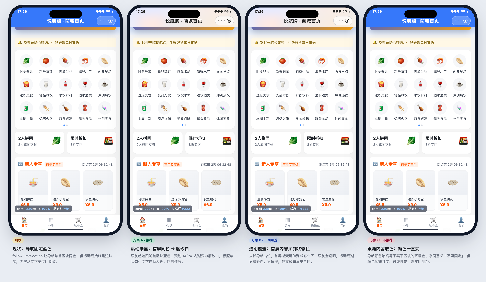
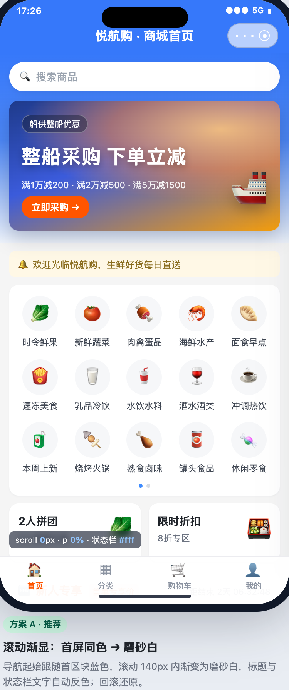
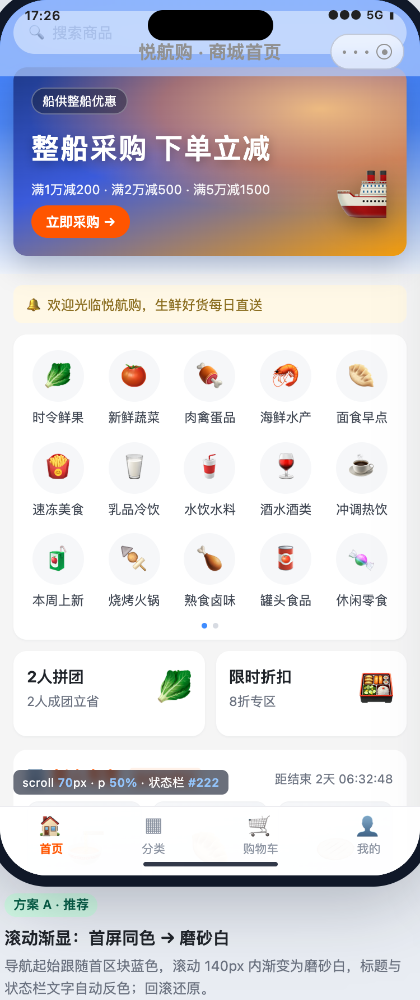
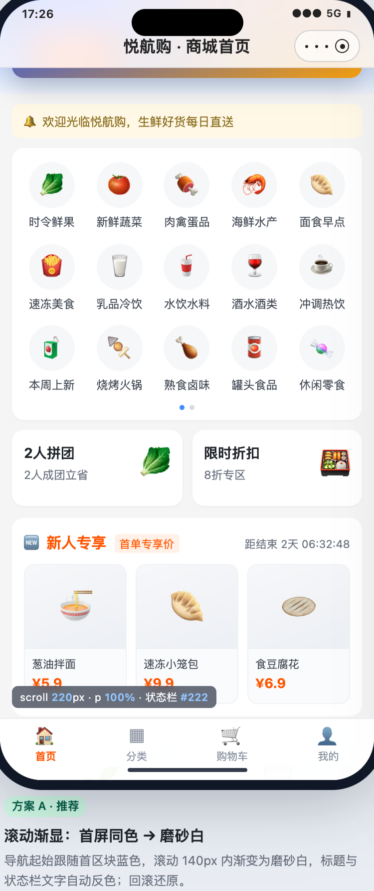
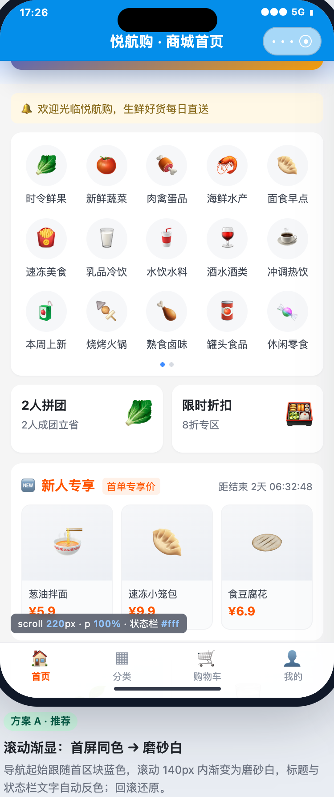

# 小程序装修页沉浸式导航栏（滚动自适应）设计方案

> 日期：2026-10-27 ｜ 状态：**P0 已实施（自动化验证通过；未真机目检）** ｜ 范围：C 端小程序 + 管理端装修器 ｜ **零后端 / 零 DB 变更**（只扩装修 JSON Schema）
> 关联：[装修 Schema v3](../2026-09-23-装修功能改造/装修功能改造实施报告.md)、[商城主题色](../2026-10-02-商城主题色/README.md)、`preview-parity` 跨端同源守卫
> 原型：`prototype/index.html`（可交互，四种模式对比）｜ 截图：`prototype/screenshots/`

---

## 0. 结论先行

**可以做，而且不需要改后端和数据库。** 推荐落地「**方案 A：滚动渐显（Scroll Fade）**」：

1. **顶部保持现状**：导航背景 = 当前解析结果（首页是 `followFirstSection`，取首区块渐变顶边色 `rgb(54,120,250)`），与首屏无缝。
2. **滚动时渐变**：`scrollTop` 0 → D（默认 **140px**，可配 60–260）过程中，导航从「首屏同色」交叉淡化为「磨砂白」（默认；可选商城主题导航色 / 自定义色），内容从半透明材质下穿过。
3. **文字/状态栏自动反色**：标题、图标、状态栏前景色统一按「当前合成背景亮度」取黑/白，跨阈值切换一次；状态栏只有 `#ffffff` / `#000000` 两档（微信 API 限制）。
4. **回滚可逆**：进度是 `scrollTop` 的纯函数，向上滚回自动还原。
5. **三端同源**：新增 `schema/navigation-scroll.ts` 纯函数 + `NAVIGATION-SCROLL` 标记块，管理端画布 / 草稿预览 / C 端小程序共用，`preview-parity.test.ts` 逐字守卫（不动现有 `NAVIGATION-FOLLOW` 块）。
6. **存量零回归**：新字段可选、缺省 `mode='none'` 走原逻辑；存量页面、模板、发布快照、回放都不变。
7. **性能可控**：滚动值 **8px 量化**（140px 全程约 18 次更新）+ 页面 `provide` 滚动 ref、只有 `hr-navbar` `inject` 读取，`DiyPage` 与装修楼层不重渲染；只在滚动回调里改一个导航子树的 opacity/color。

**关键实现前提（审计发现，必须写进任务）**：微信小程序的页面 `onPageScroll` 是否派发，由 **页面 SFC 源码里是否出现 `onPageScroll` 字面量** 决定（`__runtimeHooks` 编译期生成）；只在 composable 内部注册在 MP 上**静默失效**。所以 `home` / `diy-page` 两个宿主页必须显式写 `onPageScroll(handlePageScroll)`，并加契约测试守住。

**二期可选**：方案 B「透明覆盖」——去掉导航占位、首屏渐变延伸到状态栏下，导航全透明，滚动后渐显磨砂白（真·全屏沉浸）。需要改首屏安全区与画布预览，风险高于 A，建议先上 A，B 单独立项。

**不做**：方案 C「实时跟随内容取色」（颜色一路跳变、可读性/性能不可控）、导航内搜索框收起、深色模式联动（另立需求）。



---

## 1. 背景与现状

### 1.1 线上首页的真实现状（有据可查）

从本地 boot 库 `page_design.page_content`（`id=2105298015641964546`，首页）读到的真实配置：

```json
{
  "navigation": {
    "visible": true,
    "title": "",
    "backgroundMode": "followFirstSection",
    "backgroundColor": "#ffffff",
    "textColor": "#ffffff",
    "textColorAuto": true
  },
  "sections": [
    {
      "style": {
        "backgroundGradient": {
          "direction": "to bottom",
          "startColor": "rgb(54, 120, 250)",
          "endColor": "rgb(238, 243, 251)"
        }
      },
      "components": ["search-bar", "swiper-banner", "notice"]
    }
  ],
  "followMallTheme": true
}
```

商城默认主题（`page_design_theme.mall_default_flag='1'`）：`navigationColor=#048EEA`、`navigationTextColor=#FFFFFF`、`pageBackgroundColor=#F5F5F5`。

现在首屏是：**导航（#3678FA）+ 首区块渐变（#3678FA → #EEF3FB）连成一片**——`followFirstSection` 已把「导航与首屏同色」做好，顶部观感没问题。

### 1.2 割裂发生在滚动之后

用户提供的第二张截图：滚动到「新人专享 / 优惠券」楼层时，导航仍是那块蓝色，而下方内容已经是白底卡片 + 红色券面。导航与内容没有过渡关系，蓝条像「贴」在页面上，这就是用户说的「固定颜色、不够沉浸」。

现状缺口（按链路盘点）：

| 层 | 现状 | 缺口 |
|---|---|---|
| 导航外观解析 | `resolveNavigationAppearance()` 支持 `custom` / `followFirstSection`，是**静态**的 | 无滚动进度入参，背景不会变 |
| 导航组件 | `hr-navbar` 用 `wd-navbar`（fixed + placeholder + 安全区），只接受一个静态底色/背景图/文字色 | 没有滚动联动、没有状态栏联动、没有毛玻璃层 |
| 状态栏 | `useDecorationPage` 加载时调一次 `uni.setNavigationBarColor`，取的是**原始** `navigation.backgroundColor/textColor` | 滚动中不会变；`followFirstSection` 下原始字段与实际导航底色可能不一致（潜在缺陷，见 §4.5.4） |
| 滚动接线 | 页面有 `onPageScroll`（`useDecorationInfiniteScroll`），但只用于分页商品流；且见下方「附带发现」 | 导航没有消费滚动值 |
| 既有先例 | `goods-detail` 自己写过「白底渐显」（`onPageScroll` 200px + 标题透明度）；`hr-search-navbar` 有 `transparent + scrollTop` 的渐显 prop | 前者是页面私有实现；后者全仓**无调用方**，且只做白底 + 50% 切字色，无状态栏/毛玻璃/量化 |
| 管理端 | 画布与草稿预览都是**静态**渲染导航（`phone-canvas.vue` / `preview-canvas.vue`） | 运营无法配置、无法预览滚动态 |

### 1.3 附带发现（相邻既有缺陷，建议同批或紧接修复）

审计过程中确认了 3 个与本需求相邻、但**不是本需求引入**的问题：

1. **`onPageScroll` 在 MP 上静默失效**：`home` / `diy-page` / `user-center` / `shopping-cart` 都只调了 `useDecorationInfiniteScroll()`，页面 SFC 没有 `onPageScroll` 字面量 → 构建产物没有 `__runtimeHooks`，MP 不派发滚动事件；目前分页只靠 `onReachBottom` 兜底（能翻页，但「提前预加载」没生效）。本需求给 `home` / `diy-page` 补字面量后会**顺带激活**该能力，需要回归「提前预加载」不产生额外请求风暴。
2. **`goods-detail` 渲染 `DiyPage` 时没传 `embedded`**（`src/sub-pages/product/goods-detail/index.vue:875`）：商详装修页型（pageType=2）若 `navigation.visible=true`，会在商品信息下方多渲染一条 fixed 导航。当前该租户没有 pageType=2 的装修数据，属于潜在缺陷；建议独立提交补 `embedded`。
3. **草稿预览没传 `page-type`**（`apps/web-ele/src/views/promotion/page-preview/index.vue:100-104`）：内嵌页型（商详/分类/个人中心）在预览里会渲染出导航栏，与画布/实机不一致。做沉浸式预览前必须先补，否则「画布没有、预览有」。

### 1.4 为什么现在做正合适

- 装修 Schema v3、`followFirstSection`、商城主题色、`preview-parity` 三端同源守卫都已就位，扩展一个纯函数即可三端一致；
- 首页/微页面都是**原生页面滚动**（`onPageScroll` + `onReachBottom` + 区块 `sticky` 都依赖它），不需要改滚动容器；
- 后端只存 JSON，**零接口、零表结构**。

---

## 2. 目标与非目标

### 目标

1. 装修页（首页 / 微页面）导航支持「滚动自适应」：顶部与首屏同色 → 滚动后渐显为可配置的目标底色；回滚还原。
2. 标题、图标、状态栏前景色在任意滚动位置都保持可读，自动反色。
3. 管理端可视化配置 + 画布/草稿预览可见效果，三端所见一致。
4. 存量页面/模板/发布快照零行为变化；不做数据迁移。
5. 性能不劣化：滚动不触发整页重渲染，低端安卓不明显掉帧。

### 非目标（本期不做）

- 方案 B 透明覆盖（首屏顶到状态栏）——二期评估；
- 实时内容取色（方案 C）；
- 导航内搜索框/标题的收起-展开策略；
- 深色模式适配：`manifest` 已开 `darkmode`，但装修导航色全部来自 Schema，目前没有 dark 分支；磨砂白在深色模式下会突兀，属已知边界（§8 R6）；
- 其他 30 个使用 `hr-navbar` 的业务页（订单/优惠券等）——不传 `scrollEffect`，行为不变。

---

## 3. 方案选型

| 方案 | 做法 | 沉浸感 | 可读性 | 性能/成本 | 结论 |
|---|---|---|---|---|---|
| 现状 | `followFirstSection` 静态同色 | 顶部好，滚动割裂 | 好 | — | 问题所在 |
| **A 滚动渐显（推荐）** | 保持布局，导航背景按滚动进度交叉淡化到目标底色 | **好**：内容从半透明材质下穿过 | 自动反色，可控 | 低：一个子树、8px 量化 | **P0 实施** |
| B 透明覆盖 | 去占位，首区块延伸至状态栏，导航透明→渐显 | 最好（真全屏） | 需 scrim/自动反色 | 中高：改布局安全区、画布同构、存量页面风险 | **P1 二期** |
| C 内容取色 | 导航始终等于其下区块环境色 | 字面「不固定」 | 差：频繁跳变 | 高：滚动中实时测距 | 不做 |
| D 常驻磨砂 | 导航一直半透明毛玻璃 | 中 | 中 | 中 | 不做（顶部背后是页面底色不是头图，会像白条） |

选 A 的核心理由：**用最小改动拿到用户要的「滚动时导航不再是固定颜色」**，同时把「自动反色 + 三端同源 + 可配置」一次做扎实；B 留作后续「真沉浸」升级。

---

## 4. 方案 A 详细设计

### 4.1 状态模型与进度

```text
scrollTop = 页面滚动距离（原生页面滚动，负值按 0 处理）
D         = 渐显距离（默认 140px，可配 60–260px）
t         = clamp(scrollTop / D, 0, 1)
p         = smoothstep(t) = t²(3-2t)      // 两端缓入缓出
```

- `p=0`：导航完全等于当前静态外观（`custom` / `followFirstSection` 解析结果），首屏观感与现在**完全一致**；
- `0<p<1`：base 层透明度 `1-p`，surface 层透明度 `p`，交叉淡化；
- `p=1`：导航为完整目标底色，内容在导航下滚动；
- 向上滚回：`p` 对称回落，无一次性开关的状态残留。

> 为什么用 `smoothstep`：线性在起点/终点会「突然开始/突然停住」；`smoothstep` 两端导数为 0，更接近 iOS 导航栏材质过渡。

### 4.2 视觉规格

**层级结构**（`hr-navbar` 内新增一个 fixed 背景层，位于 `wd-navbar` 之下、页面内容之上）：

```text
z-index 500  wd-navbar（透明根 + 标题/图标，fixed，带安全区）
z-index 499  hr-navbar 背景层（fixed，height = 状态栏 + 44px，pointer-events:none）
               ├─ base 层：静态外观（纯色 / 左右渐变背景图），opacity = 1-p
               └─ surface 层：目标底色 + 可选毛玻璃，opacity = p
```

**默认参数**：

| 项 | 值 | 说明 |
|---|---|---|
| 渐显距离 D | 140px | 约 2 个导航栏高度；60–260 可配 |
| 目标底色默认 | 磨砂白 `rgba(255,255,255,.86)` + `blur(18px) saturate(160%)` | 关闭毛玻璃时用 `.97` 半透明兜底 |
| 目标底色可选 | 商城主题导航色（`theme.navigationColor`）/ 自定义色 | 主题色更品牌化；自定义给特殊页面 |
| 标题/图标色 | 按合成背景亮度自动黑/白（阈值 0.6） | 与状态栏同色；切换带 160ms `color` 过渡 |
| 状态栏前景色 | `#ffffff` / `#000000` | 微信 API 仅这两个合法值；只在翻转时调一次 |
| 底部细线 | 目标底色亮度 > 0.75 时，`p>0.55` 渐显 1px `rgba(15,23,42,.08)` | 浅色导航与内容的分界；深色不画 |
| 颜色阈值 | 亮度 0.6（与现有 `pickReadableNavigationTextColor` 同口径） | 三端一致 |

**状态矩阵**：

| 滚动位置 | 背景 | 标题/图标 | 状态栏 | 细线 |
|---|---|---|---|---|
| 顶部 p=0 | 首屏同色（#3678FA） | 白 | 白 | 无 |
| 半程 p≈0.5 | 蓝白混合（磨砂半透明） | 白→黑翻转点附近 | 白→黑翻转 | 0 |
| 完成 p=1 | 磨砂白（内容透出） | 深色 | 黑 | 1px |
| 回滚 | 对称还原 | 对称还原 | 对称还原 | 渐隐 |





> 目标底色选「商城主题导航色」时（当前主题导航色 #048EEA，蓝→蓝变化很弱，所以默认推荐磨砂白）：
> 

### 4.3 数据模型（装修 Schema v3 增量）

`navigation` 增加一个可选对象；**新增文件 `schema/navigation-scroll.ts` 承载解析与归一化**，不改现有 `navigation-style.ts` 的 `NAVIGATION-FOLLOW` 标记块：

```ts
// 管理端 schema/navigation-scroll.ts 与 C 端 diy/schema/navigation-scroll.ts 同构
export type NavigationScrollMode = 'fade' | 'none';
export type NavigationScrollSurface = 'custom' | 'frosted' | 'theme';

export interface NavigationScrollEffect {
  mode: NavigationScrollMode;        // 缺省 'none'
  surface: NavigationScrollSurface;  // 缺省 'frosted'
  surfaceColor: string;              // 仅 surface='custom' 生效
  distance: number;                  // 缺省 140，clamp 40–400
  blur: boolean;                     // 仅 surface='frosted' 生效，缺省 true
}
```

**默认值与迁移**：

- `schema/defaults.ts`：新建页面写入 `scrollEffect: { mode:'none', surface:'frosted', surfaceColor:'', distance:140, blur:true }`。
  > 为什么要写默认值而不是省略：`cloneDesignerValue` 走 JSON 克隆，`undefined` 键会消失；面板用 `Object.assign` 同步 props→form 是「加法」，撤销/套模板到不含该键的旧文档时残留键会被 form watcher 重新 emit，表现为「撤销无效 / 关不掉」。默认值常驻可规避。
- 两端 `migratePageContent()`：对 `navigation.scrollEffect` 做 defaults 深合并 + 归一化（`mode`/`surface` 白名单、`distance` clamp、`blur` 布尔、`surfaceColor` 只接受 hex/rgb，非法回落 `frosted`）；旧文档补默认、脏值不落到 CSS。
- 发布快照/回放：老快照没有该字段 → 迁移器补默认 `mode='none'` → 行为不变；版本 diff 按 `page` 顶层 key 泛化比较，新字段表现为 `page.navigation` 整体变更，后端无需改。
- 后端：`page_content` 按 JSON 原样存取；校验器只看 `sections/components`（`DefaultPageDesignDocumentValidator`），新字段随草稿/版本/模板透传，**零改动**。
- 模板种子：现有种子 SQL 的 `navigation` 无新键 → 默认关闭；若要模板演示，需 boot + cloud 双份增量 SQL 并重生成 `aryn_boot_full.sql`（另立任务，本期不做）。

**JSON 示例**：

```json
{
  "navigation": {
    "backgroundMode": "followFirstSection",
    "textColor": "#ffffff",
    "textColorAuto": true,
    "scrollEffect": {
      "mode": "fade",
      "surface": "frosted",
      "surfaceColor": "",
      "distance": 140,
      "blur": true
    }
  }
}
```

### 4.4 解析器与三端同源

**原则**：解析保持纯函数，不依赖 uni API / DOM；管理端与 C 端各存一份拷贝，用新标记块 + `preview-parity.test.ts` 逐字守卫（与现有 `NAVIGATION-FOLLOW` 相同机制，但**新开文件、新开块**，避免改动 120 行的既有块放大破坏面）。

```ts
// navigation-scroll.ts（两端同源，整体包在 NAVIGATION-SCROLL 标记块内）

export interface NavigationSurfaceAppearance {
  color: string;        // 目标底色（不含 alpha，用于亮度判断/合成）
  alpha: number;        // 目标态不透明度（毛玻璃 .86，无毛玻璃 .97，其余 1）
  blur: boolean;
  textColor: string;    // 目标态文字色（theme 用主题文字色；其余用可读色）
}

export interface NavigationScrollAppearance {
  progress: number;             // 0–1
  baseOpacity: number;          // 1-p
  surfaceOpacity: number;       // p
  surfaceColor: string;         // 目标底色（rgb/rgba 由渲染层拼）
  surfaceAlpha: number;
  blur: boolean;
  textColor: string;            // 当前进度下标题/图标色
  statusBarFrontColor: '#000000' | '#ffffff';
  hairlineOpacity: number;
}

/** 静态部分：目标底色外观（只随页面配置/主题变化） */
export function resolveNavigationScrollSurface(
  page: PageSettings,
  theme: EffectivePageTheme,
  base: NavigationAppearance,
): NavigationSurfaceAppearance;

/** 动态部分：滚动进度 → 外观（纯函数，三端共用） */
export function resolveNavigationScrollAppearance(
  base: NavigationAppearance,
  surface: NavigationSurfaceAppearance,
  effect: NavigationScrollEffect | undefined,
  scrollTop: number,
): NavigationScrollAppearance;

/** 配置归一化：缺省/脏值 → 合法对象（迁移器与设置面板共用） */
export function normalizeNavigationScrollEffect(
  value: unknown,
): NavigationScrollEffect;
```

关键规则（都写进单测）：

1. `effect?.mode !== 'fade'` → `progress=0 / baseOpacity=1 / surfaceOpacity=0 / textColor=base.textColor / statusBarFrontColor=可读色(base.backgroundColor)`，**与旧渲染完全一致**；
2. `p = smoothstep(clamp(scrollTop / clamp(distance||140, 40, 400), 0, 1))`；
3. 合成背景 `composite = mix(base.backgroundColor, surface.color, p)`（base 的左右渐变背景图取其 anchor 色，与现有口径一致），用于亮度判断；
4. `textColor = statusBarFrontColor = pickReadable(composite)`（复用 `navigation-style.ts` 的 `pickReadableNavigationTextColor`，阈值 0.6）；
5. `surface.alpha`：`surface='frosted'` 时 `blur ? .86 : .97`，`theme/custom` 为 1；
6. `hairlineOpacity = luminance(surface.color) > 0.75 ? clamp((p-0.55)/0.45, 0, 1) : 0`；
7. 非法/缺失配置全部走缺省，不抛错（小程序端不能因一条脏数据白屏）。

**跨端守卫扩展**（`preview-parity.test.ts`）：

- 新增 `NAVIGATION-SCROLL` 块一致性用例：两端去空白/分号后逐字一致（注释也参与比较，两端注释必须同步）；
- 断言三处渲染面消费 `resolveNavigationScrollAppearance`：C 端 `components/diy/index.vue` 或 `hr-navbar`、管理端 `phone-canvas.vue`、`preview-canvas.vue`；
- 断言 `mode='none'` 的返回值等于旧外观（防「默认值一改，存量页面全变」）；
- **不要动**这三处既有字面量：三端 `resolveNavigationAppearance`（`preview-parity.test.ts:1074`）、`hr-navbar` 含 `backgroundImage`（`:1082-1086`）、画布 `showNavigation` 正则（`canvas-page-shell-contract.test.ts:156-158`）。
- 风险：C 端 `types.ts` 是内联 nav 类型、管理端是独立 `NavigationSettings`，两处形状需手工对齐（无测试守卫），实现时同批改。

### 4.5 C 端实现

#### 4.5.1 文件级改动

| 文件 | 改动 |
|---|---|
| `aryn-mall-uniapp/src/components/diy/schema/types.ts` | `NavigationSettings.scrollEffect?: NavigationScrollEffect`（子字段 optional，避免现有测试 fixture 全量报类型错） |
| `aryn-mall-uniapp/src/components/diy/schema/navigation-scroll.ts` | **新增**：类型 + `NAVIGATION-SCROLL` 块 + 归一化/解析纯函数 |
| `aryn-mall-uniapp/src/components/diy/schema/navigation-scroll.test.ts` | **新增**：进度/边界/三种目标底色/可读色翻转/缺省回退/脏值归一 |
| `aryn-mall-uniapp/src/components/diy/schema/defaults.ts`、`migrate.ts` | 默认值常驻 + 深合并/归一化 |
| `aryn-mall-uniapp/src/composables/useDiyNavbarScroll.ts` | **新增**：`provide` 滚动 `shallowRef` + 量化 handler + `onShow` 回显同步 |
| `aryn-mall-uniapp/src/pages/home/index.vue`、`src/sub-pages/promotion/diy-page/index.vue` | **显式字面量** `onPageScroll(handlePageScroll)` + `useDiyNavbarScroll()` |
| `aryn-mall-uniapp/src/components/diy/index.vue` | 计算静态 `scrollEffect`/`surface` 并传给 `hr-navbar`；**不读滚动 ref** |
| `aryn-mall-uniapp/src/components/hr-navbar/index.vue` | inject 滚动 ref；新增背景层 + 毛玻璃 + 标题色 + 状态栏同步；无 `scrollEffect` 时走旧逻辑 |
| `aryn-mall-uniapp/src/composables/useDecorationPage.ts` | 状态栏逻辑收敛：fade 模式交给 navbar；非 fade 模式改用解析后的外观（修 `followFirstSection` 潜在不一致） |
| `aryn-mall-uniapp/src/components/diy/navbar-scroll.contract.test.ts` | **新增**契约：宿主页字面量、navbar 消费解析函数、状态栏去重、DiyPage 不下钻滚动值 |
| `aryn-mall-uniapp/src/sub-pages/product/goods-detail/index.vue` | （建议独立提交）`DiyPage` 补 `embedded` |

#### 4.5.2 滚动接线（关键：MP 编译期限制 + 不整树重渲染）

审计结论（已核对 uni-app 运行时与 dist 产物）：

- `injectHook` 会把页面级钩子重定向到页面根实例（`@dcloudio/uni-mp-vue` 的 `isRootHook`），**注册本身可以发生在 composable**；
- 但微信 `Page` 选项里的 `onPageScroll` 由 `@dcloudio/uni-mp-vite/dist/plugins/runtimeHooks.js` 对**页面 SFC 源文本做字符串匹配**生成 `__runtimeHooks`；没有字面量 → 页面不会收到滚动事件（H5 不受影响）；
- 现状 `home` / `diy-page` / `user-center` / `shopping-cart` 的 dist 产物都没有 `__runtimeHooks`，所以 `useDecorationInfiniteScroll` 的 `onPageScroll` 部分是**死代码**，目前只靠 `onReachBottom` 兜底（见 §1.3）。

因此接线必须写成：

```ts
// composables/useDiyNavbarScroll.ts
export const DIY_NAVBAR_SCROLL_KEY: InjectionKey<ShallowRef<number>> =
  Symbol('diy-navbar-scroll');

export function useDiyNavbarScroll() {
  const scrollTop = shallowRef(0);
  let last = 0;

  /** 量化到 8px：140px 全程最多 ~18 次更新；同值不赋值 */
  function handlePageScroll({ scrollTop: value }: { scrollTop: number }) {
    const next = Math.round(Math.max(0, value) / 8) * 8;
    if (next !== last) {
      last = next;
      scrollTop.value = next;
    }
  }

  // Tab 页切回不产生新滚动事件：onShow 用 viewport scrollOffset 补一次（异步；
  // H5/部分端不支持 selectViewport 时回调不触发，等下一次滚动校正即可）
  onShow(() => {
    uni.createSelectorQuery()
      .selectViewport()
      .scrollOffset((res) => {
        const value = (res as { scrollTop?: number } | null)?.scrollTop ?? 0;
        scrollTop.value = Math.round(Math.max(0, value) / 8) * 8;
        last = scrollTop.value;
      })
      .exec();
  });

  provide(DIY_NAVBAR_SCROLL_KEY, scrollTop);
  return { handlePageScroll, scrollTop };
}
```

```ts
// pages/home/index.vue、sub-pages/promotion/diy-page/index.vue
const { handlePageScroll } = useDiyNavbarScroll();
// 必须字面量：MP 编译期按页面 SFC 源文本生成 __runtimeHooks
onPageScroll(handlePageScroll);
```

- `DiyPage` **不 inject、不读 ref**，只透传静态配置 → 滚动时 `DiyPage` 及全部装修楼层不重渲染；
- `hr-navbar` `inject(DIY_NAVBAR_SCROLL_KEY, null)`，在 `computed` 里读 `ref.value` → **只有导航子树重渲染**；
- 其他 30 个 `hr-navbar` 页面不接线、不传 `scrollEffect` → 完全走旧逻辑（`inject` 拿 `null` 视为 `scrollTop=0`）；
- 补字面量后会顺带激活 `useDecorationInfiniteScroll` 的滚动预加载：需回归「首页滚动不会触发额外分页请求风暴」（广播限频 200ms，组件自测距，理论无影响）。

#### 4.5.3 `hr-navbar` 渲染改造

```html
<!-- 仅 scrollEffect.mode='fade' 时渲染背景层；否则模板与现在完全一致 -->
<view v-if="fadeEnabled" class="hr-navbar-bg" :style="{ height: `${totalHeight}px` }">
  <view class="hr-navbar-bg__base" :style="baseLayerStyle" />
  <view class="hr-navbar-bg__surface" :class="{ 'is-blur': appearance.blur }" :style="surfaceLayerStyle" />
  <view class="hr-navbar-bg__hairline" :style="{ opacity: appearance.hairlineOpacity }" />
</view>

<wd-navbar
  placeholder
  safe-area-inset-top
  fixed
  :bordered="false"
  :custom-style="fadeEnabled ? 'background:transparent;' : navbarStyle"
  :title="title"
>
  <template #title>
    <text :style="titleStyle">{{ title }}</text>
  </template>
</wd-navbar>
```

- `baseLayerStyle`：`background-color / background-image` = 现有解析结果；`opacity = 1-p`；
- `surfaceLayerStyle`：`background-color: rgba(surface.color, surface.alpha)`；`opacity = p`；毛玻璃时 `backdrop-filter: blur(18px) saturate(160%)`（同时写 `-webkit-` 前缀，iOS <18 必需）；
- 背景层 `position:fixed; top:0; left:0; right:0; z-index:499; pointer-events:none`；高度 = `statusBarHeight + 44`（与 `wd-navbar` 占位同口径）；
- 标题/图标色 = `appearance.textColor`，`transition: color .16s linear`；
- 无 `scrollEffect` 时：不渲染背景层，`custom-style` 仍走现有 `navbarStyle`，标题色逻辑不变 —— 存量行为零变化；
- 必须保留 `<hr-navbar … :bordered="false">` 形态（`hr-navbar/contract.test.ts` 守卫）与 `backgroundImage` 字面量（parity 守卫）。

#### 4.5.4 状态栏同步（含既有缺陷修复）

平台事实（官方文档 + 项目现状）：

- `wx.setNavigationBarColor` 的 `frontColor` 语义包含状态栏，**仅支持 `#ffffff` / `#000000`**；
- `navigationStyle: custom` 下该 API 对状态栏是否生效，官方**没有明确说明**，属未文档化行为，必须真机实测；
- 项目全局 `theme.json` 的 `navTxtStyle=black`，但首页截图状态栏是白字 → 说明现有 `uni.setNavigationBarColor({frontColor})` 在当前环境对状态栏生效（旁证，非保证）。

现状：`useDecorationPage.ts:47-58` 在加载时调 `uni.setNavigationBarColor`，入参是**原始** `page.navigation.backgroundColor/textColor`。在 `followFirstSection` 下，实际导航色来自首区块（首页 #3678FA），原始 `backgroundColor` 是 `#ffffff`；当前状态栏恰好是白色（因为运营把 `textColor` 也设成了 `#ffffff`），但这是**巧合**——如果运营把 `textColorAuto` 打开、`textColor` 留白，状态栏就可能与导航底色不一致。

本方案一并收敛：

1. **fade 模式**：`useDecorationPage` 不再写 `frontColor`（仍写标题），由 `hr-navbar` 独占状态栏：
   - `watch(appearance.statusBarFrontColor, immediate: true)` → 值变化时才调 `uni.setNavigationBarColor({ frontColor })`；
   - 组件内 `lastFrontColor` 去重，一次滚动最多 1 次切换；
   - `try/catch` 包裹，H5/App 不支持时静默（H5 只影响自绘页头，无系统状态栏）。
2. **非 fade 模式**：`useDecorationPage` 改用 `resolveNavigationAppearance()` 的 `textColor` 计算 `frontColor`（修上面这个潜在缺陷），对存量页面是「更正确」而非改变观感（当前首页仍是白）。
3. **首帧兜底**：uni-app 官方提示「进入页面就设置颜色要延迟执行，防止被框架内设置颜色逻辑覆盖」；当前项目在 `watch(immediate)` 同步设置，实测可生效。若真机发现首帧闪色，在页面 `onReady` 后再补一次（列入真机验收项）。
4. 状态栏背景色：自定义导航下状态栏区域由导航背景层覆盖，`setNavigationBarColor` 的 `backgroundColor` 仅作兜底，不依赖。

#### 4.5.5 边界与降级

| 场景 | 行为 |
|---|---|
| `navigation.visible=false` | 不渲染导航，不接线（保持现状） |
| `embedded` 装修（商详/分类/个人中心） | 不渲染导航，`DiyPage` 不消费滚动值；设置面板禁止开启 |
| 其他业务页 `hr-navbar` | 无 `scrollEffect` → 旧逻辑 |
| H5 / App | 滚动/背景/文字照常；状态栏 API 忽略（`try/catch`）；H5 顶栏由浏览器决定 |
| 毛玻璃不支持（Android 旧 X5/XWeb、Skyline） | `backdrop-filter` 不生效时仍是不透明度 `.86` 的白色层，可读性不受影响；管理端提供「毛玻璃」开关可关；Skyline 官方明确「与 opacity 混合有问题」，本项目当前是 WebView 渲染（manifest 未开 skyline），如后续切 Skyline 需重新评估 |
| 下拉刷新 | 首页当前未开 `enablePullDownRefresh`；若后续开启，需同步 `wx.setBackgroundColor` / `backgroundColorTop`（iOS）为顶部底色，避免下拉露白（列入验收项） |
| 页面返回/切 Tab 恢复滚动位置 | Tab 页实例仍在 → `scrollTop` ref 保留最后值 + `onShow` 用 `selectViewport().scrollOffset()` 补同步，导航不会闪回顶部色；非 Tab 页销毁重建从 0 开始 |
| 语言切换重拉装修 | `pageContent` 变化 → `hr-navbar` props 变化、组件不销毁；新配置即时生效；`scrollTop` ref 不受影响 |
| 横向渐变起始态 | base 层整体 opacity 渐隐，`background-image` 不需要做颜色过渡，无跳变 |
| 深色模式 | 当前无 dark 分支，磨砂白在深色模式会突兀；属已知边界，后续单独适配 |
| 脏数据 | 迁移器归一化，非法值回缺省；渲染层不抛错 |

### 4.6 管理端实现

#### 4.6.1 页面设置面板（`page-settings.vue`）

在「导航背景 / 文字」之后新增一组：

```text
滚动效果
  ( ) 关闭（固定底色）      (•) 沉浸式渐显
  提示：顶部与首屏同色，页面滚动后渐变为下方目标底色；标题与状态栏自动反色。

  目标底色   (•) 磨砂白（推荐）  ( ) 商城主题导航色  ( ) 自定义 [色块]
  渐显距离   [———●———] 140px（60–260）
  毛玻璃     [开]
  提示：在画布下方拖动「滚动位置」可预览；Android 旧机型可能不支持毛玻璃，会自动回退为半透明白。
```

- 数据流沿用现有 `form = reactive(cloneDesignerValue(modelValue))` + `watch(form) → emit('update:modelValue')`，父组件 `patchPage` → `use-page-designer.patchPage` 浅合并；
- 切到「沉浸式」时补默认对象；切回「关闭」时 `mode:'none'`；
- 面板新增 `pageType` prop（由 `index.vue` 传入，`index.vue` 已有 `shellAvailable` 同类判断）：内嵌页型（2/3/4）**禁用**该效果并提示「内嵌装修不渲染导航栏」；
- 与「跟随商城主题 / 本页主题」联动：`surface='theme'` 取主题导航色；自定义色在「跟随主题」态下禁用并提示（与现有取色器口径一致）；
- 提示「保存草稿后生效；预览需重新生成预览链接（草稿保存会使旧 token 失效）」，避免被当成 bug；
- 新增 `ElSlider`（element-plus 已有依赖）。

#### 4.6.2 编辑画布（`phone-canvas.vue` + `index.vue` + `designer-toolbar.vue`）

- 画布**没有内部滚动容器**（外层 stage 才滚动，手机壳一次铺开）；**不要**把手机壳改成滚动容器——会与 stage 滚动叠加，且操作条定位依赖 `getBoundingClientRect`/scale 折算，改滚动容器后要重验拖拽/选中；
- 推荐：工具栏加「顶部 / 滚动后」两态切换 + 可选 0–260px 滑杆（覆盖面板 60–260 的渐显距离上限）；状态放 `index.vue` 的本地 ref（**绝不进 document / patchPage**，不触发脏标记与撤销），`phone-canvas` 加可选 `scrollTop` prop，仅参与导航 style 计算；
- 导航样式用 `resolveNavigationScrollAppearance` 合成（base/surface 两层 DOM，与 C 端同构）；
- 画布天然表达不了：状态栏时间/电量、`fixed` 覆盖、毛玻璃真机差异 → 面板与画布加「以草稿预览/真机为准」提示。

#### 4.6.3 草稿预览（`page-preview/index.vue` + `preview-canvas.vue`）

- 预览页是**浏览器整页滚动**（`min-height:100dvh`），可以接真实滚动：
  - 在 `page-preview/index.vue` 挂 `window` scroll（passive + rAF 节流），把 `scrollTop` 经 prop 传给 `preview-canvas`，默认 0；
  - `preview-canvas` 把 `.preview-navigation` 改为 `position: sticky; top: 0; z-index` 高于区块吸顶的 10；
  - **必须先修** `.preview-canvas { overflow: hidden }`（会变成 sticky 的滚动祖先）→ 改 `overflow-x: clip` 或去掉；
  - 内嵌页型不渲染装修导航的逻辑保持不变（与 C 端 `!embedded` 同构）；
- **顺手修**：`page-preview/index.vue` 没传 `page-type`（接口响应里有 `pageType`），内嵌页型预览会误渲染导航；不修的话「画布没有、预览有」会被沉浸式效果放大；
- 生效卡片缩略图（`fullHeight=false`）保持顶部态，无回归；
- 预览 token 10 分钟且草稿再次保存即失效：改完设置必须重新生成 token 才能看到。

#### 4.6.4 测试与命令

- `preview-parity.test.ts`：新增 NAVIGATION-SCROLL 块同源用例 + 三处消费 + `mode='none'` 回退；
- `page-settings-contract.test.ts`：断言新控件存在、默认值、内嵌页型禁用、提示文案、`ElSlider` 引入；
- 新增 `navigation-scroll-preview.contract.test.ts`：断言 `phone-canvas` 接收 `scrollTop`、`preview-canvas` sticky + 滚动监听、画布预览态是本地 ref（不出现 `patchPage`）；
- 命令：`cd aryn-mall-ui && pnpm test:unit`（定向 `pnpm exec vitest run --dom apps/web-ele/src/views/promotion/page-designer`）、`pnpm check:type`、`pnpm lint`；
- **基线说明（审计实测，2026-10-27）**：当前工作树已有未提交改动（两端 `navigation-style.ts` 各加了 `pickReadableIconColor`）；`page-designer` 定向跑有 **3 个与本需求无关的既有失败**（个人中心骨架、补给单、活动入口条），`pnpm check:type` 因测试文件跨仓 `@/` 别名**当前就失败**。验收门槛用「不新增失败/不新增类型错误」，不要承诺全绿。

### 4.7 性能设计

| 风险 | 设计 |
|---|---|
| 滚动每帧 setData 整页 | 滚动值只存在页面 provide 的 ref 里；`DiyPage` 不读 → 不重渲染；只有 `hr-navbar` 重渲染 |
| 官方明令「避免在 onPageScroll 里频繁 setData」 | 8px 量化（140px 全程 ~18 次）+ 同值不赋值；只改一个导航子树的 opacity/color |
| 背景跳变 | base/surface 两层 opacity 由内联样式更新，CSS `transition: opacity .16s linear` 平滑量化台阶 |
| 毛玻璃合成开销 | 只在 `surface='frosted'` 且 `blur` 开启时启用；关闭后是普通半透明层；不逐帧改 `backdrop-filter` |
| 状态栏 API 频繁调用 | `frontColor` 去重，一次滚动最多切换 1 次 |
| 滚动中做测距 | 完全不做 `createSelectorQuery`（对比方案 C）；`onShow` 同步只调一次 |

验收时用微信开发者工具 Performance 面板 + 真机低端安卓滚动观察；代码层面契约测试守住「页面不读滚动 ref」「navbar 去重」两条。

### 4.8 与现有能力的关系

- **`followFirstSection`**：保持不动，作为 fade 的「起始态」；运营可以只开 follow 不开 fade（现状），也可以两者都开（推荐）。
- **`sticky` 区块**：导航高度不变（状态栏 + 44px），`--diy-sticky-top` 口径不变，无需改。
- **`hr-search-navbar`**：其 `transparent + scrollTop` 能力保持现状（当前无调用方）；本期不强行合并，避免动分类页。
- **`goods-detail` 私有渐变**：不动；后续可评估是否迁移到统一 `hr-navbar`（另立任务）。
- **主题色**：`surface='theme'` 让目标底色跟随商城主题；主题切换后解析结果自动变化（纯函数重算），无需额外同步。
- **吸顶 Tab 栏（猜你喜欢/低价捡漏/会员专区）**：`goods-tabs` 的 `stickyTabs` 栏吸顶在导航下方（`top: var(--diy-sticky-top)`）。沉浸式导航开启时，`DiyPage` 把目标底色材质以 CSS 变量（`--diy-nav-surface-bg/-blur/-hairline`）挂到 `.diy-page` 根节点，吸顶栏加 `goods-tabs__bar--immersive` 类消费同一材质 —— 顶栏与 Tab 栏成为一块连续的磨砂面，不再出现「顶栏磨砂白、Tab 栏纯白」的材质分界；未开渐显/内嵌页回落原白底，行为不变。

---

## 5. 方案 B（二期）：透明覆盖首屏

若评审认为「顶部也要完全沉浸」，再评估：

- `hr-navbar` 增加 `overlay` 模式：不生成占位，背景层 fixed 覆盖；`DiyPage` 首区块自动补 `padding-top = 状态栏 + 44`（背景延伸、内容让位），或运营选择「内容顶到状态栏」自行留白；
- 起始态 `base` 透明（不是首区块色），标题按首区块顶色自动反色；可选顶部 scrim（黑/白渐变）保证复杂头图上的可读性；
- 管理端画布需要同构显示「导航压在首区块上」，草稿预览 sticky 同构；
- 风险：存量页面首区块不一定是深色头图（可能是白色公告条），开了 overlay 会导致状态栏白字压白底 → 需要校验 + 提示 + 默认关闭；
- 下拉刷新露出的顶部颜色要同步（`wx.setBackgroundColor` / `backgroundColorTop`）。

预计 +2–3 人日（含画布同构与真机回归）。**本期不做**，避免把 P0 的交付面拖大。

---

## 6. 实施拆分与工作量

| 阶段 | 内容 | 预估 |
|---|---|---|
| P0-1 | Schema/类型 + 默认值/迁移归一化 + 解析器纯函数 + 两端单测 | 1 人日 |
| P0-2 | C 端 `hr-navbar` 背景层/毛玻璃/标题色/状态栏 + `useDiyNavbarScroll` + home/diy-page 字面量接线 + 契约测试 | 1.5 人日 |
| P0-3 | 管理端页面设置（开关/目标底色/距离/毛玻璃/内嵌禁用）+ 画布滚动预览 + 草稿预览 live + 契约测试 | 1.5 人日 |
| P0-4 | 三端 parity 扩展、双端构建、微信开发者工具 + iOS/Android 真机回归、文档回写 | 1 人日 |
| P0-5 | 顺手修复：goods-detail `embedded`、preview 补 `page-type`（各约 0.2 人日） | 0.5 人日 |
| P1 | 方案 B 透明覆盖（可选） | 2–3 人日 |

**总计 P0 ≈ 5.5 人日**（不含评审与真机排队）。

### 上线后如何让首页生效

存量首页 `scrollEffect` 缺省 = 关闭。发布后由运营在「页面设置 → 滚动效果」打开（推荐：磨砂白 + 140px + 毛玻璃），保存草稿 → 预览确认 → 发布。**不做数据迁移**（不批量改存量 JSON，避免误伤其他页面）。

---

## 7. 验收清单

### 功能

- [ ] 顶部 `p=0` 与现状**像素级一致**（同一页面开/关 fade 对比）；
- [ ] 滚动 0→140px：导航从首屏色平滑过渡到目标底色，无闪跳；
- [ ] 回滚 140→0：对称还原；
- [ ] 三种目标底色（磨砂白/主题色/自定义）都正确；
- [ ] 标题、图标、状态栏在任意 p 下可读，翻转只发生一次；
- [ ] 毛玻璃开/关都正常；关闭时仍是可读的半透明层；
- [ ] `backgroundMode=custom` 与 `followFirstSection` 两种起始态都正确；
- [ ] 关闭滚动效果（`mode='none'`）时与改造前完全一致；
- [ ] `navigation.visible=false` / `embedded` / 其他业务页无变化；
- [ ] 管理端：设置面板可配、画布滑杆可预览、草稿预览真实滚动可见；
- [ ] 三端外观一致（同配置下画布/预览/小程序截图对比）。

### 兼容

- [ ] 存量页面、模板、发布快照、回放：JSON 无新字段 → 行为不变；
- [ ] 老版本小程序/灰度：新字段被旧版本忽略（JSON 透传，旧渲染不读）；
- [ ] 后端零改动可存/可发/可回滚（发布校验放行新字段）；
- [ ] `home` / `diy-page` 构建产物 `__runtimeHooks` 含 `onPageScroll`（`grep __runtimeHooks dist/build/mp-weixin/pages/home/index.js` 应为非 0）；
- [ ] 切 Tab 返回、语言切换重拉装修后导航状态正确。

### 性能

- [ ] 微信开发者工具 Performance：滚动无长任务；
- [ ] 低端 Android 真机滚动不卡顿；
- [ ] 单次滚动 `hr-navbar` setData ≤ 20 次，`DiyPage` 楼层不重渲染；
- [ ] 状态栏 API 一次滚动 ≤ 1 次调用；
- [ ] 补字面量后首页「提前预加载」不产生请求风暴（回归分页请求数）。

### 自动化

```bash
cd aryn-mall-uniapp && pnpm type-check && pnpm test:unit && pnpm test:build
cd aryn-mall-uniapp && pnpm build:mp-weixin
cd aryn-mall-ui && pnpm test:unit        # 基线：3 个既有失败，不新增
cd aryn-mall-ui && pnpm check:type       # 基线：当前已失败（跨仓 @/ 别名），不新增
```

---

## 8. 风险与开放问题

| # | 风险/问题 | 影响 | 应对 |
|---|---|---|---|
| R1 | 状态栏前景色在 `navigationStyle:custom` 下**官方无明确说明**，iOS/Android/微信版本可能有差异 | 状态栏文字可能不反色或闪烁 | 现有项目已在用 `setNavigationBarColor`，首页截图白字可作旁证；上线前 iOS/Android 各一台真机复核；不支持时退化为「标题反色、状态栏保持静态」 |
| R2 | `backdrop-filter` 兼容（Android 旧 X5/XWeb、Skyline「与 opacity 混合有问题」） | 毛玻璃不生效 | 默认 alpha `.86`，不生效仍是可读半透明；设置里可关；写 `-webkit-` 前缀；真机矩阵验证；当前 WebView 渲染风险较低 |
| R3 | 原生胶囊样式不可控 | 浅色导航上胶囊对比 | 微信胶囊自带半透明底与描边，实测确认 |
| R4 | 运营配置不当（目标底色与首屏色接近、距离过短/过长、浅底白字） | 效果不明显或可读性差 | 默认值兜底；设置面板提示 + 起止色对比校验；预览可先看 |
| R5 | 画布预览与实机差异（画布无惯性、无状态栏、blur 平台差异） | 运营预期偏差 | 文案说明「以草稿预览/真机为准」；草稿预览提供真实滚动；验收以小程序为准 |
| R6 | 深色模式：manifest 已开 `darkmode`，但装修导航色无 dark 分支 | 深色模式下磨砂白突兀 | 本期不处理；后续主题 dark 分支一起做 |
| R7 | 页面返回/切 Tab 首帧用旧/默认 p | 短暂色差 | Tab 页 ref 保留 + `onShow` 同步；非 Tab 页从 0 开始，可接受 |
| R8 | 管理端基线不干净（3 个既有测试失败、`check:type` 已失败） | 验收口径混乱 | 用「不新增」门槛；修复跨仓 `@/` 别名另立任务 |
| R9 | 后端发布校验/版本 diff 对未知字段的处理 | 保存/发布失败 | 审计结论：JSON 透传、校验只看 sections/components、diff 按 page 顶层 key 泛化 → 预期无需改；联调时确认 |
| R10 | 两端类型形状手工对齐（C 端内联 nav 类型 vs 管理端 NavigationSettings） | 字段漂移 | 同批修改 + parity 测试；后续可抽公共类型 |

**开放问题（需要产品/设计拍板）**：

1. 目标底色默认用**磨砂白**（推荐）还是**商城主题导航色**？当前主题导航色 `#048EEA` 与首屏 `#3678FA` 太接近，主题色方案变化不明显。
2. 渐显距离默认 **140px** 是否合适？（可选 120 / 160）
3. 方案 B 透明覆盖是否要进下一期？若客户强烈要求「头图顶到状态栏」，建议单独立项。
4. 是否需要「滚动后导航栏出现搜索框」的收起策略？本期不做。

---

## 9. 附录

### 9.1 原型与截图

- 可交互原型：[`prototype/index.html`](prototype/index.html)（浏览器打开，四台手机同步滚动，可调距离/目标底色/毛玻璃）
- 截图：`prototype/screenshots/01-overview-top.png`（顶部）、`02-overview-mid.png`（半程）、`03-overview-scrolled.png`（完成）、`04-06` 方案 A 三态、`07-08` 方案 B、`09` 主题色目标底色、`11-12` H5（Chrome 390×844）顶部/滚动后、`13` H5 吸顶 Tab 栏与顶栏同材质。

### 9.2 关键代码位置（改造前）

| 位置 | 作用 |
|---|---|
| `aryn-mall-uniapp/src/components/diy/index.vue:100-106` | 解析导航外观 |
| `aryn-mall-uniapp/src/components/diy/index.vue:226-234` | 渲染 `hr-navbar` |
| `aryn-mall-uniapp/src/components/hr-navbar/index.vue:4-29` | 现有 props（底色/背景图/文字色） |
| `aryn-mall-uniapp/src/components/diy/schema/navigation-style.ts:27-152` | `NAVIGATION-FOLLOW` 同源标记块 + 解析函数 |
| `aryn-mall-uniapp/src/composables/useDecorationPage.ts:45-61` | 状态栏初始化（原始字段，潜在不一致） |
| `aryn-mall-uniapp/src/sub-pages/product/goods-detail/index.vue:469-486` | 商详私有滚动渐变先例（页面级 onPageScroll 字面量先例） |
| `aryn-mall-uniapp/src/components/hr-search-navbar/index.vue:118-151` | 搜索导航 `transparent + scrollTop` 渐显先例（当前无调用方） |
| `aryn-mall-uniapp/src/composables/useDecorationInfiniteScroll.ts:44` | 现有滚动广播（MP 上 onPageScroll 部分未激活，见 §1.3） |
| `aryn-mall-ui/.../page-designer/components/page-settings.vue:44-63,253-299` | 页面设置数据流 + 导航设置 UI |
| `aryn-mall-ui/.../page-designer/components/phone-canvas.vue:51-56,74-92,143-151` | 画布导航渲染 |
| `aryn-mall-ui/.../page-designer/designer-toolbar.vue:46-48,112-136` | 工具栏（缩放 v-model 模式，可仿照加预览态） |
| `aryn-mall-ui/.../page-preview/components/preview-canvas.vue:88-108,203-209,283-307` | 草稿预览导航与 sticky 前置 |
| `aryn-mall-ui/.../page-designer/preview-parity.test.ts:1038-1106` | 跨端同源守卫 |

### 9.3 外部资料核验

> 本会话 `web_search` 后端 401 不可用；以下结论来自对微信官方文档 markdown 源的直连抓取与 MDN 数据，标注置信度；**品牌竞品做法未能取得一手证据，不作为设计依据**。

- `wx.setNavigationBarColor`：`frontColor` 含状态栏、仅支持 `#ffffff`/`#000000`；`navigationStyle: custom` 下是否生效官方无说明 —— [官方文档](https://developers.weixin.qq.com/miniprogram/dev/api/ui/navigation-bar/wx.setNavigationBarColor.html)（高）
- 页面配置 `navigationBarTextStyle`：导航栏标题、状态栏颜色，仅 black/white —— [官方文档](https://developers.weixin.qq.com/miniprogram/dev/reference/configuration/page.html)（高）
- Skyline `backdrop-filter` 支持表：不支持多函数/drop-shadow/url，**与 opacity 混合有问题** —— [官方文档](https://developers.weixin.qq.com/miniprogram/dev/framework/runtime/skyline/wxss.html)（高；本项目当前未启用 Skyline）
- `backdrop-filter` 浏览器最低版本：Chrome 76 / Safari 18（此前需 `-webkit-`）—— [MDN BCD](https://github.com/mdn/browser-compat-data/blob/main/css/properties/backdrop-filter.json)（高）
- `onPageScroll` 官方警示：不要在滚动回调里频繁 setData —— [官方文档](https://developers.weixin.qq.com/miniprogram/dev/reference/api/Page.html)、[setData 指南](https://developers.weixin.qq.com/miniprogram/dev/framework/performance/tips/runtime_setData.html)（高）
- `wx.setBackgroundColor` / `backgroundColorTop`（仅 iOS）用于下拉窗口背景 —— [官方文档](https://developers.weixin.qq.com/miniprogram/dev/api/ui/background/wx.setBackgroundColor.html)（高）
- uni-app `setNavigationBarColor` 平台支持与「进入页面设置要延迟执行」提示 —— [官方文档](https://uniapp.dcloud.net.cn/api/ui/navigationbar.html)（高）

### 9.4 附：本方案与用户问题的对应

| 用户诉求 | 方案落点 |
|---|---|
| 导航栏背景「自适应」 | 起始态沿用 `followFirstSection`（与首屏同色），滚动后按进度渐变为目标底色（§4.1/4.2） |
| 「滚动的时候不再是固定的颜色」 | base/surface 两层交叉淡化 + 8px 量化 + smoothstep（§4.1/4.5.3） |
| 「更沉浸」 | 内容从半透明磨砂层下穿过；标题/状态栏自动反色；二期可升级为透明覆盖（§5） |
| 可配置/可运营 | 管理端页面设置 + 画布/草稿预览 + 三端同源（§4.3/4.4/4.6） |
| 不影响存量 | 字段可选、缺省关闭、发布快照回放不变（§4.3/§7） |

---

## 10. 实施记录（2026-10-27，P0）

> 本轮按评审结论落地：**目标底色默认磨砂白、渐显距离 140px、方案 B 暂不做**。零后端 / 零 DB 变更，仅装修 JSON Schema 增量字段。

### 10.1 实际改动文件

**共享解析层（Lead，两端各一份、标记块逐字同源）**

| 文件 | 内容 |
|---|---|
| `aryn-mall-uniapp/src/components/diy/schema/navigation-scroll.ts`（新） | `NAVIGATION-SCROLL` 标记块：`normalizeNavigationScrollEffect` / `resolveNavigationScrollSurface` / `resolveNavigationScrollAppearance` + 类型 |
| `aryn-mall-uniapp/src/components/diy/schema/navigation-scroll.test.ts`（新） | 14 条单测（缺省/脏值/clamp/三种目标底色/进度端点/反色/细线/距离） |
| `aryn-mall-uniapp/src/components/diy/schema/types.ts` | `NavigationScrollEffect` 类型 + `navigation.scrollEffect?` |
| `aryn-mall-uniapp/src/components/diy/schema/migrate.ts` | 默认值 + 归一化（旧文档/旧快照补 `mode='none'`，行为不变） |
| 管理端 `page-designer/schema/navigation-scroll.ts`（新） | 与 C 端逐字同源的解析块（各自仓库 prettier 格式化，token 级一致） |
| 管理端 `page-designer/schema/{types,defaults,migrate}.ts` | 同构类型/默认值/归一化 |
| 管理端 `page-designer/schema/navigation-scroll.test.ts`（新） | 与 C 端同 14 条单测 |
| 管理端 `page-designer/preview-parity.test.ts` | 新增「导航栏滚动渐显：两端解析同源，三处渲染面统一消费」：标记块逐字一致 + `NavigationScrollEffect` 接口形状对账 + 三处消费断言 |

**C 端（uniapp）**

| 文件 | 内容 |
|---|---|
| `src/components/hr-navbar/index.vue` | 新增 `scrollEffect` / `scrollSurface` props；fade 时渲染 fixed 背景层（base 1-p / surface p + `backdrop-filter` + hairline，z-index 499、height=状态栏+44、pointer-events:none）；wd-navbar 根透明；标题/图标色 = 动态外观；状态栏前景色去重 + try/catch 同步；无配置时与旧逻辑完全一致 |
| `src/composables/useDiyNavbarScroll.ts`（新） | provide `shallowRef` + 8px 量化 + `onShow` 用 `selectViewport().scrollOffset()` 补同步 |
| `src/pages/home/index.vue`、`src/sub-pages/promotion/diy-page/index.vue` | 显式字面量 `onPageScroll(handlePageScroll)`（MP `__runtimeHooks` 必需） |
| `src/components/diy/index.vue` | 静态解析 `navigationScrollEffect` / `navigationScrollSurface` 并下传；不 inject、不消费滚动值 |
| `src/composables/useDecorationPage.ts` | 状态栏改用解析后外观（修 `followFirstSection` 下原始字段不一致的隐患）；fade 且导航可见时跳过 frontColor，交给 navbar |
| `src/sub-pages/product/goods-detail/index.vue` | 顺带修复：`DiyPage` 补 `embedded` |
| `src/components/diy/diy-goods-tabs/index.vue` | 新增 `immersiveNav` prop；吸顶栏加 `goods-tabs__bar--immersive`，用 `--diy-nav-surface-bg/-blur/-hairline` 消费与顶栏相同的磨砂材质（未下发时回落原白底） |
| `src/components/diy/navbar-scroll.contract.test.ts`（新） | 11 条契约：宿主页字面量、provide/量化/onShow、DiyPage 不下钻滚动值、navbar 消费解析函数、状态栏去重、goods-detail embedded、吸顶 Tab 栏同材质令牌 |
| `src/components/hr-navbar/contract.test.ts` | 新增 9 行断言，守住既有模板契约不被 fade 改动破坏 |

**管理端（装修器）**

| 文件 | 内容 |
|---|---|
| `page-designer/components/page-settings.vue` | 新增 `pageType` prop（内嵌页型禁用+提示）；「滚动效果」组：关闭/沉浸式渐显、目标底色三选（磨砂白/主题导航色/自定义）、距离 60–260 滑杆、毛玻璃开关；全部经 `normalizeNavigationScrollEffect` 读写；保存草稿/预览 token 提示 |
| `page-designer/components/phone-canvas.vue` | 可选 `scrollTop`（默认 0）；fade 时 base/surface/hairline 两层渲染；无 fade 沿用原 `navigationStyle`，375px/showNavigation/拖拽逻辑不变 |
| `page-designer/components/designer-toolbar.vue` | 「顶部 / 滚动后」切换 + 0–260 滑杆，仅 fade 且非内嵌页型时渲染；`emit update:scrollTop`，缩放等契约不变 |
| `page-designer/index.vue` | `canvasScrollTop` 本地 ref（不进 document、不触发 patchPage/撤销）；透传画布与工具栏、`:page-type` 给面板；换页归零 |
| `page-preview/index.vue` | 从 `getPreview` 响应取 `pageType`（修既有缺 page-type 缺陷）；window scroll passive + rAF，`scrollTop = max(0, -canvasRect.top)`；卸载清理 |
| `page-preview/components/preview-canvas.vue` | 新增 `scrollTop` prop；两层渲染；**仅整页预览**吸顶（`--inline` 缩略图不吸顶）；`.preview-canvas` 改 `overflow-x: clip`（修 sticky 被 `overflow:hidden` 吃掉） |
| `page-designer/page-settings-contract.test.ts` | +5 用例（新控件/默认值/内嵌禁用/归一化写回/保存提示） |
| `page-designer/navigation-scroll-preview.contract.test.ts`（新） | 10 条契约：画布 scrollTop/两层/旧样式不变、工具栏 emit、预览态不进 patchPage、preview 传 pageType、sticky 仅整页预览、缩略图不传滚动值 |

### 10.2 验证结果（2026-10-27 本机实跑）

| 项 | 结果 |
|---|---|
| C 端 `pnpm type-check` | ✅ 0 error |
| C 端 `pnpm test:unit` | ✅ **114 文件 / 1192 用例全通过**（含新增 14 + 9 条） |
| C 端 `pnpm build:mp-weixin` | ✅ 构建成功；`dist/build/mp-weixin/pages/home/index.js`、`sub-pages/promotion/diy-page/index.js` 均 `__runtimeHooks=1`；商详产物 `embedded:!0` |
| 管理端定向 vitest（page-designer + page-preview） | ✅ **305 passed / 3 failed**：3 个失败均为**改造前既有**（个人中心骨架、补给单、活动入口条），无新增失败；新增跨端守卫用例通过 |
| 管理端 `pnpm check:type` | 仅基线既有错误（测试文件跨仓 `@/locales` 别名），**本次改动文件 0 新增类型错误** |
| 管理端 eslint / prettier --check（改动文件） | ✅ 全通过 |
| 共享层单测（两端） | ✅ 各 14 条全通过；`NAVIGATION-SCROLL` 块与 `NavigationScrollEffect` 接口 token 级一致 |
| **H5 端到端（Playwright + 真实后端）** | ✅ `pnpm build:h5:demo` 后打开 `http://localhost:8890/`：顶部 `.hr-navbar-bg` 存在、base opacity=1 / surface=0、标题白色；`scrollY=160` 时 base=0 / surface=1、标题 `rgb(34,34,34)`；无 console error；截图见 `prototype/screenshots/11-h5-top.png`（顶部）、`12-h5-scrolled.png`（滚动后） |
| **H5 吸顶 Tab 栏同材质** | ✅ 滚到 Tab 栏吸顶（`scrollY=997`，栏顶=44px 与导航下沿重合）：`.goods-tabs__bar--immersive` 生效，`background=rgba(255,255,255,0.86)`、`backdrop-filter=blur(18px) saturate(1.6)`、底边 `rgba(15,23,42,0.08)`，与 `.hr-navbar-bg__surface` 完全一致；CSS 变量由 `.diy-page` 正确继承；截图 `prototype/screenshots/13-h5-sticky-tabs.png` |

### 10.3 与设计稿的偏差

1. 画布预览滑杆上限从设计稿的 210px 提到 **260px**：覆盖面板「渐显距离」上限，避免距离调到 260 时点「滚动后」看不到完全显现态。
2. `preview-canvas` 的 sticky 限定为**整页草稿预览**（`:not(.preview-canvas--inline)`）：模板市场/生效卡片/换肤缩略图保持流内，避免在外部滚动容器里误吸顶。
3. 管理端预览的 `backdrop-filter` 未写 `-webkit-` 前缀（stylelint 禁 vendor prefix，管理端只跑桌面浏览器）；C 端 `hr-navbar` 已写双前缀。
4. 状态栏同步仍只传 `frontColor`（微信 custom 导航下 `backgroundColor` 无承载区），与设计一致。

### 10.4 剩余风险（需真机/联调收口）

- **真机未目检**：滚动渐显观感、`backdrop-filter`（iOS/Android 微信版本差异）、状态栏首帧与反色、Tab 切回/返回、下拉回弹 —— 均需微信开发者工具 + iOS/Android 各一台复核。
- **`onPageScroll` 字面量副作用**：补字面量后 `useDecorationInfiniteScroll` 的滚动预加载从死代码变活，需回归「首页/落地页滚动不产生分页请求风暴」。
- **管理端基线不干净**：3 个既有测试失败、`check:type` 跨仓别名错误仍在，验收口径为「不新增」。
- **工具栏窄窗口**：fade 开启且窗口 ≲1280 时，预览控件可能与缩放控件一起被裁切（不影响功能，后续可挪到画布底部浮条）。
- **未做数据迁移**：存量首页 `scrollEffect` 缺省关闭，上线后需运营在「页面设置 → 滚动效果」手动开启。
- **H5 演示包需重新构建**：`dev-tools/h5-demo-server.mjs` 服务的是 `aryn-mall-uniapp/dist/build/h5` 静态产物（不是 dev server）。改动 C 端后必须 `cd aryn-mall-uniapp && pnpm build:h5:demo` 再刷新页面，否则会看到旧包（本次用户反馈「H5 没效果」即为此原因：旧包构建于 15:05，早于功能落地）。服务端对 index.html 返回 `Cache-Control: no-cache`，重新构建后普通刷新即可；若仍看到旧页面，强刷一次（Cmd+Shift+R）。

### 10.5 上线后如何让首页生效

1. 管理端进入首页搭建器 → 右侧「页面设置」→「滚动效果」选「沉浸式渐显」；
2. 目标底色保持「磨砂白」、渐显距离 140、毛玻璃开（默认推荐值）；
3. 保存草稿 → 顶部工具栏「滚动后」/草稿预览确认真机效果 → 发布；
4. 无需改后端、无需执行 SQL、无需数据迁移。

