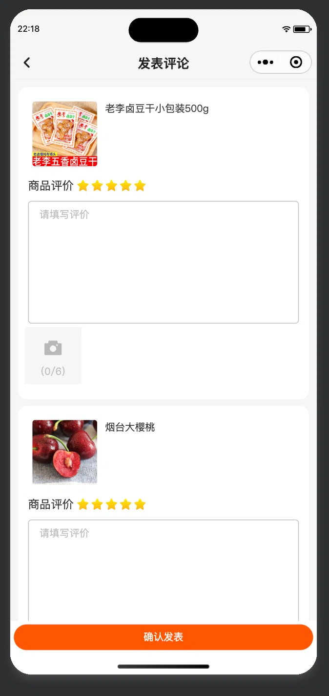

# 一单多品商品评价交互调研

> **调研问题**：一笔订单买了多个不同商品（多个 SKU）时，主流商城是怎么做商品评价的？悦航购现网「每个商品必须单独填写评价文字、整单一次性提交」是否反常？如果要改，应该怎么改？
>
> **调研日期（访问日期）**：2026-10-29
> **触发**：用户提供 C 端「发表评论」页截图（见 [附录 A](#附录-a用户截图与现网页面)）：一单两件商品，每件都要求星级 + 文字 + 最多 6 张图，全部填完才能提交。
> **环境限制（影响证据强度，请先读）**：本次会话内置 `web_search` 返回 401、AutoGLM 本地 token 服务 502、百度触发人机验证、六家平台的规则中心/学习中心均为 SPA 需登录执行 JS，因此公开可得的证据**规则层较硬、界面形态层较软**。界面形态类结论主要来自百度经验/3DM 等教程（D 级），已逐条标注；未做真机实测（见 §7 的实测清单）。
>
> **证据等级**（沿用 [2026-10-24 积分抵扣商品范围竞品调研](../2026-10-24-积分抵扣商品范围竞品调研/README.md) 口径）：
> **A** 官方原文已抓到正文 ｜ **B** 官方规则的第三方完整转载 / 官方社区、开放平台文档 ｜ **C** 权威媒体转述 ｜ **D** 教程/经验帖（版本可能过期） ｜ **E** 未找到。**D 级不作为规则依据**，只用于描述入口形态。
>
> **实施状态（2026-10-29，已落地）**：P0/P1/P2 除「评价奖励（积分）」外均已实现，并通过 uniapp type-check + 1458 用例、后端 `mvn test -pl aryn-boot -am` 全量、管理端 typecheck/eslint、双模式 SQL 静态校验。**本文件 §0–§7 保留调研时点结论与旧实现代码锚点（已过时）；当前实现范围、接口/字段、部署顺序与验证结果见 [§9 实施记录](#9-实施记录2026-10-29-已落地)**。真机/真实库联调尚未执行。

---

## 0. 结论先行（TL;DR）

1. **「一单多品、同页多卡」本身不反常**。淘宝的评价数据对象就是**子订单（≈商品行）**，多品订单天然对应多条评价；有赞也明确「一笔订单有多个商品可以分别评价」。我们真正反常的是三件事：
   - **每个商品都强制写文字**（前端 + 后端双重非空校验）；
   - **一次必须全评、不能跳过/分批/只评部分**（后端要求提交项集合等于订单项全集）；
   - **没有「一键五星 / 整单共用文案 / 快捷标签」等降摩擦手段**。
2. **行业通行做法是「星级必填、文字选填、整单快捷 + 逐品微调」**。淘宝开放平台文档写明商品评分**默认 5 分**、提供评价推荐词、图片最多 5 张；超时未评则系统默认好评。有赞/京东/淘宝都没有「必须给每件商品写一段文字」的产品要求。
3. **「默认评价」在行业里是低权重的**：淘宝超时默认好评**只计信用分，动态评分只计主动评价**；有赞默认评价**不对星级/商家服务/发货物流/宝贝描述打分**。而悦航购的自动评价恰好是**5 星 +「系统默认评价」全量入库**，会直接污染好评率——这是比交互更值得先修的问题（且现网实现还有 `spuId` 缺失缺陷，见 §1.3）。
4. **即时零售与综合电商存在形态差异，但都不支持「强制逐品写文字」**：叮咚买菜走「待评价列表 → 按商品『评价一下』」，且**配送与商品分开评**；盒马/山姆把评价做成「我的评价」聚合中心（已评/待评）；小象超市把入口放在「我的 → 五星好评」。公开资料未找到任何一家「逐品强制文字」的证据。
5. **建议分三期改**：
   - **P0（推荐立即做，0 DDL / 接口兼容，约 1–2 人日）**：文字改为选填 + 整单「全部五星 / 统一文案 / 分开评价」+ 服务端空文案兜底 + 修自动评价 `spuId` 与统计口径；
   - **P1（约 3–5 人日）**：支持**部分评价/稍后评**（订单级状态改为「全部评完才置已评价」，零 DDL 即可实现）+ 整单物流/服务维度（复用闲置字段）+ 匿名 + 评价窗口/默认评价分层（新增 `appraise_type` 等双模式增量 SQL）；
   - **P2**：追评、修改/删除、评价奖励（评价有礼/积分）、快捷标签、我的评价按订单聚合。

---

## 1. 现网核对（悦航购）

### 1.1 用户诉求（原话）

> 「这个评价，如果一单下了很多种类的货物，目前是一个商品一个商品进行评价，这个操作有点太反常了吧，你调研一下小象超市，盒马等这些主流商城是怎么做的」

截图（`screenshots/评价页现状-用户截图.webp`）：一单两件商品（老李卤豆干、烟台大樱桃），每件都有独立的「商品评价 ★★★★★ + 请填写评价 + 相册(0/6)」，底部一个「确认发表」。

### 1.2 现网链路（代码锚点，2026-10-29 核对，分支 `ship-chandler`）

| 环节 | 现网行为 | 代码锚点 |
|---|---|---|
| 入口 | 订单列表/详情「评价」按钮 → `order-appraise`（自定义导航「发表评论」） | `aryn-mall-uniapp/src/sub-pages/order/components/order-operation/index.vue:76` |
| 页面组装 | `getById(orderId)` 拉整单，**遍历全部 `orderItemList`** 一页渲染多张卡；每卡默认 5 星、空文案、最多 6 图 | `aryn-mall-uniapp/src/sub-pages/order/order-appraise/index.vue:42-65`、`:56`、`:126` |
| 提交校验 | **逐项校验 `item.content` 非空**，任一商品没写文字就 `toast` 阻断，无法提交 | 同文件 `:66-71` |
| 提交 | 一次 POST 全量数组到 `/mall-order/app/orderinfo/appraise/{orderId}` | 同文件 `:85-95`；`src/api/order/orderInfo.ts:48` |
| 后端校验 | 订单必须「已完成」且 `appraise_status='0'`；请求项集合必须**恰好等于订单全部订单项**（多一个/少一个都报「评价商品与订单不匹配」） | `aryn-order-biz/.../OrderAppraiseService.java:43-72`（全集校验 `:61-66`） |
| 落库 | 每个订单项插一条 `goods_appraise`；随后把订单 `appraise_status` 置 `'1'` | 同上 `:74-98` |
| DTO 约束 | `content` **@NotBlank**、≤255 字；`goodsScore` 必填 1–5；`picUrls` ≤6；**`logisticsScore` / `serviceScore` 已存在但前端从不采集** | `aryn-order-api/.../OrderAppraiseDTO.java:25/48/51/54-56` |
| 自动评价 | XXL-JOB 扫「已完成 + 未评价 + 收货时间早于 N 天」→ 每项写 5 星 + 「系统默认评价」 | `OrderAppraiseService.java:103-135`；`OrderJobHandler.java:137-158`；后台默认 N=1（`views/order/config/form.vue:37`） |
| 待评价计数 | 按订单 `appraise_status='0'` 统计（订单级，不是商品级） | `AppOrderInfoController.java:135-145` |

### 1.3 现网问题清单（按严重度）

| # | 问题 | 证据 | 后果 |
|---|---|---|---|
| **P0-1** | **每个商品强制写文字** | 前端 `order-appraise/index.vue:68`；后端 `OrderAppraiseDTO.java:54` `@NotBlank` | 一单 10 类商品就要写 10 段话；生鲜/日用等「没什么可写」的商品直接把用户卡死，评价完成率天然被压低 |
| **P0-2** | **没有任何降摩擦手段**：无一键五星、无整单文案、无快捷标签、无「复制到其他商品」 | 页面源码（同上，逐卡独立 textarea/upload） | 用户必须重复 10 次「点星 + 打字 + 传图」；与行业「默认 5 星 + 选填 + 推荐词」反向 |
| **P0-3** | **自动评价策略与行业相反**：5 星 +「系统默认评价」全量入库；且 `autoAppraiseOrder` **未设置 `spuId`**，而 `goods_appraise.spu_id` 是 `NOT NULL` | `OrderAppraiseService.java:116-126`；`db/boot/2aryn_boot.sql` 的 `goods_appraise` 表 `spu_id ... NOT NULL` | ① 代码静态核对：MyBatis-Plus 默认忽略 null 字段，INSERT 会缺 `spu_id` 列，预计报 1364 失败，任务每轮重扫（**需联调复现确认**）；② 即使插入成功，沉默用户也会变成 5 星好评，**直接抬高好评率**，与淘宝「默认好评不计动态评分」、有赞「默认评价不打分」相反 |
| **P0-4** | 评价窗口默认 1 天（`orderAutoCommentDays=1`） | `views/order/config/form.vue:37` | 用户次日未评即被系统「默认好评」；行业窗口为 15 天（淘宝/有赞）、60 天（京东首次评价） |
| **P1-1** | **不能跳过、不能分批、不能只评部分** | `OrderAppraiseService.java:61-66` 全集校验；订单级 `appraise_status` 一次性置位 `:90-98` | 想先评生鲜、过两天再评日用？做不到；漏评一件整单锁死 |
| **P1-2** | **评分只有商品一个维度**，物流/服务字段闲置 | `OrderAppraiseDTO.java:48/51`；`goods_appraise.logistics_score/service_score` 列已存在 | 商城拿不到履约质量反馈；而即时零售（叮咚）与美团系都把「商品/商家」与「配送/骑手」分开 |
| **P1-3** | 无匿名评价 | 页面/接口均无字段 | 用户不愿露脸/昵称时只能不评；有赞/淘宝/美团均有匿名 |
| **P2-1** | 无追评、无修改/删除、无评价奖励、无快捷标签、无「我的评价按订单聚合」 | 全链路检索无 | 评价资产运营能力缺失；行业标配（京东追评 180 天/京豆、有赞追评 30 天、淘宝评价有礼） |

> ⚠️ 自动评价缺陷的定性：`spuId` 缺失是**代码静态核对结论**（字段确实未赋值、列确实 NOT NULL），但尚未在本地库联调复现；`orderAutoCommentDays` 默认 1 是当前后台表单初始值，实际租户配置可能不同。两项都建议 P0 一并修掉。

---

## 2. 竞品证据

### 2.1 综合电商（规则层证据最硬）

#### 淘宝 / 天猫（A 级为主）

| 结论 | 内容 | 等级 |
|---|---|---|
| 评价入口 | 手淘「我的 → 待评价」（与 B2C 线上评价入口一致） | A |
| **评价时机绑整单** | 「若交易包含多件宝贝，需待整个订单的状态变成『交易成功』才可评价」 | A |
| **评价对象按子订单** | `taobao.traderate.add` 对单个子订单评价；`taobao.traderate.list.add` 对多子订单批量评价；`tmall.traderate.feeds.get` 按子订单查评价 | A |
| 时间窗 | 主评：交易成功后 15 天内；追评：180 天内；主评、追评各仅一次 | A |
| 修改/删除 | 好评发布后不可改删；中/差评 30 天内可改删；DSR 不可改；主评被删则追评入口关闭 | A |
| 默认好评 | 一方给好评、另一方 15 天未评 → 系统默认好评，**只计信用分，动态评分只计主动评价**；双方都不评则不产生评价 | A |
| 评价页组件 | 整体评分 + 分项 DSR：整体评分默认取分项平均值 / 分项默认 5 分且可改；有评价维度推荐词、字数激励语；图片最多 5 张（官方文档场景为「新零售家装」，通用实物订单文案本次未证实） | A（场景限定） |
| 评价有礼 | 商家配置条件，用户评价达标后领奖，不达标置灰 | A |
| 多品 UI 形态 | 未取得官方页面结构（SPA）；D 级教程提到「我的淘宝 → 待评价 → 找到多个订单商品 → 点击合并评价」，提示存在「合并评价」入口，**需真机核实** | D |

来源：淘宝开放平台《订单评价》<https://developer.alibaba.com/docs/doc.htm?treeId=1&articleId=119661&docType=1>；《评价有礼》<https://developer.alibaba.com/docs/doc.htm?treeId=737&articleId=120722&docType=1>；教程 <https://jingyan.baidu.com/article/67662997c4a34115d41b846f.html>（D）。

**解读**：「整单成功才开放评价 + 评价按子订单落库」是行业最常见的组合——**数据按商品、时机按订单**。「整单共用一段文字」不是数据层的默认行为，需要产品层显式设计「同步到其他商品」。

#### 京东（A 级）

| 结论 | 内容 | 等级 |
|---|---|---|
| 入口 | 我的订单 → 订单上的「评价」/「晒单」双按钮；App「我的 → 待评价」查未评价商品 | A |
| 时间窗 | **订单完成后 60 日内**首次评价/晒单；**90 日内**商品服务评价；**180 天内**追加评价 | A |
| 奖励 | 文字评价 ≥10 字：实付 20–100 元送 10 京豆、≥100 元送 20 京豆；晒图/晒视频同档；**物流服务评价单独送豆**（自营配送订单 ≥200 元送 10 豆）；新用户首评双倍、评价官双倍 | A |
| 治理 | 恶意评价/虚假评价会被屏蔽、折叠、删除、禁言；未审核通过 ≥5 条则一年内评价均不获豆 | A |
| 多品 UI 形态 / 批量评价 / 一键评价 | 未取得官方页面证据；检索到的「京东自动评价脚本」大量存在，反证逐个填写成本高 | E / C |

来源：京东帮助中心《评价晒单》<https://help.jd.com/nleft/question-759.html>；《如何给商品评价/晒单》<https://help.jd.com/user/issue/77-122.html>；《怎样查看评价晒单是否成功》<https://help.jd.com/user/issue/77-42.html>。

#### 拼多多 / 抖音商城 / 唯品会 / 苏宁（E 级为主）

- 拼多多：`rule.pinduoduo.com` 302 至商家首页、`mms.pinduoduo.com` 明确提示需 JS；消费者帮助中心为 SPA。**评价入口、合并/逐品、一键好评、默认好评天数一律未找到**；检索到的「一键好评」内容全部是「出评/好评返现」灰产，与官方功能无关。
- 抖音商城：`school.jinritemai.com` 各路径均为 28KB SPA 壳页，**未找到**可用规则。
- 唯品会帮助中心 <https://help.vip.com/> 可访问但未逐页取证；苏宁帮助中心 403。均**不做结论**。

### 2.2 SaaS 同类（对悦航购参考价值最高）

> 悦航购是「商户自营商城 SaaS」，不是淘宝式的多卖家平台；有赞/CRMEB 的商家可配置项和单据模型比平台电商更贴近。

#### 有赞（A 级）

| 结论 | 内容 |
|---|---|
| **一单多品可分别评价** | 官方帮助明确：「一笔订单有多个商品或服务**可以分别**对不同的服务或商品进行评价」——即有赞不强制「整单一段话」，而是按商品分别评价 |
| 评价窗口 | 默认交易成功后 **15 天**内可评价；商家可自定义 **15–90 天** |
| 默认评价 | 超时未评 → 系统默认评价，但**不对星级、商家服务、发货物流、宝贝描述打分**（即默认评价不计 DSR） |
| 追评 | 主动评价或默认评价后 **30 天内**可追评 |
| 修改/删除 | 主评/追评操作后 **30 天内**可各改删一次；默认评价不可改删 |
| 匿名 | 买家发布页有「匿名评价」选项，展示为灰色头像 + 匿名用户 |
| 评分维度 | 星级 + **商家服务 / 发货物流 / 宝贝描述**（DSR 三项） |
| 其他 | 评价置顶（单商品最多 5 条）、商家回复、评价会员标签、评价有礼 |

来源：<https://help.youzan.com/displaylist/detail_6_6-1-39839>（一单多品可分别评价）；<https://help.youzan.com/displaylist/detail_4_4-2-43212>（评价管理教程：窗口/追评/改删/匿名/默认评价）；<https://help.youzan.com/displaylist/detail_4_4-1-22001>（买家评价入口）。

#### CRMEB（B 级）

- 官方社区有「【pro】订单多个商品评价：评价规格展示混乱问题」的 issue（<https://www.crmeb.com/ask/thread/11261>），说明 CRMEB 的多品订单评价也是**按商品逐条**产生的，且曾因规格展示不清出过体验问题。可作为「多品按商品评价是 SaaS 主流模型」的旁证，但不可作为规则依据。

### 2.3 即时零售 / 生鲜（用户点名对象）

> ⚠️ 本节是本次调研证据最薄的部分：四家 App 的帮助中心均在 App 内 H5、不被搜索引擎收录，官网无评价规则页，小红书/知乎正文被反爬。**只对「入口链路」有可核验证据；「一键五星、图片上限、匿名、追评、超时、奖励、部分评价」均未找到**，不作推测性断言。

| App | 已核实内容 | 等级 | 来源 |
|---|---|---|---|
| **小象超市**（原美团买菜） | 存在「我的 → 五星好评」显性入口；该页是整单还是逐品**未找到**。从措辞看像「一次性给五星」的轻量动作，但无法确认是否等同「一键全部五星」 | D（入口）/ E（其余） | <https://jingyan.baidu.com/article/75ab0bcb6ab6c397874db24a.html> |
| **盒马** | 存在「我的 → 我的评价」聚合入口（查看）；另有二手 AI 内容站称「待评价 → 对已购商品**逐项**评分并文字反馈」，可信度低，仅作线索 | D / 低可信 | <https://jingyan.baidu.com/article/335530da2818eb58cb41c3c8.html>；<https://www.php.cn/faq/2369928.html> |
| **叮咚买菜** | **我的 → 查看全部订单 → 待评价 → 找到需要评价的商品 → 点「评价一下」→ 对配送和商品进行评价 → 提交**。即「待评价列表 + 逐品进入」，且**配送与商品双维** | D（两家教程一致，可信度相对高） | <https://jingyan.baidu.com/article/00a07f3853ad2ec3d128dc76.html>；<https://shouyou.3dmgame.com/gl/285122.html> |
| **朴朴超市** | 未找到任何订单评价流程描述（检索命中全是招聘点评/门店点评/拉新投诉） | E | — |
| **山姆会员店** | 「我的 → 我的评价 → 已评价/待评价」分区；确认支持带图评价（2025-12 媒体报道 App 评论区图片被自动美颜、平台回应为测试功能） | D（入口）/ C（图评） | <https://jingyan.baidu.com/article/3052f5a14bb382d6f21f8647.html>；<https://news.zol.com.cn/1105/11052571.html> |
| **美团外卖 / 大众点评**（对比） | 美团网平台点评规则：商户星级与评分 = 整体满意度 + 按品类的口味/效果/环境/服务等分项；2025-10-20 起外卖评分改为「复购率 + 餐品质量 + 食品安全」多维综合评分（媒体转述） | A（点评规则）/ C（新评分） | <https://portal-portm.meituan.com/webpc/protocolmanage/comment/judge>；<https://www.thepaper.cn/newsDetail_forward_31791278> |

**解读**：
- 「一个商品一个商品地评价」在即时零售里**并不算异类**（叮咚就是待评价列表 → 逐品进入），所以用户感知的「反常」主要不在入口形态；
- 但**没有一家被证实要求逐品写文字**；叮咚对配送和商品分别评分，说明履约反馈被单独采集；
- 小象/盒马/山姆都把评价做成可持续回看的资产（聚合入口 / 已评待评分区），而不是一次性弹窗。

### 2.4 横向对比表

| 平台 | 评价入口 | 评价粒度（数据） | 多品交互形态 | 文字是否必填 | 一键/默认 | 评分维度 | 窗口 / 默认评价 | 匿名/追评 | 奖励 | 证据 |
|---|---|---|---|---|---|---|---|---|---|---|
| 淘宝/天猫 | 我的-待评价 | **子订单** | 未证实（有「合并评价」线索） | **否**（默认 5 分可提交） | 商品评分默认 5 分 | 商品评分 + 分项 DSR | 15 天 / 默认好评不计 DSR | 有 / 180 天 | 评价有礼 | A |
| 京东 | 订单评价/晒单；我的-待评价 | 商品 | 未证实 | 未证实（文字 ≥10 字才送豆，暗示可选） | 未证实 | 商品 + 物流服务评价 | 60 天（首评）/ 90 天（服务）/ 180 天（追评） | 未证实 / 有追评 | 京豆 | A |
| 拼多多 | — | — | — | — | — | — | — | — | — | E |
| 抖音商城 | — | — | — | — | — | — | — | — | — | E |
| 有赞（SaaS） | 会员主页-我的订单-评价 | **按商品分别评价** | 未证实（商家可配） | 否（默认评价不打分） | 有默认评价 | 星级 + 商家服务/发货物流/宝贝描述 | 15 天（可配 15–90）/ 超时默认评价不计分 | 有 / 30 天 | 评价有礼 | A |
| 叮咚买菜 | 我的-待评价 | 商品 | **逐品进入** | 未见强制 | 未见 | **商品 + 配送** | 未找到 | 未找到 | 未找到 | D |
| 盒马 | 我的-我的评价 | 未证实 | 未证实（低可信源称逐项） | 未找到 | 未找到 | 未找到 | 未找到 | 未找到 | 未找到 | D/E |
| 小象超市 | 我的-五星好评 | 未证实 | 未证实 | 未找到 | 入口即「五星好评」（存疑） | 未找到 | 未找到 | 未找到 | 未找到 | D/E |
| 山姆 | 我的-我的评价 | 未证实 | 已评/待评分区 | 未找到 | 未找到 | 未找到 | 未找到 | 未找到 | 未找到 | D |
| 美团外卖 | 订单-评价 | 订单/商户 | 整单（餐饮） | 未找到 | 默认好评（内测报道） | 商户多维 + 骑手 | 未找到 | 未找到 | 未找到 | A/C |
| **悦航购现网** | 订单-评价 | **订单项** | **一页多卡（整单）** | **是（前后端双重）** | **无** | **仅商品** | **默认 1 天 / 5 星默认评价** | **无** | **无** | 代码核对 |

> 表格读法：A 级格子集中在「规则事实」，D/E 级集中在「界面形态」——这不是遗漏，而是公开互联网上真实的可获取性。任何把 D/E 格子填满的报告，大概率在编造。

---

## 3. 行业规律（设计启示）

1. **评价成本决定评价率，平台都在做减法**：默认 5 分、推荐词、字数激励语、默认好评、整单批量接口——没有一家头部平台反向要求「每件商品必须手写文字」。在本次调研范围内，悦航购现网是唯一被证实的「逐品强制文字」案例。
2. **数据按商品、交互按订单**：淘宝/有赞的数据模型都是商品行一条评价，但产品层提供「整单一次操作」的快捷方式（默认满分、批量接口、合并评价）。**「一单多品同页」不是问题，问题是没有整单快捷层**。
3. **时机与粒度可以解耦**：淘宝把「整单交易成功」作为评价开放条件、把「子订单」作为评价对象。悦航购可以保留「订单完成后才可评」，同时允许「逐件评、分批评、跳过」——这不需要改订单状态机，只需把 `appraise_status` 的置位条件从「任意提交」改为「全部订单项已评」。
4. **默认评价必须与主动评价分层**：淘宝默认好评只计信用分、不计 DSR；有赞默认评价不打分。否则沉默用户会被系统「代表」成好评，评级失真、商家也失去改进信号。悦航购的「5 星 + 系统默认评价」应当改掉。
5. **商品分与履约分分离是趋势**：叮咚「配送 + 商品」双维、美团外卖「商家 + 骑手」、美团 2025 年起把复购率/餐品质量/食品安全纳入评分。悦航购表里已有 `logistics_score/service_score` 闲置字段，应低成本启用。
6. **激励与治理配套**：京东京豆、淘宝/有赞评价有礼都是「商家/平台预算换 UGC」；同时需要差评申诉、恶意评价治理规则（美团点评诚信管理总则）。悦航购已有商家回复与差评统计，激励可后置。

---

## 4. 差距清单（现状 vs 行业）

| 优先级 | 差距 | 现状 | 行业基准 | 建议动作 |
|---|---|---|---|---|
| **P0** | 文字必填 | 前端 `:68` + 后端 `@NotBlank` | 淘宝默认 5 分可提交、有赞默认评价不打分、京东文字 ≥10 字仅影响奖励 | 文字改**选填**；服务端对空内容写统一默认文案（保住 `content NOT NULL`） |
| **P0** | 无整单快捷 | 逐卡独立操作 | 淘宝默认 5 分 / 推荐词；有赞分别评价；京东待评价列表 | 页头加「全部五星 + 统一文案 + 图片（可选）」；逐卡可展开「单独评价」覆盖 |
| **P0** | 自动评价污染评分 | 5 星 +「系统默认评价」全量入库；`spuId` 未赋值 | 默认好评不计 DSR（淘宝/有赞） | 修 `spuId`；默认评价**不计 5 星**；统计口径排除默认评价；默认窗口 1 天 → 15 天 |
| **P1** | 不能部分/跳过/稍后评 | 提交集合必须等于全集 | 淘宝按子订单可分别评；有赞可分别评 | 后端允许子集提交；`appraise_status` 改为「全部订单项已评」才置 YES；已评项幂等忽略 |
| **P1** | 无履约维度 | 只有商品星级；物流/服务字段闲置 | 叮咚配送+商品；美团商家/骑手 | 整单采集「物流/服务」两项，写入现有 `logistics_score/service_score`（无需 DDL） |
| **P1** | 无匿名 | 无字段 | 有赞/淘宝/美团均支持 | 新增 `is_anonymous`（双模式增量 SQL），展示灰色头像 + 匿名用户 |
| **P1** | 评价窗口/默认评价口径 | 默认 1 天自动 5 星 | 淘宝 15 天、有赞 15–90 天可配、京东 60 天 | 后台默认改 15 天（可配）；超时只「关闭评价 + 系统默认评价（不打分）」，不写 5 星 |
| **P2** | 追评/改删 | 无 | 淘宝追评 180 天、有赞 30 天；中差评 30 天可改删 | 新增追评（子表或字段）+ 改删窗口；商家回复已有 |
| **P2** | 评价激励 | 无 | 京东京豆、淘宝/有赞评价有礼 | 复用积分体系新增「评价奖励」场景（需产品/财务确认） |
| **P2** | 快捷标签/我的评价聚合 | 无标签；我的评价按条平铺 | 淘宝推荐词；山姆/盒马已评待评分区 | 标签按品类配置；我的评价按订单/商品双视图 |

---

## 5. 推荐方案

### 5.1 目标 / 非目标

**目标**
- 一单 N 件商品，**最少 2 次点击**（全部五星 → 确认发表）即可完成评价；
- 想认真写的商品仍可**单独展开**写文字/传图，且不强制；
- 默认评价不再污染评分；评价窗口与行业对齐；
- 为 P1「部分评价 + 履约维度 + 匿名」留好接口与数据位。

**非目标（本期不做）**
- 评价有礼/积分返现（P2，涉及财务与风控）；
- 跨店铺/多卖家拆单（悦航购为单商户 SaaS，目前无平台拆单场景）；
- 评价内容 AI 审核、图片美颜检测等治理能力。

### 5.2 方案对比

| 方案 | 内容 | 效果 | 成本 | 风险 | 结论 |
|---|---|---|---|---|---|
| A 最小改动 | 仅前端加「全部五星 + 统一文案」，后端放开 `content` 必填 | 解决 70% 摩擦 | 1–2 人日 | 自动评价污染仍在 | 可作为 P0 单独上线 |
| **B 推荐（A + P1）** | 减摩擦 + 部分评价 + 履约维度 + 匿名 + 默认评价分层 | 对齐行业主流 | 4–7 人日（含双模式 SQL） | 订单状态语义变化需回归 | **建议分两期落地** |
| C 保持现状 | — | 用户继续抱怨、评价率低、好评率失真 | 0 | 数据质量持续恶化 | 不推荐 |

### 5.3 交互规格（P0 线框）

```text
┌ 发表评价 ────────────────────────────────┐
│  这单还满意吗？   ★★★★★        [全部五星] │   ← 整单区：默认 5 星；点「全部五星」覆盖所有商品
│  ┌────────────────────────────────────┐  │
│  │ 统一说两句（选填，将同步到全部商品）    │  │   ← 一段话 + 图片（0/6，可选）
│  │ __________________________________ │  │
│  │ [图片]  □ 我想分开评价                 │  │
│  └────────────────────────────────────┘  │
│  商品 1  图  名称/规格        ★★★★★  [单独评价 ▾] │
│  商品 2  图  名称/规格        ★★★★★  [单独评价 ▾] │
│  商品 3  图  名称/规格        ★★★★★  [单独评价 ▾] │
│                                           │
│              [ 确认发表 ]                  │
└───────────────────────────────────────────┘
```

规则：
1. **星级默认 5 星、可改**；只提交星级也允许（文字/图片全部选填）。
2. 「全部五星」一键把所有商品星级置 5；用户已单独改过的商品**不覆盖**（或二次确认，产品定）。
3. 「统一说两句」+ 图片默认应用到**所有未单独填写的商品**；展开「单独评价」的商品以单独内容为准。
4. 提交时前端把统一文案回填到空商品；后端再兜底（空则写「此用户未填写评价内容」），保证 `content NOT NULL` 不触发。
5. 「我想分开评价」勾选后，统一文案区隐藏，逐卡展开（满足认真用户）。
6. 失败提示定位到具体商品卡（滚动 + 高亮），不要只 toast「请填写评价」。
7. P1 追加：整单区加「配送/服务」两行星级；页头加「匿名评价」开关；支持只提交部分商品。

### 5.4 接口与数据变更

#### P0（0 DDL，接口向后兼容）

| 端 | 文件 | 变更 |
|---|---|---|
| 移动端 | `sub-pages/order/order-appraise/index.vue` | 新增整单区（全部五星/统一文案/统一图片/分开评价开关）；逐卡文字/图片折叠为「单独评价」；提交前回填空文案；错误定位到卡片；i18n 文案（`order.zh-CN/en-US.ts` 的 `appraise` 域） |
| 后端 | `OrderAppraiseDTO.java` | `content` 去掉 `@NotBlank`，仅保留 `@Size(max=255)`；允许 null/空白 |
| 后端 | `OrderAppraiseService.java` | 落库前 `content` 空则填默认文案；保持「全量覆盖」不变（P0） |
| 后端 | `OrderAppraiseService.java:autoAppraiseOrder` | **补 `spuId`**（从 `orderItem.getSpuId()`）；默认评价不写 5 星（`goodsScore=null`） |
| 后端 | `GoodsAppraiseMapper.xml` | 好评率/评价数统计口径排除默认评价（先用 `goods_score IS NOT NULL` 兜底；P1 再加 `appraise_type` 精确标记） |
| 管理端 | `views/order/config/form.vue` | 默认 `orderAutoCommentDays` 1 → 15；字段文案改为「评价有效期（天），超时自动关闭评价」 |
| 双模式 | 无 DB/配置变更 | boot/cloud 均无路径/配置差异；前端沿用 `rewriteBootUrl` |

**兼容性**：老版本小程序仍逐品传 `content`（非空），新后端照常接受；旧客户端不会触发「部分评价」，语义不变。

#### P1（1 份增量 SQL，双模式各一份）

| 变更 | 说明 |
|---|---|
| `goods_appraise` 新增 `appraise_type` tinyint default 0 | 0=用户主动评价，1=系统默认评价；统计/展示/管理端筛选按此区分 |
| `goods_appraise` 新增 `is_anonymous` tinyint default 0 | 匿名展示（灰色头像 + 匿名用户），后台仍可追溯 |
| 订单 `appraise_status` 语义调整 | 提交子集时保持 `'0'`；仅当**全部订单项都有有效评价**才置 `'1'`；`count` 接口不变 |
| 部分评价幂等 | 提交前查询已评订单项，已评项忽略/报「该商品已评价」，避免撞 `uk_goods_appraise_active_item` |
| 配送/服务评分 | 复用 `logistics_score/service_score`：整单区采集，写到每条商品评价（或首条 + 汇总表，二选一，建议写每条便于后台按商品导出） |
| 后台配置 | 评价有效期可配（已有 `orderAutoCommentDays`）；超时行为从「自动 5 星」改为「关闭评价 + 系统默认评价（不打分）」 |
| 双模式 SQL | `db/boot/` 与 `db/cloud/` 各新增编号增量脚本（可重复执行、不 DROP 存量），登记 `db/boot/build-full-sql.mjs` 的 `sections` 并重新生成 `aryn_boot_full.sql`，`verify-full-sql.mjs` 校验 |

### 5.5 统计与数据口径

- **好评率** = `goods_score >= 4` 的**主动评价**数 / 主动评价总数（默认评价不进分子也不进分母）；
- **评价数** 展示口径需区分「全部评价数」与「主动评价数」，避免默认评价把商详评价区刷成 5 星但文不对题；
- 管理端「商品评价」列表加「评价方式（用户/默认）」筛选（有赞同款），默认评价不可回复/不可置顶；
- 历史数据迁移：存量「系统默认评价」可先按 `content='系统默认评价'` 回填 `appraise_type=1`（幂等 UPDATE），新数据按新逻辑写入。

### 5.6 风险与回滚

| 风险 | 处置 |
|---|---|
| 默认评价不计分后，部分商品好评率/评价数会下降 | 上线前出运营口径通知；商详文案区分「N 条评价（含系统默认）」 |
| 部分评价后订单长期停留「待评价」 | 已有 XXL-JOB 超时兜底（默认 15 天后系统默认评价）；后台可配 |
| 统一文案 + 单独文案的覆盖关系不清晰 | 交互上明确「单独评价展开后以单独内容为准」；提交前二次确认 |
| 匿名评价与商家回复/风控冲突 | 后台保留 userId，前台脱敏；商家回复仍可回复 |
| 双模式 SQL 漏一份 | 按 AGENTS.md 强制：boot/cloud 双份 + full sql 重新生成 + `verify-full-sql.mjs` |

---

## 6. 验收清单

### 6.1 功能（P0）

1. 一单 3 件商品：进入页面默认全 5 星、无文字 → 点「全部五星」→「确认发表」→ 成功；`goods_appraise` 3 条、`content` 为默认文案、`goods_score=5`。
2. 一单 3 件 + 只写统一文案 → 3 条评价 content 均为该文案（前端回填 + 后端兜底）。
3. 展开商品 2「单独评价」写文案 + 传图 → 商品 2 用单独内容，商品 1/3 用统一文案。
4. 后端直接构造空 content 请求（老客户端异常）→ 不报 400，落默认文案。
5. 自动评价：构造「已完成 + 未评价 + 超期」订单 → `spu_id` 正确、`goods_score` 为空/默认标记、商详好评率不被抬高；任务可重复执行不重复插入。
6. 管理端订单配置默认 15 天，保存/回显正确。

### 6.2 功能（P1）

7. 只提交商品 1 → 成功；订单仍为「待评价」；商品 2/3 可再提交；全部评完后订单变「已评价」。
8. 重复提交商品 1 → 幂等提示，不产生重复评价、不报 500。
9. 整单填物流/服务分 → 每条 `goods_appraise.logistics_score/service_score` 有值；商详/后台可查。
10. 勾选匿名 → 商详展示灰色头像 +「匿名用户」；后台可查真实用户。
11. 超时默认评价不进好评率分子/分母；管理端可按「评价方式」筛选。

### 6.3 自动化与联调

```bash
# 移动端
cd aryn-mall-uniapp && pnpm type-check && pnpm test:unit
# 后端
cd aryn-mall-java && mvn test -pl aryn-boot -am
# 双模式路径
# VITE_OPEN_BOOT=true / false 下确认 /mall-order/app/orderinfo/appraise/{id} 改写正确
# SQL
node db/boot/build-full-sql.mjs && node db/boot/verify-full-sql.mjs
```

---

## 7. 证据缺口与下一步

### 7.1 本次未证实（不要当作结论）

- 小象超市、盒马、朴朴、拼多多、抖音商城：**多品评价页的具体形态**（合并页/逐品页、一键五星、文字是否必填、图片上限、匿名、追评、默认好评天数）——公开渠道穷举后仍为 E 级；
- 淘宝/京东/有赞：**多品评价页的界面形态**（是否一页多卡、是否有「分开评价」开关）——只有规则层 A 级证据；
- 现网自动评价 `spuId` 缺失导致的插入失败，**代码静态核对确认，未联调复现**；
- 用户截图对应的 App 版本、入口路径（订单列表 or 订单详情）未核对。

### 7.2 建议真机补证（半天可完成，每 App 5–10 分钟）

| 待验证 | 操作 | 观察点 |
|---|---|---|
| 整单 vs 逐品 | 下一单 ≥5 个 SKU，完成后进「待评价」 | 一页长列表还是逐品进入；有无「全部五星」 |
| 默认星级 | 进入评价页不操作 | 是否默认选中 5 星（诱导好评关键证据） |
| 文案复用 | 只写一处文案后提交 | 是否提示「应用到全部商品」 |
| 部分评价 | 只评 1 件后退出 | 剩余商品是否仍在待评价 |
| 维度 | 评价页首屏 | 是否有配送/骑手/包装/服务态度 |
| 匿名/追评/奖励 | 已发布评价详情页 | 是否有匿名标记、追评、积分提示 |
| 超时 | 留一笔不评，观察 7/15/30 天 | 何时自动好评、是否显示「系统默认好评」 |
| 拆单 | 盒马鲜生 + 盒马 NB / 山姆极速达 + 全城配 | 1 条还是 N 条待评价 |

---

## 8. 来源清单

### A 级（官方原文可读）

| # | 来源 | URL | 用途 |
|---|---|---|---|
| 1 | 淘宝开放平台《订单评价》 | <https://developer.alibaba.com/docs/doc.htm?treeId=1&articleId=119661&docType=1> | 15/180 天、改删、默认好评、整单时机、子订单粒度 |
| 2 | 淘宝开放平台《评价有礼》 | <https://developer.alibaba.com/docs/doc.htm?treeId=737&articleId=120722&docType=1> | 整体+分项 DSR、默认 5 分、推荐词、图片 5 张、评价有礼 |
| 3 | 京东帮助《评价晒单》 | <https://help.jd.com/nleft/question-759.html> | 60/90/180 天窗口、京豆规则、物流服务评价 |
| 4 | 京东帮助《如何给商品评价/晒单》 | <https://help.jd.com/user/issue/77-122.html> | 评价/晒单入口 |
| 5 | 京东帮助《怎样查看评价晒单是否成功》 | <https://help.jd.com/user/issue/77-42.html> | App 我的-待评价 |
| 6 | 有赞帮助《评价管理使用教程》 | <https://help.youzan.com/displaylist/detail_4_4-2-43212> | 15 天窗口/可配 15–90、默认评价不打分、匿名、追评、改删、DSR |
| 7 | 有赞帮助《一单多品可分别评价》 | <https://help.youzan.com/displaylist/detail_6_6-1-39839> | 多商品分别评价 |
| 8 | 有赞帮助《买家如何评价》 | <https://help.youzan.com/displaylist/detail_4_4-1-22001> | 买家评价入口 |
| 9 | 美团网平台点评规则 | <https://portal-portm.meituan.com/webpc/protocolmanage/comment/judge> | 商户星级 + 品类分项 |
| 10 | 美团规则中心《大众点评商户评价诚信管理总则》 | <https://rules-center.meituan.com/m/detail/guize/191?activeRule=1> | 评价治理规则 |

### B / C 级

| # | 来源 | 类型 | 用途 |
|---|---|---|---|
| 11 | 电商派《淘宝网调整评价规范 12月28日生效》<https://www.pai.com.cn/170710.html> | B（转载官方规则） | 评价规范变更要点 |
| 12 | 澎湃《美团外卖实施新评分规则》<https://www.thepaper.cn/newsDetail_forward_31791278> | C（权威媒体） | 2025-10-20 多维综合评分（复购率/餐品质量/食品安全） |
| 13 | CRMEB 社区《订单多个商品评价：评价规格展示混乱问题》<https://www.crmeb.com/ask/thread/11261> | B（官方社区） | SaaS 多品按商品评价旁证 |
| 14 | 山姆图片评价报道 <https://news.zol.com.cn/1105/11052571.html> | C（科技媒体） | 山姆支持图评 |

### D 级（教程/经验帖，仅描述入口形态，版本可能过期）

| # | 来源 | 用途 |
|---|---|---|
| 15 | <https://jingyan.baidu.com/article/75ab0bcb6ab6c397874db24a.html> | 小象超市「我的 → 五星好评」入口 |
| 16 | <https://jingyan.baidu.com/article/335530da2818eb58cb41c3c8.html> | 盒马「我的 → 我的评价」 |
| 17 | <https://jingyan.baidu.com/article/00a07f3853ad2ec3d128dc76.html>；<https://shouyou.3dmgame.com/gl/285122.html> | 叮咚「待评价 → 按商品评价 → 配送+商品」 |
| 18 | <https://jingyan.baidu.com/article/3052f5a14bb382d6f21f8647.html> | 山姆「我的评价」已评/待评 |
| 19 | <https://jingyan.baidu.com/article/67662997c4a34115d41b846f.html> | 淘宝「合并评价」线索（需实测） |
| 20 | <https://www.php.cn/faq/2369928.html> | 盒马「逐项评分」线索（AI 内容站，低可信，仅线索） |

> 注：本次未能取得任何 App 内截图（小红书/知乎正文被反爬、App 未登录）；所有「界面形态」描述均来自教程文字，**不作为最终结论**，以 §7.2 真机实测为准。

---

## 附录 A：用户截图与现网页面



> 截图内容：一单两件商品（老李卤豆干小包装 500g、烟台大樱桃），每件独立星级 +「请填写评价」+ 相册（0/6），底部「确认发表」。对应代码：`aryn-mall-uniapp/src/sub-pages/order/order-appraise/index.vue`。

## 附录 B：现网关键代码摘录

```ts
// order-appraise/index.vue:66-71 —— 任一商品没写文字即阻断提交
async function onsubmit() {
  for (const item of state.list) {
    if (!item.content) {
      error(t('order.appraise.required'))
      return
    }
  }
```

```java
// OrderAppraiseService.java:61-66 —— 请求项必须覆盖订单全部项（不能跳过/部分）
Set<String> requestedItemIds = orderAppraiseList.stream()
    .map(OrderAppraiseDTO::getOrderItemId)
    .filter(Objects::nonNull)
    .collect(Collectors.toSet());
if (requestedItemIds.size() != orderAppraiseList.size()
        || !requestedItemIds.equals(orderItemMap.keySet())) {
    throw new ArynBusinessException("评价商品与订单不匹配");
}
```

```java
// OrderAppraiseService.java:116-126 —— 自动评价：5 星 +「系统默认评价」，且未设置 spuId
List<GoodsAppraise> goodsAppraiseList = orderItemEntityList.stream().map(v -> {
    GoodsAppraise goodsAppraise = new GoodsAppraise();
    goodsAppraise.setUserId(orderInfo.getUserId());
    ...
    goodsAppraise.setGoodsScore(5);
    goodsAppraise.setOrderId(orderInfo.getId());
    goodsAppraise.setOrderItemId(v.getId());
    goodsAppraise.setContent("系统默认评价");
    return goodsAppraise;
}).collect(Collectors.toList());
```

---

## 9. 实施记录（2026-10-29 已落地）

> 本节描述**当前代码状态**，与 §1/附录 B 的旧实现锚点不同；§1 仅保留作调研起点。

### 9.1 交付范围（对应 §4 差距清单）

| 优先级 | 内容 | 状态 |
|---|---|---|
| P0 | 文字改选填（空内容服务端兜底「此用户未填写评价内容」）；整单「全部五星 / 统一文案 / 统一晒图 / 分开评价」；逐品默认 5 星 + 单独评价；无「逐品必填」阻断 | ✅ |
| P0 | 自动评价：补 `spuId`、`appraise_type=1`、匿名、**不打分（goodsScore=null）**、文案「系统默认好评」；Job 配置缺失默认 15 天；C 端统计/列表排除默认评价 | ✅ |
| P0 | 管理端订单配置默认评价有效期 15 天 + 文案说明；评价列表可筛选系统默认评价 | ✅ |
| P1 | 子集/部分评价：订单 `appraise_status` 改为「全部订单项评完才置 1」，可稍后评；已评项幂等跳过 | ✅ |
| P1 | 整单物流/服务评分（复用 `logistics_score/service_score`）；匿名评价（`is_anonymous` + C 端脱敏） | ✅ |
| P1 | 评价窗口/默认评价分层（见 P0 自动评价）；存量默认评价脚本回填 `appraise_type=1` | ✅ |
| P2 | 追评（30 天、一次）、修改（30 天、一次）、删除（30 天、逻辑删除、订单状态回落）；快捷标签（≤5 个/单个≤10 字）；「我的评价」补商品图名/标签/匿名与追评展示；商详/评价列表展示标签、匿名、追评、未评分兜底 | ✅ |
| P2 | 评价奖励（积分/评价有礼） | ⏸ 未做（涉及积分发放场景、运营配置与财务口径，需单独评审，见 §9.8） |

### 9.2 接口与数据（最终契约）

| 能力 | 接口 / 字段 |
|---|---|
| 主评（支持子集） | `POST /mall-order/app/orderinfo/appraise/{orderId}`，数组元素：`orderItemId`、`goodsScore`(1–5 必填)、`content`(选填≤255)、`picUrls`(≤6)、`tags`(≤5/项≤10 字)、`logsisticsScore`→`logisticsScore`/`serviceScore`(1–5)、`isAnonymous`(boolean) |
| 追评 | `POST /mall-order/app/orderinfo/appraise/{orderId}/advance`，body `{orderItemId, content?, picUrls?}` |
| 修改 | `PUT /mall-order/app/orderinfo/appraise/{orderId}/item/{orderItemId}`，body `{content?, picUrls?, goodsScore?}`（整体覆盖；`picUrls: []` 可清空图片；空文字落默认文案） |
| 删除 | `DELETE /mall-order/app/orderinfo/appraise/{orderId}/item/{orderItemId}`（逻辑删除；订单回落待评价） |
| 我的评价 / 已评索引 | `GET /product/app/goodsappraise/user-page?orderId=`（返回 `spuName/spuUrls` + `appraiseType/isAnonymous/tags/advance*/modifyTime`） |
| 商详评价 | `/page` 强制 `appraise_type=0` 并匿名脱敏；`/count` 排除系统默认评价；`goodsScore` 可能为 null |
| 数据列 | `goods_appraise` 新增 `appraise_type`、`is_anonymous`、`tags`、`advance_content`、`advance_pic_urls`、`advance_time`、`modify_time` |

### 9.3 代码落点

- 后端：`OrderAppraiseDTO/OrderAdvanceAppraiseDTO/OrderAppraiseEditDTO`、`OrderAppraiseService`（子集/兜底/追评改删/自动评价）、`AppOrderInfoController`、`GoodsAppraise`、`RemoteGoodsAppraiseService(+Impl)`、`AppGoodsAppraiseController`、`GoodsAppraiseMapper.xml`、`OrderJobHandler`；SQL：boot `171appraise_enhancement_incremental.sql`、cloud `172appraise_enhancement_incremental.sql`。
- C 端：`sub-pages/order/order-appraise/index.vue` + `payload.ts`（提交载荷纯函数）、`sub-pages/user/appraise/index.vue` + `appraise-actions.ts`（追评/改删可见性）、`GoodsComment.vue`、`goods-appraise/index.vue`、`api/order/orderInfo.ts`、`locales/modules/{order,accountSettings,product}.{zh-CN,en-US}.ts`。
- 管理端：`views/product/appraise/index.vue`（评价方式筛选 + 类型/匿名/物流服务/标签/追评列）、`views/order/config/{form,index}.vue`（默认 15 天 + 文案）。
- 测试：`payload.test.ts`(24)、`appraise-actions.test.ts`(14)、`appraise.contract.test.ts`(8)、`OrderAppraiseServiceTest`(22)、`GoodsAppraiseMapperXmlTest`(4)、`AppGoodsAppraiseControllerTest`(2)、`CheckoutRequestValidationTest`(3)。

### 9.4 发布顺序与兼容

1. **先执行 SQL**（否则新字段查询报错）：boot 执行 `db/boot/171appraise_enhancement_incremental.sql`；cloud 执行 `db/cloud/172appraise_enhancement_incremental.sql`（脚本内切 `aryn_product`/`aryn_order`）。脚本幂等、可重复执行，会把存量 `content='系统默认评价'` 的行回填为 `appraise_type=1`。
2. 部署后端 → 管理端 → 小程序。
3. 存量租户：把后台「评价有效期」从 1 天手动改为 15 天（新表单默认 15，已有配置值不会被代码覆盖）。
4. 兼容：旧小程序仍逐品提交非空 content，新后端照常接受（`content` 必填校验已放开）；旧客户端不会触发子集/追评/改删/匿名等新能力。回滚代码时新增列保留即可，旧代码忽略；默认评价新口径需要回滚 SQL 才能恢复旧统计（不建议，保留新口径更正确）。

### 9.5 验证结果

| 验证 | 命令 | 结果 |
|---|---|---|
| C 端类型 | `cd aryn-mall-uniapp && pnpm type-check` | exit 0 |
| C 端单测 | `cd aryn-mall-uniapp && pnpm test:unit` | **134 文件 / 1458 用例全绿** |
| 后端全量 | `cd aryn-mall-java && mvn test -pl aryn-boot -am` | **BUILD SUCCESS**；order-biz 575 / product-biz 133 等全通过 |
| 管理端类型 | `cd aryn-mall-ui && pnpm --filter @vben/web-ele run typecheck` | exit 0 |
| 管理端 lint | `pnpm exec eslint <3 个改动文件>` | 0 error |
| SQL | `node db/boot/build-full-sql.mjs && node db/boot/verify-full-sql.mjs` | 静态校验通过，25599 行 |

### 9.6 剩余风险与后续

- **未真机/真实库联调**：需按 §6 验收清单与 §7.2 真机清单执行（重点：部分提交后订单仍待评价、全部评完置已评价、匿名/系统默认展示、追评/改删 30 天窗口、多租户下统计口径）。
- **评价奖励（积分）未做**：涉及 `points_config` 场景扩展、后台配置与财务口径，建议单独需求包评审后再做。
- **存量评价有效期**：已有租户 `order_config.order_auto_comment_days=1` 不会被自动修改，需运营手动调整（或另出数据订正脚本）。
- `goods_appraise` 未加 `order_id` 索引（表小暂不影响；量大时补 `idx_goods_appraise_order`）。
- 并发重复提交同一订单项依赖唯一键兜底，极端并发下第二个请求可能报「订单评价失败」；后续可加分布式锁/幂等提示优化。
- 修改评价时清空文字仍落默认文案（`content NOT NULL`），本期不支持"清空展示"，已与前端确认。
