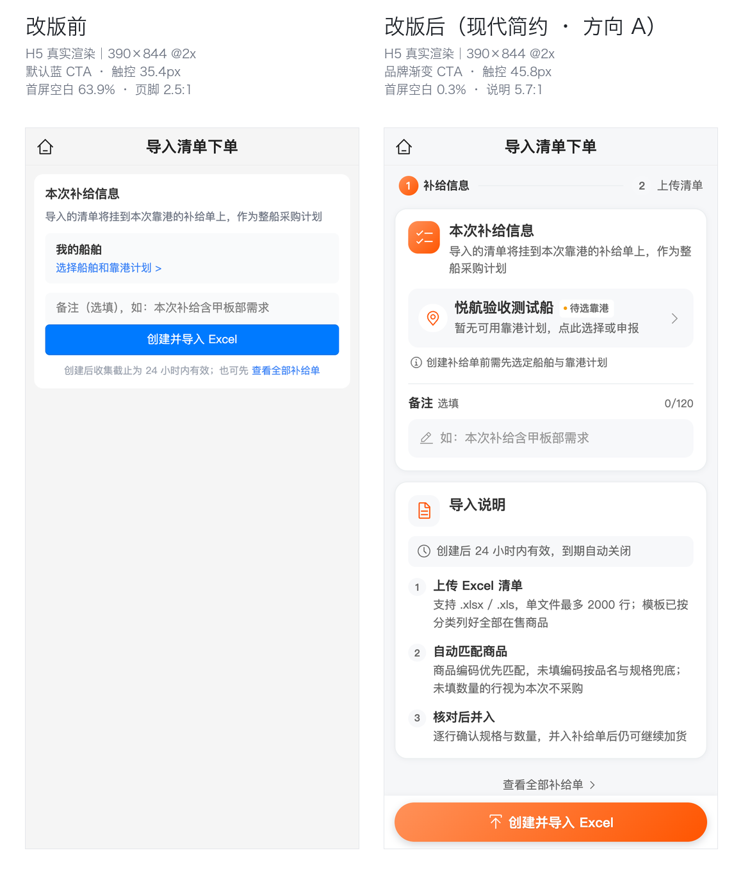

# 「导入清单下单」页视觉重构（C 端 · 方向 A 现代简约）

> 日期：2026-11-01 ｜ 范围：C 端移动端 `aryn-mall-uniapp` 的「导入清单下单」向导入口页（`sub-pages/order/shared-cart/import-entry.vue`）+ 中英文案
> 用户请求：给出小程序截图（`.dsh` 附件 `a072590f…c3319.jpg`，见 `screenshots/before-user-wechat.jpg`），要求「这个页面 UI/UX 重新设计一下，要主流现代」
> 设计方向：沿用 2026-11-01 已冻结的 **A. 现代简约 · 品牌色点缀**（同日「补给单卡片」「领券中心」两篇需求已按同一语言重构），保持全站一套视觉语言
> 状态：**实施完成**（页面 + 双语文案 + H5 前后实拍 + 双端质量门；终版文件 sha256 `ce35a004…`，见 §9）



---

## 〇、一页结论

| 项 | 结论 |
|----|------|
| **问题定性** | 不是「换个配色」：旧页把 5 个信息层级（标题/说明/船舶块/备注/CTA）全塞进**一张 250px 高的白卡**，卡片以下 63.9% 首屏是空白；主 CTA 用的是 **uni 默认蓝 `#007AFF`**（小程序端是微信默认绿），与租户品牌色 `#ff5500` 与全站橙红渐变 CTA 完全脱节；CTA 视觉高 **35.4px < 44px** 触控红线；页脚说明文字 **#9CA3AF on 白 = 2.5:1** 不可读；「选择船舶和靠港计划」是 17px 高的蓝色文字链，且**选完船/靠港后页面没有任何更换入口与状态反馈**。 |
| **重构主线** | 切到全站「白卡 + 发丝线 + 轻投影 + 中性灰 + 品牌色点状强调」：品牌色只出现在 ① 信息卡图标块 ② 主 CTA；其余全部中性灰（走 `--app-*` 语义变量，深色模式自动跟随）。信息架构从「一张卡堆 5 层」拆成 **步骤条 → 补给信息卡 → 导入说明卡 → 吸底 CTA**，首屏利用率从 36.1% 提升到 ~100%。 |
| **信息架构** | ① 两步流程条（补给信息 / 上传清单）② 本次补给信息卡（图标 + 标题 + 说明；船舶与靠港整行选择器；备注输入 + 计数 + 清除）③ 导入说明卡（24h 有效期提示 + 上传/匹配/核对三步）④ 吸底品牌渐变 CTA（88rpx 高 + 44px 触控兜底）+ 次级「查看全部补给单」 |
| **顺手修掉的可用性缺口** | ① 直接进入本页不再只读 store：先 `ensureShipContextLoaded()`，有船/有靠港的用户**自动带出**上下文，不再被要求重选（before：冷启动必空白）；② 船舶选择从文字链升级为整行热区（≥88rpx），带 **已选/待选靠港/待选择** 状态点与更换箭头；③ 主 CTA 从 35.4px/默认蓝改为 45.8px/品牌渐变 + 按压反馈；④ 页脚 2.5:1 说明文字改为 24–26rpx `--app-text-2`（5.7:1），信息提为独立说明卡；⑤ 补骨架屏、纯零售空态、备注清除与聚焦态。 |
| **数据原则** | 零后端 / 零接口 / 零 DB：仍只用 `getActiveSharedCartSummary` 与 `createSharedCart` 两个既有接口；船舶上下文复用 `useShipContextLoad`；有效期仍由服务端按创建时刻 +24h 决定（**前端不传 expiresAt**）；「已有进行中补给单 → 直接复用进导入」「同船期 adoptedExisting」两条既有契约逐字保留。说明卡文案与导入页真实规则同源，不新增「进度/已采」类无事实来源指标。 |
| **结果** | 见 §9：H5 五状态 before/after 同口径实拍，**35 项硬性红线全部通过、0 未达标**（CTA 触控 35.4/29 → **45.8/44px**；首屏空白 63.9%/69.3% → **0.3%/15.9%**；英文截断 1 → **0**；提示文字 2.5:1 → **5.4:1**；console 0 error；吸底栏遮挡 0px）；`pnpm build:mp-weixin` DONE、`pnpm test:unit` 1533 通过（唯一失败为工作树 `diy-tabnav` 既有未提交改动，与本页无关，见 §9.2）。 |
| **非目标** | 不改共享购物车/导入接口与数据结构；不改「有进行中购物车直接跳导入」的静默复用逻辑；不做进度条；不在本页做 Excel 解析（下一页）；不做暗色模式专项（沿用 `--app-*` 变量即可跟随）。 |

---

## 1. 背景与现状诊断

基线：重构前工作树 + H5 真实渲染（390×844 @2x，真实演示账号 13800009701，脚本 `outputs/import-entry-redesign/capture.mjs`）。产物：`outputs/import-entry-redesign/before/`（14 张截图）与 `metrics-s1..s5-before.json`。
> 注：目标文件在改动前已有用户未提交改动（`useFrostedNavbar` + `useRequireLogin`，模板未变），before 基线 = 该工作树内容（sha256 `bc3347f6…`，见 `baseline-before.json`）。

| # | 现状问题（用户可感知） | 证据（before 实测，390×844@2x） |
|---|--------------------------|----------------------------------|
| D1 | **首屏 63.9% 是空白**：全页只有一张 369.2×250.1 的白卡，内容底边 y=304.5 / 视口 844；320px 小屏更空（69.3%），英文 60.0% | `metrics-s1-before.json → firstScreen.blankRatioPct` |
| D2 | **主 CTA 与品牌/全站脱节**：`#007AFF` 默认蓝、radius 5px、font 13.52/400；小程序端是微信默认绿。全站其他主 CTA 都是 `secondary→primary` 橙红渐变（购物车/详情/列表同一套） | `metrics-s1-before.json → cta.bg = rgb(0,122,255)` |
| D3 | **触控目标不达标**：CTA 视觉 344.3×**35.4px**，上下 ±6/10/14/20px `elementFromPoint` 探测均未命中 → 无热区外扩，有效触控高 35.4px < 44px；320px 时仅 **29px**、字号 11.09px | `metrics-s1-before.json → cta.effectiveHeightPx` |
| D4 | **说明文字不可读**：页脚「创建后收集截止为 24 小时内有效…」`#9CA3AF on #FFF = 2.5:1`（<3:1），且字号 11.44px（320px 下 9.39px） | `metrics-s1-before.json → colors/contrast` |
| D5 | **船舶/靠港只有一条 124×17px 的蓝色文字链**，整块灰底不可点；选完之后**没有任何改变了哪些信息的反馈，也没有再更换的入口**（唯入口仍是那条小字链） | `metrics-s2-before.json`（S2 卡片高度与 S1 相同 250.1，无状态差异） |
| D6 | **信息层级平淡**：标题 14.56/700、说明 12.48、船名 13.52/700、提示 11.44，四层字重全挤在 250px 卡内；卡片无投影、圆角 10.4px，仍是「灰块 + 蓝按钮」的旧表单语言 | `metrics-s1-before.json → fonts` |
| D7 | **无流程感、无空态设计**：用户不知道「创建之后会发生什么」（下一步要传 Excel、最多 2000 行、匹配规则）；纯零售租户只得到一句 26rpx 灰字 | `dom-s1-before.html`、`unsupported` 分支 |
| D8 | **英文窄屏截断**：S4 下备注 placeholder 单行截断（scrollWidth 330 > clientWidth 319），卡片被撑到 283.1px | `metrics-s4-before.json` |

**结论**：旧页停留在「一张灰底表单卡 + 一个 uni 默认按钮」的旧语言，是船供补给链路里最不像「产品」的一页。本次按全站新语言整体重排，并修掉 D2–D5 四个可用性缺陷与 D1 的首屏浪费。

---

## 2. 设计方向（A · 现代简约 + 品牌色点状强调）

- **形**：白卡 `28rpx` 圆角 + `1rpx` 发丝线（`--app-border`）+ 双层轻投影；页面底 `--app-bg` 灰；卡片与页面之间有明确呼吸。不再使用「灰块套灰块 + 默认蓝按钮」。
- **色**：品牌色（主题变量）只给三处：信息卡图标块、步骤条当前步、主 CTA。其余全部中性灰；提示/说明/计数一律 `--app-text-2`（对白底 5.7:1），只有纯装饰图标用 `--app-text-3`。
- **层级**：① 流程条（我在第几步）② 信息卡（要填什么、当前选了什么、还能改）③ 说明卡（点了之后会发生什么）④ 固定 CTA（做什么）。
- **状态显性化**：船舶行用「状态点 + 文案」表达 `已选 / 待选靠港 / 待选择`（非仅靠颜色）；配送窗口在有数据时补一行，没数据不渲染假值。
- **反馈**：CTA 按压 `opacity .88`（150–200ms）、船舶行与次级入口 `hover-class` 按压底色、备注聚焦描边点亮 + 清除按钮、提交态降透明度并改文案「正在创建…」。
- **多租户**：品牌色全部走 `var(--wot-color-theme-*)`，中性色走 `--app-*`；换肤后本页自动跟随，不出现「红配蓝」。
- **小屏**：所有可点目标补 `min-height/min-width`（px）兜底，320px 下主 CTA 仍是 44px，次级入口 44px，备注清除 56rpx≈24px（WCAG 2.2 最小目标）。

---

## 3. 设计令牌（唯一来源：`import-entry.vue` 顶部 scoped SCSS + App.vue 语义变量）

> 换算：小程序屏宽恒 750rpx ⇒ 1rpx = 屏宽/750 px（390px 屏 ≈ 0.52px、320px 屏 ≈ 0.427px）。

| 令牌 | 值 | 用途 |
|------|-----|------|
| 页面底 | `var(--app-bg, #f6f7f9)` | 页面背景（深色自动切 #131313） |
| 卡片底 | `var(--app-card, #ffffff)` | 卡片 / 吸底栏 / 图标圆底 |
| 浅填充 | `var(--app-card-2, #f7f8fa)` | 船舶选择行、备注框、说明提示条、步骤号底 |
| 发丝线 | `var(--app-border, #ebeef0)` | 卡片描边、备注分隔线、步骤连线 |
| 主文字 | `var(--app-text, #333333)` | 卡片标题、船名、步骤当前项 |
| 次级文字 | `var(--app-text-2, #666666)` | 说明、副标题、标签、计数、提示 |
| 装饰图标 | `var(--app-text-3, #999999)` | 选择箭头、时钟/信息图标（不承载语义） |
| 品牌色 | `var(--wot-color-theme-primary, #ff4d2e)` | 图标块渐变终点、图标圆内 glyph、聚焦描边 |
| 品牌辅色 | `var(--wot-color-theme-secondary, #ff8a00)` | 图标块/CTA 渐变起点 |
| 主 CTA 渐变 | `linear-gradient(135deg, secondary, primary)` | 吸底「创建并导入 Excel」 |
| 卡片投影 | `0 2rpx 12rpx rgb(23 32 51 / 5%)` | 白卡浮起（吸底栏用向上 `0 -2rpx 12rpx rgb(0 0 0 / 4%)`） |
| 圆角 | 卡 28rpx / 选择行 22rpx / 图标块 22rpx / 输入框 20rpx / CTA 999rpx | — |
| 触控兜底 | CTA `min-height: 44px`、次级入口 `min-height: 44px`、清除按钮 56rpx | 小屏 rpx 缩水后仍达标 |

---

## 4. 信息架构与分模块规格

### 4.1 结构

```
.import-entry (bg = --app-bg)
  hr-navbar（标题「导入清单下单」，沿用磨砂玻璃顶栏）
  ├─ 骨架屏 .ie-loading（resolving）           ← 两步条 + 两张卡占位，shimmer 1.4s
  ├─ 空态 .ie-empty（纯零售租户）              ← 灰底图标 + 标题 + 说明
  └─ .ie-body
       ├─ .ie-steps       ① 补给信息（品牌渐变实心） ── 连线 ── ② 上传清单（灰）
       ├─ .ie-card ①      图标块(品牌渐变+清单图标) + 标题/说明
       │    ├─ .ie-vessel  整行选择器：图标圆 + 船名 + 状态点标签 + 副标题(+配送窗口) + 箭头
       │    ├─ .ie-vessel-hint 未就绪时提示「创建前需先选定船舶与靠港计划」
       │    └─ .ie-remark  标签 + 选填 + 计数 0/120 + 输入框（聚焦描边 / 清除）
       ├─ .ie-card ②      图标块(浅填充+单据图标) + 标题
       │    ├─ .ie-notice  24h 有效期提示条
       │    └─ 3 × .ie-guide-step  上传 Excel / 自动匹配 / 核对后并入
       └─ .ie-all-link    次级出口「查看全部补给单 ›」
  .ie-footer-spacer（150rpx + 安全区）
  .ie-footer（fixed + safe-area）→ .ie-footer__primary 品牌渐变 CTA
  ShipContextPicker（底部弹层，沿用既有组件）
```

### 4.2 关键规格

| 元素 | 规格 | 说明 |
|------|------|------|
| 步骤条 | 当前步 44rpx 圆 + 品牌渐变 + 白字 24rpx/600；非当前步浅填充 + `--app-text-2`；连线 2rpx `--app-border` | 24–26rpx 文案，不抢卡片 |
| 卡片 | `padding:28rpx; border:1rpx solid --app-border; radius:28rpx; shadow` | 与全站白卡同款 |
| 卡图标块 | 72×72rpx、radius 22rpx；① 品牌渐变 + 白 glyph 36rpx；② 浅填充 + 品牌色 glyph | 品牌色「点状强调」 |
| 卡标题/说明 | 标题 32rpx/600、说明 26rpx/1.5 `--app-text-2` | 对比度 5.7:1 |
| 船舶行 | `padding:24rpx; radius:22rpx; bg:--app-card-2`；左侧 64rpx 白圆 + 品牌色定位图标；标题 32rpx/600（单行省略）；标签 22rpx（白底 + 状态点：绿=已选 / 琥珀=待选）；副标题 26rpx；箭头 32rpx；整行 `hover-class` 按压 | before 的 17px 文字链 → 整行 ≥88rpx 热区 |
| 状态标签 | `已选`（绿点）/`待选靠港`（琥珀点）/`待选择`（琥珀点）；状态不只靠颜色 | i18n key 已双端补齐 |
| 备注 | 分隔线 + 标签 28rpx/600 + 「选填」+ 右对齐计数；输入框 88rpx、浅填充、focus 描边品牌色；非空出清除（56rpx 热区） | 计数 `n/120`；清除可点 |
| 说明提示 | 24h 提示条 16rpx 圆角 + 时钟图标 + 26rpx 文案 | 替代 before 2.5:1 的页脚小字 |
| 说明三步 | 40rpx 序号圆 + 28rpx/600 标题 + 26rpx/1.55 说明 | 内容与导入页规则同源 |
| 次级出口 | 居中 26rpx + 箭头，`min-height:44px`，按压 opacity .6 | 从卡片内小蓝字提出来 |
| 吸底 CTA | 88rpx 高 + `min-height:44px`；品牌渐变；白字 30rpx/600 + 上传图标；投影 `0 6rpx 18rpx rgb(15 23 42 / 18%)`；按压 opacity .88；提交态 .6 + 文案「正在创建…」 | 全站同款主 CTA |
| 骨架屏 | 步骤条 + 两张卡占位，shimmer 1.4s；`prefers-reduced-motion` 下关闭动画 | 避免「加载中…」大白页 |
| 空态 | 120rpx 圆角图标块 + 32rpx 标题 + 26rpx 说明 | 纯零售租户可理解 |

---

## 5. 行为与状态矩阵

### 5.1 船舶上下文（本页唯一「必填」）

| 状态 | 页面表现 | 点击行为 |
|------|----------|----------|
| 已选船 + 已选靠港（`hasVesselContext`） | 船名 + 「已选」绿点；副标题 `港口 · 泊位`；有配送窗口时补一行 `配送窗口 11-05 09:00 - 17:00` | 点击整行 → 打开 `ShipContextPicker` 更换 |
| 有船、暂无可用靠港 | 船名 + 「待选靠港」琥珀点；副标题 `暂无可用靠港计划，点此选择或申报`；下方提示行 | 点击整行 → 选择器（内含「申报本次靠港」） |
| 未绑定任何船舶 | 标题 `选择船舶和靠港计划` + 「待选择」；副标题 `尚未绑定船舶，点此选择` | 点击整行 → 选择器（空态内提供「去绑定」）；点 CTA → 既有逻辑：Toast + 去列表按收货地址发起 |

- 进入页面即 `ensureShipContextLoaded()`：**修复 before「深链/登录回跳进来船舶上下文必为空，有船用户也要重选」的问题**；该 composable 自身失败静默降级，不阻塞页面。
- 选择器关闭后 store 响应式更新，状态点/副标题/配送窗口即时刷新，无需刷新页面。

### 5.2 创建流程（行为逐字保留）

| 场景 | 行为 |
|------|------|
| 已有进行中的补给单 | 进入页面自动复用并 `redirectTo` 导入页，Toast「已有进行中的补给单，直接进入导入」 |
| 无进行中 + 上下文就绪 | `createSharedCart({vesselId, vesselCallId, remark})` → Toast「已创建」→ `redirectTo` 导入页 |
| 同船期已有单（服务端 `adoptedExisting`） | Toast「该船已在进行中，已为你打开」，不谎称新建 |
| 上下文未就绪 | 不直接报错：有船 → 打开选择器补齐靠港；无船 → Toast 引导到列表页按收货地址发起 |
| 提交中 | 防重复点击；CTA 降透明度 + 文案「正在创建…」 |

> 契约保持：不传 `expiresAt`（服务端按创建时刻 +24h）；无进度/已采类指标；导入解析仍由导入页负责。

### 5.3 加载 / 空态 / 失败

- **加载**：骨架屏（不是「加载中…」一行字），保持卡片位置与高度预期，避免 CLS。
- **纯零售租户**：`.ie-empty` 图标 + 标题「暂不支持船供补给」+ 原说明，不再是一句灰字。
- **摘要接口失败**：静默降级（允许用户继续创建，服务端仍会挡重复单），与既有实现一致。

---

## 6. 可用性与无障碍

| 项 | before | after |
|----|--------|-------|
| 主 CTA 视觉高（390 / 320） | 35.4px / 29px | **45.8px / 44px**（`min-height:44px` 兜底） |
| CTA 触控热区 | 与视觉同高，无外扩 | 视觉即热区，≥44px |
| 页脚/说明文字对比度 | `#9CA3AF` 2.5:1 | `--app-text-2 #666` **5.7:1**（26rpx） |
| 次级入口 | 124×17px 蓝字链 | 整行 `min-height:44px`，带箭头与按压态 |
| 备注清除 | 无 | 56rpx（320px≈24px，满足 WCAG 2.2 最小目标） |
| 状态传达 | 无状态、无反馈 | 状态点 + 文案（非仅颜色） |
| 动效 | 无 | 按压 160ms opacity、骨架 shimmer 1.4s、`prefers-reduced-motion` 关闭 |
| 焦点/输入 | 默认灰框 | focus 描边品牌色 + 白底，输入态清晰 |
| 文字截断 | 英文 placeholder 截断（330>319） | 无截断（见 §9 after 实测） |

---

## 7. 多租户 / 双模式 / 深色模式

- **多租户**：品牌色只通过 `var(--wot-color-theme-secondary/primary)` 取色；无硬编码品牌色值。中性色全部走 `--app-*`（`App.vue` 统一维护）。
- **双模式**：本页不新增 API；既有接口路径经 `rewriteBootUrl` 处理（`api/order/sharedCart.ts` 未改）。页面路由不变（`sub-pages/order/shared-cart/import-entry`，`pages.json` 未改）。
- **深色模式**：所有面/线/文字引用 `--app-*`，`.wot-theme-dark` 下自动切换；图标/描边随主题变量；无写死白底（`#fff` 仅用于品牌渐变上的文字与状态点）。H5 保持浅色（与全站一致）。

---

## 8. 非目标

- 不改共享购物车/导入接口、实体、DB、权限；不新增 SQL。
- 不改「已有进行中购物车直接跳导入」的静默复用、同船期复用提示。
- 不做 Excel 解析/模板下载（属下一页 `import.vue`），说明卡只引用其真实规则。
- 不做「已采/进度」类无事实来源指标（与 2026-09 决策一致）。
- 不改 `ShipContextPicker` 组件本身（本页只改入口热区与状态表达）。

---

## 9. 验证

### 9.1 H5 真实渲染（before / after 同口径，390×844@2x + 320 + en-US）

产物：`outputs/import-entry-redesign/`（before/after 各 14 张截图、`metrics-s1..s5-{before,after}.json`、`console-*.log`、`summary-*.json`、`compare-report.md`）；脚本 `capture.mjs` + `compare.mjs`（五状态自适应选择器，不写死 class；自造靠港计划采完即删，DB 复查残留 0）。本目录 `screenshots/before-vs-after.png` 为同口径对照图。

| 状态 | before | after |
|------|--------|-------|
| S1 未选靠港（zh） | 卡片 369.2×250.1、无投影、radius 10.4px；CTA 344.3×35.4px `#007AFF`；首屏空白 **63.9%**；页脚 **2.5:1**；船舶入口仅 124×17px 蓝字链 | 卡片 365.1×308.0、radius 14.56px、轻投影；CTA **365.1×45.8px** 品牌渐变 135deg `#FF9159→#FF5500`、15.6px/600 白字；两步条 + 整行船舶选择器（334×69.3）+ 说明卡 + 吸底 CTA；首屏空白 **0.3%** |
| S2 已选船+靠港+备注 | 卡片高度与 S1 完全相同（250.1px），无状态反馈、无更换入口 | 卡片 365.1×301.6；「已选」绿点 + `上海港 · 洋山四期 3号泊位` + `配送窗口 11-05 09:00 - 11-06 18:00`；备注 10/120 + 清除；整行可点更换 |
| S3 选择器 | 既有底部弹层 | 组件未改；after 从已选态打开并正确高亮「当前 ✓」 |
| S4 en-US | 备注 placeholder 截断（330>319）、卡片被撑到 283.1px | 全英文、无中文残留（数据名除外）、**截断 0**、overflowX 0、卡片 346.3px |
| S5 320px | CTA 29px / 正文 10.2px / 空白 **69.3%** | CTA **299.5×44px**（`min-height:44px` 兜底）；正文 26rpx≈11.1px（较 before 放大）；空白 **15.9%**；overflowX 0 |

**红线判定（compare-report.md）：✅ 35 项达标 / ❌ 0 项未达标 / ⚠️ 0 项待关注。** 其余关键数字：

- 五状态 console/pageerror **0**；文字截断 0；横向溢出 0。
- 对比度：标题 12.6:1、船名 11.9:1、说明 **5.7:1**、提示行 **5.4:1**（before 2.5:1）。
- 吸底 CTA 不遮挡末段内容：390 / 320 均 **covered 0px**（spacer 生效）。
- 320 同位置字号全部放大：标题 11.9→13.7、说明 10.2→11.1、船名 11.1→13.7、提示 9.4→11.1、备注 11.1→11.9。

### 9.2 质量门

| 命令 | 结果 |
|------|------|
| `aryn-mall-uniapp && pnpm build:mp-weixin` | **DONE（Build complete.）**，终版样式/文案改动后重新构建通过 |
| `aryn-mall-uniapp && pnpm exec vitest run src/locales src/sub-pages/order/shared-cart/contract.test.ts src/components/diy/diy-replenish-card/contract.test.ts src/dark-mode.contract.test.ts` | **102/102 通过**（含中英 key 对齐、英文无中文残留、共享购物车契约、补给单卡片契约、深色模式接线） |
| `aryn-mall-uniapp && pnpm test:unit` | 140 文件 / 1534 用例：**1533 通过、1 失败**；失败为 `src/components/diy/diy-tabnav/pager-height.contract.test.ts` —— 工作树里**用户未提交的 `diy-tabnav` 改动**重新引入了 `@transition`，与本页无关（本次未触碰该文件） |
| `aryn-mall-uniapp && pnpm type-check` | 仅 2 处报错，均在 `diy-tabnav/index.vue`（同一未提交改动）；`import-entry.vue` 与 locale 文件无类型错误 |
| H5 实拍 console/pageerror | 0（capture 脚本五状态 + Lead 冒烟双份） |

### 9.3 风险与遗留

- **主 CTA 渐变白字对比度**：品牌渐变浅端 `#FF9159` 上白字约 2.2:1（深端约 3.2:1），属全站主 CTA 既有配色（购物车/详情/列表同一套）。本次不单独改渐变（会与全站主按钮不一致），已给 CTA 文案补 `text-shadow: 0 1rpx 2rpx rgba(0,0,0,16%)` 提升浅端可读性，并记录为后续「全站主 CTA 对比度」专项的输入。
- `src/components/diy/diy-tabnav/index.vue` 是工作树里**用户未提交改动**，会带来 1 条契约测试失败与 2 处类型报错；本次未触碰该文件，也不得顺带修改。合并前需由该改动的负责人修复。
- 船名/港口等数据本身的多语言不在本次范围（en 界面仍显示中文船名，属数据而非文案）。
- 小程序真机（微信开发者工具）未做像素级复拍：本页为纯静态布局 + 既有组件，H5 与小程序共用同一 rpx/SCSS 与 UnoCSS 图标，`build:mp-weixin` 已通过；上线前建议真机过一遍安全区与键盘顶起。

### 9.4 附：用户截图与实拍

- 用户原始小程序截图：`screenshots/before-user-wechat.jpg`
- H5 before/after：`screenshots/before-h5-s1.png` / `after-h5-s1.png` / `after-h5-s2.png` / `after-h5-en.png` / `after-h5-w320.png` / `after-h5-picker.png`
- 机器可读对照：`screenshots/compare-report.md`

---

## 10. 文件清单

| 文件 | 变更 |
|------|------|
| `aryn-mall-uniapp/src/sub-pages/order/shared-cart/import-entry.vue` | 整页重构（信息架构 / 视觉 / 状态 / 骨架 / 空态 / 吸底 CTA；新增 `ensureShipContextLoaded` 上下文装载、备注计数与清除、配送窗口展示） |
| `aryn-mall-uniapp/src/locales/modules/sharedCart.zh-CN.ts` | `importEntry` 段新增 20 个词条、删除 2 个失效词条（`myVessel`/`validityHint`） |
| `aryn-mall-uniapp/src/locales/modules/sharedCart.en-US.ts` | 同步英文词条（key 一一对应，无中文残留） |
| `outputs/import-entry-redesign/`（未跟踪产物） | 前后截图、metrics、console、capture 脚本、README |
| `docs/50-需求文档/2026-11-01-导入清单下单页视觉重构/` | 本文档 + 截图 |

回滚：`git checkout -- aryn-mall-uniapp/src/sub-pages/order/shared-cart/import-entry.vue aryn-mall-uniapp/src/locales/modules/sharedCart.zh-CN.ts aryn-mall-uniapp/src/locales/modules/sharedCart.en-US.ts`（注意不要回滚工作树里其他用户的既有改动）。
