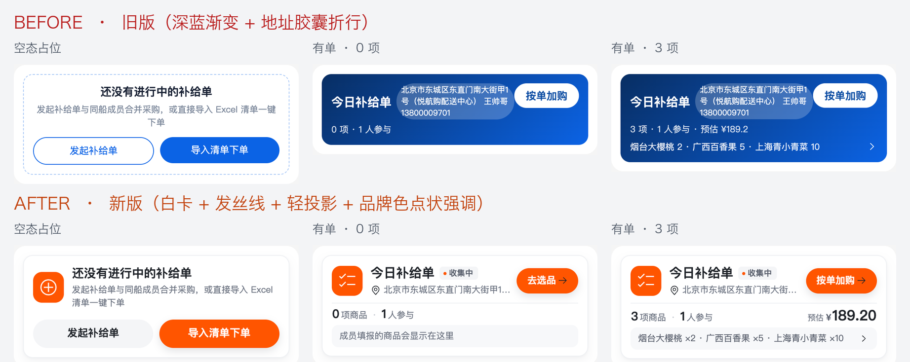

# 首页「今日补给单」卡片视觉重构（C 端 · 方向 A 现代简约）

> 日期：2026-11-01 ｜ 范围：C 端移动端「今日补给单」装修组件 + 管理端装修预览对齐
> 用户请求：给出首页小程序截图（`screenshots/before-user-wechat.png`），要求「这个补给单组件 ui/ux 也得需要重新设计一下，感觉已经不符合当前主流的审美了」
> 设计方向：沿用同日已冻结的 **A. 现代简约 · 品牌色点缀**（见 `docs/50-需求文档/2026-11-01-领券中心与满减券阶梯视觉重构/README.md`），保持全站同一套语言
> 状态：**已完成**（C 端 + 管理端 + 契约测试落地，H5 三态实拍 / 双端质量门通过；验证记录见 §9）



---

## 〇、一页结论

| 项 | 结论 |
|----|------|
| **问题定性** | 不是「换个配色」：旧卡把「标题 / 长地址 / 概览 / CTA」四层信息全部压在**深蓝渐变整块**上（`#082e63 → #0b63e5`），与全站橙红主题（demo 租户 `#ff5500`）同屏冲突；长地址塞进半透明胶囊后**折 3 行**把卡片撑高（47.1px）并挤压 CTA；CTA 是白底蓝字、整卡又可点，**主次不分**；无图标、无状态、无空清单引导；CTA 视觉仅 83.2×31.5px（<44px）。 |
| **重构主线** | 切到 10-23 之后的全站规范「白卡 + 发丝线 + 轻投影 + 中性灰 + 品牌色点状强调」：**品牌色只出现在图标块 / 状态点 / 主 CTA**，地址收成标题下 1 行省略，概览拆成「数字 + 单位」弱化 meta 行，明细收进浅灰面板；品牌色走主题变量（不写死），换肤不出现「红配蓝」。 |
| **信息架构** | ① 图标块 + 标题 + 状态胶囊 + 主 CTA ② 位置行（1 行省略）③ 发丝线 ④ 统计行（N 项商品 · M 人参与 / 预估 ¥X.XX）⑤ 明细预览面板（0 项时同一位置给引导文案）。 |
| **数据原则** | 零后端 / 零接口 / 零 DB：仍只用 `GET /app/shared-cart/active-summary` 的 `cart / itemCount / memberCount / totalAmount / previewItems`；状态文案复用 `cartStatusLabel()`（共享购物车状态唯一来源）；金额口径复用 `amountText()`（收敛到分、不显示 ¥0.00 假价）。**不新增**「已采/还差/进度条」——没有事实来源。 |
| **结果** | 长地址 1 行省略（`scrollWidth 380 > clientWidth 152~165`，`lines=1`）；CTA 视觉 33.3px、热区 45.7px（elementFromPoint 上下探针均命中）；品牌色实测 `rgb(255,85,0)`；三态均无横向溢出、console error 0；`pnpm type-check` EXIT 0、`pnpm test:unit` 1520 tests 全绿、`pnpm build:mp-weixin` DONE、管理端 `preview-parity` 补给单用例通过。 |
| **非目标** | 不改共享购物车/补给单的任何业务逻辑、接口、数据结构；不改首页装修顺序与运营配置项；不做暗色模式；不做「采购进度」类不可信指标。 |

---

## 1. 背景与现状诊断

基线：H5 真实渲染（390×844 @2x，真实 demo 数据，演示账号构造的长地址岸上补给单），
before 截图与度量在 `outputs/replenish-card-redesign/before/`（采集脚本 `capture.mjs`，三态：空态占位 / 有单 0 项 / 有单 3 项）。

| # | 现状问题（用户可感知） | 证据（before 实测） |
|---|--------------------------|----------------------|
| D1 | **深蓝渐变整块与全站橙红主题冲突**：同一屏上下是橙红新人区、橙红满减券，中间一块 `#082e63→#0b63e5` 深蓝 | `.card-inner` `background: linear-gradient(135deg,#082e63,#0b63e5)`；卡片占 346×92.2px（0 项）/ 346×115.4px（3 项）|
| D2 | **长地址把卡片撑高**：地址塞进 `rgba(255,255,255,.22)` 半透明胶囊，无省略、无最大宽 | `.card-location` 153.6×**47.1px（3 行）**，把 `.card-head` 撑到 67.2px |
| D3 | **地址胶囊挤压 CTA**：胶囊右缘与 CTA 左缘在同一条 x=272.3 上贴死 | `.card-location` 右缘 272.3 / `.card-action` 左缘 272.3 |
| D4 | **主次不分**：CTA 是白底蓝字胶囊（31.5px 高），与整卡可点（进详情）两个动作抢注意力，且没有箭头/方向暗示 | `.card-action` 83.2×31.5px、白底 `#fff`、字色 `#0a4da3` |
| D5 | **没有任何视觉锚点与状态**：无图标、无「收集中/待确认」状态，读者第一眼不知道这是什么、进行到哪一步 | DOM 无图标/状态节点（before metrics `legacy` 全为空）|
| D6 | **0 项态是死胡同**：只有「0 项 · 1 人参与」，没有任何「清单是空的该怎么办」的引导 | 0 项态与 3 项态仅差概览文案与预览行 |
| D7 | **触控目标不达标**：CTA 视觉高 31.5px（<44px） | `.card-action` 83.2×31.5px，且无按压反馈 |
| D8 | **空态占位卡是旧票券语言**：白底 1px 蓝虚线框 + 蓝字/蓝底两个胶囊按钮，与全站白卡语言断裂 | `.guide-inner` 346×131.1px，`border: 2rpx dashed rgba(11,99,229,.35)`，按钮 35.3/33.3px |
| D9 | **文字层级平淡**：标题 15.6px/800、地址 10.4px、概览 11.44px，全部压在白/半透明白上，除标题外权重几乎相同 | 三处字号 15.6 / 11.44 / 10.4，地址与概览同权重 |

**结论**：补给单卡片停留在「深色渐变 + 白胶囊按钮」的旧企业卡语言，是首页最后一个与
「白卡 + 轻投影 + 中性灰 + 品牌色点缀」脱节的重色块。本次把它整体切到新语言，并顺手修掉
长地址撑高、主次不分、0 项无引导、触控不达标四个可用性问题。

---

## 2. 设计方向（A · 现代简约 + 品牌色点状强调）

- **形**：白卡 `24rpx` 圆角 + `1rpx` 发丝线（`#eef0f3`）+ 双层轻投影（近细远散）；不再使用整块渐变、不再使用虚线框。
- **色**：品牌色（主题变量）只给三处「点状强调」——图标块、状态点、主 CTA；其余全部中性灰
  （`#1f2329 / #5b616e / #6b7280 / #9ca3af / #eef0f3 / #f7f8fa / #f4f5f7`）。地址、单位、预估标签一律弱化。
- **层级**：① 身份行（图标 + 标题 + 状态 + 主 CTA）② 位置（1 行）③ 摘要（数字大、单位小 + 金额右对齐）④ 明细（浅灰面板 1 行省略）。
- **信息密度**：0 项态给引导文案而不是空白；3 项态预览行用「商品 ×N」而非裸数字，避免和规格数字混淆。
- **多租户**：品牌色走三色主题链路 `var(--theme-color-primary, var(--wot-color-theme-primary, #ff2237))`，
  C 端零写死主色；换肤后卡片自动跟随。中性色与「钱/状态」的分配不随租户变化。
- **交互**：整卡可点进详情；CTA `@tap.stop` 直达按单加购/去选品；H5 `:active` + 小程序 `hover-class` 双份按压反馈；
  CTA 视觉高 64rpx、`::after` 把热区补到 ≥44px（不改变视觉尺寸）。

参考稿：`screenshots/before-vs-after.png`（旧 vs 新，三态）、`screenshots/home-context-before-after.png`（首页上下文）。

---

## 3. 设计令牌（唯一来源：`diy-replenish-card/index.vue` 顶部 SCSS 变量）

> 换算：小程序屏宽恒 750rpx，管理端预览画布 375px ⇒ **1rpx = 0.5px**。

| 令牌 | 值 | 用途 |
|------|-----|------|
| `$rp-brand` | `var(--theme-color-primary, var(--wot-color-theme-primary, #ff2237))` | 图标块、状态点、主 CTA |
| `$rp-text-1` | `#1f2329` | 标题、统计数字、金额数字 |
| `$rp-text-2` | `#5b616e` | 状态文案、金额符号、预览行 |
| `$rp-text-3` | `#6b7280` | 地址、单位、预估标签（对白底 4.83:1，满足 AA） |
| `$rp-muted` | `#9ca3af` | 位置/箭头弱化图标 |
| `$rp-line` | `#eef0f3` | 卡片描边、发丝线 |
| `$rp-fill` | `#f7f8fa` | 明细预览面板底 |
| `$rp-fill-strong` | `#f4f5f7` | 状态胶囊底、次要按钮底 |
| `$rp-pressed` | `#fafbfc` | 整卡按压态 |
| 卡片投影 | `0 2rpx 6rpx rgba(15,23,42,.03), 0 12rpx 28rpx rgba(15,23,42,.05)` | 白卡浮起 |
| CTA 投影 | `0 8rpx 20rpx rgba(15,23,42,.12)` | 品牌胶囊浮起 |
| 圆角 | 卡 24rpx / 图标块 22rpx / 状态胶囊 8rpx / 预览面板 16rpx / 按钮 999rpx | — |

---

## 4. 分模块规格

### 4.1 有单态（`.rp-*`，文件：`aryn-mall-uniapp/src/components/diy/diy-replenish-card/index.vue`）

```
.replenish-card                      ← 装修通用样式（margin/padding/背景/圆角，运营可配）
  .rp-card                           ← 白卡；hover-class="rp-card--pressed"；@tap=进详情
    .rp-head
      .rp-icon > .rp-icon-glyph      ← 76rpx 品牌实底圆角块 + 38rpx 白色图标（list-checked）
      .rp-heading
        .rp-title-row > .rp-title + .rp-status(.rp-status-dot + .rp-status-text)
        .rp-loc > 图标(i-carbon:location / sailboat-coastal) + .rp-loc-text
      .rp-action                     ← v-if showBatchAdd；hover-class；@tap.stop
        .rp-action-text + .rp-action-icon(arrow-right)
    .rp-divider                      ← 1rpx 发丝线
    .rp-meta
      .rp-meta-stats
        .rp-stat > .rp-stat-num + .rp-stat-unit       ← N 项商品
        .rp-stat-sep                                   ← ·
        .rp-stat > .rp-stat-num + .rp-stat-unit       ← M 人参与
      .rp-amount > .rp-amount-label + .rp-amount-symbol + .rp-amount-value   ← 预估 ¥X.XX（0 元不渲染）
    .rp-preview                      ← v-if showPreview；浅灰面板
      .rp-preview-text + .rp-preview-icon（有明细）
      | .rp-preview-placeholder（0 项：成员填报的商品会显示在这里）
```

| 项 | 规格（rpx） | 说明 |
|----|-------------|------|
| `.rp-card` | `padding: 24rpx 24rpx 22rpx; border: 1rpx solid #eef0f3; border-radius: 24rpx; background:#fff` | 卡片本体；外层留白仍由装修通用样式控制 |
| `.rp-icon` | `76×76rpx; border-radius:22rpx; background:$rp-brand; color:#fff` | 整卡唯一实心色块 |
| `.rp-icon-glyph` | `38rpx` | 图标继承父级白色（UnoCSS 图标类自带 `color:inherit`，给父级上色） |
| `.rp-title` | `32rpx/700; line-height:1.25; color:$rp-text-1`；`ellipsis`（运营改长标题不破版） | 标题 |
| `.rp-status` | `padding:4rpx 12rpx 4rpx 10rpx; radius:8rpx; background:#f4f5f7` | 状态胶囊；文案 `cartStatusLabel(cart.status)`（收集中/待确认…） |
| `.rp-status-dot` | `8rpx` 圆点，`background:$rp-brand` | 状态点 |
| `.rp-status-text` | `20rpx/600; color:#5b616e` | 状态文字 |
| `.rp-loc` | `margin-top:8rpx`；图标 `22rpx #9ca3af` | 位置行 |
| `.rp-loc-text` | `22rpx; color:#6b7280; nowrap + ellipsis; flex:1; min-width:0` | **长地址 1 行省略（本次核心修复）** |
| `.rp-action` | `height:64rpx; padding:0 24rpx 0 26rpx; margin-left:16rpx; radius:999rpx; background:$rp-brand` | 主 CTA；文字随状态（0 项「去选品」/ 有明细「按单加购」） |
| `.rp-action::after` | `position:absolute; top/right/bottom/left:-12rpx/-8rpx` | 热区补到 88rpx≈45.7px（视觉仍 33.3px） |
| `.rp-action-text` | `24rpx/600; #fff`；`.rp-action-icon` `22rpx #fff` | 白字压品牌色为全站既有约定（见 §8 取舍 1） |
| `.rp-divider` | `height:1rpx; margin:16rpx 0 14rpx; background:#eef0f3` | 身份区 / 摘要区分隔 |
| `.rp-stat-num` | `30rpx/700; #1f2329; tabular-nums` | 统计数字 |
| `.rp-stat-unit` | `22rpx; #6b7280`；`.rp-stat-sep` `22rpx #c9cdd4; margin:0 12rpx` | 单位 / 分隔 |
| `.rp-amount-label` | `20rpx; #6b7280`；`.rp-amount-symbol` `22rpx/700 #5b616e` | 「预估」+ ¥ |
| `.rp-amount-value` | `36rpx/700; #1f2329; tabular-nums` | 金额右对齐，与统计行基线对齐 |
| `.rp-preview` | `padding:12rpx 18rpx; margin-top:12rpx; radius:16rpx; background:#f7f8fa` | 明细面板 |
| `.rp-preview-text` | `22rpx; #5b616e; nowrap+ellipsis`；箭头 `22rpx #9ca3af` | 预览 1 行 |
| `.rp-preview-placeholder` | `22rpx; #6b7280` | 0 项引导文案 |

### 4.2 空态占位（`emptyStrategy=placeholder`）

```
.rp-guide
  .rp-guide-head
    .rp-icon > .rp-icon-glyph(add-alt)   ← 同款品牌实底图标块
    .rp-guide-heading > .rp-guide-title + .rp-guide-desc
  .rp-guide-actions
    .rp-guide-btn.rp-guide-btn--ghost     ← 发起补给单（#f4f5f7 底 + #1f2329 字）
    .rp-guide-btn.rp-guide-btn--primary   ← 导入清单下单（品牌实底 + 白字 + 投影）
```

| 项 | 规格（rpx） |
|----|-------------|
| `.rp-guide` | `padding:24rpx; radius:24rpx; 白底 + 1rpx 发丝线 + 卡片同款投影`（去掉旧虚线框） |
| `.rp-guide-title` | `30rpx/700; #1f2329`；`.rp-guide-desc` `22rpx; #6b7280; line-height:1.5; margin-top:6rpx` |
| `.rp-guide-actions` | `display:flex; gap:16rpx; margin-top:24rpx`；两按钮等宽 |
| `.rp-guide-btn` | `height:72rpx; font-size:26rpx; weight:600; radius:999rpx`；`::after` 上下各扩 8rpx → 热区 45.8px |
| ghost / primary | ghost `#f4f5f7` + `#1f2329`；primary `$rp-brand` + `#fff` + 轻投影 |

可见性规则不变：登录 + 船供租户 + 摘要已查且无进行中购物车 + 运营选 `placeholder` 才渲染；
未登录 / 非船供租户整体隐藏（占位是给会用到补给单的人看的引导，不是游客广告位）。

### 4.3 交互与可用性

| 项 | 处理 |
|----|------|
| 整卡点击 | 进购物车详情 `/sub-pages/order/shared-cart/detail?id=`（保持原有） |
| CTA | `@tap.stop` 进选货页 `/sub-pages/product/ship-supply/index?scene=2&sharedCartId=`（保持原有） |
| 按压反馈 | `.rp-card` / `.rp-action` / `.rp-guide-btn` 均有 H5 `:active` 与小程序 `hover-class` 两套；过渡 160ms |
| 触控目标 | CTA 视觉 64rpx→热区 88rpx（45.7px）；占位按钮视觉 72rpx→热区 45.8px；均 ≥44px |
| 文案随状态 | 0 项 → 「去选品」（i18n `pickAction`）；有明细 → 「按单加购」（`batchAdd`） |
| 空清单 | 预览面板位置给「成员填报的商品会显示在这里」，不再是纯空白 |
| 金额 | 0 元不渲染（不显示 ¥0.00 假价）；金额 `toFixed(2)` 收敛到分 |
| 主题 | 品牌色只走 CSS 变量链路；中性色不随主题变化 |

### 4.4 i18n（`diy.zh-CN.ts` / `diy.en-US.ts`，中英同 key）

| key | zh-CN | en-US | 说明 |
|-----|-------|-------|------|
| `defaultTitle` | 今日补给单 | Supply List | 运营未配置标题时的兜底 |
| `addressPending` | 收货地址待同步 | Address syncing | 岸上单缺地址快照 |
| `itemUnit` | 项商品 | items | **新增**（数字与单位拆开，单位弱化） |
| `memberUnit` | 人参与 | joined | **新增** |
| `estimateLabel` | 预估 | Est. | **新增**（替换旧 `estimate: 预估 ¥{amount}`） |
| `pickAction` | 去选品 | Add Items | **新增**（0 项态 CTA 文案；英文两态统一 Add Items，避免长词挤压标题） |
| `emptyItems` | 成员填报的商品会显示在这里 | Items your crew adds will show up here | **新增**（0 项态预览面板文案） |
| `batchAdd` | 按单加购 | Add Items | 保留（英文词条精简，见 §8 取舍 7） |
| `emptyTitle` / `emptyDesc` | 还没有进行中的补给单 / … | No active supply list / … | 保留 |
| `createAction` / `importAction` | 发起补给单 / 导入清单下单 | Start a List / Import List | 保留（管理端 parity 与运营配置口径） |

删除：`itemCount: '{count} 项'`、`memberCount: '{count} 人参与'`、`estimate: '预估 ¥{amount}'`（被上面拆词条替代，无其它引用）。

### 4.5 管理端装修预览对齐（WYSIWYG）

`aryn-mall-ui/apps/web-ele/src/views/promotion/page-design/components/replenish-card/index.vue`
按 §4.1/§4.2 新结构重写（class 同名、px = rpx/2 逐值换算），仍由 `RetailPreviewFrame` 包裹、
`previewStatus='data'`；画布不可点，不实现 `::after` 热区与 `hover-class`；图标用内联 SVG 示意（19px ↔ 38rpx）。
画布品牌色固定 `#ff5500`（演示租户主色，与 `coupon-receive` 预览的固定促销色同口径），C 端走主题变量。

`preview-parity.test.ts` 的「补给单」用例同步改为新契约：
结构 10 个 marker 双向锁定（`rp-card/rp-guide/rp-icon/rp-title/rp-action/rp-stat-num/rp-amount-value/rp-preview/rp-guide-btn/rp-guide-btn--primary`）、
13 组成对数值锁（card padding/radius、icon、title、action、stat-num、amount-value、preview、guide、guide-title、guide-btn、divider、status）、
字重与 6 个中性色 + 两端品牌色口径锁。

### 4.6 契约测试

`src/components/diy/diy-replenish-card/contract.test.ts`：
- 保留：不得出现 `plannedQuantity/fulfilledQuantity/remainingQuantity`、不得出现进度条/百分比、预览数量取服务端 `quantity`、金额文案必须是「预估」；
- 新增：**长地址 1 行省略**（`.rp-loc-text` 必须 `nowrap + ellipsis`，预览行同理）、**品牌色不写死**（必须含主题变量链路，且旧深蓝 `#082e63/#0b63e5/#0a4da3` 不得回潮）。

---

## 5. 文件清单

| 文件 | 变更 |
|------|------|
| `aryn-mall-uniapp/src/components/diy/diy-replenish-card/index.vue` | 重写（结构 / 样式 / 交互；脚本业务逻辑不变，新增 `actionText`、`locationIconClass`、`statusText`、`amountValue` 等展示计算） |
| `aryn-mall-uniapp/src/locales/modules/diy.zh-CN.ts` | i18n 新增/调整（§4.4） |
| `aryn-mall-uniapp/src/locales/modules/diy.en-US.ts` | 同上英文 |
| `aryn-mall-uniapp/src/components/diy/diy-replenish-card/contract.test.ts` | 契约更新 + 2 条新回归护栏 |
| `aryn-mall-ui/apps/web-ele/src/views/promotion/page-design/components/replenish-card/index.vue` | 管理端预览逐值重写 |
| `aryn-mall-ui/apps/web-ele/src/views/promotion/page-designer/preview-parity.test.ts` | 补给单 parity 用例改写 |

**零后端 / 零接口 / 零 DB 改动**（无 `db/boot`、`db/cloud` 变更，因此不涉及增量 SQL 与双模式构建）。

---

## 6. 验证方案（独立验收人执行，实现者不采信自身结论）

| 门 | 方法 | 通过标准 |
|----|------|----------|
| G1 类型 | `cd aryn-mall-uniapp && pnpm type-check` | EXIT 0 |
| G2 单测 | `pnpm test:unit` | 全绿（138 files / 1520 tests，含更新后的 contract） |
| G3 小程序构建 | `pnpm build:mp-weixin` | `DONE Build complete.`；`dist/build/mp-weixin/components/diy/diy-replenish-card/index.wxss` 含 `rp-card / rp-action / rp-guide-btn--primary` 与 `::after` |
| G4 预览一致性 | `cd aryn-mall-ui && npx vitest run apps/web-ele/src/views/promotion/page-designer/preview-parity.test.ts` | 补给单用例通过（2 条 pre-existing 失败与本需求无关，独立取证） |
| G5 管理端类型 | `cd aryn-mall-ui/apps/web-ele && vue-tsc --noEmit --skipLibCheck` | EXIT 0 |
| C1–C9 三态实拍 | `node outputs/replenish-card-redesign/capture.mjs after`（390×844@2x，真实 demo 数据，串行独占账号） | 地址 1 行省略 / 无横向溢出 / CTA 有效热区 ≥44px（elementFromPoint 探针）/ 状态胶囊与图标存在 / 0 项引导文案 / 品牌色实测等于租户主色 / console error 0 |
| B1–B6 同口径对照 | before / after 同一脚本同一数据 | 高度、配色、层级、文字、触控、状态逐项对照（§7） |
| S1–S9 代码交叉 | 只读源码 | 类名/数值/令牌与本文一致；无写死品牌色；无 `合计/小计/进度` 回归；无后端/DB 改动 |
| R1–R5 回归面 | 首页上下文截图 + 静态检查 | 首页邻接楼层不变、无暗色模式依赖、各租户主题不写死、窄屏不破版 |

---

## 7. before → after 关键指标（H5 390×844@2x 实测）

| 指标 | before（占位 / 0 项 / 3 项） | after（占位 / 0 项 / 3 项） |
|------|------------------------------|------------------------------|
| 卡片外框高度 | 155.1 / 116.2 / 139.4 px | 158.5 / 156.1 / 159.2 px（信息从 3 层增到 5 层，见 §8 取舍 2） |
| 卡片外观 | 深蓝渐变整块（`#082e63→#0b63e5`）或白底蓝虚线框 | 白卡 + `#eef0f3` 发丝线 + 双层轻投影，圆角 12.48px |
| 地址 | 153.6×47.1px，3 行，半透明白胶囊 | **1 行**，`nowrap+ellipsis`，`scrollWidth 380 > clientWidth 152~165` |
| 主 CTA | 白底蓝字 83.2×31.5px，无箭头 | 品牌实底（实测 `rgb(255,85,0)`）79.2~91.7×33.3px + 箭头，热区 **45.7px**，上下 4px 探针命中 `.rp-action` |
| 图标 / 状态 | 无 | 39.5px 品牌实底图标块 + 「收集中」状态胶囊（中性底 + 品牌点） |
| 文字层级 | 标题 15.6px/800、地址 10.4px、概览 11.44px | 标题 16.64px/700 → 统计数字 15.6px/700 → 单位 11.44px → 金额 18.7px/700 → 地址 11.44px，权重递减明确 |
| 0 项态 | 只有「0 项 · 1 人参与」（死胡同） | 预览面板给「成员填报的商品会显示在这里」，CTA 变「去选品」 |
| 占位态 | 蓝虚线框 + 蓝按钮 35.3/33.3px | 白卡 + 品牌图标 + 双按钮 37.4px（热区 45.8px） |
| 品牌色来源 | 写死 `#082e63 / #0b63e5 / #0a4da3` | 主题变量链路（demo 实测 `rgb(255,85,0)`），中性色固定 |
| 横向溢出 / console | 390/390；0 error | 390/390；0 error |

---

## 8. 边界与已知取舍

1. **品牌底白字对比度**：主 CTA 白字压主题品牌色（demo `#ff5500`）实测 ≈3.2:1，低于 WCAG AA 4.5:1。
   这是全站既有品牌语言（券体系 CTA、个人中心、会员中心同口径），且 11-01 券体系重构已明确
   「红橙只给钱（含主 CTA）」。小字辅助文本（地址/单位/预估标签）全部改用 `#6b7280`（对白底 4.83:1，满足 AA）作为补偿。
2. **卡片变高**：0 项态 116.2 → 156.1px（+39.9），3 项态 139.4 → 159.2px（+19.8），占位态 155.1 → 158.5px（+3.4）。
   原因是信息从「3 行文字压满渐变」升级为「身份行 / 地址 / 统计 / 明细」四层结构，且旧版 0 项态其实是
   **被长地址折行撑到 116px 才「显得矮」**（同口径旧版若地址正常为 1 行约 90px）。取舍：优先可读性与主次，
   高度控制在 160px 内（首页相邻楼层「满减券阶梯卡」约 149px，量级一致）。
3. **0 项态 CTA 文案「去选品」**：清单为空时「按单加购」没有对象（没有要补的明细），改文案是 UX 修正而非业务变更，
   跳转目标不变。运营若隐藏 CTA（`showBatchAdd=false`），整卡仍可点进详情添加商品。
4. **状态点颜色**：状态胶囊统一中性底 + 品牌点，未按「收集中/待确认」分色。原因：状态主题色
   （`cartStatusTheme()` 的蓝/琥珀/绿）会重新引入多套高饱和色，与本期「中性灰 + 品牌点缀」冲突；
   状态文案本身的语义已足够，且详情页有完整状态展示。若后续需要，可在 `.rp-status` 上挂 `cartStatusTheme()` 的 bg/text。
5. **两处非本组件问题**（不处理，仅记录）：演示种子地址乱码（采集脚本已用自有可读快照规避）；
   `preview-parity.test.ts` 另有 2 条 pre-existing 失败（公告滚动 / navigation-scroll 两端漂移），与本需求文件无交集。
6. **小程序 `::after` 触控热区**：H5 可精确测量（45.7px），小程序端伪元素在 wxss 产物中已生成
   （`dist/.../index.wxss` 含 `.rp-action::after`），真机热区未做自动化验证，列「已知未覆盖」。
7. **英文字符串更长会挤压标题**（独立验收 P2-1）：en-US 运行态「Collecting / Add from List / Start Picking」
   比中文宽，标题可用宽从 83px 降到 63~68px，中文标题（运营配置数据）会被省略。处理：**只精简卡片自身的
   英文词条**（`batchAdd/pickAction → Add Items`、`defaultTitle → Supply List`），不动共享状态词条；
   `en-layout-check.mjs` 实测 0 项 / 3 项两态 `.rp-title` 均 `scrollWidth(83) ≤ clientWidth(83)`、不再省略，
   中文无回归。余量约 1.1px 偏紧，若后续英文文案再变长会复现，脚本可随时复跑。

---

## 9. 验证记录（回写）

> 独立验收人：verifier（只读源码、自行复跑，不采信实现者结论）。
> 完整报告：`outputs/replenish-card-redesign/verify/verification.md`；
> before/after 产物：`outputs/replenish-card-redesign/{before,after}/`；采集脚本：`outputs/replenish-card-redesign/capture.mjs`。

### 9.1 实现者自测（供对照，不作为验收结论）

| 项 | 结果 |
|----|------|
| `pnpm type-check` | EXIT 0 |
| `pnpm test:unit` | 138 files / **1520 tests 全绿**（含更新后的 contract 6 条） |
| `pnpm build:mp-weixin` | `DONE Build complete.` EXIT 0；产物 wxss 含 `rp-card / rp-guide-btn--primary / .rp-action::after` |
| 管理端 `preview-parity` 定向 | 补给单用例通过；全文件 39 passed / 2 failed（2 条为 pre-existing，未触碰） |
| 管理端 `vue-tsc` | EXIT 0 |
| H5 三态实拍 | 见 §7 与 `screenshots/`；console error 0；无横向溢出 |

### 9.2 独立验收（verifier，PASS）

> verifier 只读源码、自行复跑，不采信实现者结论。报告：`outputs/replenish-card-redesign/verify/verification.md`。

| 门 | 实测 | 结论 |
|----|------|------|
| G1 C 端类型 | `pnpm type-check` → EXIT 0，0 error | ✅ |
| G2 C 端单测 | 138 files / **1520 tests 全绿** | ✅ |
| G3 小程序构建 | `DONE Build complete`；产物含 `rp-card/rp-action/rp-guide/rp-icon/rp-status/rp-meta/rp-preview/rp-loc-text`，**旧类 `card-inner/card-location/guide-inner` 残留 0** | ✅ |
| G4 管理端 parity | 补给单定向用例 1 passed；全文件 39 passed / 2 failed（2 条 pre-existing：公告滚动、navigation-scroll 两端漂移，读取路径与本需求 6 个文件无交集） | ✅ |
| G5 管理端类型 | `vue-tsc --noEmit --skipLibCheck` EXIT 0 | ✅ |
| 零后端/DB | `aryn-mall-java` 19:20 后改动 0 文件 | ✅ |
| after 三态实拍 | 单次串行（19:36:24–39，产物 mtime 跨度 11s），console error 0；采集后演示车 0、孤儿 0/0、用户 2093 的 7 张车原样 | ✅ |
| 长地址 / 溢出 | `.rp-loc-text` 高 14.86px=**1 行**、`scrollWidth 380 > clientWidth 165/152`；三态 `scrollWidth==clientWidth`（390/390） | ✅ |
| CTA 热区 | 视觉 33.27px + `::after` 上下各 6.24px → **有效 45.75px**；`elementFromPoint` 中心/上 5/下 5 全部命中 `.rp-action`（zh+en 两态） | ✅ |
| 0 项引导 / 双 CTA | 0 项：「成员填报的商品会显示在这里」+ CTA「去选品」；3 项：CTA「按单加购」；状态胶囊「收集中」 | ✅ |
| 令牌与主题 | 白底 + `#eef0f3` 发丝线 + 双层轻投影 + radius 12.48px；深蓝渐变 0 处；`.rp-icon/.rp-action/.rp-status-dot` computed **`rgb(255,85,0)`**；源码仅主题变量链路无写死品牌色 | ✅ |
| i18n | zh/en `diy.replenishCard` 各 12 key 一致、en 无中文；en 运行态状态 Collecting / CTA Add Items / items / joined / Est. 全英文（标题、地址为运营数据仍中文，不判缺陷） | ✅ |
| 管理端 ↔ C 端逐值 | 独立脚本核对 **53 项数值 0 偏差**（adminPx == mobileRpx/2） | ✅ |
| **结论** | **PASS｜P0=0 / P1=0 / P2=10（均不阻塞）** | ✅ |

**P2 处置**：
- P2-1（en 标题被宽度挤压省略）→ **已修复，verifier 独立复验通过（原 PASS 结论不变，P2 未闭环项 10→9）**：只精简卡片英文词条（见 §8 取舍 7），修复前后仅 `diy.en-US.ts` 一个文件变化（其余 5 文件哈希未变）；verifier 自研探针实测 en 两态 `.rp-title` 均 `client 83 / scroll 83`（修复前 68/83、63/83）、CTA 均 `Add Items` 101.83px，zh 逐项无回归、地址仍 1 行省略、三态无横向溢出；`en-layout-check.mjs` 交叉印证四组数字逐项一致。残余：可用宽与文本宽恰好相等（余量约 0.6px），运营配置更长标题时仍按设计省略号截断（1 行省略本就是设计行为）。
- P2-2/3/4/5/6/7/8/9/10（横向热区口径、画布固定演示色、1rpx 取整、before/after 脚本版本差异、并发污染历史、演示地址构造、工作区并发改动、小程序真机热区、暗态未实拍）→ 均为口径记录或已知未覆盖，不阻塞，详见 verifier 报告 §9。
- **已知未覆盖（低风险）**：小程序真机/微信开发者工具目检（本机仅 H5 + MP 构建产物）、暗色模式实拍、第二租户换色实拍、管理端画布浏览器实拍、`hide`/未登录等运行态组合。

---

## 10. 交付物

- 代码：§5 六个文件。
- 设计规格：本文档（含令牌表、逐组件数值、i18n、before/after、验证记录）。
- 视觉参考（均在本目录 `screenshots/`）：

| 截图 | 内容 |
|------|------|
| [before-vs-after.png](./screenshots/before-vs-after.png) | 三态前后对照总图（空态占位 / 有单 0 项 / 有单 3 项） |
| [home-context-before-after.png](./screenshots/home-context-before-after.png) | 首页上下文前后对照（与相邻新人区/券区同屏） |
| [before-user-wechat.png](./screenshots/before-user-wechat.png) | 用户原始反馈截图（微信小程序） |
| [before-placeholder-card.png](./screenshots/before-placeholder-card.png) / [after-placeholder-card.png](./screenshots/after-placeholder-card.png) | 空态占位卡 |
| [before-data-zero-card.png](./screenshots/before-data-zero-card.png) / [after-data-zero-card.png](./screenshots/after-data-zero-card.png) | 有单 0 项（与用户截图同形，长地址折行问题） |
| [before-data-items-card.png](./screenshots/before-data-items-card.png) / [after-data-items-card.png](./screenshots/after-data-items-card.png) | 有单 3 项（预览行 + 预估金额） |
| [after-en-data-zero-card.png](./screenshots/after-en-data-zero-card.png) | en-US 运行态（P2-1 修复后：标题不省略、CTA `Add Items`、状态 `Collecting`） |
- 采集与复核：`outputs/replenish-card-redesign/capture.mjs`（三态、真实 demo 数据、串行可复现）、`before/`、`after/`、`verify/`。
