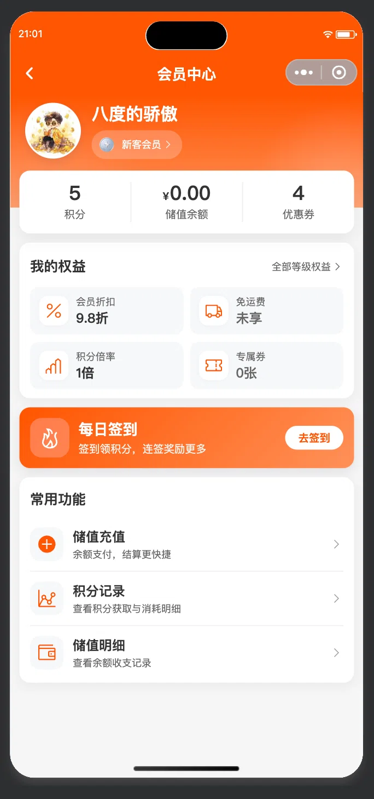
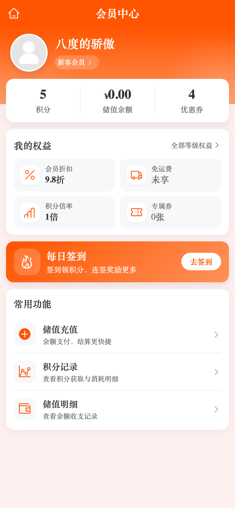
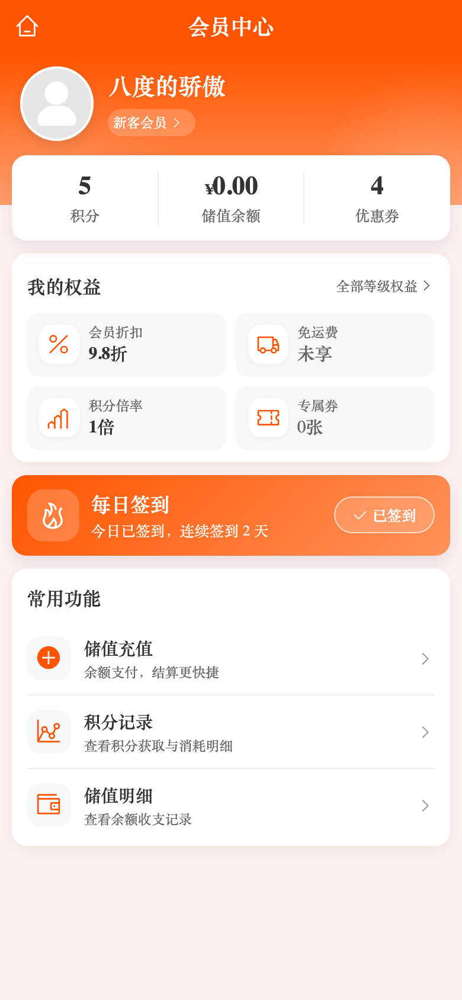

# 会员中心「每日签到」横幅按今日签到态切换

> 日期：2026-11-03 ｜ 状态：**已完成**（移动端单页 + 共享组合式，H5 实拍四场景 + 单测/类型检查通过）
> 原始请求：「这个每日签到需要优化一下，已经签过到了，就不能继续显示去签到吧」（附真机截图：会员中心横幅仍显示「去签到」）

## 〇、一页结论

| 项 | 结论 |
|----|------|
| **问题定性** | 不是样式问题，是**状态缺失**：会员中心横幅 CTA 写死 `accountMember.goCheckIn`，页面从未读取签到态；签到态只在签到页里用当月记录私算，两页口径不一致，已签到用户被反复引导去签到 |
| **修复主线** | 复用既有 C 端记录接口判断「今天是否已签」，已签到把 CTA 换成「✓ 已签到」状态胶囊 + 副文案带连签天数；**不新增后端接口、不改 DB、不改路由** |
| **首帧不闪** | 新增「用户 + 日期 + 签到态 + 连签天数」本地快照：setup/onShow 先同步渲染，接口按需校正；跨天 / 换账号 / 脏数据快照一律作废 |
| **省请求** | 命中「今天已签到」快照不再请求记录接口（签到当天不可逆）；未签 / 无快照 / 换设备才会请求 |
| **结果** | H5 四场景实拍通过（首帧即正确、端到端签到返回即时切换、console error 0）；`pnpm test:unit` 1642 例全绿、`pnpm type-check` 通过 |
| **非目标** | 不改签到页视觉与签到规则；不改后端 `sign_date` 的 Asia/Shanghai 口径；不做签到提醒/推送 |

## 一、改版前后对照

| 状态 | 改版前 | 改版后 |
|------|--------|--------|
| 今日已签到 | 副文案「签到领积分，连签奖励更多」+ 白色实心「去签到」（误导） | 副文案「今日已签到，连续签到 N 天」+ 描边「✓ 已签到」状态胶囊 |
| 今日未签到 | 「去签到」 | 不变（白色实心「去签到」） |
| 未登录 | 「去签到」（点击去登录） | 不变（快照态只对登录用户生效） |

| 已签到（改版后） | 未签到（改版后，与原样一致） |
|---|---|
|  |  |

完整页面：

| 已签到 | 未签到 | 签到页签到后返回 |
|---|---|---|
|  |  |  |

## 二、设计规格

### 2.1 状态与数据来源

| 项 | 取值 |
|----|------|
| 签到态数据源 | `GET /mall-user/app/signin/records`（C 端，登录态本人记录），`beginDate=endDate=当天`、`size=1`；`sign_in_record` 对 `(user_id, sign_date)` 唯一，当天最多一条 |
| 本地快照 | `signInStatusSnapshot` = `{ userId, date, signed, consecutiveDay }`；只认「当前用户 + 今天」，跨天/换号/脏数据返回 null |
| 已签到副文案 | 「今日已签到，连续签到 N 天」（`N>0`）；拿不到天数时「今日已签到，明天记得再来」 |
| 已签到 CTA | 描边状态胶囊：`background: rgba(255,255,255,.16)`、`border: 1rpx solid rgba(255,255,255,.66)`、白字 + `i-carbon:checkmark`；仍随整条横幅可点进签到页看日历 |
| 未签到 CTA | 保持白色实心 + 主题色字（原样） |

### 2.2 状态矩阵

| 状态 | 首帧 | 后续 |
|------|------|------|
| 已签到 + 本地快照 | 直接「已签到」（不发记录请求） | 保持 |
| 未签到（无快照/快照为未签） | 「去签到」 | 发 1 次记录请求校正；若另一台设备已签 → 翻为「已签到」 |
| 已签到但无快照（换设备/清缓存） | 先按未签到渲染 | 记录请求回来后翻为「已签到」 |
| 接口失败 | 保持快照态 | 不弹错、不阻断；点进签到页仍可看真实状态 |
| 未登录 | 「去签到」 | 不发任何 `/app/**` 请求 |

## 三、实现要点

- **共享组合式** `src/composables/useSignInStatus.ts`：`signedToday` / `consecutiveDay` / `syncFromCache()` / `refresh()` / `markSigned()` / `reset()`；纯函数 `formatSignInDate` / `resolveSignInSnapshot` / `buildSignInSnapshot` 单测覆盖边界。
- **API 层** `sub-pages/api/user/signIn.ts`：补 `AppSignInRecord` / `AppSignInRecordPage` / `AppSignInConfigPage` 类型（替换原 `any`），新增 `getTodaySignInRecord(date)`。
- **会员中心** `sub-pages/user/member/index.vue`：setup 读快照；onShow 未登录 `reset()`、已登录 `refresh()`；模板按 `isSignedToday` 切副文案与 CTA；新增 `.mc-signin__cta--signed` / `.mc-signin__cta-icon` 样式。
- **签到页** `sub-pages/user/member/sign-in.vue`：首帧用快照渲染 `isSigned/consecutiveDay/signedDates`（已签到用户进来不再先闪「立即签到」，且「CTA 已签到 / 本月签到 N 天 / 日历当日打勾」三处首帧一致）；拉到当天记录或签到成功后 `markSigned()` 写快照，返回会员中心即时生效；删除本地 `formatDate`，统一用共享 `formatSignInDate`。
- **i18n**：`zh-CN` / `en-US` 同步新增 `checkedInToday` / `checkedInDesc`（`{days}`）/ `checkedInDescPlain`。
- **健壮性**：`refresh()` 先校验登录态、await 后二次校验 `userId`（请求期间退登/换号时丢弃迟到响应）；storage 读写包 try/catch（存储异常只降级为「无快照」，不会冒泡到页面 setup 白屏）。
- **零后端 / 零 DB / 零接口 / 零权限码 / 零路由变更**；不改签到页签到规则。

## 四、验证

| 项 | 方式 | 结果 |
|---|------|------|
| 组合式单测 | 新增 `src/composables/useSignInStatus.test.ts` 15 例（跨天/换号作废、快照命中免请求、接口空/失败不覆盖快照、迟到响应丢弃、markSigned 跨页同步、未登录不发请求、reset） | 15/15 通过 |
| API 契约单测 | 新增 `src/sub-pages/api/user/signIn.test.ts` 2 例：锁死记录接口入参 `{current:1,size:1,beginDate:date,endDate:date}` 与空响应 → `null`（防止退化成「取最近一条」把昨天当成今天） | 2/2 通过 |
| 全量单测 | `pnpm test:unit` | 148 文件 / 1646 例全绿 |
| 类型检查 | `pnpm type-check`（vue-tsc） | exit 0 |
| Lint | `npx eslint <7 个改动文件>` | 0 error / 0 warning |
| i18n 契约 | `locale.test.ts`（key 对齐 / 英文无中文 / 占位符可编译） | 通过 |
| H5 实拍 + 行为 | 生产构建 `dist/build/h5` + 本地静态服务 + Playwright 全量 mock 接口，390×844 dsf2，主题 `#ff5500` | 四场景通过（见下表） |

H5 四场景（`artifacts/signin-status-fix/visual-check.cjs`，可复跑）：

| # | 场景 | 关键断言 | 结果 |
|---|------|---------|------|
| A | 已签到 + 本地快照 | 首帧 CTA「已签到」、副文案「今日已签到，连续签到 3 天」；签到记录接口 **0** 次请求；CTA 实测 `rgba(255,255,255,0.16)` / 白字 / `1px solid rgba(255,255,255,0.66)` | ✅ |
| B | 未签到 | CTA「去签到」、副文案原样；记录接口 1 次请求 | ✅ |
| C | 无快照但接口有当天记录（另一台设备签） | 接口返回后校正为「已签到 / 连续签到 4 天」 | ✅ |
| D | 端到端：未签到 → 签到页签到时 → 返回会员中心 | 签到 POST 1 次；签到页 CTA 变「今日已签到」+ 飘分/成功提示；返回会员中心横幅立即「已签到 / 连续签到 2 天」；**返回后记录接口请求数不增加**（2→2） | ✅ |

四场景 `console error = 0`；`documentElement.scrollWidth = 390 = viewport`（无横向溢出）。
独立审查（只读 teammate，逐层核对后端接口/Mapper/唯一约束、分层与 i18n 契约、UnoCSS 图标坑）结论为「可合并（无 P0/P1）」；其 P2 建议中已采纳：API 参数契约单测、签到页首帧三处一致、迟到响应防护、storage 兜底、登录态门控、失败不覆盖快照的强断言、描边 `box-sizing`。

## 五、已知取舍与边界

1. **快照只是「首帧不闪 + 省一次请求」的优化**，唯一事实来源仍是记录接口；清缓存/换设备后首次打开仍会先按「未签到」渲染一帧，再由接口校正——在没有接口调用的前提下无法知道另一台设备已签。
2. **时区口径未改**：后端 `sign_date` 用 `Asia/Shanghai` 计算，前端与签到页既有逻辑一致按设备本地日期取「今天」；用户群在国内时等价，真正跨时区（船员设备改时区）属既有口径问题，本次未扩大改动。
3. **CTA 在已签到态仍可点**：进签到页查看连签进度/日历；若后续希望「已签到」完全不可点，需要再评估（会失去查看日历入口）。
4. **签到横幅独立于后端签到写链路**：若签到成功但 `markSigned` 写快照失败（storage 满/禁用），只影响下次进入的免请求优化，页面仍能由接口校正。
