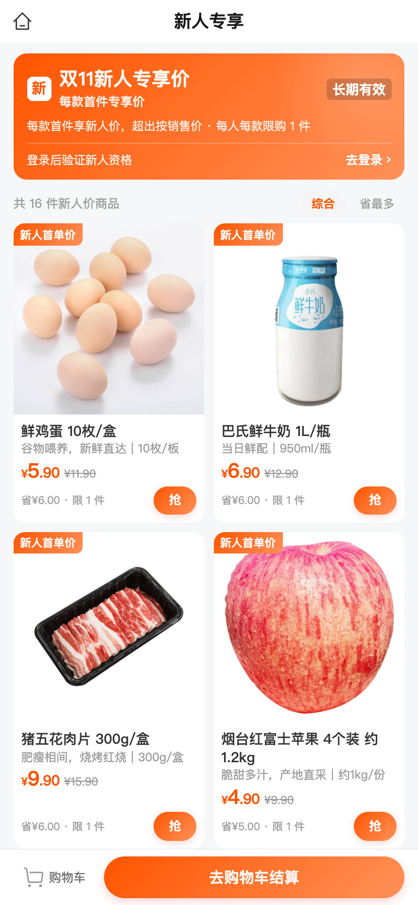
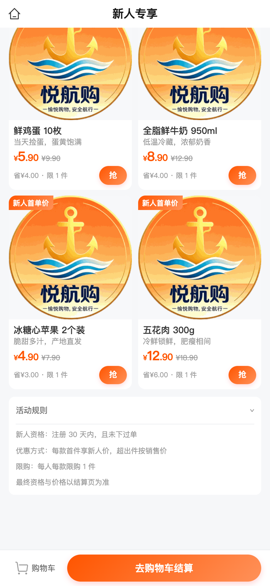

# 新人专享页优化调研（2026-11-12）

## 原始请求

结合当前项目，调研主流生鲜商城小程序，评估线上「新人专享」页还有哪些需要提升优化的地方。

## 一句话结论

这一页现在**能用、价格也对**，但形态仍是「新人价商品列表」，不是「新客首单转化页」。差距集中在三件事：

1. **规则说不清**：副标题「首单专享价」、权益行「首件享新人价」、限购提示「每人每款限购」指向三种规则；限购提示还缺数字并被省略号截断。
2. **加购后没有下一步**：页面无购物车入口、合计与去结算，也没有券包/免运/凑单钩子；新客第一单通常不止一件。
3. **选品撑不起专享**：8 个 SKU 以 1 元级小件为主，缺鸡蛋、牛奶、肉、水果等硬通货，省额 0.5–3 元，感知是「便宜一点」。

## 关键发现（按优先级）

| 优先级 | 问题 | 落点 |
|---|---|---|
| P0 | 规则文案三处冲突（首单/首件/限购），中英文均需同步 | `locales/modules/diy.zh-CN.ts` / `diy.en-US.ts` |
| P0 | `promotion.newbie.ruleHint` 写死且缺 `{limit}`，`hero-hint` 又 nowrap 截断 | `promotion.zh-CN.ts`、`newbie/index.vue` |
| P0 | 页面无购物车/合计/去结算，加购即终点 | `sub-pages/promotion/newbie/index.vue`，复用 `glass-tabbar` 与 `useQuickCart` |
| P0 | 卡面未提示「限 1 件」，超件规则只在结算暴露 | `useNewbieGoodsActions.ts` + 卡片模板 |
| P1 | 无券包、无免运门槛（对标平台为「价格 + 券 + 免运」三件套） | 复用 `diy-coupon-receive`；满额免运需订单级运费规则 |
| P1 | 选品结构与卡片信息层级 | 运营选品 3+3+2；卡片省额/划线价合并 |
| P1 | 无品类筛选与「省最多」排序 | 页面已有全量 `goodsList`，前端分组即可 |
| P2 | `ineligibleReason` 未使用，阻断态一刀切 | 接口已返回，前端补资格条与分层出口 |
| P2 | 无页面级漏斗埋点，优化无法验证 | 参考 `useDecorationPage` 埋点方式 |

## 对标要点

- 小象超市把新人权益打包成「四重礼」：三单免运费、专享券、0.99 元起、满减/大牌折扣；新店期做到「150+ 款 1 分钱任选一件」。
- 盒马在首页用大尺寸「新朋友专享福利」banner 承接，落地页把新人特价商品与新人券放在同一页。
- 朴朴用大面积 0.01 元专区先拿首单，并在购物车给「免配送差额」提示。
- 行业免运门槛集中在 35–39 元（小象多数城市 35–39、七鲜 5 公里内 39、多多买菜小时达 39）。
- 首单玩法的方法论强调「限时 + 限量 + 门槛」，且必须排查退款后名额是否返还等漏洞。

> 以上为公开资料与产品分析，具体权益以各平台当期规则为准，详见 HTML 报告第 6 节来源。

## 项目特有约束

- 船供/海员场景：靠港时间窗短、常见整船或代购批量采买，「每人每款限 1 件」与真实采购方式可能冲突；倒计时也绑自然日而非靠港/开航。
- 双模式：本次建议均为 C 端展示与交互，不新增 biz 间依赖；若做满额免运，需同时提供 boot / cloud 两侧配置与增量 SQL。
- 多语言：`en-US` 已覆盖，但 `newbieFloor.perks` 英文漏了「超出按销售价」，需同步校对。

## 交付物

- [新人专享页诊断与改版原型.html](新人专享页诊断与改版原型.html)：可视化报告，含现状标注、改版原型（430×932）、逐条诊断、竞品对标、优化清单与验收指标。
- [改版原型.png](改版原型.png)：改版页面单图（860×1866）。
- [现状截图.png](现状截图.png)：线上原图。

## 建议落地顺序

1. **第 1 周（零后端）**：文案口径统一、限购补数字、底部结算条。
2. **第 2 周（运营主导）**：3+3+2 选品换血、卡片压缩、品类与排序。
3. **第 3–4 周**：券包、资格条（用 `ineligibleReason`）、四段漏斗埋点。
4. **下一阶段**：订单级满额免运、限量库存、船队邀请裂变。

## 状态

调研与原型已完成；**第 1 周零后端改造已落地前端 + 选品回填已落库**（2026-11-12，16 款），券包/免运/埋点等仍待评审后再排期。

### 已实施（`aryn-mall-uniapp`，仅前端）

- 页面 `src/sub-pages/promotion/newbie/index.vue`：头卡改品牌渐变 + 白字、新增资格条、商品卡改「省¥X · 限 N 件」一行、移除截断的限购胶囊、页脚免责话术改为可展开的「活动规则」、新增「综合 / 省最多」排序、新增底部购物车角标 + 「去购物车结算」入口。
- 文案 `src/locales/modules/promotion.zh-CN.ts` / `promotion.en-US.ts`：`ruleHint` 带 `{limit}`；新增资格条、规则折叠、购物车、排序、限购标签、价格规则等键；中英键一一对应。
- 文案 `src/locales/modules/diy.zh-CN.ts` / `diy.en-US.ts`：`newbieFloor.subtitle` 由「首单专享价」改为「每款首件专享价」，`perks` 补「每款首件 / 超出按销售价」。
- 契约测试 `src/sub-pages/promotion/newbie/contract.test.ts` 扩到 11 条：锁死底部结算入口、限购占位、口径统一、规则折叠。
- 验证：`vue-tsc --noEmit` 通过；`vitest run --config vitest.config.ts` 全量 **165 文件 / 1882 条通过**；`node scripts/run-uni.mjs build -p mp-weixin` 构建通过。

### 选品回填（2026-11-12，已落库）

原活动 8 款全是 1 元级零食，已补 8 款蛋奶肉果菜并排到列表最前（共 16 款、每人每款仍限 1 件）：

| 商品 | 规格 | 原售价 | 新人首单价 | 省 |
| --- | --- | ---: | ---: | ---: |
| 鲜鸡蛋 | 10 枚/盒 | ¥11.90 | ¥5.90 | ¥6.00 |
| 巴氏鲜牛奶 | 1L/瓶 | ¥12.90 | ¥6.90 | ¥6.00 |
| 猪五花肉片 | 300g/盒 | ¥15.90 | ¥9.90 | ¥6.00 |
| 烟台红富士苹果 | 4 个装 约 1.2kg | ¥9.90 | ¥4.90 | ¥5.00 |
| 国产香蕉 | 约 1kg/把 | ¥6.90 | ¥2.90 | ¥4.00 |
| 上海青小青菜 | 约 300g/份 | ¥4.99 | ¥1.90 | ¥3.09 |
| 黄心土豆 | 约 500g/份 | ¥3.90 | ¥1.90 | ¥2.00 |
| 全麦面包 | 400g/袋 | ¥12.90 | ¥6.90 | ¥6.00 |

- 价格全部低于当前售价，也低于会员价（9 折），避免结算时被会员价覆盖。
- 增量脚本：`aryn-mall-java/db/boot/223newbie_staples_backfill_incremental.sql`、`db/cloud/234newbie_staples_backfill_incremental.sql`；已登记 `build-full-sql.mjs` 并重新生成 / 校验 `aryn_boot_full.sql`。
- 库内校验：`rules.skus` 16 条、`scope_value` 16 个、一一对应；`end_time` 2099-12-31、`longTerm=true`；脚本重复执行不重复加品。
- 接口校验：`/app/newbie/current?limit=200` 返回 16 条，首屏为鸡蛋 / 牛奶 / 五花肉 / 苹果。

### 改造后实机效果（H5，430×932）

| 真实活动首屏（16 款，刚需品在前） | 滚动到底 + 展开规则 |
| --- | --- |
|  |  |

> 右图为 mock 活动数据下的版式截图（商品图占位），用于核对底栏与规则折叠；左图为接真实接口的活动页，商品图、价格与「省¥X · 限 1 件」均为线上数据。

### 未实施（需后端/运营配置）

- 券包、订单级满额免运与凑单进度、品类筛选（`AppNewbieGoodsVO` 无类目字段）、限量/已抢进度、四段漏斗埋点、A/B 实验。
- 船供场景的限购维度（按船舶/代理而非按人）、倒计时绑靠港时间窗，需产品与后端共同确认。
- 后续「个人 / 船供 / 企业」三轨首单与工厂自助绑定方案，见 [新人首单双轨与采购主体改造](../2026-11-12-新人首单双轨与采购主体改造/README.md)（四项决策已确认，待实施；未落代码）。
