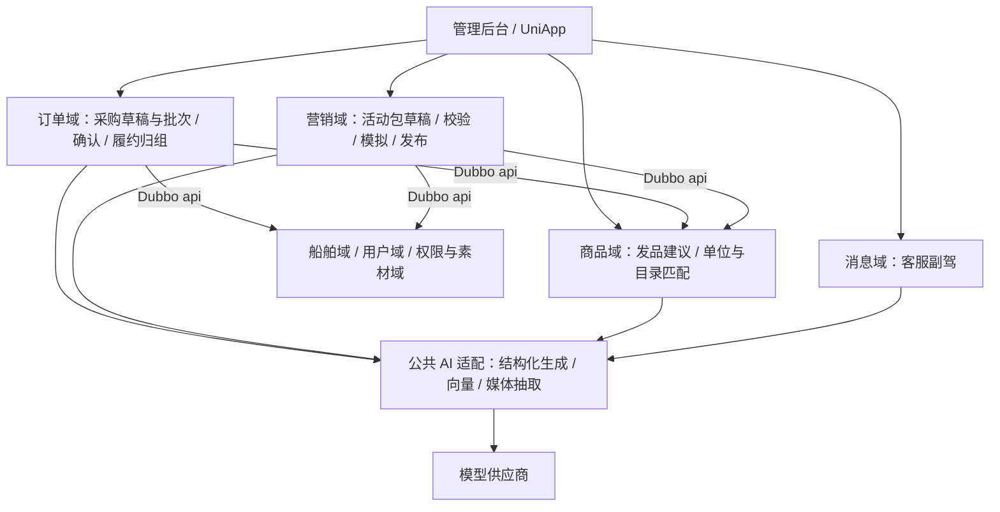

# 结合当前代码的 AI 方案可行性评估

> 评估日期：2026-11-15。
> 对象：[行业调研](./README.md)与[易用性优先的落地方案](./02-易用性优先的AI落地分析.md)。行业调研用于确定方向，本次主要评估后者能否落地。
> 代码基线：当前工作目录 `codex/b2b-activity-member`，包含未提交、未跟踪的 B2B 改造；不是只看 HEAD，也不是历史文档中的 ship-chandler 分支。
> 证据强度：已核对源码、配置、SQL 和相关测试源码；未执行构建、测试、真实模型调用或部署联调。Graphify / UA 命令不可用，采用源码搜索回退。本文为设计建议，未实施业务代码改造。

## 1. 总体判断

**方案可行，且当前适合做结构性改造。核心工作是补齐采购与营销的业务模型，AI 接入本身已有起点。**

建议保留“清单变订单”和“活动意图变草稿”两条主线。先保证单位、数量、导入来源和发布动作可校验，再增加识别来源与生成能力。开发阶段可以重构旧接口与内部实现，并用增量 SQL 迁移开发数据，无需长期维护一套有缺陷的旧链路；仍应保留已有订单、价格快照和用户工作区数据。

原方案不能直接作为实施清单，主要有五个原因：

1. 营销范围与最新 B2B 定位冲突，仍包含停运玩法。
2. 文档高估了现有 MOQ、步长、IMPA/ISSA 和采购单位的可用程度；相关船供资料已在代码中退出主链路。
3. 已有导入任务、异常分区、常购与历史复用，应该深化这些能力，避免重复建设。
4. “送到船”已有默认逻辑，“同一靠港批次合送”尚需确定归组和截单语义；现有出车单可以复用。
5. 原 P0 同时包含数据治理、异步任务、多模态识别、履约和营销工作台，0—6 周不能作为完整交付承诺。

## 2. 能力与现有代码对照

“基础”表示存在对应源码，不表示已经完成生产验证。

| 能力 | 当前基础 | 尚缺什么 | 判断 |
|---|---|---|---|
| 接龙文字解析 | `ChainAiAssistant`，兼容 Chat Completions；失败回退 `ChainOrderTextParser` | 数量精度、单位校验、任务化、版本与调用记录 | 高可行，重构已有链路 |
| Excel 清单 | 共享车导入、直下单导入、2000 行上限、报告与确认 | 统一单位协议、来源贡献、替换批次、断点恢复 | 高可行 |
| 商品语义匹配 | 精确/包含/二字组匹配，`CatalogVectorRecallService`，候选内 AI 选品 | 结构化规格、业务编码、别名治理、完整目录覆盖、反馈记录 | 高可行，现阶段不需训练模型 |
| 图片/PDF/语音 | 现有采购入口主要是 Excel 与文字 | 文件抽取、OCR/多模态、ASR、私有文件、异步处理与行级证据 | 可行，属于新增适配工作 |
| 常购与复购 | frequent-purchase、reorder-preview、共享清单 reuse | 统一入口、差异核对、周期模板 | 高可行，先整合 |
| 默认送到船 | `shipContextStore` 与结算页已有船舶/靠港默认 | 过期上下文与用户提示；个人与企业场景隔离 | 大部分已有基础 |
| 个人单与补给单合送 | 订单/配送任务已有船舶、靠港字段；出车单支持多任务 | 稳定的归组标识、截单、变更、独立签收与延误通知 | 可行，不能只加一个拼接 key |
| 营销草稿生成 | 协议价、采购档期、阶梯/满量满额/买赠、定向券等 | 统一活动包草稿、类型白名单、服务层命令、方案版本 | 高可行，建议作为重点 |
| 发布前校验 | 规则治理、协议价 dry-run、营销 preview | 未发布方案的隔离试算、跨类型/跨主体校验、库存与成本事实 | 可行，基础不等于完整模拟器 |
| 页面与文案生成 | 装修 schema、组件注册、模板、草稿修订号、发布快照/回滚 | 白名单生成、数据绑定、活动包发布一致性 | 高可行，复用装修器 |
| 发品助手 | 商品已有子标题、卖点 HTML、属性标签与清洗器 | 生成建议与人工回填、事实缺失标记 | 高可行，可作为小范围先行功能 |
| 客服副驾 | 会话、消息、客户快照、发送权限与限流 | 可检索知识、订单事实工具、建议回复与发送隔离 | 可行，排在采购与营销之后 |
| 经营问数/活动复盘 | 订单统计、装修曝光/点击/渲染错误指标 | 指标目录、行级权限、订单关联、优惠成本与退款口径 | 固定问题可先做，完整 ROI 尚不具备 |
| 航次/菜单测算 | 船舶、靠港、采购场景与商品目录 | 系数/配方、现存量、损耗、包装换算、版本与适用条件 | 可行，主要是规则与业务数据建设 |
| 工厂餐厅完整采购 | scene=3、buyer_org、共享采购、协议价与企业等级 | 周期计划、菜单 BOM、多供应商报价、验收/对账闭环 | 基础交易可复用，完整系统需独立阶段 |
| 销量预测/自动补货/个性化优化 | 开发阶段缺少可验证样本 | 连续真实数据、基线、离线回测与灰度 | 继续后置 |

## 3. 必须修正的设计与代码前提

### 3.1 采购单位应成为通用商品能力

当前 `GoodsSku` 没有 `salesUnit/unitWeightKg/unitSpecText`。更关键的是：

- `ReplenishImportMatchVO` 明确注明 `moq/stepQty` 在船供包装资料下线后恒空，订单域按 1 兜底。
- `ReplenishImportExcel` 明确记录 2026-09-29 移除了单位、起订量和步长列。
- `ReplenishImportMatchServiceImpl` 现在把“商品编码”解释为 SKU ID，已不等同于 IMPA/ISSA。
- `previewChainImport` 保存 `rawUnit`，但匹配请求没有携带它，分类调用传入的规格为 null；确认阶段也只检查整数数量、库存与 MOQ/步长，没有单位相容性检查。

所以，“香蕉 3 斤”命中按把销售的 SKU 时，**存在把 3 当成销售件数并标记 OK 的路径**。这是静态代码结论，未用真实接口复现。

建议直接建立商品域统一的采购度量模型，不恢复独立“船供目录”。销售单位、起订量、步长适用于三个场景，应该由所有加购、导入、复购、结算接口共同消费。

原方案的三个字段适合试点，但不足以覆盖一般换算。建议至少表达：

| 内容 | 建议表达 |
|---|---|
| 实际销售数量单位 | `sales_unit`；订单买的是把、箱、袋还是 kg |
| 换算基准 | 基准单位及量纲：质量、体积、件数、长度 |
| 包装/净含量 | 每销售单位包含多少基准单位；精确值或约量标记 |
| 数量约束 | `min_order_qty`、`step_qty`，明确按销售单位计 |
| 展示 | 可读规格文本，不用它承担计算职责 |
| 外部编码与别名 | 租户内按码制区分，独立维护已审核映射 |

原始需求量用 Decimal 保留，如 1.5 kg；最后购买数量可以继续采用整数销售件数，减少对交易链路的侵入。只有明确需要“按实际称重结算”时，才扩展计价、库存和退款数量协议，不把该能力混进一期。

换算必须是确定性规则。3 斤 = 1.5 kg；若每把仅标“约 1kg”，不能无条件认定买 2 把就满足要求，应标为约量建议并要求确认。没有换算依据时进入 UNKNOWN，不允许模型编造净含量。

### 3.2 已有任务模型，需要补来源与替换语义

`SharedCartImport` 已有任务状态、文件摘要、逐行结果和确认记录；`confirmImport` 已有购物车/任务行锁，同一任务重复确认会幂等返回。因此，不应描述成“当前没有批次模型”。

实际缺口是：

- 同一段文字再次预览会产生新的任务；已保存 SHA-256，但当前流程没有利用它阻止再次累加。
- 已导入明细按“成员/归属姓名 + SKU”累加，缺少可用于替换的来源贡献关系。
- 候选列表、AI 选择和解析来源只随首次预览返回，没有完整持久化；重开报告时能力退化。
- 报告可以取回，但共享车仍有固定 24 小时收集窗口，长期草稿不能直接依附该窗口。
- 前端已有待处理/正常行分区，仍需按人分组、持久化处置和单位异常状态。

建议在订单域统一“采购草稿 → 来源批次 → 原始行 → 标准行 → 人工处置”的处理管道，保留个人、船供、企业各自的权限与提交适配。共享车导入和直下单导入共用规则，避免两套解析、换算和确认逐渐分叉。

“追加”“替换上一份”“这是一次新的采购”必须是明确动作。替换只能撤销该来源批次的贡献，不能按 SKU 直接删除或简单减掉整个聚合数量，否则会覆盖其他成员及后续手动修改。需保存贡献关系、修订号，并在事务内校验。

匹配成功、数量合法、单位相容、人工已确认应是独立状态。一个 `RESULT_OK` 不能同时证明四件事；单位 UNKNOWN/MISMATCH 的行不能被当成正常行自动并入。

### 3.3 多模态应接入异步任务，避免扩展同步长事务

当前 `previewChainImport` 带事务，方法内部进行模型解析、商品 RPC、行写入及候选 AI 选择。模型单次超时默认 20 秒；目录首次向量构建也同步执行，Embedding 每批 32 条顺序调用。

这套实现可以承接小清单，但继续加入图片、PDF 与语音会拉长请求和事务。数据库允许 2000 行，并不意味着一次模型调用也能可靠解析 2000 行：当前生成输出上限为 8192 tokens。

建议流程：

1. 短事务创建任务并保存输入引用，提交后再处理。
2. Excel/可提取文本的 PDF 先确定性抽取；扫描页走 OCR/多模态，语音走 ASR，然后进入相同标准行协议。
3. 根据输入/输出 token 预算分块，保留页码、原文片段或图片区域，逐行可追溯。
4. 独立任务线程池限制并发，保存解析/匹配进度、错误、取消和重试；工作线程显式恢复租户。
5. 人工处置独立保存；确认时用短事务重新检查版本、权限、单位、在售状态和库存。

模型失败时保留输入和已完成结果。文字可回退规则；无法识别的图片应要求人工补录，不应报告为空单成功。采购原件可能含人名及企业信息，走私有存储和受控读取，不能复用公开商品图路径。

### 3.4 向量召回可以复用，需明确容量和准确性边界

现有实现已按租户缓存目录、异步刷新时恢复租户，AI 只能从真实候选中选 SKU，这些机制应保留。

扩展前补齐：

- **目录覆盖**：当前 `CATALOG_LIMIT=2000`，SQL 有 LIMIT；导入行数上限不应决定租户目录上限。超过规模时须完整分批索引或明确提示覆盖范围。
- **失效与容量**：TTL 到期是刷新，不是淘汰。需限制缓存占用、商品变更触发失效、冷启动预热，避免每实例重复向量化。
- **版本**：缓存应绑定租户、目录修订、模型与向量维度。当前点积按两向量较短长度计算，不能作为模型升级后维度不一致的处理方式。
- **事实新鲜度**：缓存里带有价格库存，展示及确认前应重新读取，不能把旧快照当实时事实。
- **评分含义**：余弦相似度、规则分、AI 建议与用户确认是不同概念；0.8 相似度不能显示为“80% 正确率”。

先保留进程内召回，补完整性和资源控制；是否引入专用向量库由实际目录规模、多实例成本与压测决定。目前不必为了 AI 先建设向量数据库或训练平台。

### 3.5 营销工作台可做，先补统一写入入口和草稿试算

已有基础较好：`ActivityPublishGovernanceService` 校验规则，`PricePolicyService.dryRun` 提示协议价倒挂/成本风险/政策覆盖，`PromotionEngineServiceImpl` 负责运行时计价，装修系统已有独立草稿与发布版本。

但三处必须改：

**第一，限定现行 B2B 能力。** AI 方案只能使用协议价、档期特供、阶梯价、满量/满额优惠、买赠、会员价专区、出清价专区、定向券、采购档期。新人权益需求也不能通过复活 type=9 实现。会员/出清专区由商品标签与系统托管活动维护，不能让 AI 新建手工 type=10 活动。

代码仍保留旧玩法实现，不能把“存在对应类/枚举”当成可用白名单。例如当前船供活动规则校验仍接受 type=9，而 `ShipActivityController` 的显式手工类型保护主要针对会员价。新工作台前，应在统一领域写入口落实停运类型拒绝规则，覆盖人工、批量与 AI 入口。

**第二，将 Controller 中的写入规则下沉。** `ShipActivityController` 直接操作 Mapper 并承担保存、修改、发布等逻辑。新增 AI 调用方后，若直接写 Mapper 会绕过这些校验，若复制 Controller 逻辑又会产生两套规则。应提取统一的营销命令模块，集中校验租户、权限、类型、状态与并发版本。

**第三，建立未发布方案的隔离试算。** 现有引擎 `preview` 从数据库读取已发布活动，不能直接试算尚未落地的活动包。应分离“读取事实/活动集合”和“执行既有计价规则”，允许把草稿覆盖到模拟集合中，明确模拟时间、采购主体、数量档位及叠加条件；不能通过临时发布再回滚来试算。

一期活动包建议只支持“一个主活动 + 可选定向券 + 一个页面草稿”。先用规则选择库存、成本等事实齐全的商品，再让模型提出方案并解释。全量活动组合、利润最优解和销量预测不纳入一期。

预算要区分优惠预算、赠品预算、库存限额与预计销量。无销量数据时只能算情景上下界；成本价缺失时毛利应显示未知，不能用零成本制造虚假利润。已有 reserve/锁/快照继续负责交易时额度一致性，AI 测算不替代它们。

### 3.6 页面和效果统计应各复用一条链路

装修生成使用当前支持的 schema、组件注册、默认值、后端文档校验、`draftRevision` 和发布快照。AI 输出受限组件 JSON 及绑定，不生成任意 Vue/JS；商品、档期等 ID 必须校验归属和有效性。

活动、券、页面并非同一张表。一期先各自保存草稿并记录活动包状态；发布时重新校验，失败明确显示已完成/未完成项，可幂等重试。确需统一定时生效时，再用发布计划及补偿机制；跨服务不能假设一个本地事务能原子发布全部资源。

已有 `PageDesignMetricService` 只统计页面曝光、组件点击、渲染错误，不能直接推出转化、净 GMV 或 ROI。需补活动包/活动/页面版本与订单优惠快照关联，处理退款、优惠成本、赠品成本和人工成本口径。

“活动相关成交”与“活动带来的增量”分开表达；前者可以记账，后者需要对照实验。问数先做经过授权的固定指标工具，不允许模型生成 SQL 直接查询业务库。

### 3.7 送到船已有默认，合送需区分采购批次与物理出车

结算页在 `shipContextStore.hasVesselContext` 时已经默认公司配送到船；订单保留个人/船供/企业场景。因此原 P0 第 5 件应改为完善已有默认体验和合送规则。

现有两套履约概念需要区分：

- `DeliveryTaskServiceImpl.assignTasks` 已支持把多订单任务并入司机当前出车单，可以复用。
- `FulfillmentServiceImpl.addOrderToWave` 加入第一单即把波次改成 PICKING，随后加入订单会被拒绝；该波次当前也只明确核对港口，没有完整核对同船同靠港。

所以，**已有人工多单同车能力，但不能据此认定业务上的同船同靠港合送已经闭环**。也不能只改仓库波次，就认为司机任务与签收会自动一致。

建议在订单域建立稳定的配送归组标识，关联租户、仓库、船舶/靠港、计划窗口、批次序号与截单规则，再映射到既有配送任务和出车单。一个业务批次可以因运力拆车，一次出车也可以承接多个业务批次；不要把批次等同于司机当前趟次。

靠港时间变化时更新同一个组的计划，不能因原始时间字符串改变而意外生成第二组。并发归组需唯一性与锁；截单后的订单应明确排下一批或人工处置，无可用靠港/批次时不能承诺“随本次补给送达”。

个人订单、支付、退款、标签与签收结果继续独立。整批代收必须有明确授权，不能因为同车就替所有人完成收货。另外，当前到船/岸上公司配送默认货到付款，与原方案“个人在线支付”不同，支付策略需单独明确，不能混在 AI 改造中悄悄变更。

### 3.8 工厂餐厅与航次测算的边界

工厂餐厅已有企业采购场景、采购主体、协议价和企业权益，不需要新造一套商城或另建同义合同价引擎。现有协议价可以先承担商城向客户销售的合同价。

原方案的 `supplier_sku_price` 应先辨明是客户买入报价，还是本商城向上游采购成本。两者属于不同关系；多供应商询价、菜单 BOM、验收三单匹配需要采购域模型，不能往零售订单加几个字段就算完成。

`enterprise_credit_account/enterprise_statement/statement_item` 已有预留 DDL，但未找到对应完整业务实现；B2B 需求也明确账期授信属于后续阶段。建表、成长值“月度对账 Job”都不代表财务月结已可用。

航次测算用版本化专家模板可行，但应调整原方案的系数表：人数、航次天数属于每次测算输入，系数模板存适用条件、品类、基准单位、人均用量区间与来源。生成结果必须记录模板版本及修正项，并扣减可用存量，解释安全余量与包装取整。

原文同时引用船舶设计容量、仓储估算和食物规划量，还提出将 3 kg 设计定额用于采购下限校核；这些口径不能直接转换成采购约束。例子里品类相加、推荐总食品重量和“无造水机”的水量表述也有不一致。本文未重新核验外部来源，建议将这些数值保留为待业务确认样本，不直接写入默认生产规则。

## 4. 建议的模块划分

### ADR-01：公共 AI 适配复用，业务编排归各自领域（建议）

从两个现有 HTTP 客户端提取共享的模型调用适配，可命名为 `aryn-common-ai`。只处理结构化生成、向量、供应商参数、超时、限流、用量与调用标识；不依赖 biz，也不读取商品/订单库。

若作为 L1 模块，应只依赖 L0 及第三方基础库，鉴权、租户事实及业务权限由调用领域提供和验证。不要为了在公共模块直接读取 SecurityUtils 而破坏分层。

替代方案是独立 AI 微服务；当前会增加部署、RPC、配置与权限转发成本，暂不采用。也不急于整体切换 Spring AI/LangChain；先形成稳定适配接口，后续需要更多模型能力时再评估 SDK。

2026-11-15 用户补充：供应商、Key、模型及用途绑定应支持管理端配置和运行时切换，纳入第一阶段，不再只依赖 yml/环境变量；密钥加密主密钥仍由部署注入。详见[管理端 AI 配置与供应商切换](./04-管理端AI配置与供应商切换.md)。

### ADR-02：采购度量归商品域，原文与确认归订单域（建议）

商品域提供已审核单位/包装/编码事实；订单域保存客户原始需求、换算建议、候选与人工决定。通用纯规则可放现有 api 支持层复用，跨 biz 查询继续走 Dubbo。

这样单位规则只有一个来源，个人购物车、共享购物车和清单直下单可以共享校验；不再为“船供”建立第二套商品事实。

### ADR-03：重构已有采购管道，不整体推翻交易系统（建议）

`SharedCartServiceImpl` 当前约 2700 行，已混合成员、权限、导入、AI、复用和确认。按采购草稿处理与共享车操作拆分，将单位判定、来源替换、处置保存集中到一个可测试模块。

以原始行和人工确认协议作为测试入口，先替换一条文字/Excel 路径，再迁移其他入口；不用同一份大改同时重写价格、支付和配送状态机。

### ADR-04：统一营销命令与规则模拟，模型只产出建议（建议）

手工编辑、复制活动和 AI 生成共用保存/校验/发布模块。生成成功只产生草稿，发布权限、类型白名单、修订号和最终事实检查由服务端执行。

相比直接让模型调用现有 Controller/Mapper，这种做法需要先提取领域逻辑，但可以防止旁路校验，并保证草稿模拟与结算复用同一计价实现。

## 5. 双模式、租户与运行要求

- **路径**：沿用实际 Gateway 域，订单例如 `/mall-order/app/procurement-drafts`，营销例如 `/promotion/campaign-drafts`。请求进入现有 `parseOpenBoot/rewriteBootUrl`；Boot 对应 `/boot/app/procurement-drafts`、`/boot/campaign-drafts`。Controller 维持现有去域后的映射，不添加 `/boot`。
- **依赖**：共享 AI 适配由各 biz 使用，Boot 聚合；跨域事实走 `*-api` + Dubbo。新增服务级 AI 路由不是一期前提。
- **配置**：供应商、Key、模型和用途绑定迁入管理端版本化配置，Boot/Cloud 统一读取；部署级密钥和网络策略仍由 application/环境/Nacos 按用途维护。现有环境变量用于迁移初始化，避免和数据库来源互相覆盖。本轮未确认部署环境 key 有效。详见[配置设计](./04-管理端AI配置与供应商切换.md)。
- **SQL**：新增单位/批次/调用记录等表字段时，两模式增量脚本、cloud 基线、租户表配置均补齐；登记 boot 构建清单，重生成并校验全量 SQL。本文不包含可直接执行的数据库变更。
- **权限**：隔离粒度至少是租户 + 操作者 + 采购主体/船舶/会话权限。tenant_id 相同不代表同租户所有员工都能查看所有合同价、清单或客服记录。AI 接口不能绕过现有行级授权。
- **输出校验**：模型输出不可信。SKU、活动类型、页面组件、外部链接和工具参数执行白名单校验；模型不能提供权威价格、成本、库存与权限。
- **恢复与成本**：记录模型/模板/输入版本、耗时、token/媒体用量、错误、采纳/改选结果；按租户和场景限制并发与预算。原件和 prompt 按业务需要脱敏、限制留存，不默认无限期记录完整人员信息。
- **弱网**：服务端草稿为主，本地仅缓存未同步修改；用 revision 检查冲突，重试确认必须幂等。耗时任务可先轮询，不必为一期新增一套流式通信协议。

## 6. 建议实施顺序与范围

| 阶段 | 应交付的业务结果 | 必须先完成 |
|---|---|---|
| 第一阶段：基础改造 | 商品单位/包装/MOQ/步长统一；采购草稿与来源批次；公共 AI 适配及管理端供应商/模型/用途配置；停运类型服务端白名单 | 单位规则、原文与购买数量协议、人工处置状态；配置版本与向量索引切换 |
| 第二阶段：采购最小闭环 | 文字/Excel → 异步解析匹配 → 单位异常核对 → 幂等确认；整合常购/历史单复用 | 来源替换不误伤手工明细；断点恢复；确认重新校验 |
| 第二阶段内的履约专题 | 默认到船体验、同船同靠港归组、截单和延误处理 | 区分业务批次、仓库波次与司机出车单 |
| 第三阶段：营销最小闭环 | 目标/时间/预算 → 一个主活动的草稿 → 情景试算 → 页面草稿 → 人工发布 | 统一命令模块与未发布方案模拟 |
| 后续扩展 | 图片/PDF → 语音；航次模板；菜单周期模板；发品、客服副驾、固定问数 | 前述行协议与事实工具稳定；按实际需求逐项增加 |

如果资源有限，先在“采购准确性”和“营销生成”中各交付一条完整路径，图片优先于语音；不要将三个客户场景、全部媒体、全部活动组合同时展开。

**排期判断**：按 1 名后端 + 1 名前端全职、测试/业务校准有人配合、其他在研需求基本冻结估算，文字/Excel 采购改造、履约归组及营销最小工作台宜按约 8—12 周量级评估。该范围不含完整团餐采购、账期授信、全量媒体与完整活动 ROI；这是静态粗估，需按拆分任务再校准。原 0—6 周可作为更窄的采购或营销 MVP 目标，不能覆盖原 P0 全部验收项。

开发阶段可直接调整旧 DTO、表结构与页面流程，不必为未上线接口长期维持双协议；推荐按模块切换并保留可验证迁移，避免一次大版本将全部交易链路推翻。

## 7. 验收门槛

1. **数量与单位**：斤/kg、g/kg、ml/L、整箱/散件、约重、无单位、小数、规格不一致均有明确结果；未知数量不无声默认 1 后作为正常行并入；MOQ/步长在导入、普通加购和结算结果一致。
2. **来源与幂等**：同任务重复确认、重新粘贴同文、替换已导入批次、多个成员同 SKU、后续手工修改、跨天重开与多端并发均不造成意外翻倍或覆盖。
3. **模型故障**：超时、限流、非法 JSON、返回候选外 SKU、输出截断、向量维度不一致、目录超过 2000 条均有受控结果，不能静默少行或漏目录后声称全部匹配完成。
4. **营销**：停运类型在所有写入入口被拒绝；未发布草稿可模拟；协议价/阶梯/身份价/满额/定向券的组合由同一计价实现处理；成本未知不伪造毛利；试算不影响真实活动。
5. **履约**：多个人订单与企业补给单能按同一有效归组履约；串船、串靠港、截单后追加和延误可解释；个人支付退款与签收权限独立。
6. **隔离与双模式**：跨租户、同租户不同主体、异步重试、本地草稿身份切换均验证授权；两端路径分别检查 Boot/Cloud 输出，后端通过 `mvn clean compile -pl aryn-boot -am`；数据库双份脚本与 full SQL 生成校验通过。

匹配准确率与采纳率用人工标注清单评估：先收集各场景典型样本和困难样本，报告自动处理覆盖率、误匹配、单位错配、人工改行数与耗时。不能只追求命中率，也不能把原文中的样本数量或“3—6 个月”当成模型质量保证。

## 8. 主要源码证据

路径相对本目录，供实施时直接定位。

| 主题 | 入口 |
|---|---|
| 已有 AI 解析与防御式输出解析 | [ChainAiAssistant](../../../aryn-mall-java/aryn-order/aryn-order-biz/src/main/java/com/aryn/cloud/order/support/ChainAiAssistant.java)；同目录测试 `ChainAiAssistantTest` 只测输出解析，不代表真实模型效果 |
| 原始单位、任务确认与来源累加 | [SharedCartServiceImpl](../../../aryn-mall-java/aryn-order/aryn-order-biz/src/main/java/com/aryn/cloud/order/service/impl/SharedCartServiceImpl.java)，重点 `previewChainImport/confirmImport/mergeIntoCartItems/reuseFromHistory` |
| 导入任务与原始行 | [SharedCartImport](../../../aryn-mall-java/aryn-order/aryn-order-api/src/main/java/com/aryn/cloud/order/api/entity/SharedCartImport.java)、[SharedCartImportRow](../../../aryn-mall-java/aryn-order/aryn-order-api/src/main/java/com/aryn/cloud/order/api/entity/SharedCartImportRow.java) |
| 单位列与 MOQ 列退出模板 | [ReplenishImportExcel](../../../aryn-mall-java/aryn-order/aryn-order-biz/src/main/java/com/aryn/cloud/order/support/ReplenishImportExcel.java) |
| 商品字段与 MOQ 空值约定 | [GoodsSku](../../../aryn-mall-java/aryn-product/aryn-product-api/src/main/java/com/aryn/cloud/product/api/entity/GoodsSku.java)、[ReplenishImportMatchVO](../../../aryn-mall-java/aryn-product/aryn-product-api/src/main/java/com/aryn/cloud/product/api/vo/ReplenishImportMatchVO.java) |
| 编码与匹配、规则 | [ReplenishImportMatchServiceImpl](../../../aryn-mall-java/aryn-product/aryn-product-biz/src/main/java/com/aryn/cloud/product/service/impl/ReplenishImportMatchServiceImpl.java)、[ReplenishMatchRules](../../../aryn-mall-java/aryn-product/aryn-product-api/src/main/java/com/aryn/cloud/product/api/support/ReplenishMatchRules.java) |
| 向量缓存与目录限制 | [CatalogVectorRecallService](../../../aryn-mall-java/aryn-product/aryn-product-biz/src/main/java/com/aryn/cloud/product/support/CatalogVectorRecallService.java)、[EmbeddingClient](../../../aryn-mall-java/aryn-product/aryn-product-biz/src/main/java/com/aryn/cloud/product/support/EmbeddingClient.java) |
| 已有异常分区 | [chain-import.vue](../../../aryn-mall-uniapp/src/sub-pages/order/shared-cart/chain-import.vue) |
| 复购、常购 | [AppOrderInfoController](../../../aryn-mall-java/aryn-order/aryn-order-biz/src/main/java/com/aryn/cloud/order/controller/app/AppOrderInfoController.java)、[常购页](../../../aryn-mall-uniapp/src/sub-pages/product/frequent/index.vue) |
| 已有到船默认与支付默认 | [结算页](../../../aryn-mall-uniapp/src/sub-pages/order/order-confirm/index.vue)、[shipContextStore](../../../aryn-mall-uniapp/src/store/shipContextStore.ts) |
| 波次与出车能力 | [FulfillmentServiceImpl](../../../aryn-mall-java/aryn-order/aryn-order-biz/src/main/java/com/aryn/cloud/order/service/impl/FulfillmentServiceImpl.java)、[DeliveryTaskServiceImpl](../../../aryn-mall-java/aryn-order/aryn-order-biz/src/main/java/com/aryn/cloud/order/service/impl/DeliveryTaskServiceImpl.java)、[DeliveryTripServiceImpl](../../../aryn-mall-java/aryn-order/aryn-order-biz/src/main/java/com/aryn/cloud/order/service/impl/DeliveryTripServiceImpl.java) |
| 直接写入与规则校验 | [ShipActivityController](../../../aryn-mall-java/aryn-promotion/aryn-promotion-biz/src/main/java/com/aryn/cloud/promotion/controller/admin/ShipActivityController.java)、[ActivityPublishGovernanceService](../../../aryn-mall-java/aryn-promotion/aryn-promotion-biz/src/main/java/com/aryn/cloud/promotion/service/impl/ActivityPublishGovernanceService.java) |
| 已发布活动试算与协议价预检 | [PromotionEngineServiceImpl](../../../aryn-mall-java/aryn-promotion/aryn-promotion-biz/src/main/java/com/aryn/cloud/promotion/service/impl/PromotionEngineServiceImpl.java)、[PricePolicyService](../../../aryn-mall-java/aryn-promotion/aryn-promotion-biz/src/main/java/com/aryn/cloud/promotion/service/impl/PricePolicyService.java) |
| 装修草稿、发布和埋点 | [PageDesignDraftDTO](../../../aryn-mall-java/aryn-promotion/aryn-promotion-api/src/main/java/com/aryn/cloud/promotion/api/dto/PageDesignDraftDTO.java)、[PageDesignVersionServiceImpl](../../../aryn-mall-java/aryn-promotion/aryn-promotion-biz/src/main/java/com/aryn/cloud/promotion/service/impl/PageDesignVersionServiceImpl.java)、[PageDesignMetricService](../../../aryn-mall-java/aryn-promotion/aryn-promotion-biz/src/main/java/com/aryn/cloud/promotion/service/PageDesignMetricService.java) |
| 企业采购、账期范围 | [B2B 重构方案](../2026-11-14-船供B2B活动与会员体系重构/README.md)，§5.4 与 P2；[PurchaseSceneEnum](../../../aryn-mall-java/aryn-order/aryn-order-api/src/main/java/com/aryn/cloud/order/api/enums/PurchaseSceneEnum.java) |

本轮仅完成可行性评估和设计建议。上述验收门槛属于后续实施要求，不是本轮已通过的测试记录。
