# 商详对标小象超市 / 盒马：信息层级改造方案

- 日期：2026-11-22
- 范围：悦航购 C 端商品详情页（B2B 船供 / 企业采购）
- 状态：P0/P1 已完成；P2 进行中，船上场景卡已落地，批次新鲜度待独立批次表；cloud 脚本仅保留双模式一致性，不在本次验收范围
- 关联文档：[商详信息层补位](../2026-11-20-商详信息层补位/README.md)

## 一、结论先行

小象超市和盒马都不是靠“模块更多”取胜，而是同一套信息层级：

1. **首屏只放决策信息**：价格、规格、保质期/储存、履约承诺、4 个短标签。
2. **深度信息收进入口**：配料、营养等深层信息放进「商品档案」弹层，全部参数留在「商品参数」卡内展开，不在主流程里堆长表格。
3. **评价做成“可扫读的推荐理由”**：好评率 + 3 个高频标签 + 代表性评价，而不是只放一个分数。

悦航购当前已经把“券中心、立即下单、船供资料卡”这些不该留的东西删掉了，服务承诺、参数卡、评价卡也都在。下一步不建议继续加卡片，而是做三件事：

- 把 **规格、箱规、储存、产地/保质期** 从参数卡提到标题下方，变成 4 个采购标签；
- 把 **配料、营养、过敏原、执行标准、认证** 收进「商品档案」弹层，入口放在参数卡头部，不在图集上再叠一个胶囊；
- 把评价标签真正用起来，并修掉会压住内容的固定口碑气泡。

B2B 差异要继续保留：不做领券中心、不做会员券包、不做“立即购买”、不做无数据支撑的营养分级和 AI 总结。

## 二、两家实际怎么做

### 2.1 小象超市

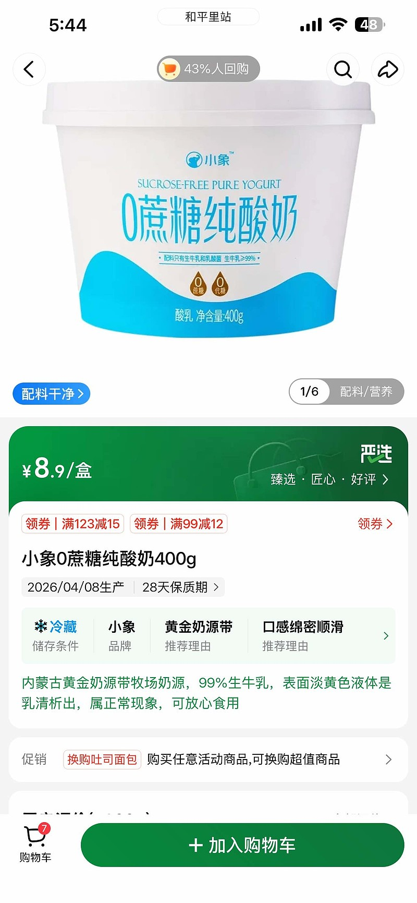

可见结构：

- 图集右下角 `1/6` + **配料/营养** 入口，图集左下角是“配料干净”这类品质徽标；
- 价格块：会员价/券、严选徽标；
- 标题下直接给 **生产日期 + 保质期**（如“2026/04/08生产 | 28天保质期”），可点开；
- 4 个短标签：`冷藏 / 储存条件`、`小象 / 品牌`、`黄金奶源带 / 推荐理由`、`口感绵密顺滑 / 推荐理由`；
- 一段 2–3 行的“人话”说明，解释真实可能出现的现象（乳清析出），降低售后；
- 促销/换购行；
- 底部购物车 + 加入购物车。

小象的关键不是“可爱文案”，而是**把短保、储存、推荐理由放在用户第一屏就能看到的位置**。

### 2.2 盒马

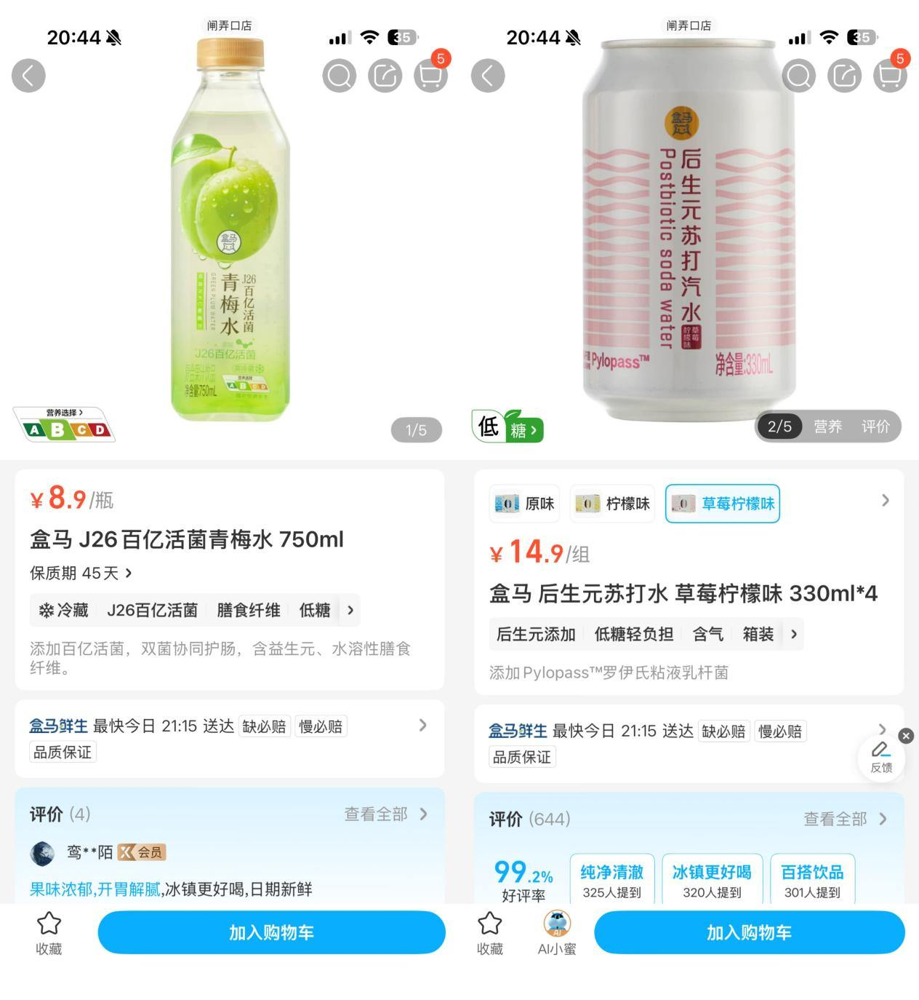

可见结构：

- 图集角标 `1/5`，右下角 **营养 / 评价** 两个入口；图集左下角是营养选择、低糖等徽标；
- 价格块 + 规格/口味选择；
- 标题下直接给 **保质期**（如“保质期 45 天 >”）；
- 4 个短标签：`冷藏`、`J26百亿活菌`、`膳食纤维`、`低糖`；
- 一段 1–2 行商品说明；
- 履约行：`盒马鲜生 最快今日 21:15 送达` + `缺必赔 / 慢必赔 / 品质保证`；
- 评价摘要：`99.2% 好评率` + 3 个高频标签（`纯净清澈 325人提到`、`冰镇更好喝 320人提到`、`百搭饮品 301人提到`）+ 一条代表性评价；
- 底部收藏 + 加入购物车。

盒马的“商品参数”是一个独立弹层，而不是主流程里的长卡片：

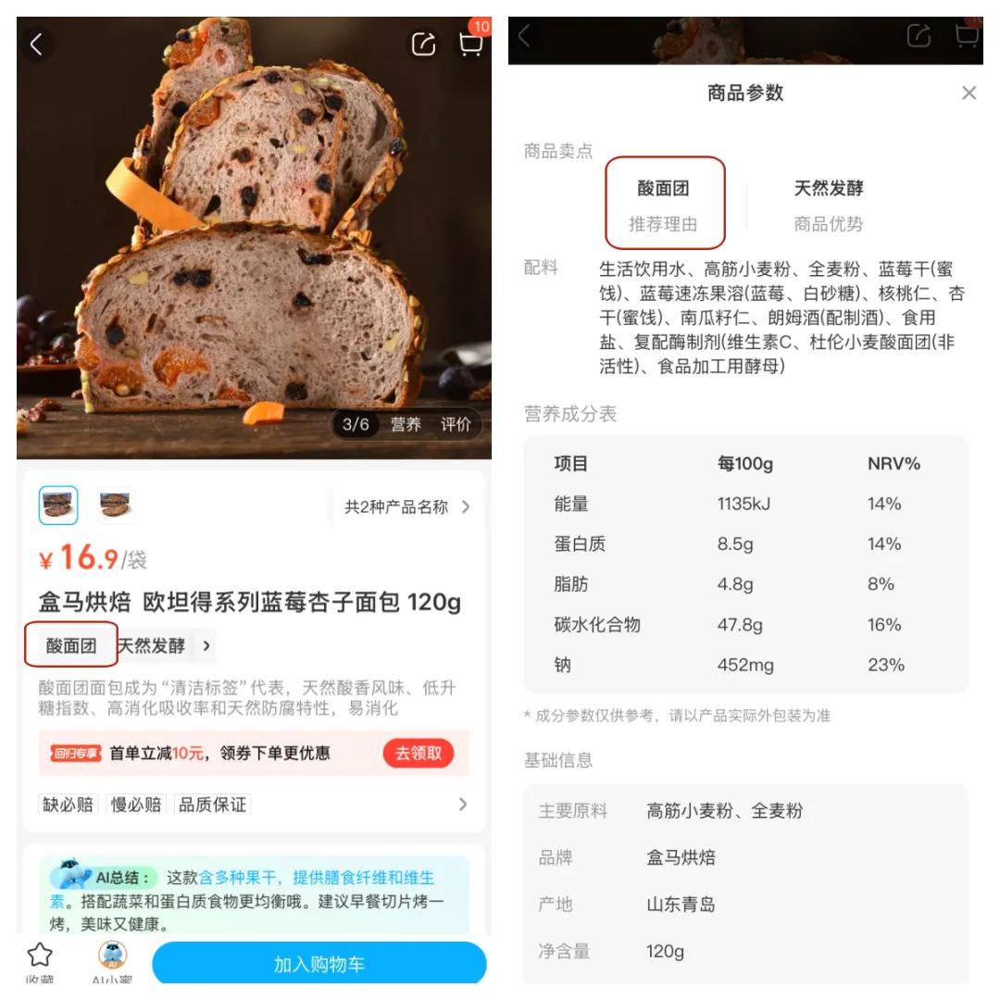

弹层里分四段：

1. **商品卖点**：`酸面团 / 推荐理由`、`天然发酵 / 商品优势`
2. **配料**：完整配料表
3. **营养成分表**：项目 / 每100g / NRV%
4. **基础信息**：主要原料、品牌、产地、净含量

这套结构的价值是：主页面保持短，真正想深挖的人再进弹层；而不是让所有人滚过一整屏参数。

### 2.3 悦航购当前效果

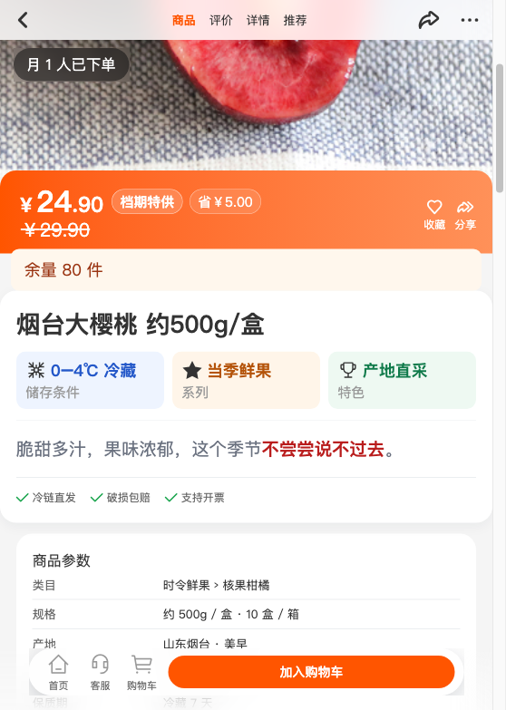

当前页面已经是“干净版”：

- 图集 → 价格/档期 → 标题 → 属性标签 → 卖点 → 服务承诺 → 商品参数 → 评价 → 详情 → 推荐；
- 全场满赠已经从商详移除，不再每个商品重复“订单优惠”；
- 服务承诺居中；
- 商品参数 6 行；
- 没有立即下单，只有加入购物车。

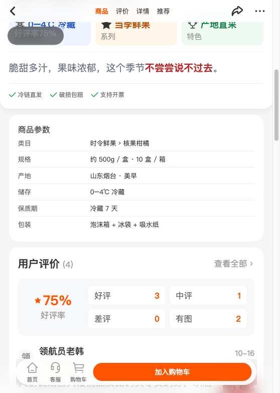

但和两家对比，还有 4 个明显差距：

1. **首屏缺采购决策信息**：规格、箱规、起订、产地都在下面的参数卡里，用户要滚下去才知道。
2. **参数卡是“终点”而非“入口”**：没有“查看全部/商品档案”，配料、营养、执行标准无处安放。
3. **评价只有框架没有内容**：`appraiseCount.tags` 前端已经支持，但数据为空，所以只剩“75% 好评率”；盒马那种“xx人提到”的标签没有出现。
4. **详情只有一段话**：没有产地、工艺、食用场景、质检这类结构化内容；而盒马已经把“商品卖点/配料/营养/基础信息”拆开。
5. **固定口碑气泡**：左上角“好评率/月售”气泡是 `position: fixed`，滚动后会压住属性标签和参数。两家也做悬浮口碑，但只悬浮在图集区，不压正文。

## 三、建议的目标结构

不增加新卡片，只调整信息位置，并把深度内容收进一个弹层：

```text
┌──────────────────────────────┐
│ 图集 1/6                      │
│                              │
│ ¥24.90 /盒   档期特供 省¥5     │
│ 烟台大樱桃 500g/盒            │
│ [0–4℃ / 储存] [500g/盒 / 规格] │
│ [10盒/箱 / 箱规] [烟台 / 产地]  │
│ 当季现摘，果径均匀…（2行以内）  │
│ ✓ 冷链直发  ✓ 破损包赔  ✓ 开票 │
├──────────────────────────────┤
│ 当前靠港安排（有上下文才显示）  │
├──────────────────────────────┤
│ 商品参数（6行）      商品档案 › │
│ 查看全部参数                   │
├──────────────────────────────┤
│ 评价 75% + 高频标签 + 2条      │
├──────────────────────────────┤
│ 商品详情（产地/储存/场景 3块）  │
├──────────────────────────────┤
│ 分类入口 / 猜你喜欢            │
└──────────────────────────────┘
底栏：加入购物车
```

「商品档案」弹层只放参数卡没有的深层信息，避免与「商品参数」重复：

```text
商品档案
  配料 · 营养 · 标准
  配料表
  营养成分（每 100g）
  过敏原 / 执行标准
  认证与保障
  脚注：以实物包装标注为准
```

## 四、优先级与落点

### P0：只复用现有字段，先把首屏做对

| 改动 | 具体做法 | 代码/数据 | 验收 |
|---|---|---|---|
| 首屏 4 个采购标签 | 用 SKU + params 计算：储存、规格、箱规、产地；起订量 >1 时才显示“起订” | `GoodsInfo.vue`、`goods-purchase.ts`；`goodsSkus.unitSpecText/baseQtyPerSalesUnit/baseUnit/minOrderQty`、`params` | 430px 首屏能看到价格、标题、4 标签、承诺；缺字段自动隐藏，不出现空标签 |
| 商品档案入口 | P0 先在图集试做过胶囊；P1 已改为参数卡头部文字链「商品档案 ›」。弹层只展示参数卡没有的配料/营养/标准，不重复参数行 | `GoodsParamCard.vue` + `GoodsProfileSheet.vue` | 入口不与图集页码抢位置；打开/关闭正常；弹层内容与参数卡不重复 |
| 评价标签 | 前端已支持 `appraiseCount.tags`，先补高频商品标签数据；无数据时不留空行 | `GoodsComment.vue` + 评价数据 | 有数据时出现 3 个“xx人提到”；无数据不占位 |
| 固定口碑气泡 | 从 `position: fixed` 改为图集内绝对定位，或滚出图集后隐藏；不再压正文 | `GoodsInfo.vue` 样式 | 滚动到参数/评价时气泡不覆盖文字 |
| 规格数据治理 | 给在售商品补 `unit_spec_text`、`base_qty_per_sales_unit`、`base_unit`、`min_order_qty`；后台用类目模板 | `goods_sku`、管理端表单 | 商详 4 标签有真实数据；不靠前端猜 |

P0 不需要改表结构，也不新增后端接口。先把“首屏能不能做采购判断”解决。

### P1：补“商品档案”数据，学盒马的弹层

| 改动 | 具体做法 | 数据 |
|---|---|---|
| `goods_profile` | 新增 JSON 字段：配料、营养成分、过敏原、执行标准、认证；不重复放类目/规格/产地/储存/保质期 | 后端 `GoodsSpu` + TypeHandler；管理端「商品档案」表单；C 端弹层 |
| `detail_sections` | 结构化详情：产地/工艺、储存/食用、适用场景；每块支持一段文字 + 一张图 | 后端 JSON；管理端编辑器；C 端按块渲染 |
| 批次日期 | 生产日期/保质期如果是批次级数据，放 SKU/批次表，不在 SPU 上造假；有才显示 | 批次表/入库单 |
| 评价标签聚合 | 从评价内容抽高频词，或运营维护标签；展示“标签 + 人数” | 评价服务/运营后台 |

“商品档案”优先做食品类；非食品只显示基础信息，不出现“配料/营养”空段。

### P2：内容和场景

- 产地/加工过程短视频；
- “船上怎么吃/怎么存”的 2–3 个场景卡；
- 同船/同港复购、同航线推荐；
- 到港时间与批次新鲜度联动。

P2 进展（2026-11-22）：

- **已落地「船上怎么存 / 怎么吃」场景卡**：复用商品现有储存、保质期参数，只对食品类目显示；饮料类标题自动改为「船上怎么喝」，非食品不出现。当前为前端计算，不新增字段，也不在 SPU 上编造批次日期。
- **批次新鲜度暂不做**：现有库没有商品批次/入库时间表，`procurement_source_batch` 是采购导入批次，不是商品批次。要做得先补独立批次表（生产日期、到港日期、批次号），再和商详联动，不能用 SPU 字段伪造。
- 短视频、同船/同航线推荐继续后置。

## 五、不建议照抄的部分

- **领券中心/会员券包**：B2B 零售限时玩法已停运，不要借商详改造复活。
- **立即购买**：已确认不要；两家也都只有“加入购物车”。
- **盒马 AI 总结**：需要真实评价与商品数据支撑，B2B 场景下容易产生信任风险。
- **营养 A/B/C/D 分级**：没有第三方检测数据就不要做视觉分级。
- **小象的“人话”文案语气**：可以学“解释真实现象”，但不要学可爱化表达；B2B 用“规格、储存、适用场景”说话。
- **把配送/包邮行重新加回商详**：当前共享层已经定过口径——普通免费商品不展示运费，只有收费或靠港场景才出配送行；不要为了像盒马而加回噪声。

## 六、验收标准

1. 在 430×932（iPhone 15 Pro Max 逻辑尺寸）首屏内，用户不滚动就能看到：价格、商品名、4 个采购标签、服务承诺。
2. 「商品档案」入口在参数卡头部，打开后只出现配料/营养/过敏原/标准/认证；基础参数继续在参数卡内，不重复出现；关闭后页面高度不变。
3. 评价有标签时显示 3 个“标签 + 人数”；无数据时不留空白。
4. 详情为空时不出现空白“商品详情”卡；有结构化内容时按块渲染。
5. `月售 1 件` 保持现状；不出现立即下单、不出现领券中心。
6. `vue-tsc` 通过；商详契约测试、参数/承诺相关测试通过；新增字段按双模式补 `db/boot` 与 `db/cloud` 增量 SQL。

## 七、建议的开工顺序

1. 先做 P0 的 4 个标签 + 商品档案入口 + 气泡修复，不改表，1–2 天可看到效果。
2. 用 10–20 个高频商品补评价标签和规格数据，验证“扫读感”是否成立。
3. P1 再上 `goods_profile` 与 `detail_sections`，从食品类目开始，非食品不铺。
4. 最后做批次日期、产地视频、场景推荐，避免一开始把后台录入负担做重。

## 八、P0/P1 落地记录（2026-11-22）

P0 与 P1 的 C 端部分已完成，当前 H5 预览可见。下图是 P1 调整后的实际页面：图集只保留页码，入口移到参数卡头部。

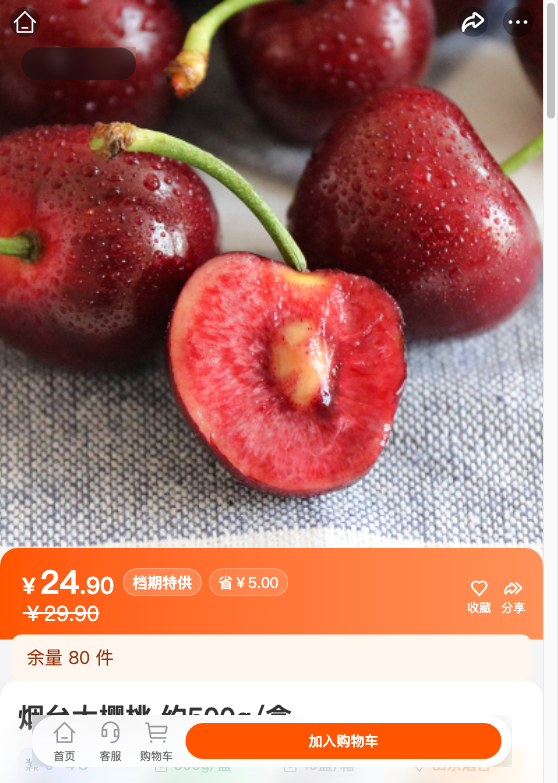

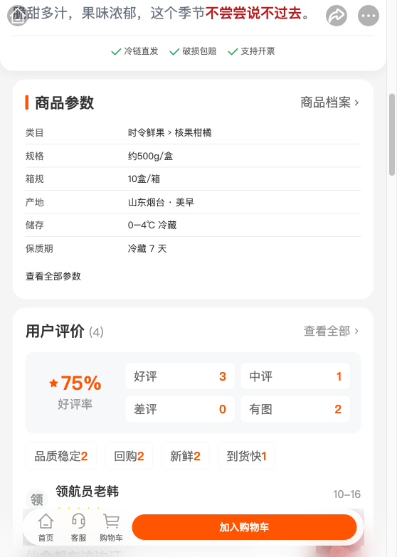

已落地内容：

- **首屏 4 个采购标签**：储存、规格、箱规、产地；起订量 >1 时才补“起订”。樱桃显示 `0–4℃ / 500g/盒 / 10盒/箱 / 山东烟台`，不足 2 条时回退运营配置的 `attrTags`。
- **商品档案入口重设计（P1）**：最初在图集右下角试做胶囊，实际效果抢页码且显得多余；已移除，图集只保留 `1/N`。入口改到「商品参数」卡头部右侧的小号文字链「商品档案 ›」，与「参数卡负责快速参数」形成明确分工。
- **商品档案去重（P1）**：弹层不再重复类目/规格/箱规/产地/储存/保质期，只展示参数卡缺失的配料表、营养成分、过敏原、执行标准、认证与保障；内容为空时整段隐藏。
- **参数卡补箱规**：`splitUnitSpecText` 从 `unit_spec_text` 拆出单份规格和箱规，参数卡新增“箱规”行。
- **评价标签**：`GoodsComment` 原有 `appraiseCount.tags` 能力启用；樱桃本地预览数据补了 `品质稳定 / 回购 / 新鲜 / 到货快`。
- **口碑气泡**：从 `position: fixed` 改为图集内 `absolute`，随图滚动，不再压住标题/参数；弹出动画只做位移缩放，不依赖 `opacity: 0 → 1`，避免自动动效受限时气泡整颗不可见。
- **属性条四列**：`GoodsAttrTags` 从“超过 3 张横滑”改为“4 张等宽、超过 4 张横滑”，并加 compact 字号，避免“500g/盒”被省略号截断。

代码落点：

- `aryn-mall-uniapp/src/utils/goods-purchase-tags.ts` / `.test.ts`
- `aryn-mall-uniapp/src/utils/goods-params.ts`（`splitUnitSpecText`、`boxSpec`）
- `aryn-mall-uniapp/src/sub-pages/product/goods-detail/components/GoodsInfo.vue`
- `aryn-mall-uniapp/src/sub-pages/product/goods-detail/components/GoodsProfileSheet.vue`
- `aryn-mall-uniapp/src/sub-pages/product/goods-detail/components/GoodsAttrTags.vue`
- `aryn-mall-uniapp/src/sub-pages/product/goods-detail/index.vue`
- `aryn-mall-uniapp/src/sub-pages/locales/modules/product.zh-CN.ts` / `product.en-US.ts`
- `aryn-mall-uniapp/src/sub-pages/product/goods-detail/detail-info-layer.contract.test.ts`
- `aryn-mall-uniapp/src/sub-pages/product/goods-detail/goods-social-bubble.contract.test.ts`（气泡位置从 fixed 断言改为 absolute）

验证：

- `npx vue-tsc --noEmit` 通过；
- 全量 `npx vitest run --config vitest.config.ts`：P1 改动后最终 **179 个测试文件、2021 条测试全部通过**（P0 当时为 178 个 / 2015 条）；
- H5 实测：4 标签、商品档案开/关、评价标签、气泡随图滚动且首帧可见均正常。

数据说明：

- 樱桃评价标签只写本地预览库，用于验证“评价标签”效果，未写生产 SQL；
- 生产环境需要运营给评价打标签，或由评价服务做高频词聚合；
- P0 没有新增表字段，不需要双模式增量 SQL。

### P1：商品档案与结构化详情

商品档案弹层只承载深层信息，打开后不再与商品参数重复：

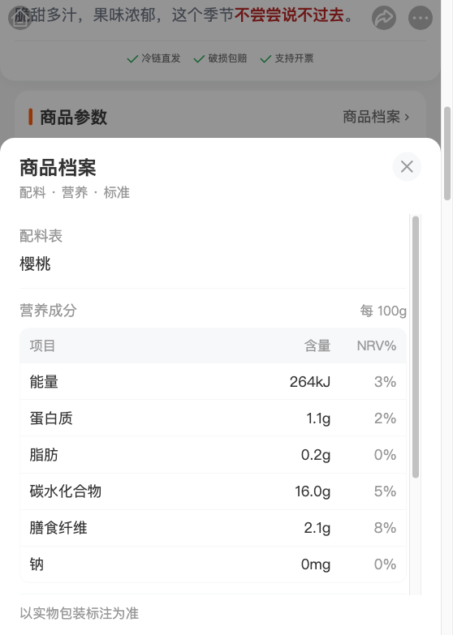

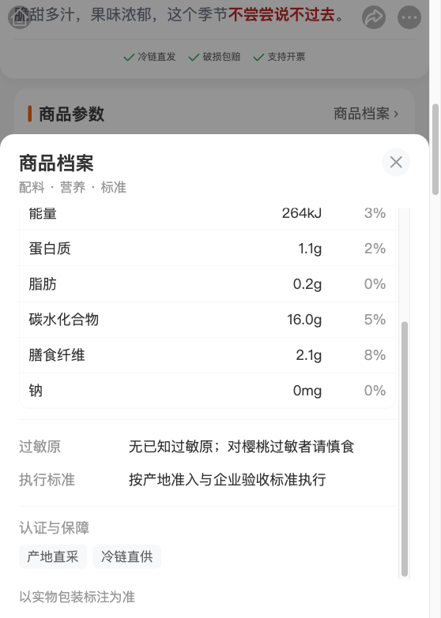

商品详情区改为结构化段落，放在原富文本描述之前：

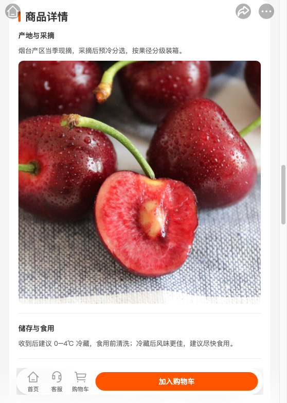

已落地内容：

- **数据层**：`goods_spu` 新增 `goods_profile`、`detail_sections` 两个 JSON 字段；`GoodsProfile` 只管配料、营养、过敏原、执行标准、认证，`GoodsDetailSection` 管「标题 + 正文 + 可选配图」。
- **C 端**：`goods-profile.ts` 负责归一化并过滤空段；`GoodsProfileSheet.vue` 只接收 `profile`；`GoodsDetailSections.vue` 在「商品详情」区按块渲染；`GoodsParamCard.vue` 提供头部入口。
- **管理端**：商品 SPU 表单新增商品档案区（配料、过敏原、执行标准、认证多选、营养成分行增删）与结构化详情段落（标题、正文、单图）。
- **双模式 SQL**：`db/boot/1017goods_profile_detail_sections_incremental.sql`、`db/cloud/1017goods_profile_detail_sections_incremental.sql` 各一份；boot 全量脚本已重新生成并校验。

验证结果：

- 当前部署为 **boot 单体模式**，本次按 boot 链路验收：`aryn-boot` 容器、`aryn_boot` 库、boot 增量 SQL 与全量 SQL 均已验证；cloud 脚本只用于保持双模式代码一致，本次不执行。
- 后端已重新打包、重建镜像、重启 `aryn-boot`；`GET /boot/app/goodsspu/9740000000000000201` 实际返回 `goodsProfile` 与 `detailSections`。
- H5 实测：参数卡头部入口可打开弹层；弹层可滚到最底部，过敏原、执行标准、认证均正常显示；结构化详情三段正常渲染。
- uniapp `vue-tsc --noEmit` 通过；全量 `vitest` **179 个测试文件、2021 条测试全部通过**。
- 管理端 `@vben/web-ele typecheck` 通过；表单运行态（配图选择、营养行增删、保存回显）尚未实际点验。
- `aryn_boot_full.sql` 已重新生成，`verify-full-sql.mjs` 校验通过，共 35353 行。

数据说明：

- 测试环境已按类目批量补齐：635 个在售 SPU 全部写入 3 段结构化详情，510 个食品类 SPU 写入商品档案，635 个 SKU 补齐 `unit_spec_text`；非食品 SPU 不写配料/营养，商品档案入口自动隐藏。
- 批量补数前已备份 `p1_bak_goods_spu_20261122`、`p1_bak_goods_sku_20261122`；数据只写入本地 `aryn_boot` 测试库，生产环境未执行。
- 商品档案字段目前只做 TypeHandler 映射，未在 service 层做条数/长度归一化，录入侧主要靠管理端表单约束。

### P2：船上场景卡

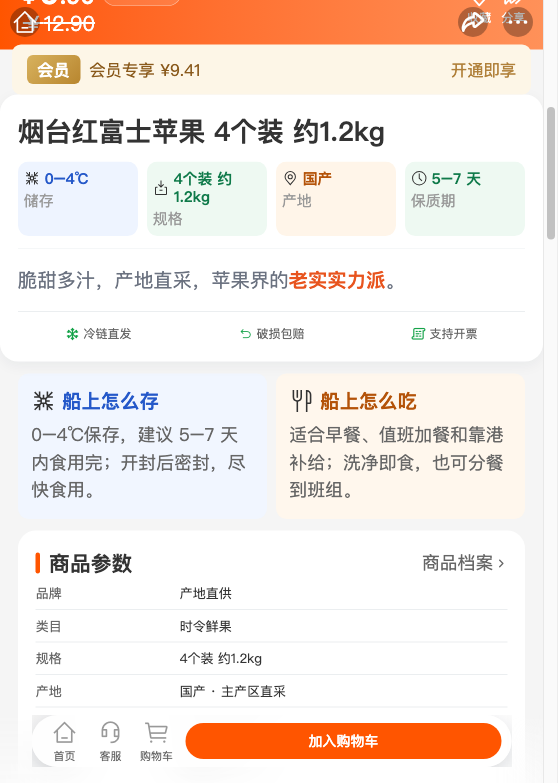

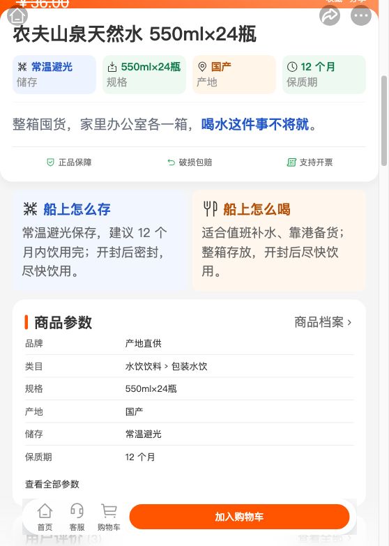

已落地内容：

- 新增 `goods-use-scenarios.ts`，从商品类目、储存、保质期生成两张场景卡；非食品返回空数组，不出现空卡。
- 新增 `GoodsUseScenarios.vue`，接在商品信息卡下方、参数卡上方；两张卡分别用蓝色储存、橙色饮食场景区分。
- 饮料类标题由「船上怎么吃」自动改为「船上怎么喝」；苹果等食品显示「怎么吃」。
- 顺手修正参数卡头部在子组件内丢失 `flex`、导致「商品档案」换行的问题，头部入口恢复右侧对齐。
- 服务承诺行从居中改为按可用宽度等分铺开，三项贴齐左右两侧，不再全部挤在中间。
- 承诺图标按语义拆分：正品保障用盾牌勾、破损包赔用退款箭头、支持开票用票据、冷链直发用雪花，不再统一用对号。
- 修复顶部 tab 点击无响应：评价卡在 `GoodsComment` 子组件里，页面级 selectorQuery 量不到 `#scroll-comment`；改为 H5 点击时用原生 DOM 现量锚点、原生 `window.scrollTo` 滚动，非 H5 保留 uni 查询。商品/评价/详情/推荐四个 tab 均已实点验证。

代码落点：

- `aryn-mall-uniapp/src/utils/goods-use-scenarios.ts` / `.test.ts`
- `aryn-mall-uniapp/src/sub-pages/product/goods-detail/components/GoodsUseScenarios.vue`
- `aryn-mall-uniapp/src/sub-pages/product/goods-detail/index.vue`
- `aryn-mall-uniapp/src/sub-pages/product/goods-detail/components/GoodsParamCard.vue`（头部布局兜底）

验证：

- 苹果页显示「船上怎么存 / 船上怎么吃」；饮用水显示「船上怎么存 / 船上怎么喝」；维达抽纸不显示场景卡。
- `vue-tsc` 通过；场景卡单测 5 条通过；全量测试 **180 个测试文件、2026 条全部通过**。

批次新鲜度没有一起做：当前没有商品批次表，先用 SPU 造到港日期会失真。下一步若要做，需要补 `goods_batch`（批次号、生产日期、到港日期、保质期）和入库单联动。

## 参考来源

- 小象超市商详截图：[微博](https://m.weibo.cn/detail/5331541963309471)
- 小象超市酸奶商详截图：[雪球](https://xueqiu.com/7669473740/384963884)
- 盒马商详截图与评价标签：[新浪财经](https://finance.sina.com.cn/jjxw/2025-11-03/doc-infwatrz1557584.shtml)
- 盒马商品参数弹层截图：[今日头条](https://m.toutiao.com/group/7492049575306379814/)
- 盒马商详结构（配送/服务/评价/详情）：[腾讯网](https://new.qq.com/rain/a/20220324A03MW300)
- 盒马商品介绍与内容结构：[FoodTalks](https://www.foodtalks.cn/news/47368)
