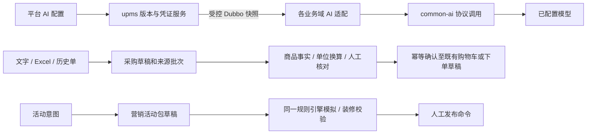

# AI 能力、采购与营销闭环开发改造计划

> 执行要求：使用本机 `executing-plans` 技能逐任务实施。用户已要求新开会话执行，不再询问执行方式；每阶段汇报验证结果后继续推进。
> 技能位置：`/Users/wangqingyu/.agents/skills/executing-plans-0.1.0/SKILL.md`。技能中 worktree、默认等待反馈等通用建议服从本仓库和本次用户授权：使用当前目录，禁止 worktree，不因例行检查点反复索要确认。

**目标**：让平台管理员在后台切换已适配协议的 AI 供应商，并交付可核对、可恢复、可追溯的采购与营销业务闭环。

**架构**：提取 L1 `aryn-common-ai` 协议模块，平台配置和版本归 upms，采购编排归 order，商品单位与召回归 product，营销草稿和模拟归 promotion。业务事实跨域走 `*-api` + Dubbo，生成结果进入草稿与确定性规则，不直接成为订单、价格或已发布活动。

**技术栈**：Java 17、Spring Boot 3.5.16、MyBatis-Plus、Dubbo、MySQL、Redis；管理端 Vue 3 / TypeScript / Element Plus / Vben；移动端 UniApp / Vue 3 / TypeScript；沿用现有 JDK HTTP 客户端，不以引入大型 AI 框架为前提。

**计划日期**：2026-11-15。**工作目录**：`/Users/wangqingyu/IdeaProjects/codes/ARYN`，下列代码路径均相对该目录。**进度台账**：[执行进度](./2026-11-15-AI能力与采购营销改造-进度.md)。

---

## 1. 输入、授权和交付边界

按以下顺序阅读，文档中的旧建议不自动成为新授权：

1. 根 `AGENTS.md`、`docs/README.md`、`docs/10-开发指南/开发工作流.md`。
2. [代码可行性评估](../../50-需求文档/2026-11-14-主流同类产品AI能力调研/03-结合当前代码的可行性评估.md)。
3. [管理端 AI 配置与供应商切换](../../50-需求文档/2026-11-14-主流同类产品AI能力调研/04-管理端AI配置与供应商切换.md)。
4. [原易用性方案](../../50-需求文档/2026-11-14-主流同类产品AI能力调研/02-易用性优先的AI落地分析.md)，只作场景来源；与最新 B2B 规则冲突处采用本计划。
5. [船供 B2B 活动与会员体系重构](../../50-需求文档/2026-11-14-船供B2B活动与会员体系重构/README.md)，尤其活动范围、采购主体、权益与停运规则。

本次新会话的实施范围是 **T00—T29 全部任务**，不能完成配置页面或公共客户端后就宣称整个方案完成。T30 是后续扩展路线和接口预留说明，不在本次代码完成标准中。现有个人、船供、企业三场景均保持原授权与交易语义；每条新能力以同一服务规则覆盖三个场景，页面入口按现有业务提供。

用户允许开发阶段改造：可调整内部实现、未上线 DTO 和表结构，按模块迁移调用方，不要求长期保留有缺陷的双协议。仍必须保留现有订单、价格快照和工作区数据。新会话可以修改代码、生成迁移和运行本地验证；真实外部模型计费调用、对现有数据库执行迁移、推送、部署、发布真实活动不作为自动执行步骤，先准备可审阅结果，有现成明确授权和隔离测试环境时再按授权验证。

### 不得改变的约束

- 当前目录已有大量未提交 B2B 修改，当前分支为 `codex/b2b-activity-member`；执行时重新核对，不切换分支、不使用 worktree、不回退、不覆盖或格式化无关内容。
- 不自动提交、推送；如用户后续要求提交，只选择本任务改动，标题与正文使用中文。
- 后端无 biz 之间直接 import。`common-ai` 不依赖 upms、security、Redis、业务实体；调用方传入配置、租户审计上下文和结果接收接口。
- 新增 API 路径沿用实际 Gateway 服务域；Controller 采用现有去域后的映射，不写 `/boot`。前端统一复用 `parseOpenBoot` / `rewriteBootUrl`。
- 所有业务表有 `tenant_id`、逻辑删除和审计字段；平台 AI 配置也归系统识别的平台租户，不能硬编码租户 ID。跨租户平台配置只通过专用受控读取，不能开放通用配置 CRUD。
- 营销仅允许现行 B2B 体系：协议价、档期特供 12、阶梯 4、满量/满额 7、买赠 5、会员专区 10、出清专区 11、定向券、采购档期。会员/出清专区继续由专区标签和系统活动治理，不能生成任意手工 10/11 活动。停运类型禁止新增、复制复活或发布；历史订单读侧与补偿仍保留。
- 原始数量用 Decimal；成交数量一期仍为整数销售件数。无单位、无数量、约重、规格冲突不能静默转换成正常行。
- AI 不产生权威价格、库存、净含量、成本、权限或合规采购定额；模拟和确认时重新读取事实。

## 2. 里程碑与依赖

| 里程碑 | 任务 | 可验收结果 | 前置 |
|---|---|---|---|
| M0 基线 | T00 | 工作区保护清单、影响范围、验证基线 | 无 |
| M1 AI 基座与后台 | T01—T07 | 供应商/模型/用途/版本/调用记录；文本与向量调用迁移；无重启切换及安全回滚 | T00 |
| M2 商品度量 | T08—T10 | 单位/包装/MOQ/步长维护，通用确定性换算与成交检查 | T00，T07 为召回接入前置 |
| M3 采购闭环 | T11—T17 | 文字/Excel 异步草稿、异常核对、来源替换、幂等确认、复购复用、弱网恢复 | M1、M2 |
| M4 同船履约 | T18—T20 | 稳定归组、截单/延误与管理界面，独立订单和签收 | M3 采购主体契约 |
| M5 营销闭环 | T21—T27 | B2B 命令、草稿模拟、AI 活动包/装修草稿、人工发布及可恢复发布记录 | M1；可在采购后顺序实施 |
| M6 总验收与交接 | T28—T29 | 三端回归、双模式 SQL 与迁移手册、所有未验证项明确登记 | M1—M5 |
| 后续路线 | T30 | 图片/PDF、语音、模板、发品、客服、问数的接入路径 | 不阻塞本次闭环 |

执行按表顺序串行推进，避免同一目录被并发改写。每项按“读取落点 → 增加必要的行为回归 → 实现 → 定向验证 → 更新台账”拆成小步。出现普通实现问题先修复；缺少外部凭证时继续完成可模拟验证的任务，不把它标成真实联调通过。只有存在无法独立解决的业务分歧或不可逆操作才向用户询问。

### 运行态数据流



## 3. 关键契约先定清楚

### 3.1 AI 配置与调用

- 能力枚举：`STRUCTURED_TEXT`、`EMBEDDING`，预留 `VISION`、`ASR`、`IMAGE_GENERATION`，未实现能力在后台明确不可启用。用途枚举：`PROCUREMENT_PARSE`、`SKU_RERANK`、`MARKETING_DRAFT`、`PRODUCT_COPY`、`CATALOG_EMBEDDING` 等，能力约束固定在服务端。
- 模型配置含协议、模型 ID、能力、超时、输入/输出限制及经过白名单校验的参数。`thinking`、`dimensions`、结构化输出参数按适配能力发送，不能对所有“兼容”接口强发。
- 启用版本是不可变快照：用途绑定、模型参数、端点、凭证版本引用、配置摘要都固定。替换 Key 创建新的凭证版本，不能修改旧凭证使在途任务悄悄换 Key。
- `resolve(usage, trustedBusinessContext)` 返回受控运行快照；`checkRuntimeState(version, provider)` 在每次调用/重试前检查紧急停用。只向允许的内部调用方返回必要配置，HTTP 管理接口永不返回明文 Key。用户传来的 tenantId 不能成为跨租户读取凭证的依据。
- 新任务在创建时确认权威启用版本；广播失效 + 短 TTL 仅是优化。upms 不可达时，新 AI 任务不能用过期配置冒充已生效；可转规则路径或等待。旧任务保持原快照，紧急停用仍能阻止后续调用，运行态检查失败不继续外呼。
- 每次外呼带 `callId/taskId/tenantId/usage/configVersion`；错误统一为鉴权、限流、超时、协议、非法结果、已禁用等。规则降级须在报告中可见，解析缺字段不能伪装成功。
- 文本配置可版本回滚；Embedding 的运行绑定是“查询模型 + 索引版本 + 目录版本”的成套引用，各租户索引未准备好时继续旧套或字面召回。

### 3.2 商品度量与采购行

建议在 `GoodsSku` 上增加 `salesUnit/baseDimension/baseUnit/baseQtyPerSalesUnit/quantityPrecision/minOrderQty/stepQty/unitSpecText/measurementRevision`；`quantityPrecision` 表示 EXACT / APPROX / UNKNOWN，不表示小数位数。原始单位归一到质量 g、体积 ml、件、长度 mm 等固定基准；最终字段命名实施时与现有风格统一。

纯规则输出：`rawQuantity/rawUnit`、`normalizedBaseQuantity`、`suggestedSalesQuantity`、`roundingReason`、`measurementRevision`。对于 3 斤且每销售袋精确 1 kg，需求为 1500g，建议 2 袋并说明包装取整；若为约 1kg/把，则进入人工确认；量纲不符、无换算依据则不产生可自动确认数量。

采购行分开保存 `parseStatus`、`matchStatus`、`unitStatus`、`quantityStatus`、`reviewStatus`。参考值：unit 为 EXACT / APPROX / UNKNOWN / MISMATCH，review 为 REQUIRED / CONFIRMED / REJECTED。只有事实与数量合法且所需人工确认已完成才允许确认；模型评分只用于候选排序，不是正确率。

### 3.3 草稿、批次与幂等

- 长期 `procurement_draft` 独立于共享车的 24 小时收集窗口，归属 tenant + actor + scene + buyer/vessel 授权范围。
- 每次输入建 `procurement_source_batch`，保存输入类型、摘要、原件/文本引用、解析配置/模板版本、任务状态与 lease；行保存来源位置、候选、匹配/换算证据和人工处置。
- `clientRequestId` 防网络重试建重复批次；内容摘要仅用于同主体/草稿内提示重复，不能作为全局禁止同文再次采购的唯一键。默认遇重复返回既有批次并提示；用户显式选择新采购才创建新批次。
- 追加、替换上一批、另开采购是不同命令。贡献记录以 batch + sourceRow + targetLine 归属，替换只撤销本批贡献，保留手工贡献和其他人/批次贡献。手工修改成为明确贡献或冲突，不用“总数减旧数”猜测。
- 处置写入带 revision；确认带 requestId + expectedRevision。任务锁/草稿锁 + 贡献唯一约束 + 状态更新在同一本地事务内，跨域查事实与模型调用在事务外；事务内校验事实版本/有效期及目标行，成交仍由现有订单服务最终校验。

### 3.4 履约与营销

- 业务合送组、仓库拣货波次、司机出车单分别建模；合送组具有稳定 ID，tenant/warehouse/vesselCall/windowSequence/cutoff 等为字段。ETA 改变不改变主键。不同港口、船舶、靠港或仓库不误合并。
- 营销活动包一期为“一个主活动 + 可选定向券 + 一个页面草稿”。主活动支持档期特供、阶梯、满量/满额、买赠；协议价是采购主体价格政策，作为显式政策建议走既有命令，不自动套成公开活动。会员/出清专区只选已有合法货盘。
- `simulate(draftRevision, scenario)` 将未发布草稿叠加到隔离事实快照，复用正式计算核心；不临时发布，不扣库存、预算、券或名额。成本缺失标 UNKNOWN，展示情景测算，不推断因果收益。
- 人工发布绑定草稿修订号、试算输入摘要和事实有效期，最终重新校验。用可恢复操作记录控制多步骤发布；同服务同库能事务的步骤用本地事务，跨服务用幂等命令/outbox/补偿，不能宣称一笔普通事务覆盖所有服务。

## 4. 数据与接口实施约定

### 双模式 SQL 交付单

| 领域 | 新增或调整的逻辑数据 | Cloud 基线与配置 |
|---|---|---|
| upms | AI provider/model/credential_version/config_version/runtime_state/call_log；菜单权限 | upms 基线、Nacos upms 租户表与部署密钥/网络策略 |
| product | SKU 度量字段；审核后的编码/别名映射；向量索引 generation/item 与构建状态 | product 基线、product Nacos；不要把 2000 条查询当全目录 |
| order | 采购 draft/batch/row/contribution/job 必要字段；合送 group/order link/operation | order 基线、order Nacos；复用旧导入数据时提供映射与兼容阅读策略 |
| promotion | campaign draft/revision/simulation/publish operation 与关联 ID | promotion 基线、promotion Nacos |

表名是设计落点，实施可合并等价字段，避免重复建表。例如 batch 自带持久 job 状态可不再单建 job 表，但不能用纯内存任务替代。

每个 DDL 任务必须同时完成：

1. 执行前重新扫描两目录最大编号，各自递增，采用相同语义后缀；当前观察到 boot 246 / cloud 263，只作基线，不预占号码。
2. 在 `aryn-mall-java/db/boot/`、`db/cloud/` 各建可重复执行增量 SQL；列/索引用 information_schema 守卫，迁移数据不覆盖人工修订。新表可 CREATE IF NOT EXISTS；不 DROP/TRUNCATE 存量。
3. Cloud 对应微服务完整基线补同等定义；所有新增租户表登记 boot yml、biz yml/Nacos 及相关租户测试清单，遵守既有配置风格。
4. 更新 `db/boot/build-full-sql.mjs` 的 sections，生成并验证 `aryn_boot_full.sql`；只生成文件，不能在存量库执行全量重建脚本。
5. 在隔离临时数据库连续执行增量两次核对幂等、默认值与旧数据迁移；无隔离环境时记为待验，不能用“SQL 已生成”代替“已实跑”。

### HTTP 入口

| 功能 | 前端 Cloud 路径前缀 | Boot 改写前缀 | Controller 映射 |
|---|---|---|---|
| AI 配置 | `/upms/ai-config` | `/boot/ai-config` | `/ai-config` |
| 采购草稿 | `/mall-order/app/procurement-drafts` | `/boot/app/procurement-drafts` | `/app/procurement-drafts` |
| 采购管理/履约 | `/mall-order/procurement-drafts`、`/mall-order/delivery-groups` | `/boot/procurement-drafts`、`/boot/delivery-groups` | 对应去域路径 |
| 营销活动包 | `/promotion/campaign-drafts` | `/boot/campaign-drafts` | `/campaign-drafts` |

现有 API 保留自己的域与映射。第一段必须核对 Gateway 实际路由，尤其订单域为 `mall-order`，不能凭模块名写 `/order`。仅前端调用需要服务域，Controller 与仓库既有模式一致。

## 5. 逐任务实施

### T00：冻结工作区边界与验证基线

**读取**：`AGENTS.md`；三端 package/pom；本计划；需求评估 03/04。**修改**：仅进度台账，必要时新增本需求目录下的验证基线记录。

1. 运行 `git status --short`、`git diff --stat` 与相关文件 diff，记录分支、HEAD、在途修改。标记 `OrderInfoServiceImpl`、`OrderPriceComputeService`、`PromotionEngineServiceImpl`、boot yml、SQL 构建器、商品/装修 UI 等交叉文件，编辑前后核对无关片段。
2. 检查 Java/Node/pnpm 实际版本与现有依赖；不顺带升级项目。尝试 Graphify / UA；不可用则用 `rg`、调用链与 API 搜索回退并登记限制，不恢复已删除 harness。
3. 先运行当前涉及域的定向用例及两端类型检查；耗时全量基线可在首次模块验收时运行并保存结果。失败按“本次改动 / 既有 / 环境”区分，不能直接套用历史通过数字。
4. 在进度台账记录命令、结果和基线后开始 T01，不停在计划确认。

**验收**：现有改动保护清单可复查；未运行的检查明确写未运行。

### T01：提取公共 AI 协议模块与契约

**新增**：`aryn-mall-java/aryn-common/aryn-common-ai/pom.xml`，该模块 `src/main/java/com/aryn/cloud/common/ai/` 下 contract/client/protocol/error 包。**修改**：`aryn-mall-java/aryn-common/pom.xml`、`aryn-mall-java/pom.xml`。**测试新增**：模块 `src/test/java/com/aryn/cloud/common/ai/AiProtocolClientTest.java`。

1. 定义不可变请求/快照/结果，包含能力、用途、调用 ID、版本、token/维度等；业务方提供可信 tenant/task 标签，公共模块不自行查权限或配置库。
2. 以本地 HTTP stub 写行为回归：兼容文本与 embeddings 正常响应、401/429/超时、非法 JSON、截断、错误维度；确认用例先失败再实现。
3. 实现两个现有协议适配，固定可选参数白名单、响应体/输入大小限制、取消与超时。允许一个协议多个供应商，不按供应商名写业务 if 分支。
4. 结构化输出做 schema/字段约束；限制重试次数和总时间，非幂等生成不能无界重试；无效结果返回明确错误，不吞异常返回空列表。
5. 执行 V-JAVA 定向命令（见 §6），检查无低层反向依赖。

**验收**：fake server 能断言不同配置发往不同端点；不会对未声明支持的模型发送 `thinking/dimensions` 等字段。

### T02：实现平台 AI 配置表、凭证与权限边界

**新增**：upms-api 的 AI 配置实体/DTO；upms-biz `config/AiCredentialProperties.java`、`support/AiCredentialCipher.java`、AI mapper/service。**参考**：`aryn-mall-java/aryn-upms/aryn-upms-biz/src/main/java/com/aryn/cloud/upms/support/PlatformTenantGuard.java`。**修改**：两模式 SQL 与部署配置；`aryn-mall-java/aryn-common/aryn-common-log/src/main/java/com/aryn/cloud/common/log/aop/LogAopAspect.java`。**新增测试**：upms-biz `src/test/java/com/aryn/cloud/upms/ai/AiCredentialCipherTest.java`、`AiConfigAuthorizationTest.java`。

1. 按 §3.1/§4 建数据模型：配置修订号、不可变凭证版本、active revision、逻辑删除、审计；请求 DTO 独立于落库实体。
2. 用 AES-256-GCM、随机 nonce、keyId、带 tenant/provider/credentialVersion/purpose 的 AAD；主密钥部署注入，支持旧 key 解密与轮换。不复用 ECB `AesUtils`，不 import pay-biz。
3. API Key 操作为 KEEP / REPLACE / CLEAR，REPLACE 要求新明文；返回只含配置状态和掩码。CLEAR 不允许生成仍需要 Key 的有效版本。
4. 平台管理方法复用 PlatformTenantGuard 并校验 `query/edit/test/activate` 独立权限；普通租户即使伪造平台 tenantId/持有菜单权限仍拒绝。
5. 补 apiKey/Authorization/credential 等日志脱敏，异常不回传供应商原始鉴权正文；错误 nonce/AAD/密钥、掩码回写、跨租户读取均有测试。
6. 完成双 SQL、租户表登记及 V-SQL，部署密钥无值时可启动非 AI 功能，配置操作/启用时明确报缺失，禁止弱默认密钥。

**验收**：无浏览器可取明文 Key 的接口；数据库泄漏单独不能恢复凭证；旧版本凭证可供在途任务按留存策略使用。

### T03：实现配置草稿、能力测试、启用和回滚

**新增**：upms-biz `controller/AiConfigController.java`、`service/impl/AiConfigServiceImpl.java`、`support/AiEndpointPolicy.java`；upms-api 版本/测试结果 DTO。**测试新增**：`AiConfigServiceTest.java`、`AiEndpointPolicyTest.java`。

1. 实现 provider/model/usage 草稿读写，expectedRevision 乐观并发控制；草稿修改不影响 active。
2. 固定最小样本测试指定模型能力，记录配置摘要、时间、结构化输出/维度结果；测试结果过期或配置改变后不能复用为启用依据。测试按钮写清会产生少量用量。
3. 自定义端点校验 HTTPS/允许协议、实际解析 IP、重定向、响应大小；默认拒绝回环/内网/元数据，部署显式 allowlist 才允许本地模型。测试与正式调用共用该策略，不留绕过分支。
4. 本地事务 CAS 切 active revision，并记录 activation/rollback 操作；回滚创建新的切换记录，仍引用不可变原版本。能力未适配、参数不合法、无密钥、未通过对应能力测试则拒绝启用。
5. 提供紧急停用 provider/全局用途入口；不将连接成功展示成“业务准确率合格”。
6. 覆盖并发编辑/启用、配置修改后测试失效、测试失败不改 active、回滚审计等行为。

**验收**：后台改草稿/错误 Key 不破坏已启用版本；支持的协议内可配置 A/B 两个端点与模型。

### T04：实现受控运行快照、多实例生效与用量

**新增**：`aryn-mall-java/aryn-upms/aryn-upms-api/src/main/java/com/aryn/cloud/upms/api/remote/RemoteAiConfigService.java` 及 DTO；upms-biz `dubbo/RemoteAiConfigServiceImpl.java` 与运行态/用量服务。**测试新增**：`AiRuntimeSnapshotTest.java`、`AiUsageBudgetTest.java`。

1. 定义 resolve/currentVersion/checkRuntimeState/reportUsage 契约，限定调用方/业务用途与可信租户上下文，禁止将平台任意配置 CRUD 暴露为 RPC。
2. 执行时审查 Dubbo 的真实内部调用安全边界；将凭证读取约束在专用路径。确需受控平台租户上下文切换时用 finally 恢复，遵守租户绕过审计，不能注解整个 mapper 忽略租户。
3. active 更新后 Redis 发布失效消息；新任务向权威服务验证 active，实例缓存按版本键存不可变快照，失效消息丢失也不能长期沿用旧 active。
4. 每次外呼/重试前检查 emergency epoch；紧急停用时在途任务后续请求被拒绝。检查失败暂停或规则降级，不继续访问旧 Key。
5. 按 tenant/usage 限制并发、单任务 token/行数/调用数和日用量；用 requestId 幂等记账，未知 token 标记未知，不伪造精确金额。调用记录只存必要标签、摘要和脱敏错误，不默认保存客户原文/prompt。
6. 模拟两个实例和失效消息丢失、upms 短暂不可达、重试重复上报、tenant context 线程复用，验证 §3.1。

**验收**：新任务使用权威启用版本，旧任务固定版本；紧急停用无需等待普通 TTL；跨租户看不到业务调用记录。

### T05：接入管理端 AI 配置完整页面

**新增**：`aryn-mall-ui/apps/web-ele/src/api/upms/ai-config.ts`；`src/views/system/ai-config/index.vue` 及 provider/model/usage/version/log 组件。**参考**：现有 `src/api/upms/storage-config.ts` 与配置页面。**修改**：双模式菜单/权限 SQL。**测试新增**：同目录 `ai-config-state.test.ts`、`ai-config-form.test.ts`；扩展 `src/api/boot-url.test.ts` 的实际新路径案例。

1. 复用项目表单/表格/弹窗，分供应商、模型、用途版本、调用记录四页签；未适配能力显示后续接入，不提供可误启用的选项。
2. Key 默认“保留”，显式替换/清除；编辑回填绝不拿掩码当输入。切换协议后清理不适用参数，支持手动填模型 ID。
3. 完成保存草稿→固定样本测试→查看差异/用途影响→启用→查看生效版本→回滚与紧急停用，显示版本冲突和错误状态。
4. 记录页按权限显示用途/模型/版本/耗时/用量/错误，索引页展示各租户 embedding 准备情况；普通租户无平台入口，后端仍执行守卫。
5. 测试表单序列化、Key 三态、并发 revision 冲突、不支持能力和 URL 重写。运行 V-UI 定向、类型与改动文件格式检查。

**验收**：通过 fake A/B 端点演示后台切换流程；确认 `/upms/ai-config/...` 在两模式下正确改写，动态菜单可到达页面。

### T06：迁移现有文本和向量调用，建立数据库唯一配置源

**修改**：`aryn-mall-java/aryn-order/aryn-order-biz/src/main/java/com/aryn/cloud/order/support/ChainAiAssistant.java`、`aryn-mall-java/aryn-product/aryn-product-biz/src/main/java/com/aryn/cloud/product/support/EmbeddingClient.java`；两个 biz pom；boot/order/product yml 与 Cloud Nacos。**新增**：各域 AI runtime adapter、一次性 bootstrap 命令/服务及测试。**回归**：`ChainAiAssistantTest`、`EmbeddingClientTest`。

1. 业务 adapter 经 upms-api 取快照，再传 common-ai；移除 final @Value 供应商配置的实际运行分支，保持领域输出校验。
2. 为旧环境配置提供显式一次性导入：不把 Key 写 SQL/控制台；已存在有效配置时不覆盖；导入后仍是草稿，能力测试与启用走同一流程。
3. 未启用文本 AI 时沿用可见的规则解析降级；未启用向量时用字面召回。后台显示“未配置/已停用/规则降级”，不能暗用环境里的另一家模型。
4. 消除整数截断：解析 Decimal，缺数量标记 REQUIRED；候选外 SKU 拒绝，结构化字段缺失/输出截断完整记录。
5. 用两个本地 fake provider 验证切换无需重启、旧任务使用旧快照、文本和向量不同提供商互不覆盖；运行旧用例后更新有缺陷的旧断言。

**验收**：`ChainAiAssistant` / `EmbeddingClient` 的实际请求完全受 active 配置版本控制，部署密钥/网络策略外没有模糊双来源。

### T07：把向量缓存升级为可切换的持久索引

**修改**：`aryn-mall-java/aryn-product/aryn-product-biz/src/main/java/com/aryn/cloud/product/support/CatalogVectorRecallService.java` 与相关 mapper；`CatalogVectorRecallServiceTest.java`。**新增**：product-biz 索引构建服务/任务、索引 generation/item mapper，product-api 索引状态 DTO 与受控远程管理契约；双 SQL。

1. 为 tenant + model/config fingerprint + dimension + catalogRevision 创建 generation，分页游标遍历完整在售目录；移除 `CATALOG_LIMIT=2000` 的静默覆盖上限，分批进度与失败可见。
2. 离线持久构建、分布式 lease 防重复建、断点恢复；查询不在用户请求内同步构建整个目录。初期可以 MySQL 保存向量并有界内存加载，记录容量/检索耗时，达到阈值后再评估专用向量库。
3. 向量长度严格等于声明维度，禁止取短长度点积。检索只回 SKU 候选 ID/排序理由，再取实时商品、价格和库存，不把索引里的旧事实作确认依据。
4. 新旧模型即使同维度也视为不同空间。新索引通过覆盖/维度验证后按租户原子切换引用；未完成继续旧模型+旧索引；旧模型不可用则字面降级。
5. 配置回滚校验旧 generation 仍可用；只按留存策略清理无引用索引。商品变更通过版本/增量任务更新并在查询时过滤删除下架 SKU。
6. 测试 2001+ 目录完整遍历、同维不同模型、异维拒绝、两个实例重建幂等、切换中查询/回滚/下架事实，完成双 SQL 和索引状态 UI。

**验收**：热更新 embedding 不混空间；查询任务不被冷启动整库网络请求阻塞；索引覆盖数和降级状态可查。

### T08：建立商品度量事实与迁移

**修改**：`aryn-mall-java/aryn-product/aryn-product-api/src/main/java/com/aryn/cloud/product/api/entity/GoodsSku.java`、`api/vo/ReplenishImportMatchVO.java`、`api/dto/ReplenishImportMatchDTO.java`（后两者相对 product-api Java 包）；product-biz `service/impl/GoodsSpuServiceImpl.java`、`service/impl/ProductExcelConverter.java`。**新增**：度量 DTO/枚举、双 SQL；度量字段/迁移测试。

1. 按 §3.2 增加结构化度量字段和 measurementRevision；约束销售单位非空时基准量纲一致、换算系数 >0、MOQ/step 为正整数。
2. 旧 SKU 销售单位显示为“件/待核对”，数量门槛默认 1；度量精度 UNKNOWN，不从标题/HTML 自动推断成 EXACT。迁移不能凭“500g”字符串自动写成已审核事实。
3. 更新商品保存/复制/批量 Excel/详情读取/候选接口，全链带度量与版本；纠正 MOQ/step 永远 null 的旧注释和接口。
4. 编码与别名使用租户内审核映射，码制区分 SKU_ID、IMPA、ISSA、客户自编码；没有映射就不承诺识别。别名新增先为待审核，不能由一次 AI 选择直接污染全租户目录。
5. 校验非法系数/负门槛/维度不一致、旧 SKU 读写兼容、复制保留事实但重建版本；完成双 SQL。

**验收**：商品事实有唯一维护入口；未审核旧数据可继续普通整数件购买，但不能自动换算外来 kg/斤为销售件数。

### T09：实现纯换算规则并接入所有成交入口

**新增**：`aryn-mall-java/aryn-product/aryn-product-api/src/main/java/com/aryn/cloud/product/api/support/ProductMeasurementRules.java` 及输入/结果 DTO。**修改**：同包 `ReplenishMatchRules.java`；order-biz `support/ReplenishImportClassifier.java`、`service/impl/OrderInfoServiceImpl.java`、`OrderPriceComputeService.java` 与实际购物车加购/改量入口。**测试新增**：product-api `ProductMeasurementRulesTest`；order-biz 成交门槛回归。

1. 先写参数化行为用例：3斤→1500g、1.5kg、500ml→0.5L、箱/件精确系数、约重、不同量纲、未知单位、0/负值、缺数量、MOQ=3/step=2、超大数与小数边界。
2. 使用 BigDecimal 和明确舍入，规则返回建议件数/取整原因/需确认标记；MOQ/step 采用一套有文档的口径：数量至少 minOrderQty，且 `(qty-minOrderQty) mod stepQty = 0`，默认二者均 1。同步核对现有 `ReplenishMatchRules`，统一旧差异而非两套共存。
3. 用例示例：3斤、精确1kg/袋、MOQ1/step1→建议2袋且说明多500g；约1kg/把→2把只作建议、REQUIRED；按把但无重量→UNKNOWN，不产生自动成交数量。
4. order 通过 product-api 取得度量，公共纯规则不查询数据库；购物车、共享车、导入、复购、结算/下单一致使用整数销售件数门槛，最终下单重新校验最新 SKU 事实。
5. 规则拒绝不能被“客户端已确认”绕过；人工只能确认约量建议或明确改成销售件数，不能凭确认标记接受负数、非法步长或跨量纲自动换算。
6. 运行规则定向 + 订单既有价格/下单回归，特别保留当前 B2B 协议价 minQty 与商品 MOQ 的独立校验，不把两个概念合并覆盖。

**验收**：同一 SKU 同一数量在所有入口结果一致；Decimal 不经 `intValue()` 静默截断。

### T10：补齐商品管理端度量与编码维护

**修改**：`aryn-mall-ui/apps/web-ele/src/api/product/goods-spu.ts`、`src/views/product/goods-spu/form.vue`、`goods-spu-form-validation.ts`；实际 SKU 表格组件、商品 Excel 导入导出。**新增**：度量表单/别名与编码审核组件、行为测试；必要菜单权限双 SQL。

1. SKU 行维护销售单位、基准量/单位、精确或约量、MOQ/步长、展示规格；常见单位提供选择，自定义显示名不能直接当可计算单位。
2. 显示换算预览和旧数据待治理状态；保存失败定位到具体 SKU 字段，不让整表只报“参数错误”。
3. Excel 模板增加单位事实列及审核标志，校验错误报告保留行号；管理端确认前不批量把推测文本标成精确。
4. 编码/别名映射显示来源、状态、审核人；支持批量导入已审核映射，重复/冲突按租户与码制提示。
5. 测试表单数字序列化、修改 measurementRevision、约量提示、冲突；V-UI 验证并检查新请求两模式路径。

**验收**：运营能完成一批真实 SKU 的度量治理，采购链路不依赖开发者手工写数据库。

### T11：建立持久采购草稿、来源行和贡献模型

**新增**：order-api `entity/ProcurementDraft.java`、`ProcurementSourceBatch.java`、`ProcurementDraftRow.java`、`ProcurementContribution.java` 及 command/report DTO；order-biz mapper/service；双 SQL。**修改/迁移参考**：`SharedCartImport`、`SharedCartImportRow` 与对应表、`SharedCartServiceImpl`。

1. 按 §3.3 建状态、revision、摘要、输入原件、候选/证据/处置、目标明细与贡献关系；候选只存必要商品事实快照，显示时再取当前数据。
2. 定义 draft OPEN/CONFIRMING/CONFIRMED/ARCHIVED；batch QUEUED/RUNNING/REVIEW_REQUIRED/READY/CONFIRMED/FAILED/CANCELLED，允许失败块恢复但已确认批次不可原位重算覆盖。
3. `clientRequestId` 幂等；同草稿/主体/操作者/内容摘要碰撞返回 DUPLICATE 决策及原批次，显式新采购可绕过内容去重并记录意图。哈希不跨租户去重泄露他人输入。
4. 旧已确认导入保留只读报告与来源标识；未确认任务迁移为新草稿或明确要求重新解析。未能重建的旧购物车贡献标 LEGACY，禁止猜测性自动替换，仍可人工改量。
5. 写迁移/隔离/幂等测试：跨天重开、同租户不同主体、相同内容不同新采购意图、已确认旧任务读取；完成双 SQL。

**验收**：采购草稿生命周期独立于共享车 24 小时窗口，服务重启后原文、候选与人工处置不丢失。

### T12：实现可恢复异步处理与短事务

**新增**：order-biz `service/impl/ProcurementJobService.java`、`job/ProcurementJobWorker.java`、专用线程池配置与测试。**修改**：`SharedCartServiceImpl.previewChainImport`、`ReplenishDirectImportServiceImpl` 对应入口；boot/order/cloud 部署配置。

1. 提交短事务保存 draft/batch/input 和待处理状态；提交后触发 worker，持久队列扫描作为漏唤醒恢复，不依赖内存 future 存活。
2. 原子 claim lease + fencing token，保存 attempt、heartbeat、nextRetryAt；过期可重领，旧 worker 失 lease 后不能覆盖新进度。异步执行显式设置/恢复租户与业务上下文。
3. 模型/RPC/文件抽取在事务外；按块保存短事务进度，部分失败保留成功行。重试只处理未完成块，输出按 sourcePosition + parseRevision 幂等写入。
4. 取消状态在每块/外呼前检查；已完成外呼但未提交结果不会越过取消/lease CAS。重跑明确选原配置版本或当前版本，保留修订历史。
5. 有界线程池/队列、租户公平并发、模型预算限制；扫描机制兼容 boot 调度与 cloud 多实例，不能每实例无限并行扫同一任务。
6. 测试进程重启模拟、lease 过期双 worker、跨租户线程复用、半批失败恢复、取消与重试竞争；证明外呼时无数据库事务持续占用。

**验收**：HTTP 创建任务快速返回 ID，可轮询状态；不再在同步长事务内等模型解析整份清单。

### T13：统一文字/Excel 抽取及行级来源

**修改**：order-biz `support/ChainAiAssistant.java`、`ChainOrderTextParser.java`、`ReplenishImportExcel.java`；**新增**：`service/impl/ProcurementExtractionService.java` 与来源协议测试；沿用原 Excel 2000 行限制并可配置。

1. Excel 确定性读表，文字按段/成员/行分片；保留原始文本、原始 Decimal 数量/单位、姓名、规格、编码、sheet/row/offset，不让模型把单位消掉。
2. 输入/输出 token 预算分块；记录源区间和覆盖清单，截断或源行未覆盖则块 FAILED/REVIEW_REQUIRED。无法证明覆盖时不能声称“全部处理完成”。
3. AI 输出按 schema 解析；缺数量只返回 REQUIRED，规则回退同样保留未知项。模型生成新商品名/数量必须对应源片段，否则进入人工核对。
4. 处理重复标题、合并单元格、空行、单位列/备注列、同名不同人、中文数字和小数；复杂表达可以待核对，不为提高覆盖率默认 1。
5. 保存 parserSource/configVersion/templateVersion、块级错误和行级证据，支持报告重新打开完整展示。
6. 对现有解析、Excel 用例做真实行为回归；增加输出超长、8192 token 截断、多块边界重复/漏行、规则 fallback 用例。

**验收**：同一输入的行号与原始单位可追溯；2000 行输入通过分片而非一次大模型调用处理。

### T14：统一候选匹配、单位判定与处置保存

**修改**：product-biz `service/impl/ReplenishImportMatchServiceImpl.java`、`mapper/ReplenishImportMatchMapper.xml`（实际 XML 在 resources）；product-api `remote/RemoteReplenishImportMatchService.java`；order-biz 导入分类。**新增**：order-biz `ProcurementMatchingService`、`ProcurementReviewService` 及测试。

1. 顺序采用已审核编码/别名、词法、同版本向量召回；AI 只能对服务端候选排序，候选外 ID 拒绝。规格、品牌、包装与单位进入判定，不仅比较名称。
2. 读取实时 SKU/库存/价格与度量版本，调用 T09；分别存 match/unit/quantity/review 状态，近似或未知单位始终在待核对区。
3. 人工可换 SKU、改成明确销售件数、确认约量建议、补数量、拒绝行；每次决定保存操作者、revision、前后值和原因。候选改选不自动审核全局别名。
4. 处置保存采用 expectedRevision，冲突返回当前版本与冲突行；批量确认只操作满足前置条件的行，返回剩余问题清单。
5. 覆盖名字相近但量纲不同、相同 SKU 两种规格、候选下架、库存变动、测量事实更新、两端同时处置、越权拿草稿 ID 等用例。

**验收**：一个“匹配成功”不能跳过单位、数量和人工状态；重新打开报告完整保留候选和处置。

### T15：实现贡献级追加/替换与幂等确认

**新增**：order-biz `ProcurementConfirmationService`、贡献仓储与确认测试。**修改**：`SharedCartServiceImpl.confirmImport/mergeIntoCartItems`、直导入确认及目标购物车改量入口；order-api 确认 DTO。

1. 用行为测试先固化：同 requestId 重试、同任务换 requestId 重试、同文再预览、A/B 成员同 SKU、手工改量后替换、替换并发确认、部分行拒绝、事实失效。
2. 确认前在事务外取受权商品事实和目标版本，事务内锁定草稿/批次/目标行，核对 revision/状态与事实有效期；必要事实变化退回核对，最终成交仍走现有下单兜底。
3. ADD 追加本批贡献；REPLACE 指定旧 batch，撤销其仍有效贡献并加入新批贡献；不直接删整个 SKU。手工加减是可归属的贡献修订；无法安全分解的 LEGACY 明细返回冲突并要求人工决定。
4. 贡献插入唯一键、目标数量聚合、旧批取代状态、新批确认状态、幂等响应在同一本地事务提交。失败回滚全部本地写入，避免成功响应丢失导致再次加购。
5. 个人直购产出可追溯的现有下单草稿/购物车引用，不在此服务代付或绕过下单权限；共享车保持成员/归属人语义。
6. 改量/删行/清空同样维护贡献关系与 revision；确认后商品量纲事实变化重新结算核对，不重用旧价格。

**验收**：重复确认不翻倍；替换上一份不会吞掉其他成员和后续手工添加；网络重试可返回相同结果。

### T16：交付移动端采购工作台与恢复体验

**修改**：`aryn-mall-uniapp/src/sub-pages/order/shared-cart/chain-import.vue`、`src/api/order/replenishImport.ts`、`sharedCart.ts`、`src/store/directImportOrderStore.ts`、`sharedCartStore.ts`，相关页面路由和中英语言包。**新增**：`src/api/order/procurement-draft.ts`、采购报告/核对组件与状态测试。

1. 复用已有“待处理/正常”分区，增加按人分组、原文/单位证据、候选、换算解释、剩余问题计数；不重新造一个普通聊天页。
2. 创建后轮询任务，支持离页继续、重开/重试失败块/取消；服务器草稿是权威，本地只保未同步处置。
3. 遇重复显示“继续原批次 / 替换这份 / 作为新采购”，明确影响范围；确认前展示销售件数、取整多买量和被替换来源。
4. 本地缓存 key 含 tenant/用户/场景/主体，登录或身份变化清理未授权状态；revision 冲突展示需重载的行，不强覆盖服务端。
5. 弱网重复点击/响应丢失仍复用 requestId；退出重进后已确认不再追加；中英提示对齐。
6. 写状态流/请求重试/身份切换行为测试，扩展 `src/api/core/boot-url.test.ts` 新路径案例，V-UNI 验证；检查小程序包和 H5 实际流程。

**验收**：移动端完成文字和 Excel 两条从创建到确认的路径，断网重开保留人工工作。

### T17：整合常购、历史单和旧导入入口

**修改**：order-biz `controller/app/AppOrderInfoController.java`、`AppReplenishImportController.java` 及共享车 controller；`SharedCartServiceImpl.reuseFromHistory`；移动端 `src/sub-pages/product/frequent/index.vue`、相关复购入口与 stores。

1. 常购/frequent-purchase、reorder-preview、共享 reuse 的结果统一作为 HISTORICAL/REORDER 来源批次，继续使用既有主体授权和重复保护，不新增另一套“AI 常购”表。
2. 历史价格/规格仅作来源，按当前 SKU、度量、协议和库存重新预览，展示下架/换包装/数量门槛变化。
3. 旧文字/Excel 接口切到新服务，所有调用方迁移完成后移除有缺陷的同步旧分支；保留历史报告阅读入口，不长期双写两套贡献。
4. 测试历史多成员复用、原船舶权限已失效、旧 SKU 下架/量纲变化、同批复用重复确认；回归个人/船供/企业三场景。

**验收**：复购、直接导入、共享车使用相同单位与确认管道；不破坏已有常购与历史 reuse 能力。

### T18：建立稳定合送组和截单语义

**新增**：order-api DeliveryGroup/OrderLink/Operation DTO 与实体；order-biz `DeliveryGroupService`、mapper 与双 SQL；单测。**参考**：现有订单 vessel/vesselCall/warehouse 字段、PurchaseSceneEnum 与配送资格守卫。

1. 定义稳定 groupId、tenant/warehouse/vessel/vesselCall/windowSequence、计划窗口、cutoff、revision，状态 OPEN/CLOSED/FULFILLING/COMPLETED/CANCELLED；订单链接保留加入/移出操作记录。
2. 同 tenant/warehouse/vesselCall 且窗口兼容的待履约订单才能归组；靠港计划已关闭/跨船/跨港/跨仓拒绝，时间调整更新字段而非重建 key。
3. cutoff 由业务配置/管理员明确设置；没有合法配置则不猜测“提前几小时”，提示待排程。截单后默认进入下一窗口/单独配送，管理员特批须重校验运力/状态并留理由。
4. scene1 个人订单和船/企业补给单可以同组，订单、支付、退款、开票/对账和签收权限独立；分组列表对普通买家仅显示自己订单及公共履约信息。
5. 订单取消/改靠港/ETA 延误通过幂等操作更新归组并触发通知事件，重复消息不重复加入。
6. 测试同船不同靠港、同时截单/加单、ETA 更改、个人退款、成员退出与越权查看；完成双 SQL。

**验收**：合送依据稳定业务标识，可解释截单后的订单去向，不靠港口+日期字符串误合并。

### T19：接通既有波次、任务、出车单和通知

**修改**：order-biz `service/impl/FulfillmentServiceImpl.java`、`DeliveryTaskServiceImpl.java`、`DeliveryTripServiceImpl.java`、订单履约事件与消息域 API 调用。**测试**：`FulfillmentServiceTest`、`DeliveryTaskServiceImplTest`、`DeliveryTripServiceImplTest` 与新增归组回归。

1. 为业务组提供创建/选择波次、关联配送任务的适配，保留三者独立关系；一个司机出车单可以服务多个业务组，一个组也可拆配送，不用同 ID 复用。
2. 修复 `addOrderToWave` 首单将波次变 PICKING 后阻止第二单的问题：提供锁定波次的批量加单命令，在允许加入阶段统一校验并加入；拣货开始作为明确状态动作。原单单入口委托同一规则，已开始执行时不无条件开放加单。
3. 补 vesselCall/warehouse/tenant 完整一致性校验；根据实际拣货状态决定追加、另建波次或拒绝，不能只验港口。
4. 既有 assignTasks 能向出车单追加任务，明确在途追加的重新出发/通知语义；不把新加入订单默认标成已装车/已送达。
5. 延误/截单变更用现有消息通道 + 本地 outbox/幂等事件触发，通知只包含允许展示的订单信息；失败重试不改变原配送资格。
6. 个人每单签收继续检查本人或显式委托；同车/同船不是代签授权。测试部分签收/部分退款不批量影响整组。

**验收**：多单能进入合法波次与既有出车流程，首单不再意外封死后续合法加单；无第二套配送系统。

### T20：完善归组管理与到船结算体验

**新增**：管理端 `src/api/order/delivery-group.ts`、`src/views/order/delivery-group/index.vue` 和测试；菜单双 SQL。**修改**：现有配送任务/出车单管理视图；移动端 `src/store/shipContextStore.ts`、`src/sub-pages/order/order-confirm/index.vue` 与订单详情。

1. 管理端显示同靠港归组、订单数/待处理、截单、延误、拆组/特批与操作记录，操作按原配送管理权限授权。
2. 移动端沿用已有默认送船逻辑，显示当前靠港、截止时间和是否同批配送；过期船舶/靠港上下文需要重新确认，不沿用旧 ETA。
3. 保留 deliveryWay=3/4 现有 COD 默认及个人独立支付，不把“合送”改成合并付款；展示预计窗口不承诺固定到达时刻。
4. 只显示本人可见的订单详情；管理员组内汇总也按租户/职责范围。测试切船/个人切企业/截单刷新和无归组情况。
5. V-UI、V-UNI 定向与类型检查，新接口两模式改写、动态菜单和 H5/小程序入口检查。

**验收**：管理员能操作归组，买家理解当前订单配送安排，支付与签收行为保持各自订单边界。

### T21：收口 B2B 写入白名单并提取活动命令

**修改**：`aryn-mall-java/aryn-promotion/aryn-promotion-biz/src/main/java/com/aryn/cloud/promotion/controller/admin/ShipActivityController.java`、`service/impl/ActivityPublishGovernanceService.java`、`PricePolicyService.java`、采购档期/定向券保存发布入口。**新增**：`service/impl/B2bActivityCommandService.java`、命令 DTO、`B2bActivityCommandServiceTest.java`。

1. 定位所有保存/更新/复制/发布入口，不能只在 AI 接口增加限制；区分历史读取、补偿与新建写入，避免删掉历史订单处理。
2. 写统一的业务类型准入，拒绝新建/修改复活停运秒杀、折扣、拼团、新人9、领券中心、分销。定向发券继续可用；会员/出清由专区治理，不能从通用活动入口任意手工创建。
3. 将 Controller 的 Mapper 写入、详情校验、主体圈定、发布冲突、上下线抽到 service 命令。手工表单、复制、AI 活动包都调用同一命令，保留权限与 expectedRevision 检查。
4. 明确活动类型与协议政策区别，协议价复用 `PricePolicyService`、采购档期复用 `PromoCalendarService`，不把所有玩法硬塞一张通用 AI 表后绕开原规则。
5. 对每个写入口做参数化拒绝测试；对现行类型保存/修改/发布和停运历史只读/补偿做回归。禁止因为枚举仍有 type9 就视为可用。

**验收**：手工和 AI 均无法旁路复活停运活动；原 B2B 规则、价格快照、提成和 compensation job 保持有效。

### T22：从正式营销引擎提取可复用计算核心

**修改**：`aryn-mall-java/aryn-promotion/aryn-promotion-biz/src/main/java/com/aryn/cloud/promotion/service/impl/PromotionEngineServiceImpl.java`、`service/PromotionEngineService.java`、事实加载与 handler；相关 `PromotionEngineTest`。**新增**：`PromotionFactSnapshot`、`PromotionScenarioEvaluator` 等内部契约与回归。

1. 先记录当前协议价、特供、阶梯、身份价、满量/满额、买赠、定向券叠加及 reserve/release 行为；特别保护工作区已有协议价 minQty、特供件数配额和退款补回修复。
2. 把“按权限加载已发布事实”与“对给定事实计算”分开；原 preview/正式结算仍调用同一计算核心，不能复制一份 AI 计价分支。
3. 计算输入包含时点、场景、买方主体、SKU/数量、适用规则和必要成本事实；引擎只计算，不在纯评估中扣预算/锁库存/发券。
4. 为时间边界、主体权限、同价优先级和叠加互斥写黄金行为回归，使用确定样本比较拆分前后结果，不只测试方法被调用。
5. 定向测试后跑 promotion + order 相关现有测试，发现价格变化先查契约，不为了新模拟器修改正式结算结果。

**验收**：给相同事实快照，正式 preview 与内部纯评估结果一致，reserve/release 仍由原交易路径承担。

### T23：实现未发布活动包模拟器

**新增**：promotion-api `dto/CampaignSimulationDTO.java`、结果 VO；promotion-biz `service/impl/CampaignSimulationService.java` 与测试。**修改**：T22 事实装配/`PricePolicyService.dryRun` 的复用边界。

1. 输入草稿修订号 + 场景样本（SKU、数量、采购主体、时间），在受权事实快照上覆盖/注入草稿规则；区分新增活动与替换既有活动，防同一规则计两遍。
2. 同时展示原方案/草稿方案的单价、优惠来源、门槛/冲突、库存/配额假设和成本区间；无成本为 UNKNOWN，无销量预测就不显示保证 ROI。
3. 检查未来时点、协议/阶梯/会员权益取低、满额/券/赠品门槛、库存不足、预算和售价低于成本等风险；不能把 `PricePolicyService.dryRun` 当前局部预检冒充全模拟器。
4. 试算不写活动发布态、promotion_lock、券、预算占用或库存；保存仅为草稿模拟记录，含输入摘要、事实版本、结果、过期时间和操作者。
5. 测试草稿未发布可生效于模拟、正式 preview 仍看不到、模拟无副作用、事实改变使结果过期、不同主体无权合同价不泄露。

**验收**：无需临时发布/回滚即可比较草稿，规则解释来自正式计算核心。

### T24：实现活动包草稿和受约束 AI 生成

**新增**：promotion-api campaign draft/revision/command DTO；promotion-biz `service/impl/CampaignDraftService.java`、`CampaignGenerationService.java`、mapper、测试；双 SQL。**修改**：promotion-biz pom/配置，接入 common-ai 和 upms-api。

1. 草稿保存意图、目标主体/时间、预算、选品、一个主活动、可选定向券、页面引用、revision 和生成版本。生成持久异步状态，沿用有界任务/lease 设计，不能把采购业务实体直接当通用任务模块 import。
2. 对缺失的必要业务参数返回待补字段（如对象、档期、让利上限）；普通无阻塞文案可由模型建议，但不可猜造实际成本、库存与业务主体。
3. 以服务端已授权候选 SKU 和合法类型生成 schema JSON；严格检查引用、价格区间/让利门槛/预算、时间和主体；模型产物只能入草稿。
4. 主活动优先支持档期特供/阶梯/满量满额/买赠；协议政策用显式命令分支，专区只引用合法现有货盘；定向券不建领券中心。
5. 保存模型/配置版本、prompt模板版本、输入摘要和生成理由；失败可重试/手工编辑，保存不会自动发布。修改字段使旧模拟标记过期。
6. 测试模型返回停运类型/候选外 SKU/超预算/恶意组件引用/非法时间、并发改草稿、生成完成时人工已改 revision 等情况；完成双 SQL。

**验收**：自然语言意图能生成可编辑活动包，合法性由服务端命令验证；AI 不持有最终发布权限。

### T25：把活动包转换为装修草稿

**修改**：promotion-biz `service/impl/DefaultPageDesignDocumentValidator.java`、`PageDesignVersionServiceImpl.java` 与草稿服务；promotion-api `dto/PageDesignDraftDTO.java`；管理端 `src/views/promotion/page-designer/registry/component-registry.ts`、实际页面草稿 API。**新增**：`CampaignPageDraftBuilder` 及 schema/绑定行为测试。

1. 依据已存在组件注册表选择可用 B2B 商品/档期/图文组件；产物为白名单 JSON，不生成 Vue、HTML脚本或任意可执行代码。
2. 活动包页面先引用草稿逻辑 ID，预览时解析草稿事实；实际发布前映射到真实活动/券/页面 ID，校验引用完整，未发布 ID 不暴露为 C 端可用入口。
3. 文案可建议，价格/时间/库存展示绑定已校验事实；禁止生成停运专区入口、外部 JS、危险 URL。图片一期可使用已有素材，不把未实现生图接入伪装可用。
4. 调用既有 page schema、revision、模板和预览令牌；人工在原装修器继续编辑，编辑使活动包页面摘要变化并重新校验。
5. 测试新 JSON 经后端与前端 validator、草稿预览不泄露其他主体价格、活动引用失效、组件下线和危险链接。

**验收**：生成页可在现有装修器继续编辑和预览，C 端只读正式发布快照。

### T26：实现人工发布编排和失败恢复

**新增**：promotion-biz `service/impl/CampaignPublishService.java`、发布 operation/outbox mapper、重试恢复任务与测试；必要双 SQL。**修改**：T21 领域命令、既有页面/券发布契约。

1. 人工发布入口验证权限、expectedRevision、模拟记录摘要/有效期、主体与成本风险确认；事实已变化则要求重试算，不能沿用失效“绿灯”。
2. operation 用 requestId 幂等，保存每步前置状态和生成 ID；状态 DRAFT_VALIDATED/RESOURCES_PREPARED/PUBLISHING/PUBLISHED/FAILED_RECOVERABLE/COMPENSATING，实际字段可合并但不得只记成功布尔值。
3. 同库可原子提交活动与页面时用真实本地事务；跨服务先准备不可见草稿，再依幂等命令启用，页面最后曝光。故障时只补偿本 operation 新创建且仍被其拥有的资源，不回滚别人的后续人工编辑。
4. 一期不自动发券给用户；准备定向券规则与合法领取/发放配置，实际发放沿用现有授权命令。操作面板明确哪些步骤已生效，不能失败后一直显示“未发布”但实际活动已开。
5. 恢复服务从持久记录继续，重复点击/超时/进程崩溃不重复建活动和页面；历史发布回滚走既有权限及资源版本校验。
6. 注入每一步失败验证幂等、恢复、补偿和审计；验证 C 端入口只在资源一致可用后出现。

**验收**：人工一次发布动作可追踪并恢复，没有无状态的多接口串调和虚构跨服务事务。

### T27：交付营销工作台与事实指标

**新增**：管理端 `src/api/promotion/campaign-draft.ts`、`src/views/promotion/campaign-workbench/index.vue`、意图/方案/模拟/页面/发布状态组件与测试；菜单双 SQL。**修改**：现有 `src/views/promotion/ship-supply/index.vue` 与 page-designer 入口；后端 `PageDesignMetricService` 关联查询（确有授权指标时）。

1. 完整流程为输入意图→补齐必要字段→生成一个主方案→人工编辑→情景试算→装修预览→人工发布；已有手工创建入口继续调用 T21。
2. 显示选择理由、未知事实、让利/库存/预算冲突、固定样本情景；不展示没有数据支持的预估成交增幅或保证利润。
3. 操作权限拆分草稿编辑/模拟/发布，发布有清晰确认内容；配置 AI 的平台权限不等于租户发布活动权限。
4. 发布记录显示已完成步骤、失败原因、重试/补偿选项；页面关联可跳原装修器，不重造页面设计器。
5. 一期复盘展示现有可核实 page_view/component_click/render_error 与活动关联订单/优惠成本（仅能从已有可信关系拿到的部分）；缺少归因数据明确“暂无”，不宣称全 ROI。为后续固定问数定义指标标识与口径，不开放任意 SQL。
6. 测试停运类型无法选/提交、修订导致模拟过期、无权限发布、错误恢复；V-UI、相关 C 端装修回归与双模式路径验证。

**验收**：管理员可完成一个合法 B2B 活动包从意图到人工发布，既有装修页渲染和定向发券流程不被破坏。

### T28：执行系统回归与可复查验收场景

**新增**：本需求目录 `05-验收用例与验证记录.md`（完成时填写实测结果与证据，不预填通过）。**修改**：各任务行为测试、必要双模式契约测试。

1. 运行 §6 全部适用命令，修复本次引入失败，保存退出码/测试报告路径。存量失败核对基线后单独登记，不能用它掩盖新增失败。
2. 在隔离配置/数据库执行下表可复查场景；缺外部凭证时以本地 fake provider 验证协议与状态，真实供应商联调单列待验。

| 场景 | 必须观察到 |
|---|---|
| 后台 A→B→回滚 | 无重启；调用记录有版本；在途任务保持原版；旧 Key 不泄露 |
| 误配置与紧急停用 | draft 错误不改 active；运行外呼及重试可被停止；多实例消息丢失仍正确 |
| Embedding 切换 | 同维不同模型不混空间；2001+目录覆盖可见；未准备租户用旧套/字面回退 |
| 采购数量 | 3斤、1.5kg、约重、未知单位/数量、规格冲突、MOQ/步长，结果和核对状态准确 |
| 来源替换 | 重粘、双击、同任务重试、A/B成员同SKU、手工改量后替换均不意外翻倍/覆盖 |
| 恢复 | 重启worker、半批失败、离页/断网/跨天、身份切换、revision冲突都有可恢复结果 |
| 复购 | 当前价格/度量/库存重新校验；三种场景各自主体权限有效 |
| 履约 | 同船不同靠港不串组、截单追加明确、两单入波次、在途追加、个人部分签收/退款独立 |
| 营销 | 停运写入被拒；未发布可模拟且无副作用；成本未知有标记；部分发布失败可恢复 |
| 隔离 | 跨租户/同租户不同主体/已退出成员/无平台身份/异步线程复用均不泄露或越权 |
| 双模式 | 新请求路径/Controller/Dubbo契约/租户表/Nacos一致，boot编译与SQL校验通过 |

3. 采购效果使用一组人工标注的普通/困难样本，记录完整覆盖、误匹配、单位错配、人工改行数和耗时；样本是验证材料，不把小样本通过等同模型泛化质量。
4. 运行 UI 端到端人工/浏览器验证时只用隔离数据；不发送真实客户清单给未批准的模型。记录实际观察结果，不能仅凭组件测试宣称运行态已通过。

**验收**：每项有命令或可观察证据；“可配置”“可编译”“本地模拟通过”“真实供应商通过”“Cloud 部署联调”分别表述。

### T29：补齐迁移、部署与知识交接

**新增**：本需求目录 `06-部署迁移与运维手册.md`。**修改**：需求 README、04 配置说明、`docs/20-业务与数据/功能到代码索引.md`、`docs/40-接口与风险/README.md`、`docs/90-记录归档/需求记录.md` 与执行进度。

1. 整理两模式部署配置：AI 主密钥/keyId与旧key、端点准入、线程池/预算、配置 RPC、租户表、索引构建；变量名以实际实现为准，文档不放有效 Secret。
2. 写执行顺序：增量 SQL→两模式服务兼容部署→旧 env 显式导入草稿→能力测试→启用文本→按租户构建向量→切索引→开放采购/营销入口。未配置 AI 仍可规则路径与手工业务。
3. 写回滚：应用版本兼容/业务入口关闭、AI 配置版本回滚、索引成套回退、发布 operation 恢复；数据库采用向前修复，禁止用 DROP 新表或恢复整库当默认回滚。
4. 说明旧任务/贡献 LEGACY 处置、原文/调用记录/旧凭证/向量留存与清理；清理执行逻辑符合逻辑删除和审计要求，不无限保存含人员信息的原件。
5. 完成台账：已完成任务、仍待真实环境验证、遗留风险和明确后续路线。未完成 T00—T29 不能把项目整体标为完成；外部验收未做要保留待验标志。

**验收**：另一名开发者能从文档部署、配置首个模型、执行迁移、验证和回退；本会话不自动执行生产发布。

### T30：后续扩展路线（本次不实施业务代码）

保留统一输入行、能力枚举和领域工具扩展点，不提前建所有未来表或假按钮。后续按实际需求逐项立计划：

| 顺序 | 能力 | 接入与完成条件 |
|---|---|---|
| E1 | 图片/文本PDF/扫描PDF清单 | upms-api `RemoteMaterialService` 扩展私有上传/签名读取；订单 job 接入文本抽取和视觉适配；页数/尺寸/格式限额，页码/区域证据、同一行协议；供应商实际能力测试；先不把聊天协议等同视觉支持 |
| E2 | 语音报货 | common-ai ASR 适配、私有音频/格式时长、时间戳片段和转写确认；识别结果进入同一核对管道，数字/单位仍用规则验证 |
| E3 | 航次补给模板 | 版本化专家模板+人数/天数/存量输入+确定计算与包装取整；实际人数不能取 VesselInfo.crewCapacity；原方案系数未经核验不作默认或法规下限 |
| E4 | 工厂餐厅周期菜单 | 复用 scene3/buyer_org/协议价，增加菜单BOM/人数/库存/周期批次；上游供应商采购、应付对账、授信账期另立领域计划，不用销售协议伪装采购系统 |
| E5 | 发品建议 | product 域复用商品表单、HTML清洗/属性标签，后台选已适配文本用途；只回填草稿建议，缺事实显式标记 |
| E6 | 客服副驾 | message 域现有会话守卫和 `ChatMessageServiceImpl`；受权知识/订单事实工具、带来源的建议回复；人工点击发送走现有发送权限，不自动群发/私信 |
| E7 | 固定问数/复盘 | 固定指标目录/时间退款口径/主体权限+领域查询API；可核对查询结果与来源，模型不生成任意 SQL；完善埋点归因后再谈ROI |
| E8 | 预测与自动优化 | 连续真实数据、确定性基线、离线回测、灰度与业务授权后再评估；不在开发期承诺自动补货、自动定价或自主发布 |

租户自带 Key、自动备用供应商、图片生成亦为后续独立能力；先解决租户隔离、能力适配、预算和 embedding 成套索引，不能简单加一个 fallback URL。

## 6. 验证命令和完成标准

以下命令在注明目录分别执行，不用长串 shell 隐藏失败。新测试类名以任务中新增的实际文件为准，首次运行应因缺功能失败；完成后必须通过。低风险文档/展示文案无需为了测试而测试，重点覆盖状态、权限、单位、幂等和价格行为。

### V-JAVA：按模块定向测试

目录 `aryn-mall-java/`，示例：

```bash
mvn -pl aryn-common/aryn-common-ai -am test -Dtest=AiProtocolClientTest -Dsurefire.failIfNoSpecifiedTests=false
mvn -pl aryn-upms/aryn-upms-biz -am test -Dtest=AiConfigServiceTest,AiRuntimeSnapshotTest,AiCredentialCipherTest -Dsurefire.failIfNoSpecifiedTests=false
mvn -pl aryn-product/aryn-product-biz -am test -Dtest=CatalogVectorRecallServiceTest,EmbeddingClientTest,ReplenishImportMatchServiceTest -Dsurefire.failIfNoSpecifiedTests=false
mvn -pl aryn-order/aryn-order-biz -am test -Dtest=ChainAiAssistantTest,SharedCartServiceImplTest,ShoppingCartServiceImplTest -Dsurefire.failIfNoSpecifiedTests=false
mvn -pl aryn-promotion/aryn-promotion-biz -am test -Dtest=PromotionEngineTest,B2bActivityCommandServiceTest,CampaignSimulationServiceTest -Dsurefire.failIfNoSpecifiedTests=false
```

预期 BUILD SUCCESS，目标类确实被发现且执行，不能只看上游模块“无指定测试”成功。每个新类必须加入所属任务定向列表；定向通过后在模块/里程碑边界运行相关全量回归，不反复无依据重跑全部测试。

### V-UI：管理端

目录 `aryn-mall-ui/`，使用项目 pnpm 10.10.0：

```bash
pnpm exec vitest run --dom apps/web-ele/src/views/system/ai-config/ai-config-state.test.ts apps/web-ele/src/views/system/ai-config/ai-config-form.test.ts apps/web-ele/src/api/boot-url.test.ts
pnpm check:type
pnpm test:unit
pnpm lint
pnpm build:ele
```

任务内先跑实际改动的测试/文件格式检查，里程碑与最终执行完整检查。`pnpm lint` 若会改写文件，先检查脚本/工具参数，确保不格式化用户无关修改；报告可分全量静态检查失败与改动文件检查。预期退出码 0；历史失败重新复现后记录具体用例，不从旧文档复制数字。

### V-UNI：移动端

目录 `aryn-mall-uniapp/`，Node >=22，使用项目 pnpm 9.9.0（必要时 Corepack 按本项目版本执行）：

```bash
pnpm exec vitest run --config vitest.config.ts src/api/core/boot-url.test.ts
pnpm type-check
pnpm test:unit
pnpm build:h5
pnpm build:mp-weixin
pnpm check:mp-package
```

没有 `pnpm lint` 脚本，不发明该命令。定向测试还应包含本次采购/归组状态测试；构建两端之后进行实际界面检查。

### V-PATH：双模式路径

给两端既有 boot-url 测试增加真实新接口的输入/输出断言：

```typescript
expect(rewriteBootUrl('/upms/ai-config/versions/activate', false))
  .toBe('/upms/ai-config/versions/activate');
expect(rewriteBootUrl('/upms/ai-config/versions/activate', true))
  .toBe('/boot/ai-config/versions/activate');
expect(rewriteBootUrl('/mall-order/app/procurement-drafts/1?revision=2', true))
  .toBe('/boot/app/procurement-drafts/1?revision=2');
expect(rewriteBootUrl('/promotion/campaign-drafts/1/simulate', true))
  .toBe('/boot/campaign-drafts/1/simulate');
```

这些断言验证请求路径；还要核对 Controller 映射/Gateway 路由，不能将字符串测试等同 Cloud 部署联调。页面读取环境变量仍仅用既有 `parseOpenBoot(import.meta.env.VITE_OPEN_BOOT)` 逻辑，不在每个新 API 重写一次。

### V-SQL 与最终后端门禁

目录 `aryn-mall-java/`：

```bash
node db/boot/build-full-sql.mjs
node db/boot/verify-full-sql.mjs
mvn -pl aryn-boot -am test -Dtest=TenantConfigurationConsistencyTest,TenantInterceptorBypassAuditTest,TenantJoinAliasAuditTest,PublicEndpointWhitelistContractTest -Dsurefire.failIfNoSpecifiedTests=false
mvn clean compile -pl aryn-boot -am
mvn test -pl aryn-boot -am
```

并审查本次 Java import 无新增跨 biz 依赖、所有新增表被两模式租户配置覆盖；上面测试不会代替 SQL 实跑。隔离库执行双份增量两遍，保存幂等结果。Cloud 验证除了 API/SQL/config 静态一致性，至少验证领域服务分开启动后的远程配置读取/业务事实 RPC；没有该环境则将“Cloud 运行态联调”保留待验，不能声称已通过。

### 完成定义

1. T00—T29 实施和相应行为回归完成，进度台账有证据；不以配置骨架、mock页面或只写接口当业务闭环。
2. 新功能实际入口/权限/菜单、双 SQL/基线/租户配置、Boot 全量 SQL 生成与检查齐全。
3. 本次引入的编译/类型/测试失败已解决；存量或环境阻塞具体记录，未完成验收保持待验。
4. 后台 A/B 切换、文字/Excel采购、同靠港履约、营销草稿到人工发布均可按 T28 验证；真实供应商与 Cloud 部署若未实测，结果说明中明确区分。
5. 交接资料、数据保留/迁移与回滚方案齐全，未推送/部署的代码可由用户在当前目录审阅。

## 7. 文件定位补充与计划调整规则

现有 Java 文件简写例如 `order-biz service/impl/X.java` 指 `aryn-mall-java/aryn-order/aryn-order-biz/src/main/java/com/aryn/cloud/order/service/impl/X.java`；product/upms/promotion 同理。资源 XML 在对应 `src/main/resources/mapper/`，测试在 `src/test/java/`。新文件标为新增，不把计划中的文件名当成已存在能力。

已核对的关键落点：

- 商品 Excel 转换器真实路径为 `aryn-mall-java/aryn-product/aryn-product-biz/src/main/java/com/aryn/cloud/product/service/impl/ProductExcelConverter.java`。
- 普通购物车为 `aryn-mall-java/aryn-order/aryn-order-biz/src/main/java/com/aryn/cloud/order/service/impl/ShoppingCartServiceImpl.java`。
- 埋点服务为 `aryn-mall-java/aryn-promotion/aryn-promotion-biz/src/main/java/com/aryn/cloud/promotion/service/PageDesignMetricService.java`。
- 客服发消息为 `aryn-mall-java/aryn-message/aryn-message-biz/src/main/java/com/aryn/cloud/message/service/impl/ChatMessageServiceImpl.java`，仅后续 E6 涉及。
- 配送管理视图执行时从实际 DeliveryTask/DeliveryTrip API 消费者定位，不凭目录名假设一定在 `views/order/` 下。

任务内可在不改变目标的情况下调整类名、合并等价 DTO 或复用现有服务；先记清原因与最终落点，再继续实施。若发现重大架构前提不成立，先给出具体代码证据与可行调整，不能为了机械照计划新建重复模块。技能中要求不存在的 `superpowers:*` 工具或 finishing 技能不作为阻塞；采用当前可用工具完成同等读取、验证与交接。
